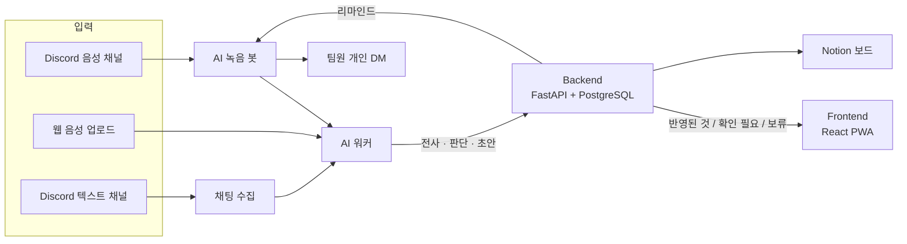

<div align="center">
  

  <h1>Manager's Manager</h1>

  <p><strong>회의만 하면 할 일이 정리되는 PM 에이전트</strong></p>
  <p>회의에서 정한 할 일과 일정 변경을 근거와 함께 찾아,<br />확실한 것은 바로 반영하고 애매한 것만 PM에게 묻습니다.</p>
  <p>카카오테크 캠퍼스 4기 · 경북대 3팀</p>

  <p>
    <a href="https://managers-manager.duckdns.org"><strong>매스 시작하기 ↗</strong></a> ·
    <a href="./docs/user/getting-started.md">사용자 가이드</a> ·
    <a href="./docs/index.md">문서 포털</a>
  </p>
  <p>
    <a href="#서비스-소개">서비스 소개</a> ·
    <a href="#주요-기능">주요 기능</a> ·
    <a href="#ai가-판단하는-방식">AI 판단 방식</a> ·
    <a href="#서비스-구성">서비스 구성</a> ·
    <a href="#로컬에서-시작하기">로컬 실행</a> ·
    <a href="#팀-소개">팀 소개</a> ·
    <a href="#개발-문서">개발 문서</a>
  </p>
</div>

---

## 서비스 소개

회의에서 "제가 금요일까지 할게요"라고 정한 일은 말로만 남기 쉽습니다. 회의록을 다시 읽고 보드에 옮기는 일은 결국 PM의 몫입니다.
Manager's Manager(화면 이름 **매스**)는 **Discord 회의를 듣고 새 할 일과 기존 할 일의 변경을 찾아, 근거와 함께 태스크·Notion 보드에 반영하는 서비스**입니다.

| 회의만 하면 됩니다 | 근거가 붙습니다 | 애매한 것만 묻습니다 |
| :--- | :--- | :--- |
| Discord 음성 회의, 녹음 파일 업로드, Discord 채팅에서 할 일·담당자·마감을 찾습니다. | 모든 항목에 원문 인용·화자·회의 안 시각이 붙고, 회의록 원문으로 바로 이동합니다. | 확실한 것은 바로 태스크로 만들고, 애매한 것은 PM이 확인한 뒤 반영합니다. |

```text
Discord에서 /record → 회의 → /stop → 전사·판단 → 반영된 것 / 확인 필요 / 보류
                                                   ↓
                     Notion 보드 동기화 ← PM 승인    → 마감 전 리마인드 DM → 웹 답장
```

> [!NOTE]
> 심사·체험용 테스트 계정과 샘플 회의는 준비 중입니다(#606). 처음 쓰는 순서는 [처음 쓰는 분을 위한 안내](./docs/user/quick-guide.md)에 있습니다.

## 주요 기능

<!-- 화면 캡처는 #654 에서 채운다. 이미지 자리: docs/assets/readme-*.png -->

### 01. Discord에서 회의를 기록합니다

음성 채널에서 `/join` → `/record`로 녹음을 시작하고, 끝나면 `/stop`을 입력합니다. 봇이 화자별 트랙으로 녹음하고, 회의가 끝나면 전사와 판단이 이어집니다.
Discord 없이 만났다면 녹음 파일을 웹에 올리고, PM이 화자를 팀원에 지정합니다.

### 02. 할 일과 변경을 근거와 함께 정리합니다

새 할 일뿐 아니라 "그거 다음 주로 미룰게요" 같은 **기존 할 일의 변경**도 찾아 해당 태스크에 연결합니다.
회의록에는 결정된 것·담당자·마감과 함께 원문 인용이 남아, 왜 이 항목이 나왔는지 바로 확인할 수 있습니다.

### 03. 확실한 것은 반영하고, 애매한 것은 PM이 확인합니다

| 표시 | 뜻 |
| --- | --- |
| **반영된 것** | 아래 검사를 모두 통과한 일. 승인 없이 태스크가 됩니다 |
| **확인 필요** | 마감이 애매하거나("다음 주 중"), 전사 오류가 의심되는 일. PM이 보고 승인합니다 |
| **보류** | 담당자를 찾지 못한 일. PM이 담당자를 고르면 다음 회의부터 그 호칭을 기억합니다 |

<details>
<summary><strong>회의 뒤 관리: 리마인드·답장·Notion</strong></summary>

- 마감이 다가오면 담당 팀원에게 Discord DM으로 리마인드를 보냅니다.
- 팀원은 웹 메시지 화면에서 답장하고, AI가 답장을 읽어 진행 상태·마감 변경을 제안합니다.
- 승인된 태스크는 연결한 Notion 보드에 동기화합니다.
- Discord 텍스트 채널의 대화도 하루 한 번 모아 같은 방식으로 정리합니다.

</details>

## AI가 판단하는 방식

LLM이 뽑은 결과를 그대로 반영하지 않고, 여러 단계의 검사를 지난 항목만 자동으로 반영합니다.

```text
전사 → 할 일 후보 추출 → 기존 태스크 검색 → 새 일인지·변경인지 판단 → 제목·마감 초안
     → 근거 검증(Jev) → 전사 오류 검사 → 반영 조건(게이트) → 반영된 것 / 확인 필요 / 보류
```

| 단계 | 하는 일 |
| --- | --- |
| **근거 검증** | 할 일과 마감이 원문에 분명히 있는지(`certain`), 추측인지(`inferred`), 없는지(`missing`) 별도 판정 모델로 확인합니다 |
| **전사 오류 검사** | 제목의 명사가 팀 용어 목록에 없으면 "맞게 받아 적은 말인가"를 다시 묻습니다. 용어 목록은 이전 회의에서 두 사람 이상이 말한 말과 PM이 승인한 제목으로 쌓입니다 |
| **반영 조건** | 말한 담당자가 팀원으로 확정되고, 말한 마감·할 일의 근거가 분명하고, 겹칠 수 있는 기존 태스크가 없을 때만 자동으로 반영합니다. 자동 반영은 운영 설정으로 끌 수 있습니다 |

> [!TIP]
> 판단 파이프라인과 평가 결과는 [설계 심화](./docs/design/index.md)와 [테크스펙](./docs/techspec/index.md)에 정리했습니다.

## 서비스 구성



| 파트 | 기술 |
| --- | --- |
| Frontend | React 19 · TypeScript · Vite · TanStack Query · Tailwind CSS · PWA |
| Backend | FastAPI · SQLAlchemy · Alembic · PostgreSQL |
| AI | Python · py-cord(Discord 녹음) · Elice STT · Elice MLAPI(LLM·임베딩·Jev) |

자세한 구조는 [아키텍처](./docs/techspec/architecture.md)를 봅니다.

## 로컬에서 시작하기

각 파트는 의존성과 실행 환경을 따로 관리합니다. 환경 변수를 준비한 뒤 파트별로 실행합니다.

| 파트 | 안내 | 내용 |
| --- | --- | --- |
| Frontend | [frontend/README.md](./frontend/README.md) | 설치·실행·검사, MSW 모의 API로 화면만 띄우기 |
| Backend | [backend/README.md](./backend/README.md) | 실행·API·마이그레이션·검사 |
| AI | [ai/README.md](./ai/README.md) | Discord 녹음 봇·워커·전사·판단, pytest |

로컬 실행 순서, 환경 변수, 테스트, CI/CD와 배포는 [개발자 가이드](./docs/dev/local-setup.md)에, 배포 절차와 복구는 [배포 안내](./deploy/README.md)에 있습니다.

> [!NOTE]
> Frontend의 MSW 검사는 모의 API를 씁니다. 실제 서비스 연결과 외부 공급사 호출은 따로 검증합니다.

## 팀 소개

**카카오테크 캠퍼스 4기 경북대 3팀**이 기획부터 개발·배포까지 함께 만든 프로젝트입니다.

| 파트 | GitHub |
| --- | --- |
| AI | [@dw021213](https://github.com/dw021213) · [@Y-Jimin](https://github.com/Y-Jimin) · [@letsgojh](https://github.com/letsgojh) |
| Backend | [@wkddnjswns](https://github.com/wkddnjswns) · [@hwnv](https://github.com/hwnv) |
| Frontend | [@hotpringles](https://github.com/hotpringles) |
| 멘토 | [@minsang0850](https://github.com/minsang0850) |

역할과 협업 방식은 [협업 문서](./docs/collab/index.md)에, 기여 내역은 [Contributors](https://github.com/kakaotechcampus-4/ktc4-kyungpook-3/graphs/contributors)에 있습니다.

## 개발 문서

| 알고 싶은 내용 | 문서 |
| --- | --- |
| 서비스 사용법 | [사용자 가이드](./docs/user/getting-started.md) |
| 실행·환경 변수·테스트·배포 | [개발자 가이드](./docs/dev/local-setup.md) |
| 설계와 AI 판단 방식 | [테크스펙](./docs/techspec/index.md) · [설계 심화](./docs/design/index.md) |
| API | [API 문서](./docs/api/index.md) |
| 그라운드룰·브랜치·컨벤션·리뷰 | [협업 문서](./docs/collab/index.md) |
| 파트별 계약·계획·결과 | [문서 안내](./docs/README.md) · [FE API 계약](./frontend/docs/contracts/frontend-api-contract.md) · [BE·AI 계약](./backend/docs/contracts/backend-ai-contract.md) |

문서 포털의 원본은 `docs/` 폴더입니다(`mkdocs.yml`).
