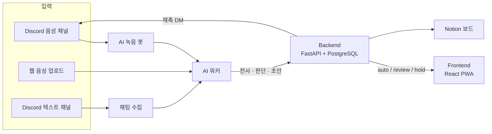

# Manager's Manager

> 회의만 하면 할 일이 정리되는 PM 에이전트.
> Discord 회의를 녹음하면 할 일을 뽑아 담당자·마감을 붙이고, 확실한 건 바로 태스크로, 애매한 건 PM 확인 뒤 태스크·Notion에 반영합니다.

카카오테크 캠퍼스 4기 경북대 3팀 프로젝트.

> 📷 **사진 자리**: 대표 화면 GIF — 회의 업로드 → 회의록 → 확인 필요 카드 승인 → Notion 반영 (파일: docs/assets/readme-hero.gif)

## 바로 써 보기

| 항목 | 내용 |
|---|---|
| 서비스 주소 | `[확정 후 기입]` |
| 테스트 계정 | PM 1개 + 팀원 5개 — `[확정 후 기입 — #606]` |
| 샘플 데이터 | 이전 회의 5회(목업), 오프라인 2인 회의 음성·대본, Discord 2인 회의 대본 — `[확정 후 기입 — #606]` |
| 자세한 사용법 | [사용자 가이드](docs/user/getting-started.md) |

## 핵심 기능

1. **회의만 하면 할 일이 정리된다** — Discord 음성 녹음, 웹 음성 업로드, Discord 채팅 세 경로에서 새 할 일과 기존 할 일의 변경을 뽑습니다.
2. **근거가 붙는다** — 모든 항목에 원문 인용·화자·회의 내 시각이 붙고, 원문을 다시 들을 수 있습니다.
3. **확실한 것만 자동, 애매한 것은 PM 확인** — 근거 검증(Jev)·전사 오인식 검사·조건 게이트로 "반영된 것 / 확인 필요 / 보류"를 나눕니다.
4. **회의 뒤 후속 관리** — 마감 전 재촉 DM, 웹 답장, 답장 판단, Notion 보드 동기화까지 이어집니다.

## 구성도

자세한 구조는 [테크스펙 — 아키텍처](docs/techspec/architecture.md)를 봅니다.

## 빠른 시작 (개발자)

각 파트는 의존성과 실행 환경을 따로 관리합니다. 환경 변수를 준비한 뒤 파트별로 실행합니다.

| 파트 | 실행·테스트 안내 | 역할 |
|---|---|---|
| Frontend | [설치·실행·검사](frontend/README.md) | React·TypeScript·Vite 웹 앱. Node 24 LTS |
| Backend | [실행·API·검사](backend/README.md) | FastAPI·SQLAlchemy·PostgreSQL API |
| AI | [설치·실행·테스트](ai/README.md) | Discord 녹음, 웹 업로드 처리, 전사·추출·BE 인계 워커 |

로컬 실행 순서, 환경 변수, 테스트, CI/CD와 배포는 [개발자 가이드](docs/dev/local-setup.md)에 모았습니다. 배포 절차와 복구는 [배포 안내](deploy/README.md)에 있습니다.

Frontend의 MSW 검사는 모의 API를 씁니다. 실제 서비스 연결과 외부 공급사 호출은 따로 검증합니다. 코드 병합, CI 통과, 배포 성공, 실제 사용자 환경 검증은 각각 확인합니다.

## 문서 지도

| 이런 분은 | 여기로 |
|---|---|
| 서비스를 써 보고 싶다 | [사용자 가이드](docs/user/getting-started.md) |
| 코드를 실행·배포하고 싶다 | [개발자 가이드](docs/dev/local-setup.md) |
| 설계와 AI 판단 방식이 궁금하다 | [테크스펙](docs/techspec/index.md) · [AI 판단 심화](docs/ai-logic/index.md) |
| API를 보고 싶다 | [API 문서](docs/api/index.md) |
| 팀이 어떻게 일했는지 궁금하다 | [협업 문서](docs/collab/index.md) |
| 파트별 계약·계획·결과를 찾는다 | [문서 안내](docs/README.md) · [FE API 계약](frontend/docs/contracts/frontend-api-contract.md) · [BE·AI 계약](backend/docs/contracts/backend-ai-contract.md) |

문서 포털의 원본은 이 저장소의 `docs/` 폴더입니다(`mkdocs.yml`).

## 팀

| 파트 | 구성원 (GitHub) |
|---|---|
| AI | dw021213, Y-Jimin, letsgojh |
| Backend | wkddnjswns, hwnv |
| Frontend | hotpringles |
| 멘토 | minsang0850 |

역할과 협업 방식은 [협업 문서](docs/collab/index.md)에 있습니다.
