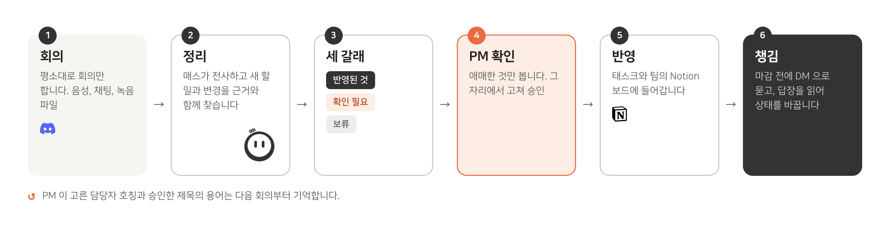
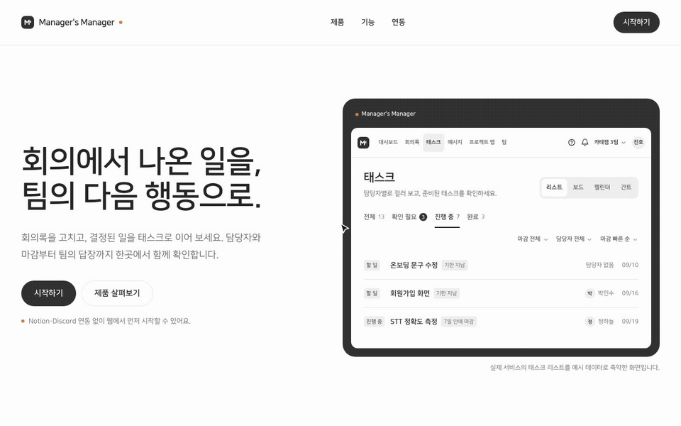
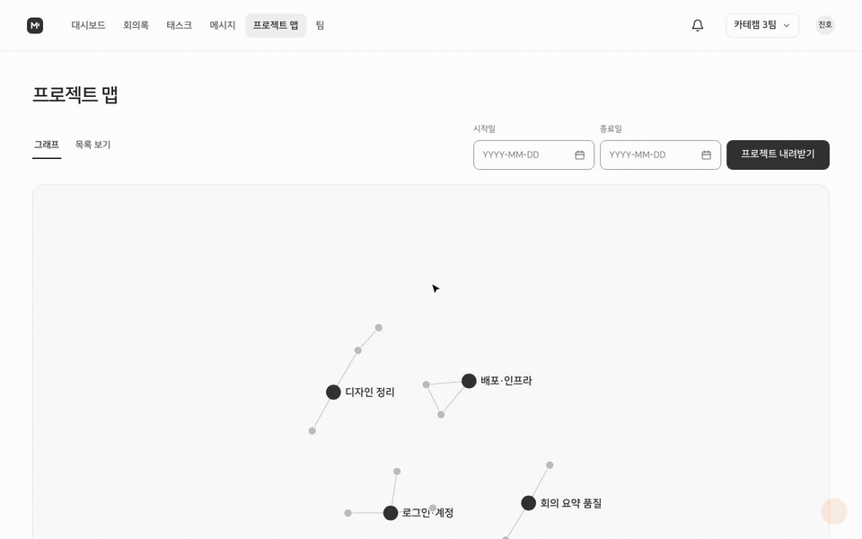
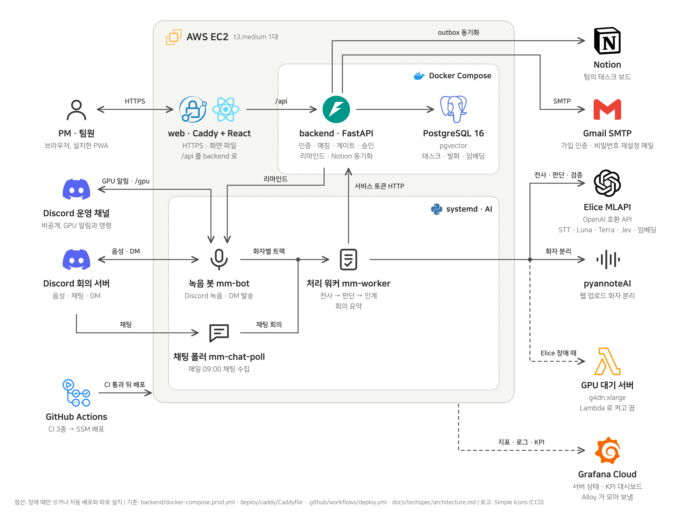
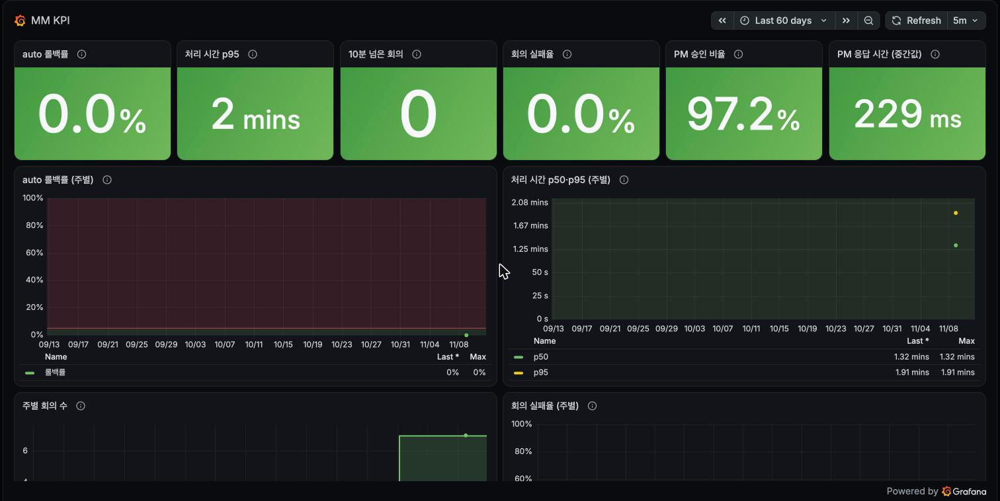

<div align="center">


# Manager's Manager

**회의만 하면 할 일이 정리되는 PM 에이전트**

https://github.com/user-attachments/assets/84a8441a-2db7-490d-9440-d1b6ac693e23

[](https://managers-manager.duckdns.org)


[서비스 소개](#서비스-소개) • [주요 기능](#주요-기능) • [AI 판단 방식](#ai가-판단하는-방식) • [서비스 구성](#서비스-구성) • [트레이드오프](./docs/techspec/tradeoffs.md) • [시작하기](#시작하기) • [팀](#팀) • [문서](#문서)

</div>

회의에서 정한 할 일과 일정 변경을 **근거와 함께** 찾아, 확실한 것은 바로 태스크로 만들고 애매한 것만 PM에게 묻습니다. 카카오테크 캠퍼스 4기 경북대 3팀 프로젝트입니다.

> [!TIP]
> 바로 써 보려면 **[managers-manager.duckdns.org](https://managers-manager.duckdns.org)** 에 접속하고 [처음 쓰는 분을 위한 안내](./docs/user/quick-guide.md)를 따라 하세요. 심사용 테스트 계정의 로그인 정보는 저장소에 적지 않고 심사 운영진에게 따로 전달합니다(#606). 계정 구성과 샘플 회의 목록은 [사용자 가이드](./docs/user/getting-started.md#테스트-계정으로-바로-써-보기)에, 로컬에서 같은 데이터를 만드는 방법은 아래 [심사용 샘플 데이터](#심사용-샘플-데이터)에 있습니다.

## 서비스 소개

"제가 금요일까지 할게요", "그거 다음 주로 미룰게요"처럼 회의에서 정한 일은 말로만 남기 쉽습니다. 회의록을 다시 읽고 보드에 옮기는 일은 결국 PM의 몫입니다.

Manager's Manager(화면 이름 **매스**)는 Discord 회의를 듣고 **새 할 일과 기존 할 일의 변경**을 찾아 태스크와 Notion 보드에 반영합니다. 모든 항목에는 원문 인용·화자·회의 안 시각이 붙어, 왜 이 일이 나왔는지 바로 확인할 수 있습니다.

[](./docs/assets/flow-service.png)

## 주요 기능

- **세 가지 입력** - Discord 음성 회의(`/join` → `/record` → `/stop`), 녹음 파일 업로드, Discord 텍스트 채널
- **변경까지 추적** - 새 할 일뿐 아니라 기존 태스크의 마감·상태·담당 변경을 찾아 해당 태스크에 연결
- **근거가 붙는 회의록** - 결정·담당자·마감과 원문 인용, 회의록 원문으로 바로 이동
- **확실한 것만 자동** - 검사를 모두 통과한 일만 승인 없이 태스크가 되고, 나머지는 PM이 확인
- **배우는 담당자 매칭** - PM이 보류 카드에서 담당자를 고르면 그 호칭을 다음 회의부터 기억
- **회의 뒤 관리** - 마감 전 Discord DM 리마인드, 웹 답장, 답장을 읽은 진행 상태 제안, Notion 동기화

| 표시 | 뜻 |
| --- | --- |
| **반영된 것** | 아래 검사를 모두 통과해 승인 없이 태스크가 된 일 |
| **확인 필요** | 마감이 애매하거나("다음 주 중") 전사 오류가 의심되는 일. PM이 보고 승인 |
| **보류** | 담당자를 찾지 못한 일. PM이 담당자를 골라 승인 |

### 화면으로 보는 핵심 기능

실제 브라우저에서 서비스를 조작하며 찍었습니다. 화면에 나오는 팀과 회의는 샘플 데이터입니다.

#### 1. 가입하고 팀 만들기

이메일로 받은 인증 코드로 가입합니다. 팀을 만들면 Discord 연결, Notion 연결, 팀원 연결로 이어집니다.

<p align="center"></p>

#### 2. 녹음을 올리고 들어 보며 화자 지정

Discord 음성 회의는 봇이 화자별로 녹음합니다. 녹음 파일은 웹에서 올립니다. 올린 녹음은 목소리를 화자별로 나누고, PM이 화자마다 샘플을 들어 보고 팀원을 고르면 전사부터 할 일 추출까지 이어서 정리합니다.

<p align="center"></p>

#### 3. Discord 채팅도 하루 한 번 정리

Discord 텍스트 채널의 대화도 하루 한 번 모아 회의처럼 정리합니다. 채팅에서 나온 일은 바로 반영하지 않고 확인 필요로 올립니다. 영상 앞부분의 채널 화면은 대화 흐름을 보여 주려고 다시 그린 화면입니다.

<p align="center"></p>

#### 4. 근거가 붙는 회의록

요약, 전사문, 추출된 일을 탭으로 봅니다. 추출된 일은 반영된 것과 확인이 필요한 일로 나뉘고, 원문 듣기로 그 말이 나온 시각으로 갑니다.

<p align="center"></p>

#### 5. 확인이 필요한 일만 승인

마감이나 담당자가 애매한 일은 근거 원문과 함께 카드로 옵니다. 빈 칸을 채워 승인하면 태스크가 됩니다.

<p align="center"></p>

#### 6. 네 가지로 보는 태스크

같은 태스크를 리스트, 보드, 캘린더, 간트로 봅니다.

<p align="center"></p>

#### 7. 주제로 묶어 보는 프로젝트 맵

회의에서 나온 결정과 태스크를 주제별로 묶어 그래프로 봅니다. 주제의 이름과 설명을 고치고, 겹치는 주제는 하나로 합칩니다.

<p align="center"></p>

#### 8. 마감 리마인드와 답장

마감 전에 보낼 Discord 개인 메시지 초안을 PM이 확인하고 보냅니다. 팀원의 답장은 대화로 모입니다.

<p align="center"></p>

#### 9. 한눈에 보는 대시보드

확인 대기, 기한 지남, 마감 임박, 최근 자동 반영을 한 화면에서 보고 바로 확인하러 갑니다.

<p align="center"></p>

## AI가 판단하는 방식

LLM이 뽑은 결과를 그대로 반영하지 않고, 여러 검사를 지난 항목만 자동으로 반영합니다.

[](./docs/assets/techspec-pipeline-judge.png)

| 단계 | 하는 일 |
| --- | --- |
| **근거 검증** | 할 일과 마감이 원문에 분명히 있는지(`certain`), 추측인지(`inferred`), 없는지(`missing`) 별도 판정 모델로 확인 |
| **전사 오류 검사** | 제목의 명사가 팀 용어 목록에 없으면 "맞게 받아 적은 말인가"를 다시 확인. 용어 목록은 이전 회의에서 두 사람 이상이 말한 말과 PM이 승인한 제목으로 쌓임 |
| **반영 조건** | 말한 담당자가 팀원으로 확정되고, 말한 할 일·마감의 근거가 분명하고, 겹칠 수 있는 기존 태스크가 없을 때만 자동 반영 |

> [!NOTE]
> 자동 반영은 운영 설정으로 끌 수 있습니다. 판단 파이프라인과 평가 결과는 [설계 심화](./docs/design/index.md)와 [테크스펙](./docs/techspec/index.md)에 있습니다.

## 서비스 구성

[](./docs/assets/techspec-architecture.png)

한 대의 EC2 에서 Caddy 가 HTTPS 와 화면 파일을 내고 `/api` 는 FastAPI 로 넘깁니다. 녹음 봇과 처리 워커는 systemd 로 돌고 Backend 와는 서비스 토큰을 단 HTTP API 로만 통신합니다. 배포 구성과 파이프라인 그림은 [아키텍처 설계](./docs/techspec/architecture.md)에 있습니다.

| 파트 | 기술 |
| --- | --- |
| Frontend | React 19 · TypeScript · Vite · TanStack Query · Tailwind CSS · PWA |
| Backend | FastAPI · SQLAlchemy · Alembic · PostgreSQL 16(pgvector) |
| AI | Python 3.12 · py-cord(Discord 녹음) · Elice STT · Elice MLAPI(LLM·임베딩·Jev) |
| Infra | AWS EC2 · Docker Compose · Caddy · systemd · GitHub Actions(OIDC → SSM) |

운영 지표는 Grafana 대시보드로 봅니다. 자동 반영 되돌림 비율, 처리 시간, 실패율, PM 승인 비율과 응답 시간을 한 화면에 모았습니다(2026-11-11 캡처, 최근 60일).

[](https://happysycamore2502.grafana.net/public-dashboards/256fe7b56cf34bfe9c345612ea9ac654)

## 시작하기

### 준비물

- [Node.js](https://nodejs.org) 24 LTS - frontend
- Python 3.12와 [uv](https://docs.astral.sh/uv/) - backend, ai
- [Docker](https://www.docker.com/) - backend 의 PostgreSQL(pgvector)
- Discord 봇 토큰과 외부 API 키(Elice MLAPI 등) - ai. 없으면 해당 기능만 꺼집니다

> [!TIP]
> 화면만 보고 싶다면 백엔드 없이 frontend 의 모의 API(MSW)로 띄울 수 있습니다. 아래 Frontend 를 펼쳐 보세요.

<details open>
<summary><strong>Frontend</strong></summary>

```bash
cd frontend
npm ci
npm run dev        # http://localhost:5173
```

- 백엔드 없이 띄우려면 `frontend/.env` 에 `VITE_ENABLE_MSW=true` 를 두고, 모의 계정 `pm@example.com` / `mock-password` 로 로그인합니다.
- 배포 백엔드에 붙이려면 `API_PROXY_TARGET=https://managers-manager.duckdns.org npm run dev`

</details>

<details>
<summary><strong>Backend</strong></summary>

```bash
cd backend
uv venv --python 3.12 .venv
uv pip install -r requirements-dev.txt
cp .env.example .env                     # OAUTH_STATE_SECRET, SERVICE_TOKEN 등을 채운다
docker compose up -d db                  # PostgreSQL(pgvector)
source .venv/bin/activate                # Windows Git Bash 는 .venv/Scripts/activate
./run.sh                                 # 마이그레이션 + uvicorn (:8000)
```

API 문서는 `http://localhost:8000/docs` 에서 봅니다.

</details>

<details>
<summary><strong>AI</strong></summary>

```bash
cd ai
uv venv --python 3.12 .venv
uv pip install -r requirements.txt
source .venv/bin/activate
cp .env.example .env               # DISCORD_BOT_TOKEN, BE_BASE_URL, BE_SERVICE_TOKEN, 모델 키
python -m capture.run_recorder     # 녹음 봇: Discord 에서 /join → /record → /stop
python -m capture.worker           # 처리 워커: 전사·판단 후 BE 로 넘김
```

> [!IMPORTANT]
> Discord 음성 수신은 DAVE(E2EE)가 필수라 PyPI 의 py-cord 로는 녹음되지 않습니다. `ai/requirements.txt` 의 브랜치 버전을 그대로 씁니다.

</details>

### 심사용 샘플 데이터

로컬에서 Backend 를 띄운 뒤 시드 명령으로 계정 6개(PM 1 + 팀원 5), 워크스페이스 "심사용 데모 팀", 지난 회의 6개(승인 완료 5개 + 승인 대기 1개)를 넣습니다(#606).

```bash
cd backend
source .venv/bin/activate
set -a; . <(tr -d '\r' < .env); set +a   # run.sh 처럼 .env 를 올린다(SERVICE_TOKEN, DATABASE_URL)
read -rs DEMO_PM_PASSWORD && export DEMO_PM_PASSWORD           # PM 계정 비밀번호를 직접 정한다
read -rs DEMO_MEMBER_PASSWORD && export DEMO_MEMBER_PASSWORD   # 팀원2 계정 비밀번호를 직접 정한다
python -m app.cli.seed_demo --email-pattern 'demo+{n}@example.com' --dry-run   # 쓰지 않고 만들 내용만 본다
python -m app.cli.seed_demo --email-pattern 'demo+{n}@example.com'
```

- 이메일은 패턴의 `{n}` 이 1~6 으로 바뀝니다. 1번이 PM, 2번이 팀원2 입니다. 비밀번호는 저장소에 없고 실행할 때 정합니다.
- 로그인할 수 있는 계정은 PM 과 팀원2 입니다. 3~6번 계정은 팀원 자리에 연결만 되고 비밀번호는 무작위로 만들어집니다.
- 팀원2 자리는 초대·수락을 직접 해 볼 수 있게 비워 둡니다. PM 이 팀원2 의 아이디(출력 JSON 의 `usernames.p2`)로 초대합니다.
- API 서버에 `EMBEDDING_API_KEY` 가 있어야 하고 `AUTO_CREATE_ENABLED` 가 켜져 있어야 합니다. 옵션과 종료 코드, 운영 서버에서 돌리는 방법은 [backend README 의 심사용 시드](./backend/README.md#심사용-시드)에 있습니다.

환경 변수, 테스트, CI/CD와 배포는 [개발자 가이드](./docs/dev/local-setup.md)와 [배포 안내](./deploy/README.md)에 있습니다.

## 팀

**카카오테크 캠퍼스 4기 경북대 3팀**이 기획부터 개발·배포까지 함께 만든 프로젝트입니다.

| 파트 | GitHub |
| --- | --- |
| AI | [@dw021213](https://github.com/dw021213) · [@Y-Jimin](https://github.com/Y-Jimin) · [@letsgojh](https://github.com/letsgojh) |
| Backend | [@wkddnjswns](https://github.com/wkddnjswns) · [@hwnv](https://github.com/hwnv) |
| Frontend | [@hotpringles](https://github.com/hotpringles) |
| 멘토 | [@minsang0850](https://github.com/minsang0850) |

역할과 협업 방식은 [협업 문서](./docs/collab/index.md)에, 기여 내역은 [Contributors](https://github.com/kakaotechcampus-4/ktc4-kyungpook-3/graphs/contributors)에 있습니다.

## 문서

| 알고 싶은 내용 | 문서 |
| --- | --- |
| 서비스 사용법 | [사용자 가이드](./docs/user/getting-started.md) · [처음 쓰는 분을 위한 안내](./docs/user/quick-guide.md) |
| 실행·환경 변수·테스트·배포 | [개발자 가이드](./docs/dev/local-setup.md) |
| 설계와 AI 판단 방식 | [테크스펙](./docs/techspec/index.md) · [설계 심화](./docs/design/index.md) |
| 고민한 것과 고른 이유 | [트레이드오프](./docs/techspec/tradeoffs.md) · [일정·히스토리·스펙 아웃](./docs/techspec/history.md) |
| API | [API 문서](./docs/api/index.md) |
| 그라운드룰·브랜치·컨벤션·리뷰 | [협업 문서](./docs/collab/index.md) · [멘토 리뷰와 반영 기록](./docs/collab/code-reviews.md) |
| 파트별 계약·계획·결과 | [문서 안내](./docs/README.md) · [FE API 계약](./frontend/docs/contracts/frontend-api-contract.md) · [BE·AI 계약](./backend/docs/contracts/backend-ai-contract.md) |

문서는 `docs/` 폴더에 있고 [문서 첫 화면](./docs/index.md)에서 시작합니다.
