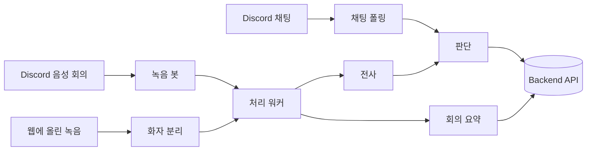

# Manager's Manager AI 파트

회의 음성과 채팅을 전사하고, 할 일과 기존 태스크의 변경을 근거(원문, 화자, 시각)와 함께 찾아 Backend 에 넘깁니다. PM 승인과 Notion 반영은 Backend 와 Frontend 가 맡습니다.

| 항목 | 내용 |
|---|---|
| 실행 환경 | Python 3.12, `uv` |
| 입력 | Discord 음성 회의, 웹에 올린 녹음 파일, Discord 텍스트 채널 |
| 출력 | 회의록 전사, 할 일과 변경 제안, 회의 요약. 모두 Backend API 로 넘깁니다 |
| 외부 서비스 | Elice MLAPI(전사, LLM, 임베딩, 근거 판정), pyannoteAI(화자 분리) |

이 저장소는 `ai/`, `backend/`, `frontend/` 가 각자 독립된 프로젝트입니다. 아래 명령은 모두 `ai/` 안에서 실행합니다.

## 처리 흐름



| 입력 | 처리 |
|---|---|
| Discord 음성 회의 | 봇이 `/join` → `/record` → `/stop` 으로 화자별 트랙을 녹음합니다. 워커가 전사 → 회의록 → 할 일 추출 → Backend 인계를 합니다 |
| 웹에 올린 녹음 | 워커가 Backend 에서 파일을 가져와 화자를 나누고 샘플 구간을 보고합니다. PM 이 웹에서 화자를 지정하면 전사와 인계를 이어 갑니다 |
| Discord 채팅 | 매일 09:00 KST 에 채널 대화를 모아 같은 판단 경로로 정리합니다 |
| 회의 요약 | 워커가 Backend 요약 대기열에서 한 건씩 가져와 요약을 저장합니다 |

## 폴더 구조

| 위치 | 역할 |
|---|---|
| `capture/` | Discord 녹음(`discord_adapter.py`), 처리 워커(`worker.py`), 단계 진행(`recorder.py`), Backend 인계(`handoff.py`), 채팅 폴링(`chat_poll.py`), 회의 요약 대기열(`summary_sweep.py`) |
| `stt/` | 화자별 트랙 전사. 운영 기본은 Elice API 이고, 로컬 faster-whisper 와 GPU 서버는 장애 대응입니다 |
| `upload/` | 올린 녹음의 화자 분리, 화자 라벨 보고, PM 지정 반영, 로컬 정리 |
| `judge/` | 판단 파이프라인. 후보 찾기 → 비슷한 태스크 검색 → 변경 판단 → 초안 → 근거 검증 |
| `extract/` | 이전 추출 경로(`MM_EXTRACT_PATH=legacy`) |
| `draft/` | 승인 항목의 제목, 마감일, 설명 초안 |
| `summary/` | 회의 요약 생성 |
| `shared/` | Backend 와 공유하는 타입 계약(`schemas.py`), 설정 로딩(`config.py`) |
| `llm.py`, `embedding.py`, `jev.py` | LLM, 임베딩, 근거 판정 클라이언트 |
| `deploy/` | 운영 systemd 유닛(`mm-bot`, `mm-worker`, `mm-chat-poll`)과 GPU 전사 서버 전환 |
| `tests/` | pytest. 외부 서비스와 API 키 없이 돕니다 |
| `docs/` | 계획, 결정 기록, 진행 로그, [처리 상세](docs/api/pipeline-details.md) |

`recordings/` 와 `transcripts/` 는 녹음과 전사 산출물이 쌓이는 곳이라 git 에서 뺍니다.

## 시작하기

### 설치

```bash
uv venv --python 3.12 .venv
uv pip install -r requirements.txt   # py-cord 는 PR #3159 브랜치라 git 이 필요합니다. Linux: sudo apt install libopus0
source .venv/bin/activate
cp .env.example .env                 # DISCORD_BOT_TOKEN 을 채웁니다
```

> [!WARNING]
> Discord 음성 수신은 2026-03 부터 DAVE(E2EE)가 필수입니다. PyPI 의 py-cord 2.8.x 로는 녹음이 되지 않으니 `requirements.txt` 의 PR 브랜치를 쓰세요. `/stop` 뒤 "저장된 오디오가 없습니다"가 나오면 라이브러리 문제일 가능성이 큽니다.

### 실행

| 명령 | 하는 일 |
|---|---|
| `python -m capture.run_recorder` | 녹음 봇. Discord 에서 `/join` → `/record` → (말하기) → `/stop` |
| `python -m capture.worker` | 저장된 회의를 처리합니다. 단계가 끝날 때마다 채널에 알릴 글을 남기고, 올리는 것은 봇입니다 |
| `python -m capture.worker --retry <서버ID>` | 자동 재시도를 멈춘 회의까지 그 서버만 한 바퀴 다시 처리합니다 |
| `python -m capture.chat_poll` | 채팅 폴링. 운영에서는 타이머가 돌립니다. `--dry-run` 은 Backend 에 쓰지 않고 판단만 합니다 |
| `python -m capture.backfill_summaries --workspace ID --all --dry-run` | 옛 회의의 요약 대상과 예상 비용을 봅니다 |

산출물은 `recordings/{guild}_{ts}/{user_id}_{ts}.wav`, `recordings/session_{ts}.json`, `transcripts/session_{ts}.transcript.json` 에 남습니다.

### 테스트

```bash
pytest          # py-cord 없이 돕니다 (스텁 데이터 사용)
```

## 주요 환경 변수

값은 `.env.example` 을 참고합니다. 전체 목록은 [환경 변수](../docs/dev/env.md)에 있습니다.

| 변수 | 뜻 |
|---|---|
| `DISCORD_BOT_TOKEN`, `DISCORD_GUILD_ID` | 봇 토큰. 서버 ID 를 넣으면 슬래시 명령이 바로 반영됩니다 |
| `BE_BASE_URL`, `BE_SERVICE_TOKEN` | Backend 주소와 서비스 토큰. 없으면 인계 단계에서 멈춥니다 |
| `MM_EXTRACT_PATH` | 추출 경로. `legacy`(기본) 또는 `judge`. 운영은 `judge` 로 돕니다. `judge` 는 `TERRA_*`, `LUNA_*`, `BE_*` 가 필요합니다 |
| `MM_UPLOAD_INTAKE` | `1` 이면 웹 업로드를 가져옵니다. `PYANNOTEAI_API_KEY` 가 함께 필요하고 운영 서버 한 대에서만 켭니다 |
| `MM_SUMMARY_LLM` | 회의 요약 모델. 비우면 꺼짐이고 `luna` 나 `terra` 를 넣으면 켜집니다 |
| `MM_GPU_FAILOVER` | Elice 장애 때 GPU 전사 서버로 넘기는 모드 |
| `MM_DEBUG_REPORT` | `1` 이면 단계 시작, 회의록 파일, 할 일 목록, 처리 시간을 채널에 올립니다(개발용) |

## AI ↔ BE 경계

- Backend 와는 HTTP API 로만 이야기합니다. 모든 호출에 `X-Service-Token` 을 싣고, 호출은 `capture/handoff.py` 의 `BeClient` 를 거칩니다.
- Discord 는 `capture/` 안에만 있습니다. `stt`, `judge`, `summary` 등은 `discord` 를 import 하지 않습니다(`tests/test_platform_isolation.py`).
- `shared/schemas.py` 는 Backend 와 공유하는 계약입니다. 바꾸면 [AI 계약](../backend/docs/contracts/backend-ai-contract.md)도 같이 고칩니다.

### Backend 호출

| 시점 | 호출 | 누가 |
|---|---|---|
| 녹음 시작(`/record`) | `POST /api/v1/meetings` | 봇 |
| 녹음이 끝난 뒤 | `PATCH /meetings/{id}/end` | 워커 |
| 판단 중 | `POST /workspaces/{id}/tasks/similar` | 워커 |
| 추출 뒤 | `POST /extractions` (회의마다 한 번) | 워커 |
| 자동 재시도를 멈출 때 | `PATCH /meetings/{id}/fail` | 워커 |
| 웹 업로드 가져오기 | `GET /uploads/pending`, `PATCH /uploads/{id}/claim`, `GET /uploads/{id}/file` | 워커 |
| 화자 라벨 보고와 지정 받기 | `POST /uploads/{id}/speakers`, `GET /uploads/assigned`, `PATCH /uploads/{id}/resume` | 워커 |
| 업로드 회의 인계 | `POST /meetings/{id}/sources`, `POST /extractions` | 워커 |

### 단계 상태

매니페스트 `recordings/session_{ts}.json` 의 `status` 로 진행을 적습니다. 워커는 마지막으로 끝난 단계 다음부터 이어서 처리합니다.

| 상태 | 뜻 |
|---|---|
| `recording` → `saved` | 녹음 중, 트랙 저장 완료 |
| `transcribed` | 전사 완료 |
| `extracted` | 할 일 추출 완료 |
| `handed_off` | Backend 인계 완료 |
| `failed` | 실패. 멈춘 단계는 `failed_stage` 에 적습니다 |
| `diarized` → `mapped` | 업로드 회의의 화자 분리 완료, PM 의 화자 지정 완료 |

- 실패가 5회 쌓이면 자동 재시도를 멈춥니다. `python -m capture.worker --retry <서버ID>` 로 다시 돌리고, 포기 7일 뒤에는 음성이 지워져 다시 돌릴 수 없습니다.
- 상대 날짜("내일")의 기준일은 처리한 날이 아니라 회의 날짜입니다.

단계별 요청과 응답 처리, 웹 업로드의 가져오기·라벨 보고·지정 받기·인계는 [처리 상세](docs/api/pipeline-details.md)에 있습니다.

## 문서

| 문서 | 내용 |
|---|---|
| [문서 안내](docs/README.md) | AI 파트 문서의 위치와 양식 |
| [처리 상세](docs/api/pipeline-details.md) | 녹음 뒤 처리, Backend 인계, 웹 업로드, 회의 요약의 단계별 동작 |
| [결정 기록과 진행 로그](docs/basis_for_decision/) | 왜 이렇게 만들었는지와 측정 결과 |
| [AI 설계 문서](../docs/design/ai/index.md) | 전사, 판단, 근거 검증, 오인식 검사, 답장 판단의 설계 |
| [AI 계약](../backend/docs/contracts/backend-ai-contract.md) | Backend 와 주고받는 API |
