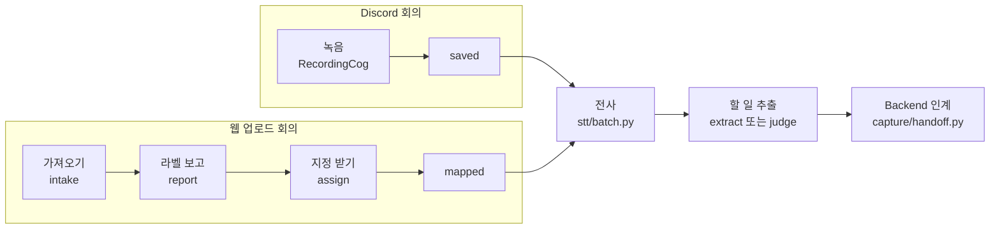
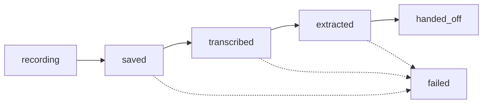
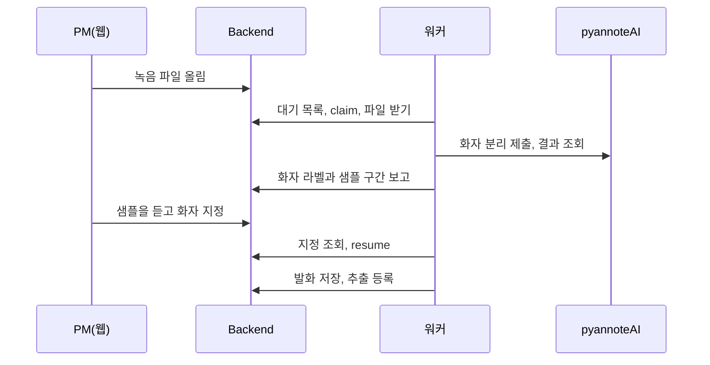

# 처리 상세

AI 파트가 회의 하나를 처리하는 과정을 단계별로 적은 참고 문서입니다. 개요는 [AI 파트 README](../../README.md)에, Backend 와의 약속은 [AI 계약](../../../backend/docs/contracts/backend-ai-contract.md)에 있습니다.

| 절 | 내용 |
|---|---|
| [1. 한눈에 보기](#1-한눈에-보기) | 입력별 흐름과 담당 코드 |
| [2. Discord 회의](#2-discord-회의) | 녹음, 처리 단계, Backend 호출 |
| [3. 추출 경로](#3-추출-경로) | `legacy` 와 `judge` |
| [4. 매니페스트](#4-매니페스트) | 필드, 단계 상태, 재시도 |
| [5. 웹 업로드 회의](#5-웹-업로드-회의) | 가져오기, 라벨 보고, 지정 받기, 인계, 정리 |
| [6. 회의 요약](#6-회의-요약) | 요약 대기열과 설정 |

## 1. 한눈에 보기

| 입력 | 시작 | 처리 주체 | 끝 |
|---|---|---|---|
| Discord 회의 | `/record` | 봇이 녹음하고 워커가 처리합니다 | `handed_off` |
| 웹 업로드 회의 | PM 이 웹에 파일을 올림 | 워커가 가져오고, PM 이 화자를 지정한 뒤 워커가 처리합니다 | `handed_off` |

처리는 워커(`capture/worker.py`) 하나가 합니다([결정 0026](../basis_for_decision/member/2026-10-13-0026-worker-only.md)).

## 2. Discord 회의

### 녹음 봇

- `capture/discord_adapter.py` 의 `RecordingCog` 가 녹음을 맡습니다. 운영에 올리는 Cog 는 이것 하나입니다.
- 실행기 `capture/run_recorder.py` 가 봇을 띄웁니다. 운영에서는 systemd `mm-bot` 이 이 실행기를 돌립니다.
- `capture/realtime/` 은 실행기에 등록하지 않습니다. 공용 계층(`voice_client.py`, `streaming_sink.py`, `track_writer.py`)에 기댈 뿐이고 반대 방향 의존은 없습니다.
- 재연결 키 갱신처럼 두 경로에 다 필요한 처리는 공용 계층에 있습니다.

### 처리 순서

| 순서 | 누가 | 하는 일 | Backend 호출 |
|---|---|---|---|
| 1 | 봇 | `/record` 때 디스코드 서버로 워크스페이스를 물어 매니페스트에 고정하고 회의를 만듭니다 | `POST /api/v1/meetings` |
| 2 | 봇 | `/stop` 이면 트랙을 닫고 저장한 뒤 워커를 찌르고 `on_session_saved(manifest, manifest_path)` 훅을 부릅니다 | |
| 3 | 워커 | `capture/recorder.py` 의 `process_session` 으로 전사(`stt/batch.py`)를 합니다 | `PATCH /meetings/{id}/end` |
| 4 | 워커 | 회의록을 저장하고 할 일을 추출합니다 | `POST /workspaces/{id}/tasks/similar` (judge 경로) |
| 5 | 워커 | Backend 에 인계합니다(`capture/handoff.py`) | `POST /extractions` |
| 실패 | 워커 | 자동 재시도를 멈추면 실패를 알립니다 | `PATCH /meetings/{id}/fail` |

- 봇과 워커가 Backend 회의 API 를 직접 부릅니다([결정 0009](../basis_for_decision/member/2026-09-19-0009-bot-hands-off-to-be-api.md)).
- 단계가 끝날 때마다 워커가 그 채널에 알릴 글을 우편함(`recordings/.worker/outbox`)에 쓰고, 봇이 채널에 올립니다.
- Backend 가 읽는 전사는 `transcripts/session_{ts}.transcript.json` 입니다.

### 멈추는 조건

| 상황 | 동작 |
|---|---|
| `BE_BASE_URL` 이나 `BE_SERVICE_TOKEN` 이 없음 | 인계 단계에서 멈춥니다 |
| 웹에서 연결하지 않은 디스코드 서버 | 녹음을 시작하지 않습니다 |
| 처리할 때 워크스페이스 연결이 없음 | 채널에 한 번 알리고 연결될 때까지 전사하지 않습니다(#199) |

## 3. 추출 경로

`MM_EXTRACT_PATH` 로 고릅니다([결정 0016](../basis_for_decision/member/2026-09-30-0016-judge-path-flag-and-unjudged-findings.md)).

| 값 | 추출기 | 동작 |
|---|---|---|
| `legacy` (기본) | `extract/` 의 `extract_tasks` | 전사록에서 할 일을 뽑습니다 |
| `judge` | 판단 파이프라인 `judge/pipeline.py` | 1단계가 전사록에서 finding 을 고르고, finding 마다 Backend 의 비슷한 태스크를 찾아 판단합니다 |

`judge` 경로의 규칙입니다.

- finding 은 결정이나 진척 보고 하나입니다. 근거 줄 하나나 여러 줄과 요약 문장으로 이뤄집니다.
- 비슷한 태스크 검색(`POST /workspaces/{id}/tasks/similar`, 헤더 `X-Service-Token`)은 전사록의 줄마다가 아니라 finding 마다 그 요약 문장으로 부릅니다.
- 나온 항목은 회의마다 한 번 그대로 `POST /extractions` 로 보냅니다.
- 판단하지 못한 finding 이 남으면 인계를 미루고 다시 돌립니다.
- 등록할 항목 없이 판단하지 못한 finding 만 남으면 빈 추출을 등록하지 않고 단계 실패로 셉니다.

## 4. 매니페스트

회의 하나의 진행을 `recordings/session_{ts}.json` 에 적습니다.

| 필드 | 뜻 |
|---|---|
| `session`, `status`, `stages` | 세션 이름, 지금 상태, 단계별 기록 |
| `started_at`, `timezone` | 회의 시작 시각과 시간대 |
| `meeting_dir`, `transcript` | 트랙 폴더와 전사 파일 |
| `tasks` 또는 `items` | 추출 결과 |
| `be` | Backend 회의 정보 |
| `speakers[]` | `user_id`, `display_name`, `file`, `duration_sec` |

### 단계 상태

- 워커는 마지막으로 끝난 단계 다음부터 이어서 처리합니다.
- 실패하면 `status` 가 `failed` 가 되고 멈춘 단계를 `failed_stage` 에 적습니다.
- 실패 5회로 자동 재시도를 멈춘 회의는 서버에서 `python -m capture.worker --retry <서버ID>` 로 다시 돌립니다.
- 포기 7일 뒤에는 음성이 지워져 다시 돌릴 수 없습니다.
- 상대 날짜("내일")의 기준일은 처리하는 날이 아니라 `started_at` 을 `timezone` 으로 바꾼 회의 날짜입니다.

## 5. 웹 업로드 회의

PM 이 웹에 올린 녹음 파일을 워커가 가져와 화자를 나누고, PM 이 화자를 지정하면 전사와 인계를 이어 갑니다.

### 켜는 조건

- `MM_UPLOAD_INTAKE=1` 이고 `BE_BASE_URL`, `BE_SERVICE_TOKEN`, `PYANNOTEAI_API_KEY` 가 모두 있을 때만 켜집니다. 아니면 Backend 도 pyannoteAI 도 부르지 않습니다.
- 운영 서버 한 대에서만 켭니다. Backend 의 claim 계약이 단일 워커를 전제로 합니다.
- 워커가 바퀴 끝에 `assign_one` → `report_one` → `intake_one` 순서로 한 번씩 부릅니다. 한 번에 한 건을 한 단계만 진전시킵니다.
- 진행 기록은 `recordings/.uploads/<meeting_id>/intake.json` 에 남아 재시작해도 이어 갑니다.
- 워커 로그에는 `[worker] 업로드 <meeting_id> <진행>` 한 줄이 남고, 하트비트 `current` 는 가져오는 동안 `upload` 입니다.

### 5.1 가져오기 (`upload/intake.py`)

| 순서 | 하는 일 |
|---|---|
| 1 | `GET /uploads/pending` 으로 대기 목록을 받습니다 |
| 2 | `PATCH /uploads/{id}/claim` 으로 맡습니다(조건부 한 번) |
| 3 | `GET /uploads/{id}/file` 로 원본을 내려받고 `size_bytes` 를 확인합니다 |
| 4 | 16kHz mono wav 로 변환합니다 |
| 5 | pyannoteAI 에 제출하고 `job_id` 를 기록합니다 |
| 6 | 결과를 조회해 화자별 가상 트랙과 매니페스트를 씁니다 |
| 7 | 원본과 변환 wav 를 지웁니다 |

진행 상태는 `claiming` → `claimed` → `converted` → `submitted` → `done` 이고 실패는 `failed` 입니다.

| 상황 | 처리 |
|---|---|
| `job_id` 를 적은 뒤 재시작 | 다시 제출하지 않습니다 |
| 제출 응답을 받기 전에 끊김, 30분이 지나도 결과 없음, job 실패 | 다시 제출될 수 있습니다(과금) |
| claim 한 뒤 2시간 30분 경과 | 다시 맡기지 않고 `failed_stage=diarize` 로 실패를 보고합니다. Backend 가 3시간 뒤 정리하기 전에 끝내기 위해서입니다 |
| 일시 실패 | 복구와 같은 시도 한도와 대기로 다시 합니다 |
| 영구 실패나 한도 초과 | `PATCH /meetings/{id}/fail`(`failed_stage=diarize`)을 보냅니다. 보내지 못하면 다음 바퀴에 다시 보냅니다 |

결과물은 세션 `upload_<meeting_id>` 의 매니페스트 `recordings/session_upload_<meeting_id>.json` 입니다. `be`(`{meeting_id, status}`), `workspace_id`, `title`, `attendees`, `upload`(원본 파일 정보)가 들어가고 `status` 는 `diarized` 입니다. 지정 전이라 워커의 처리 바퀴가 집지 않습니다.

### 5.2 라벨 보고 (`upload/report.py`)

가져오기가 끝난(`done`) 회의의 화자 라벨과 샘플 구간을 Backend 에 보고합니다(`POST /uploads/{id}/speakers`). Backend 는 보고를 받아야 `awaiting_speakers` 로 바뀌고 PM 이 웹에서 지정할 수 있습니다.

샘플을 고르는 규칙입니다.

| 항목 | 규칙 |
|---|---|
| `total_sec` | 그 라벨 구간 길이의 합. 다른 라벨과 겹친 부분을 포함하고 소수 셋째 자리까지 적습니다 |
| 샘플 | 다른 라벨과 겹치지 않는 구간 중 2초 이상을 긴 순서로 최대 3개 고릅니다 |
| 길이와 순서 | 각각 앞에서부터 10초로 자르고 시작 시각 오름차순으로 보냅니다 |
| 2초 이상인 깨끗한 구간이 없을 때 | 가장 긴 깨끗한 구간 하나를 씁니다 |
| 깨끗한 구간이 전혀 없을 때 | 가장 긴 원래 구간 하나를 씁니다 |

같은 입력이면 같은 결과이고 매니페스트의 모든 라벨이 한 번씩 들어갑니다.

기록은 `intake.json` 의 `report` 키입니다. 상태는 `reporting` → `reported` 나 `ended` 이고, 실패는 `failing` → `failed` 입니다.

- 보고 본문은 처음 만들 때 기록에 고정합니다. 재전송은 그 본문을 그대로 보내므로 응답을 잃어도 같은 내용입니다.
- 가져오기 상태와 매니페스트(`diarized`)는 바꾸지 않습니다.
- `reporting` 인데 지정 받기가 남긴 `resume` 키가 있으면(PM 지정이 이미 끝난 회의) Backend 를 부르지 않고 `reported` 로 닫습니다.
- 어느 응답 처리에서도 `mapped` 매니페스트는 지우지 않습니다.

| 응답 | 처리 |
|---|---|
| 200 | `reported` |
| 409 `SPEAKERS_ALREADY_REPORTED` | Backend 가 가진 라벨이 우리 것과 같으면 `reported`. 다르면 로컬을 정리하고 `failed_stage=diarize` 로 실패를 보고합니다 |
| 409 `MEETING_ALREADY_ENDED`, 404 | 로컬을 정리하고 `ended` 로 기록합니다. fail 을 보내지 않습니다 |
| 409 `UPLOAD_NOT_CLAIMED`, 400 | 로컬 정리 뒤 fail 을 보냅니다 |
| 매니페스트나 분리 파일이 없거나 깨짐, 라벨이 어긋남 | 로컬 정리 뒤 fail 을 보냅니다 |
| 연결 실패, 5xx, 401, BAD_RESPONSE | 일시 실패입니다. 대기 뒤 다시 하고 포기 한도는 없습니다 |
| fail 을 보내지 못함 | `failing` 으로 남겨 다음에 다시 보냅니다 |

### 5.3 지정 받기 (`upload/assign.py`)

PM 이 웹에서 화자 지정을 끝낸 회의를 `mapped` 로 바꿉니다.

| 순서 | 하는 일 |
|---|---|
| 1 | `GET /uploads/assigned` 로 지정이 끝난 회의를 받습니다 |
| 2 | `PATCH /uploads/{id}/resume` 직전에 로컬 기록(`intake.json` 의 `resume` 키, 상태 `resuming`)을 남깁니다 |
| 3 | resume 응답의 mapping 으로 `apply_mapping` 을 부릅니다 |
| 4 | `mapped` 로 기록합니다 |

- assigned 는 resume 하지 않은 건만 줍니다. resume 응답을 잃거나 죽어도 로컬 기록을 보고 다시 resume 합니다(resume 은 멱등입니다).
- 때가 된 `resuming` 기록을 assigned 보다 먼저 이어 갑니다.
- `mapped` 매니페스트는 워커의 처리 바퀴가 이어서 집습니다.

| 응답이나 상황 | 처리 |
|---|---|
| 409 `SPEAKERS_NOT_ASSIGNED` | 매니페스트를 그대로 두고 fail 도 보내지 않습니다. 다음에 다시 봅니다 |
| 409 `MEETING_ALREADY_ENDED`, 404 | Backend 가 이미 끝낸 회의입니다. 로컬 매니페스트, 트랙, 잠금을 지우고 `ended` 로 기록합니다. fail 을 보내지 않습니다 |
| 연결 실패, 5xx, `apply_mapping` 잠금 경합 | 일시 실패입니다. 대기 뒤 다시 하고 포기 한도는 없습니다 |
| assigned 에 나왔는데 로컬 매니페스트가 없음 | resume 하지 않고 건너뜁니다. 로그는 실행 동안 회의마다 한 번 남깁니다 |
| resume 은 됐는데 지정을 쓸 수 없음(라벨 불일치 등) | `PATCH /meetings/{id}/fail`(`failed_stage=diarize`)을 보내고 로컬을 정리해 `failed` 로 기록합니다. 409 ended 는 성공으로 봅니다 |
| fail 을 보내지 못함 | 기록에 남겨 다음에 다시 보냅니다 |

### 5.4 인계 (`capture/handoff.py`, `capture/recorder.py`)

대상은 `mapped` 이고(모든 화자에 `member_id` 키가 있음) `workspace_id` 와 `be.meeting_id` 가 있는 업로드 매니페스트입니다. 워커의 처리 바퀴(`run_pass`, 복구)가 디스코드 회의보다 먼저 집어 전사 → 회의록 → 할 일 추출 → Backend 인계를 합니다. 디스코드 서버가 없어도 집습니다.

| 항목 | 규칙 |
|---|---|
| 라벨 변환 | 인계 직전에만 합니다. 전사 계약 파일과 추출 입력은 라벨 id(`SPEAKER00`)를 그대로 쓰고, Backend 로 나갈 때만 멤버 ID 로 바꿉니다 |
| `POST /meetings/{id}/sources` | 모든 발화의 `speaker` 를 null 로 두고, 멤버에 지정된 라벨의 발화에 `speaker_member_id` 를 싣습니다. `speaker_names` 는 보내지 않습니다 |
| `POST /extractions` | judge 와 legacy 항목 모두 `evidence_speaker` 를 null 로 두고 `evidence_speaker_member_id` 를 싣습니다 |
| 외부 참석자 | 화자도 멤버 ID 도 비웁니다. 그 발화도 전사, 발화 저장, 추출에 넣습니다. LLM 에는 "외부 참석자 N" 이라는 이름으로 보입니다 |
| 회의 생성과 종료 | Backend 회의는 가져오기 때 이미 만들어져 있어 `POST /meetings` 와 `PATCH /meetings/{id}/end` 를 부르지 않습니다 |

| 응답 | 처리 |
|---|---|
| 400 `details.member_ids` | 그 ID 를 null 로 바꿔 다시 보냅니다(서로 다른 ID 수만큼만). 버린 ID 는 `be.sources.dropped_member_ids` 와 로그에 남깁니다 |
| 발화 저장의 409 `MEETING_FAILED`, 404 | Backend 가 이미 끝낸 회의입니다. 새 회의를 만들지 않고 실패 횟수와 `/fail` 없이 잠금을 놓은 뒤 로컬 매니페스트, 잠금, 트랙 폴더를 지웁니다 |
| 추출 등록의 409 `MEETING_NOT_PROCESSING`, 404 | 위와 같습니다 |

### 5.5 로컬 정리와 음성 보관

워커가 바퀴 끝에 `cleanup_one`(`upload/cleanup.py`)을 한 번 더 부릅니다.

| 대상 | 지우는 때 |
|---|---|
| 인계가 끝난 회의의 트랙 wav (업로드, 디스코드 모두) | 워커가 바퀴마다 바로 지웁니다(`recorder.prune_audio`, [결정 0055](../basis_for_decision/ai/2026-11-08-0055-meeting-audio-retention.md)) |
| 포기한 회의 | 포기 7일 뒤 |
| 인계까지 못 가고 멈춘 디스코드 회의 | 마지막 진행 7일 뒤 |
| 지정 기한이 지난 업로드 | Backend 가 끝났다고 답할 때만 |
| 포기한 업로드와 끝난 가져오기 기록 | 7일 보관 뒤 |
| 업로드 원본과 변환 wav | 트랙 생성 뒤 `upload/intake.py` 가 따로 정리합니다 |

음성 정리 기준 `AUDIO_PRUNE_SINCE` 는 2026-11-09 00:00 KST 이고 별도 활성화 설정은 없습니다. 배포 후 첫 워커 바퀴부터 기준에 맞는 트랙을 지웁니다.

- 기준과 비교하는 값은 회의 생성일이 아니라 인계, 포기, 마지막 진행 시각입니다. 오래된 녹음도 그 진행 시각이 기준 이후면 대상입니다.
- 기준 이전 진행 기록과, 시간대가 없거나 해석할 수 없는 시각은 보존합니다.

`prune_audio` 가 지키는 것입니다.

- 매니페스트의 세션 잠금을 잡고 상태를 다시 읽은 뒤 지웁니다.
- 그 세션 폴더의 `speakers[].file` 에 등록된 실제 wav 만 지웁니다. 미등록 wav 는 소유를 추정해 지우지 않습니다.
- 경로가 다른 세션, 폴더 밖, 링크를 가리키면 그 매니페스트의 정리를 보류합니다.
- 일부 파일 삭제가 실패하면 매니페스트를 남겨 다음 바퀴에서 남은 파일을 다시 지웁니다.

### 5.6 개발용 도구

웹을 거치지 않고 오디오 파일 하나를 직접 준비할 때 씁니다. PM 이 쓰는 경로가 아닙니다.

| 명령 | 하는 일 |
|---|---|
| `python -m upload.prepare <오디오> --started-at <ISO>` | 화자 분리를 해 라벨마다 원본 길이의 가상 트랙 `recordings/upload_{ts}/{id}_{ts}.wav`, `diarization.json`, 매니페스트(`status` 는 `diarized`, `source` 는 `upload`)를 만듭니다. pyannoteAI 를 실제로 부르므로 `PYANNOTEAI_API_KEY` 가 필요하고 과금됩니다 |
| `python -m upload.mapping <매니페스트> <mapping.json>` | 화자 라벨을 멤버에 지정합니다(`upload.mapping.apply_mapping`) |

`mapping.json` 의 규칙입니다.

| 항목 | 규칙 |
|---|---|
| 형식 | `{"mapping": {"SPEAKER_00": "멤버ID", "SPEAKER_01": null}}` 이거나 안쪽 객체 그대로입니다. 키는 `SPEAKER_00` 도 `SPEAKER00` 도 됩니다 |
| 한 번에 전부 | 모든 라벨을 한 번에 지정해야 합니다. 빠진 라벨, 모르는 라벨, 빈 문자열이거나 앞뒤 공백이 있는 멤버 ID 는 거절하고 파일은 그대로 둡니다 |
| `null` | 외부 참석자입니다 |
| 같은 멤버 | 여러 라벨에 지정해도 됩니다 |
| 결과 | `speakers[].member_id`, 최상위 `mapped_at`, `status` 가 `mapped` 가 됩니다. `user_id`(라벨 id), `file`, wav 이름은 그대로입니다 |
| 다시 지정 | `mapped` 에서 다시 지정하면 덮어씁니다 |

워커가 처리하지 않는 매니페스트가 있습니다.

- `diarized` 인 업로드 매니페스트.
- `workspace_id` 나 Backend 회의(`be.meeting_id`)가 없는 업로드 매니페스트. 상태가 무엇이든(사람이 `saved` 로 고쳐도) 워커의 자동 바퀴, `--retry` 바퀴, 복구 어디서도 처리하지 않습니다.
- `prepare` 로 만든 매니페스트는 `workspace_id` 와 Backend 회의 정보가 없고 `guild`, `channel` 이 null 이라 여기에 해당합니다.

## 6. 회의 요약

`capture/summary_sweep.py` 가 Backend 요약 대기열에서 한 건을 claim 하고 재료를 읽어 요약한 뒤 저장합니다. 요약 생성 자체는 `summary/` 가 맡고 Discord 나 로컬 녹음 파일을 읽지 않습니다. 계약은 [BE 요약 API](../../../backend/docs/contracts/backend-ai-contract.md#회의-요약)에 있습니다.

| 항목 | 동작 |
|---|---|
| 입력 고정 | claim 의 토큰과 `identity_epoch` 를 입력 조회와 저장까지 고정합니다. 탈퇴나 회의 삭제로 바뀐 입력에 옛 결과를 저장하지 않습니다 |
| 예약 시점 | 워커가 일반 처리, 업로드, 개인정보 정리, 회의 삭제 정리, 음성 정리 뒤에 요약 작업 하나를 예약합니다 |
| 동시 실행 | 진행 중인 요약이 있으면 추가 작업을 만들지 않습니다 |
| 다른 처리와의 관계 | 요약은 일반 회의의 처리 자리를 점유하지 않아 다음 바퀴가 계속 돕니다. 하트비트의 `summary_running` 이 병행 요약 상태입니다 |
| 종료 | 진행 중 요약이 끝난 뒤 stopped 하트비트를 남깁니다 |
| 임대와 재시도 | 회의당 15분 임대와 최대 두 번 시도를 유지합니다 |

### 설정 `MM_SUMMARY_LLM`

| 값 | 동작 |
|---|---|
| 빈 값 (로컬 기본) | 꺼짐 |
| `luna` 또는 `terra` | 켜짐. 대응 모델과 Backend 설정이 필요하고 과금됩니다 |

- 운영은 실제 `mm-worker` 환경에 `MM_SUMMARY_LLM=luna` 를 적용하고 재시작해야 합니다. 예제 파일 수정만으로 켜지지 않습니다.
- 초기화에 성공하면 로그에 `[summary] runner ready model=luna` 가 남습니다. API 인증이나 요약 품질 검증과는 별개입니다.
- Backend 는 스위치가 꺼져 있어도 대상 회의를 표시합니다. 켜면 기존 pending 도 회의 시각 순서로 처리합니다.
- 화면의 pending 은 1시간 뒤 감춰도 대기열에는 남습니다.
- 표시되지 않은 옛 회의는 자동으로 등록하지 않습니다.

옛 회의를 다시 처리할 때는 `python -m capture.backfill_summaries --workspace ID --all --dry-run` 으로 대상을 보고, 유료 실행은 `--meeting` 으로 범위를 지정합니다.
