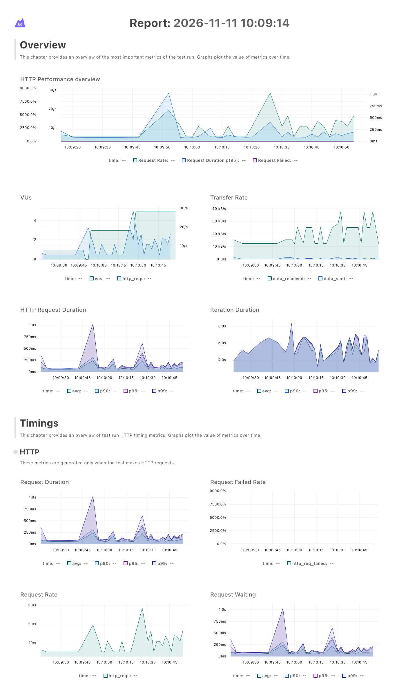
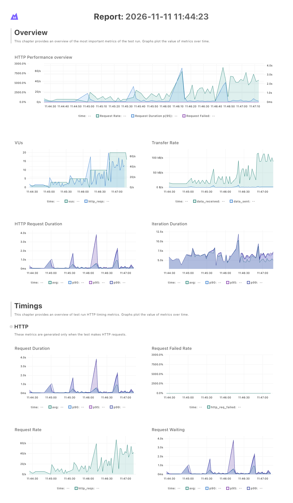
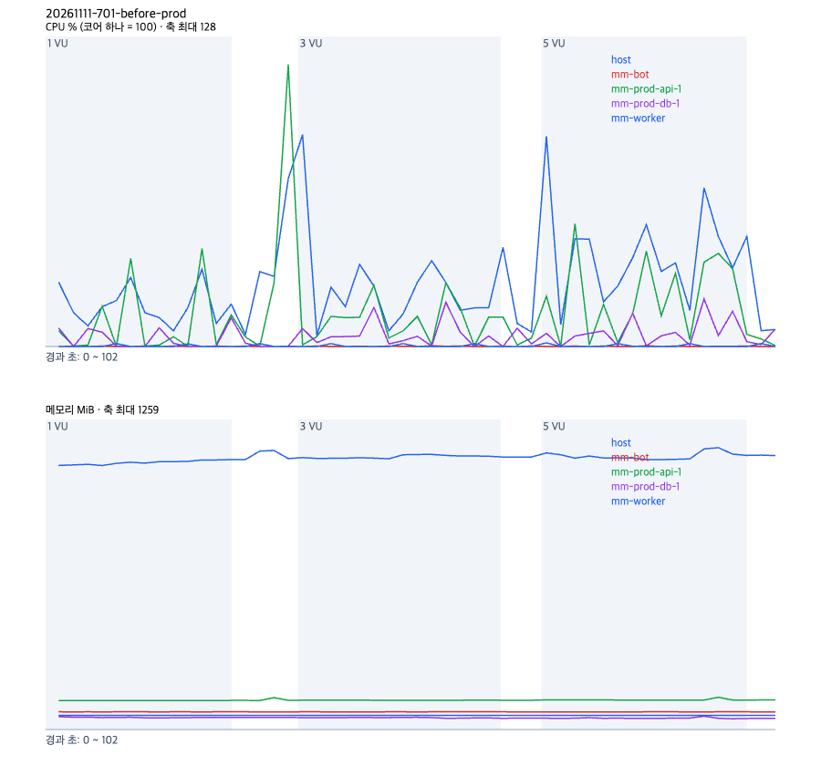
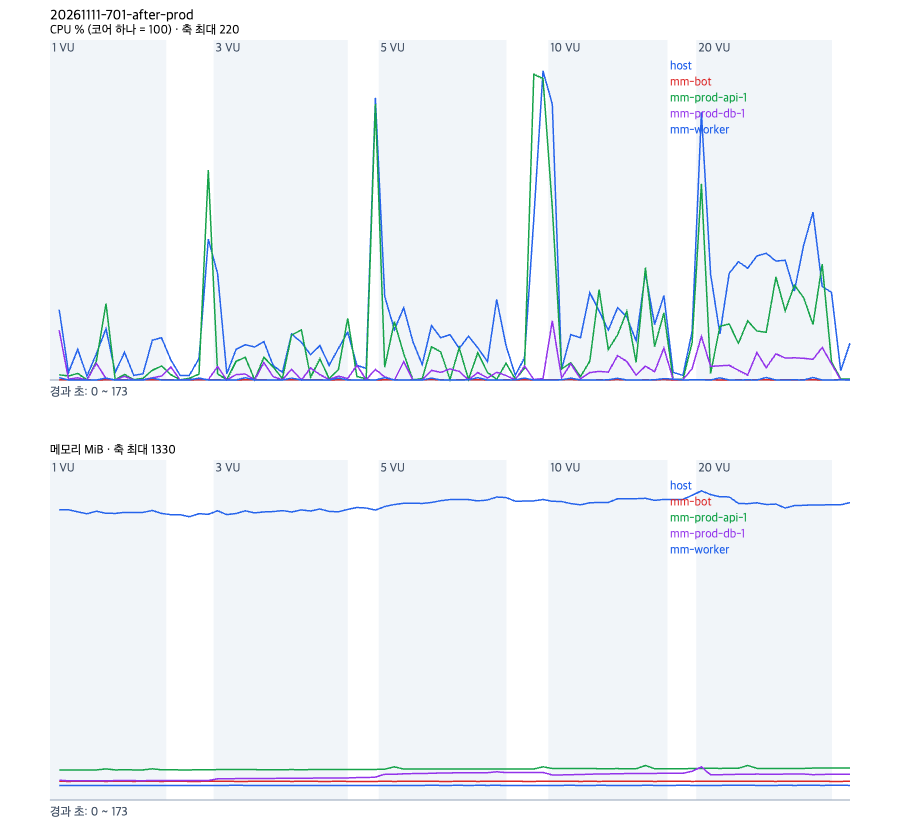

# k6 로 웹 API 와 봇 인계 API 에 부하를 걸어, 동시 요청 40개에서 BE 가 멈추는 것을 찾았다

- 날짜: 2026-11-11
- 이슈: #688
- PR: #703
- 브랜치: feature/688-k6-load-test
- 작성자: dw021213

## 한 일

- `loadtest/` 에 k6 시나리오 두 개(`web.js` 웹 사용자, `handoff.js` 봇 인계)와 실행 스크립트(`run.sh`)를 두었다. 한 줄로 스택을 띄우고(`up`), 치고(`web`, `handoff`), 지운다(`down`)
- 로컬 스택(`compose.yml`)은 운영 이미지를 vCPU 2개 상한으로 띄우고 임베딩을 0원 대역으로 바꾼다. 테스트 데이터는 심사 시드(`app.cli.seed_demo`)를 공간 다섯 개에 돌려 만든다
- 샘플러(`sampler.py`)가 컨테이너, systemd 서비스, 호스트의 CPU·메모리를 2초 간격으로 적고, `report.py` 가 단계별 표와 서버 그래프를 만든다. k6 웹 대시보드와 서버 그래프는 headless Chrome 으로 캡처한다
- 운영용으로 읽기 전용 모드(`LT_READONLY`), 서버에서 도는 샘플러(`LT_SSH`), 테스트 계정·공간 정리(`cleanup.py`)를 두었다. 정리는 로컬에서 테스트 계정 0개, 공간 0개가 남는 것을 확인했다
- 웹 시나리오가 멈춘 원인을 py-spy 와 `pg_stat_activity` 로 찾고, 고치는 안 두 개를 로컬에서 재 #701 에 남겼다. BE 코드는 이 PR 에서 고치지 않았다

## 왜

동시 사용자나 회의가 늘 때 어디서 먼저 막히는지 잰 적이 없었다. 운영 서버는 t3.medium 한 대에 BE(`--workers 1`)·DB·봇·워커가 같이 돈다.

## 결과

측정 환경은 MacBook(10코어, 32GB) 의 Docker(8GB), 기준 커밋 `b009f81d` 이다. api 에만 vCPU 2개 상한을 두고 DB 는 상한 없이 돌렸다. k6 도 같은 기계에서 돌았고 측정 중 부하 평균은 3 ~ 5 였다. 운영 수치가 아니다. 단계마다 60초이고 단계별로 한 번씩 쟀다.

웹 사용자(대시보드 열기). 같은 깨짐을 두 번 재현했다. 첫 실행(10·25·50·100·200 VU)은 25 VU 에서 실패율 57% 였다.

| VU | 처리량 req/s | p50 ms | p95 ms | 실패율 | api CPU 최고 | api 메모리 최고 MiB | DB CPU 최고 |
|---|---|---|---|---|---|---|---|
| 5 | 12.3 | 31.9 | 110 | 0% | 68% | 115 | 14% |
| 10 | 22.4 | 30.4 | 268 | 0% | 143% | 120 | 32% |
| 15 | 18.6 | 22.6 | 30,048 | 3.9% | 87% | 125 | 15% |
| 20 | 2.2 | 59,997 | 60,000 | 81% | 19% | 121 | 4% |

봇 인계(동시 회의 N개가 쉬지 않고 넘김). 한 번 쟀고, 그 사이 회의 7,223개와 승인 카드 30,079개가 쌓였다. 뒤 단계일수록 데이터가 많은 조건이다.

| 동시 회의 | 처리량 req/s | p50 ms | p95 ms | 실패율 | api CPU 최고 | api 메모리 최고 MiB | DB CPU 최고 |
|---|---|---|---|---|---|---|---|
| 1 | 106.8 | 10.4 | 16.8 | 0% | 79% | 181 | 138% |
| 2 | 184.7 | 10.9 | 21.9 | 0% | 123% | 184 | 156% |
| 5 | 212.8 | 19.3 | 60.3 | 0% | 167% | 187 | 182% |
| 10 | 187.5 | 36.2 | 161 | 0% | 187% | 192 | 204% |
| 20 | 171.9 | 85.5 | 314 | 0% | 183% | 210 | 210% |

첫 병목은 웹 15 VU 에서 DB 연결 풀이 바닥나 응답이 30초씩 멈추는 것이다. 이때 CPU 는 남는다. DB 연결 15개가 모두 `idle in transaction` 으로 18 ~ 48초 머물렀고, api 로그에 `QueuePool limit of size 5 overflow 10 reached ... timeout 30.00` 이 쌓였다. 동기 의존성과 엔드포인트가 단계마다 스레드풀(40개) 차례를 기다리는 동안 연결을 쥐고 있어, 진행 중인 요청이 40개를 넘으면 연결을 쥔 요청과 스레드를 쥔 요청이 서로 기다린다. 자세한 근거와 고치는 안은 #701.

봇 인계는 동시 회의 5개에서 처리량이 213 req/s 로 멈췄다. api CPU 가 상한 200% 근처(약 185%)에 붙은 CPU 병목이다. 워커는 회의를 하나씩 처리하고 회의 하나의 인계는 1초가 안 걸려, 이 경로가 먼저 막힐 가능성은 낮다. 인계 중 DB CPU 가 단계마다 주기적으로 튀는 원인은 확인하지 않았다.

고치는 안을 같은 부하로 비교했다(10·20·30·50 VU, 단계 45초).

| 안 | 10 VU | 20 VU | 30 VU | 50 VU |
|---|---|---|---|---|
| 지금 (풀 5+10) | 23 req/s, 0% | 실패 42% | 실패 100% | 측정 못 함 |
| 풀 20+20 | 23 req/s, 0% | 실패 5% | 실패 27% | 실패 100% |
| 풀 20+20, 관문 40 | 24 req/s, 0% | 46 req/s, 0% | 71 req/s, 0% | 111 req/s, 서버 실패 0 |

관문 안의 50 VU 실패 1.15% 는 단계가 끝날 때 k6 가 끊은 요청(상태 0)이다.

재현 명령.

```
loadtest/run.sh up
loadtest/run.sh handoff
loadtest/run.sh down && loadtest/run.sh up
LT_LEVELS=5,10,15,20 loadtest/run.sh web
```

원자료는 레포 밖 `mm/eval-runs/loadtest/20261111-070403-handoff/`, `20261111-071109-web/`, `20261111-071719-web/`, `20261111-fix-experiment/` 에 있다. 유료 호출은 없었다(임베딩 대역).

### 운영, #705 고치기 전과 뒤

#701 은 #705 로 고쳐 2026-11-11 운영에 배포했다(머지 커밋 `75fe5c4a`, 관문 30, 연결 풀 20+20). 배포 전후로 운영(`https://managers-manager.duckdns.org`, t3.medium 한 대)에 테스트 공간 하나(`seed_demo`, 계정 6개)를 만들고 읽기 전용으로 쟀다. 고치기 전에는 실제 사용자가 멈추지 않게 5 VU 까지만, 고친 뒤에는 20 VU 까지 쳤다. k6 는 노트북에서 인터넷을 거쳐 돌려 p50 에 왕복 지연이 들어 있다. 단계마다 30초씩 한 번이다. 측정마다 `cleanup.py` 로 테스트 계정과 공간을 지웠고 0개가 남았다.

```
BASE_URL=https://managers-manager.duckdns.org LT_WORKSPACES=1 LT_READONLY=1 LT_LEVELS=1,3,5,10,20 LT_STAGE_SECONDS=30 \
  LT_SSH=ktc-server LT_TARGETS="mm-prod-api-1 mm-prod-db-1 unit:mm-worker unit:mm-bot host" loadtest/run.sh web
```

| VU | 전 req/s | 전 p95 ms | 전 실패율 | 후 req/s | 후 p95 ms | 후 실패율 | 후 api CPU 최고 | 후 호스트 CPU 최고 |
|---|---|---|---|---|---|---|---|---|
| 1 | 2.6 | 89.6 | 0% | 2.7 | 88.4 | 0% | 50% | 46% |
| 3 | 7.6 | 280.9 | 0% | 6.3 | 137.3 | 0% | 40% | 69% |
| 5 | 12.3 | 277.0 | 0% | 11.5 | 265.4 | 0% | 38% | 54% |
| 10 | 재지 않음 | | | 23.4 | 492.5 | 0% | 112% | 179% |
| 20 | 재지 않음 | | | 44.3 | 1,240 | 0% | 127% | 174% |

고친 뒤 운영 20 VU 에서 실패는 0건이고, 측정하는 동안 api 로그에 `QueuePool limit` 은 한 줄도 없었다. 로컬에서 고치기 전 20 VU 실패율이 20.6% 였던 부하다. 5 VU 까지는 전후가 같아 관문이 낮은 부하를 늦추지 않았다.

다음 병목은 CPU 다. 10 VU 부터 호스트 CPU 가 2코어 중 174 ~ 179% 에 붙고 p95 가 492ms, 1.2초로 늘었다. api 외에 DB, Caddy, 봇, 워커가 같은 2코어를 나눠 쓴다. 20 VU 의 요청별 p95 는 `GET /workspaces/{id}/integrations` 1.7초, `GET /members` 1.6초, `GET /approvals` 1.6초 순이다.

운영 서버 시계가 노트북보다 36초 늦어, `run.sh` 가 그 차이를 재 `clock_offset_s.txt` 에 남기고 `report.py` 가 서버 샘플을 단계에 맞췄다.

| | 고치기 전(5 VU 까지) | 고친 뒤(20 VU 까지) |
|---|---|---|
| k6 |  |  |
| 서버 |  |  |

원자료는 `mm/eval-runs/loadtest/20261111-701-before-prod/`, `20261111-701-before-prod-5vu/`, `20261111-701-after-prod/`. 운영 시드가 태스크 임베딩을 불러 시드마다 약 0.2원이 들었다.

## 다음

- 운영 CPU 병목. 인증 단계 쿼리 수(요청마다 약 6개)와 `integrations`, `members`, `approvals` 조회부터 본다
- 녹음 업로드 시나리오(화자 분리, STT, 추출까지 회의별 대기·처리 시간). 유료 호출이라 호출 전 원 단위 계산을 남긴다
- #670 이 머지되면 인계 흐름에 `PUT /meetings/{id}/recording` 을 더한다
