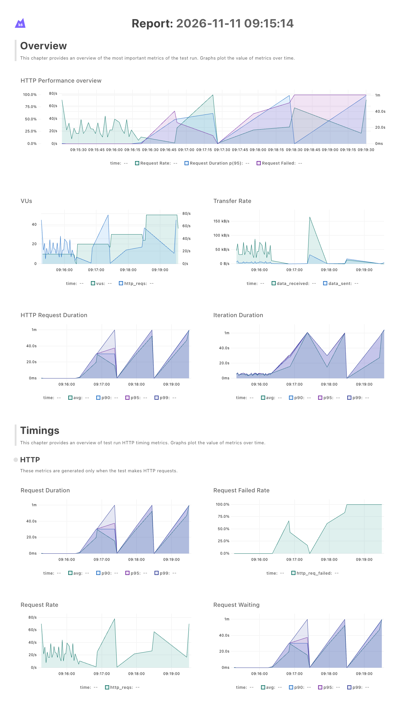
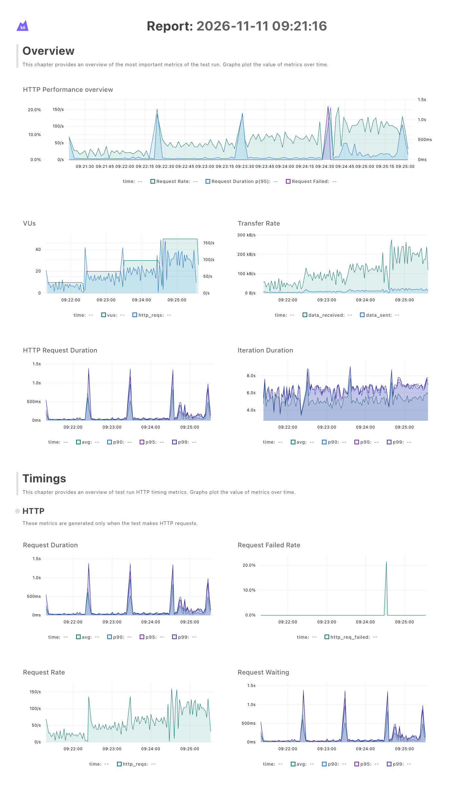
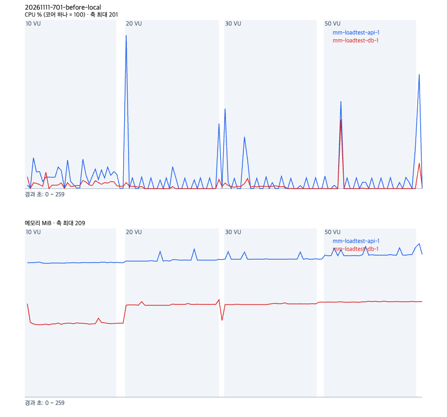
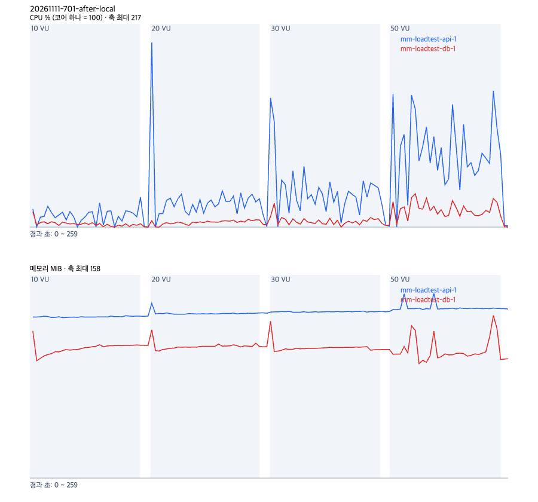

# 동시 요청 관문으로 스레드풀과 DB 연결 풀의 교착을 없앤다

- 날짜: 2026-11-11
- PR: #705
- 브랜치: fix/701-pool-gate
- 작성자: 김동우

## 한 일

- `backend/app/core/request_gate.py`: HTTP 요청만 `asyncio.Semaphore` 30개로 들여보내는 ASGI 미들웨어. 웹소켓은 그대로 통과한다
- `backend/app/main.py`: 관문을 맨 바깥 미들웨어로 붙였다
- `backend/app/core/database.py`: Postgres 엔진에 `pool_size=20`, `max_overflow=20` 을 준다. SQLite(테스트)는 그대로다
- `backend/tests/api/test_request_gate.py`: 5개 요청 중 2개만 안에 들어가는지, 관문이 차도 웹소켓은 들어가는지, 관문이 풀보다 작은지

## 왜

동시 요청이 40개를 넘으면 스레드풀과 연결 풀이 서로 기다려 BE 전체가 30초씩 멈췄다(#701). 고르는 과정은 결정 기록 [0068](2026-11-11-0068-request-gate.md) 에 있다.

## 결과

로컬 측정이다. #688 의 `loadtest/` 도구로, api 컨테이너에 vCPU 2개 상한을 두고 같은 기계에서 k6 를 돌렸다. 단계마다 60초씩 한 번 쟀다. 고치기 전은 develop(`f9e86282`, 백엔드는 `b03d270f` 과 같다), 고친 뒤는 이 브랜치다.

웹 사용자 시나리오(`LT_LEVELS=10,20,30,50 loadtest/run.sh web`)

| VU | 전 req/s | 전 p95 ms | 전 실패율 | 후 req/s | 후 p95 ms | 후 실패율 |
|---|---|---|---|---|---|---|
| 10 | 23.9 | 118 | 0% | 23.3 | 150 | 0% |
| 20 | 4.0 | 30,426 | 20.6% | 48.0 | 251 | 0% |
| 30 | 1.7 | 59,999 | 72.0% | 68.3 | 363 | 0% |
| 50 | 4.8 | 60,098 | 100% | 104.4 | 662 | 1.1% |

고친 뒤 50 VU 의 실패 69건은 모두 k6 가 단계 끝에서 끊은 요청(status 0, error 1220)이고 서버가 실패로 답한 요청은 0건이다.

봇 인계 시나리오(`LT_LEVELS=5,20 LT_STAGE_SECONDS=30 loadtest/run.sh handoff`)는 고친 뒤 동시 회의 5개에서 242 req/s, p95 61ms, 20개에서 192 req/s, p95 364ms 로 실패 0% 였다. 고치기 전 #688 측정(212.8 req/s, 171.9 req/s)과 비슷해 관문이 인계를 늦추지 않았다.

| | 고치기 전 | 고친 뒤 |
|---|---|---|
| k6 |  |  |
| 서버 |  |  |

백엔드 테스트는 Postgres(`TEST_DATABASE_URL`)를 붙여 6002 통과, 71 건너뜀, ruff 통과.

원자료는 레포 밖 `mm/eval-runs/loadtest/20261111-701-before-local/`, `20261111-701-after-local/`, `20261111-701-after-local-handoff/` 에 있다.

## 다음

- 운영 서버 전후 측정은 아직 안 했다
- 인증 단계 쿼리 수(요청마다 약 6개) 줄이기
