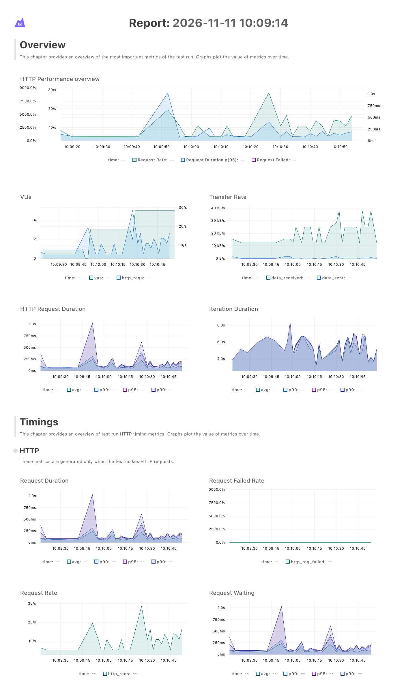
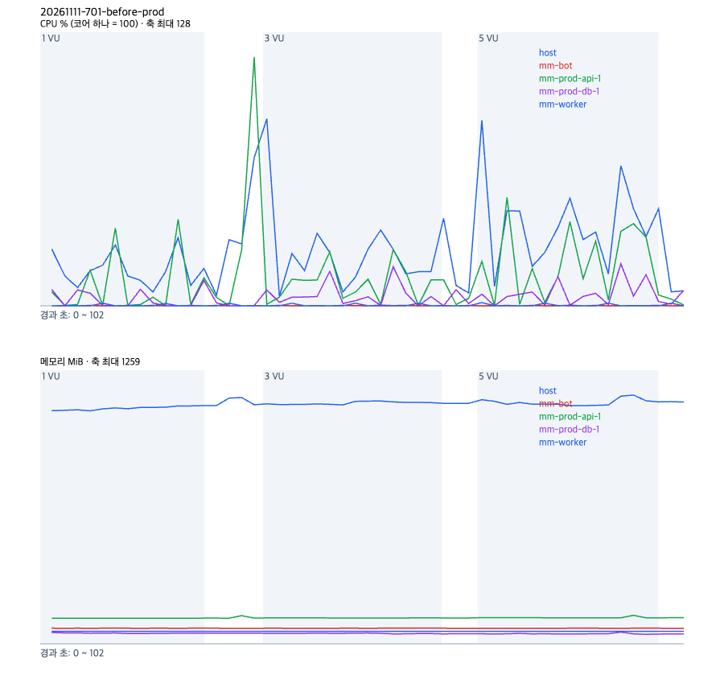
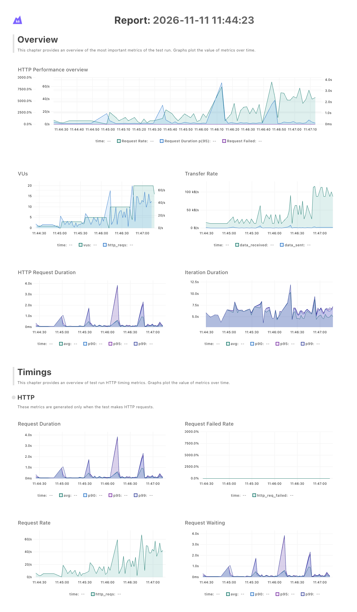
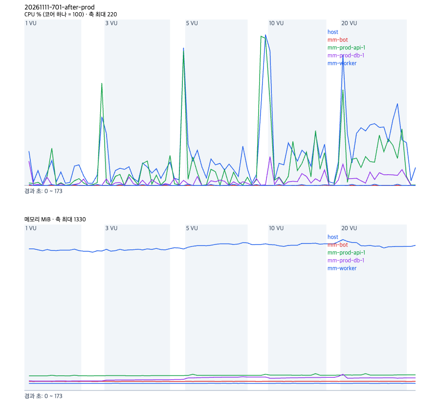

# 동시 요청 관문으로 스레드풀과 DB 연결 풀의 교착을 없앤다

- 날짜: 2026-11-11
- PR: #705
- 브랜치: fix/701-pool-gate
- 작성자: 김동우

## 한 일

- `backend/app/core/request_gate.py`: HTTP 요청만 `asyncio.Semaphore` 30개로 들여보내는 ASGI 미들웨어. 웹소켓은 그대로 통과한다
- `backend/app/main.py`: 관문을 맨 바깥 미들웨어로 붙였다
- `backend/app/core/database.py`: Postgres 엔진에 `pool_size=20`, `max_overflow=20` 을 준다. SQLite(테스트)는 그대로다
- `backend/tests/api/test_request_gate.py`: 5개 요청 중 2개만 안에 들어가는지, 관문이 차도 웹소켓은 들어가는지, 관문이 풀보다 작은지

## 무엇이 나아지나

동시에 쓰는 사람이 늘어도 BE 가 멈추지 않는다. 고치기 전에는 대시보드를 동시에 여는 사용자가 15 ~ 20명이면 요청들이 30초를 기다린 뒤 실패했다. 같은 연결 풀을 쓰는 봇 인계와 승인 처리도 그동안 막혔을 것으로 본다(동시에 재지는 않았다). 고친 뒤에는 로컬에서 50명까지 서버가 실패로 답한 요청이 없었다. 사람이 몰리면 실패 대신 조금 늦어진다. 50명에서 p95 가 662ms 였다.

| 로컬 웹 시나리오 | 고치기 전 | 고친 뒤 |
|---|---|---|
| 멈추기 시작하는 동시 사용자 | 15 ~ 20 VU | 50 VU 까지 멈추지 않음 |
| 20 VU 처리량, 실패율 | 4.0 req/s, 20.6% | 48.0 req/s, 0% |
| 50 VU 처리량, 실패율 | 4.8 req/s, 100% | 104.4 req/s, 서버 실패 0 |
| 몰릴 때 모양 | 30초 기다린 뒤 500 | 관문 앞에서 짧게 기다린 뒤 성공 |

## 왜 멈췄나

FastAPI 는 `def` 로 쓴 의존성과 엔드포인트를 스레드풀에서 돌린다. 스레드풀은 프로세스 하나에 40개다. 이 BE 의 인증 의존성(`get_current_user`, `get_current_member`)과 엔드포인트는 모두 `def` 라서 요청 하나가 의존성 하나, 엔드포인트 하나마다 스레드풀 차례를 따로 기다린다. DB 세션은 `get_db` 에서 열리고 첫 쿼리에서 연결을 받아 요청이 끝날 때까지 쥔다.

1. 진행 중인 요청이 40개를 넘으면 스레드 40개가 모두 찬다
2. 먼저 와서 연결을 쥔 요청(최대 15개)은 다음 단계(엔드포인트)를 돌릴 스레드를 기다린다
3. 스레드를 잡은 나중 요청은 인증 첫 쿼리에서 연결을 기다린다. 연결 15개는 모두 2번 요청들 손에 있다
4. 서로를 기다리다 연결 풀 대기 시간 30초가 끝나야 나중 요청이 500 으로 실패하며 스레드를 놓는다. 곧 다음 요청이 그 스레드를 잡아 다시 막힌다

그래서 DB 연결 15개가 모두 `idle in transaction` 으로 18 ~ 48초 머물렀고 CPU 는 남았다. 브라우저는 사용자 한 명당 요청을 최대 6개 동시에 보내고 대시보드는 한 번에 10개를 부르므로, 15명이면 진행 중인 요청이 약 90개가 된다.

## 왜 이렇게 고쳤나

교착은 "연결을 쥔 채 스레드를 기다리는 요청" 과 "스레드를 쥔 채 연결을 기다리는 요청" 이 함께 있어서 생긴다. 안에 들어온 요청 수를 스레드 수와 연결 수보다 작게 막으면 들어온 요청은 스레드와 연결을 반드시 받는다. 관문 밖에서 기다리는 요청은 아직 아무 코드도 돌지 않아 스레드도 연결도 잡지 않는다. 그래서 숫자를 키우는 것이 아니라 들여보내는 수를 막는 쪽을 골랐다.

검토한 안과 고르지 않은 이유는 결정 기록 [0068](2026-11-11-0068-request-gate.md) 에 있다. 요약하면 이렇다.

| 안 | 결과나 문제 |
|---|---|
| 풀만 20+20 | 로컬에서 20 VU 실패 5%, 30 VU 27%, 50 VU 100%. 막히는 지점만 뒤로 간다 |
| 스레드풀을 키우기 | 스레드가 늘면 연결을 기다리는 스레드도 늘어 같은 교착이 더 큰 수에서 생긴다(재지 않았다) |
| 의존성과 엔드포인트를 async 로 | 스레드풀을 거치지 않지만 DB 코드 전체를 비동기 드라이버로 바꿔야 한다 |
| uvicorn 워커 늘리기 | 프로세스마다 리마인드·Notion 동기화 워커가 따로 떠 중복 발송을 먼저 막아야 하고, 프로세스마다 교착은 그대로다 |
| 관문 + 풀 20+20 (고름) | 로컬 50 VU 까지 서버 실패 0. 코드 30줄 안쪽이고 엔드포인트를 건드리지 않는다 |

숫자는 이렇게 정했다.

- 관문 30: 스레드풀 40 보다 작아야 들어온 요청이 스레드를 받는다. 연결 풀 40 보다 10 작게 잡아 같은 프로세스의 백그라운드 워커 6개(리마인드, Notion 동기화, 임베딩, 업로드 sweeper, 세션 정리, 회의 삭제)와 웹소켓 인증이 쓸 연결을 남겼다. 이 관계는 테스트(`test_gate_leaves_connections_for_background_workers`)로 묶었다
- 풀 20+20: 관문 30 과 워커 몫을 담는다. 운영 Postgres 는 `max_connections` 100 이고 확인할 때 12개를 쓰고 있어 40개를 더해도 남는다
- 실험에서는 관문 40 으로 쟀고, 커밋에서는 워커 몫을 남기려고 30 으로 줄여 다시 쟀다

구현에서 고른 것은 이렇다.

- 맨 바깥 미들웨어에 둔다. 기다리는 요청이 다른 미들웨어 일을 시작하기 전에 멈추게 하려는 것이다
- 웹소켓은 관문에 넣지 않는다. 연결이 몇 분씩 열려 있어 자리를 계속 차지한다. 소켓은 인증할 때만 세션을 짧게 열고 바로 닫아(`message_socket._authorize`) 연결을 오래 쥐지 않는다
- 관문에서 기다리는 시간에 상한을 두지 않았다. 상한을 두면 몰릴 때 503 이 새로 생기고, 로컬 50 VU 에서도 대기를 포함한 p95 가 1초 안쪽이었다

이 선택의 대가도 있다.

- 몰리면 관문 앞에서 기다린 만큼 응답이 늦다. 로컬에서 p95 가 20 VU 251ms, 50 VU 662ms 였다
- 녹음 업로드처럼 본문을 오래 받는 요청도 한 자리를 쓴다. 업로드가 몰리는 경우는 재지 않았다
- 프로세스 하나 안에서만 막는다. uvicorn 워커를 늘리면 프로세스 수 × 40 이 `max_connections` 를 넘지 않는지 다시 봐야 한다

## 결과

### 로컬

#688 의 `loadtest/` 도구로, api 컨테이너에 vCPU 2개 상한을 두고 같은 기계에서 k6 를 돌렸다. 단계마다 60초씩 한 번 쟀다. 고치기 전은 develop(`f9e86282`, 백엔드는 `b03d270f` 과 같다), 고친 뒤는 이 브랜치다.

웹 사용자 시나리오(`LT_LEVELS=10,20,30,50 loadtest/run.sh web`)

| VU | 전 req/s | 전 p95 ms | 전 실패율 | 후 req/s | 후 p95 ms | 후 실패율 |
|---|---|---|---|---|---|---|
| 10 | 23.9 | 118 | 0% | 23.3 | 150 | 0% |
| 20 | 4.0 | 30,426 | 20.6% | 48.0 | 251 | 0% |
| 30 | 1.7 | 59,999 | 72.0% | 68.3 | 363 | 0% |
| 50 | 4.8 | 60,098 | 100% | 104.4 | 662 | 1.1% |

고친 뒤 50 VU 의 실패 69건은 모두 k6 가 단계 끝에서 끊은 요청(status 0, error 1220)이고 서버가 실패로 답한 요청은 0건이다.

봇 인계 시나리오(`LT_LEVELS=5,20 LT_STAGE_SECONDS=30 loadtest/run.sh handoff`)는 고친 뒤 동시 회의 5개에서 242 req/s, p95 61ms, 20개에서 192 req/s, p95 364ms 로 실패 0% 였다. 고치기 전 #688 측정(212.8 req/s, 171.9 req/s)과 비슷해 관문이 인계를 늦추지 않았다.

| | 고치기 전 | 고친 뒤 |
|---|---|---|
| k6 |  |  |
| 서버 |  |  |

### 운영, 고치기 전

`https://managers-manager.duckdns.org` 에 테스트 공간 하나(`seed_demo`, 계정 6개)를 만들고 읽기 전용(`LT_READONLY=1`)으로 쟀다. 실제 사용자가 있는 서버라 교착이 생기는 15 VU 근처는 치지 않고 5 VU 까지만 쟀다. k6 는 노트북에서 인터넷을 거쳐 돌렸으므로 p50 에 왕복 지연이 들어 있다. 측정 뒤 `cleanup.py` 로 테스트 계정과 공간을 지웠고 0개가 남았다.

```
BASE_URL=https://managers-manager.duckdns.org LT_WORKSPACES=1 LT_READONLY=1 LT_LEVELS=1,3,5 LT_STAGE_SECONDS=30 \
  LT_SSH=ktc-server LT_TARGETS="mm-prod-api-1 mm-prod-db-1 unit:mm-worker unit:mm-bot host" loadtest/run.sh web
```

| VU | req/s | p50 ms | p95 ms | 실패율 | api CPU 최고 | api 메모리 최고 MiB | DB CPU 최고 |
|---|---|---|---|---|---|---|---|
| 1 | 2.6 | 58.6 | 89.6 | 0% | 40% | 118 | 12% |
| 3 | 7.6 | 65.9 | 280.9 | 0% | 26% | 119 | 18% |
| 5 | 12.3 | 77.8 | 277.0 | 0% | 50% | 131 | 20% |

5 VU 를 한 번 더 잰 값은 11.8 req/s, p95 321ms, 실패 0%, api CPU 최고 91% 였다. 운영 서버 시계가 노트북보다 36초 늦어 서버 샘플 시각을 36초 당겨 단계에 맞췄다(원자료 `server.raw.csv`, 보정한 `server.csv`).

| k6 | 서버 |
|---|---|
|  |  |

### 운영, 고친 뒤

머지(`75fe5c4a`)와 배포가 끝난 뒤 운영 api 컨테이너에서 관문 30, 풀 20+20 이 올라온 것을 확인하고, 같은 방법으로 1·3·5·10·20 VU 를 쟀다.

| VU | req/s | p50 ms | p95 ms | 실패율 | api CPU 최고 | 호스트 CPU 최고 | DB CPU 최고 |
|---|---|---|---|---|---|---|---|
| 1 | 2.7 | 61.8 | 88.4 | 0% | 50% | 46% | 32% |
| 3 | 6.3 | 61.1 | 137.3 | 0% | 40% | 69% | 11% |
| 5 | 11.5 | 78.0 | 265.4 | 0% | 38% | 54% | 12% |
| 10 | 23.4 | 73.7 | 492.5 | 0% | 112% | 179% | 38% |
| 20 | 44.3 | 91.3 | 1,240 | 0% | 127% | 174% | 28% |

20 VU 까지 실패 0건이고 측정 동안 api 로그에 `QueuePool limit` 이 없었다. 5 VU 까지는 고치기 전과 같았다. 10 VU 부터는 호스트 CPU(2코어, api·DB·Caddy·봇·워커가 나눠 씀)가 바닥나 p95 가 늘었다. 연결 풀이 아니라 CPU 가 다음 병목이다. 측정 뒤 테스트 계정과 공간을 지웠고 0개가 남았다.

| k6 | 서버 |
|---|---|
|  |  |

### 테스트

백엔드 테스트는 Postgres(`TEST_DATABASE_URL`)를 붙여 6002 통과, 71 건너뜀, ruff 통과.

원자료는 레포 밖 `mm/eval-runs/loadtest/` 의 `20261111-701-before-local/`, `20261111-701-after-local/`, `20261111-701-after-local-handoff/`, `20261111-701-before-prod/`, `20261111-701-before-prod-5vu/`, `20261111-701-after-prod/` 에 있다. 운영 시드가 태스크 임베딩을 불러 시드마다 약 0.2원, 두 번에 약 0.4원이 들었다(장부 `fix-701-pool-gate.jsonl`).

## 다음

- 운영 CPU 병목(10 VU 부터 호스트 CPU 2코어에 붙음)
- 인증 단계 쿼리 수(요청마다 약 6개) 줄이기
- 원격 샘플러 시각 보정은 #703 의 `run.sh`·`report.py` 에 넣었다(`clock_offset_s.txt`)
