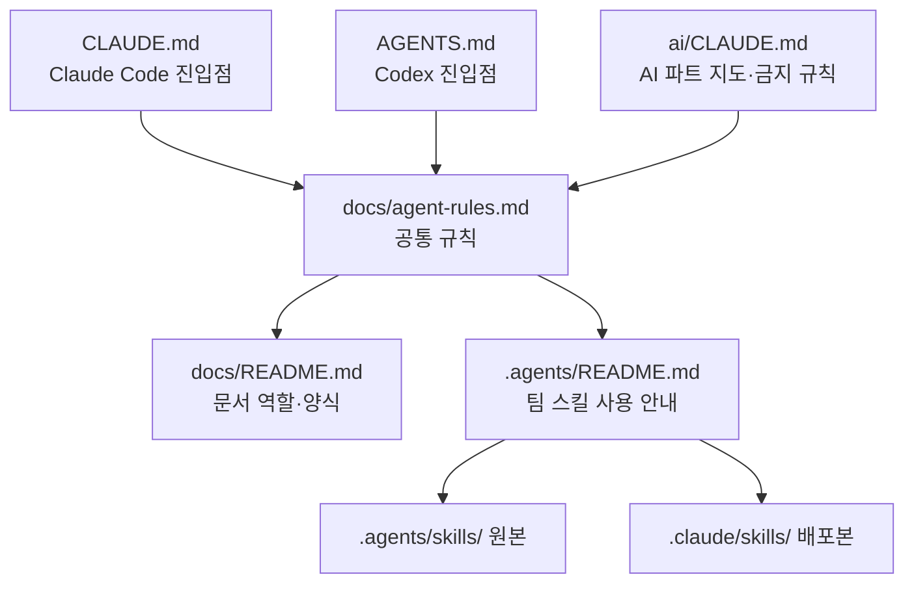

# AI 에이전트 운영 규칙

이 팀은 Claude Code 와 Codex 를 개발 도구로 적극적으로 썼다. 에이전트를 개인 취향에 맡기지 않고 **저장소에 규칙·스킬·하네스로 남겨 팀 규칙으로 관리**했다. 이 쪽은 그 구조와, AI 가 만든 기록과 사람이 쓴 기록을 구분한 방식을 정리한다.

## 1. 왜 팀 규칙으로 관리했나

| 문제 | 대응 |
|---|---|
| 사람마다 다른 도구(Claude Code, Codex)를 쓴다 | 두 도구의 진입점(`CLAUDE.md`, `AGENTS.md`)이 같은 공통 규칙 하나를 읽게 했다 |
| 에이전트가 계획 문서나 사람의 기록을 고칠 수 있다 | 보호 문서와 수정 권한을 공통 규칙에 적었다 |
| 개발 뒤 기록(결과·결정·계약)이 빠진다 | 기록 의무를 규칙으로 두고 스킬로 절차를 고정했다 |
| AI 가 쓴 글과 사람이 쓴 글이 섞여 신뢰도를 알 수 없다 | 작성 주체별로 폴더를 나눴다(4절) |
| 비밀값 노출 | 팀 공통 설정에서 `.env` 읽기·편집을 막았다 |

## 2. 규칙 파일 구조

| 파일 | 역할 |
|---|---|
| [CLAUDE.md](../../CLAUDE.md) · [AGENTS.md](../../AGENTS.md) | 도구별 진입점. 내용은 "공통 규칙을 먼저 읽는다"와 그 도구에만 필요한 지침뿐이다 |
| [docs/agent-rules.md](../agent-rules.md) | 작업 시작 절차, 수정 범위(보호 문서), 개발 후 기록 의무, 스킬 선택 기준, 마무리 점검 |
| [docs/README.md](../README.md) | 문서 경로별 작성 주체·시점·내용 표 |
| [.agents/README.md](../../.agents/README.md) | 팀 스킬 목록, 호출 예시, 원본·배포본 동기화 방법 |
| [ai/CLAUDE.md](../../ai/CLAUDE.md) | AI 파트 "지도". 100줄 안팎을 유지하고 자세한 내용은 링크한다(#242) |
| `.claude/settings.json`(루트·파트별) | 팀 공통 설정: 기본 모델, `.env` 계열 읽기·편집 차단(#240) |

### 공통 규칙의 핵심

- 전체 개발 계획은 에이전트가 작성·수정하지 않는다. 마일스톤 `plan.md` 는 명시적으로 요청받았을 때만 고친다.
- 트러블슈팅 기록은 사람이 작성·관리한다. 에이전트는 정리안만 제시한다.
- 개발 뒤 `result.md`, `basis-for-decision/`, 계약 갱신이 의무다. 요청·합의·검증 결과를 추정하지 않는다.
- 사용자 변경을 되돌리거나 기록을 중복 생성하지 않는다.

### AI 파트의 "깨면 안 되는 규칙" (`ai/CLAUDE.md`)

일부는 테스트로 강제해 에이전트가 어겨도 CI 에서 잡힌다.

| 규칙 | 강제 방법 |
|---|---|
| Discord 는 `capture/` 안에만 있다 | `tests/test_platform_isolation.py`, 워커 import 테스트 |
| `shared/schemas.py` 는 BE 와의 계약이다. 바꾸면 계약 문서도 고친다 | `contract-update` 스킬 |
| BE 와는 HTTP API 로만 이야기한다 | `capture/handoff.py` 의 `BeClient` 경유 |
| LLM 호출 실패는 `None`. 테스트에서 실제 API 를 부르지 않는다 | API 키 없이 pytest 가 돈다 |
| 실제 API 를 부르는 평가 스크립트는 pytest 에 넣지 않는다 | 평가 스크립트를 따로 둔다(`judge/eval_*.py`) |
| 상대 날짜의 기준일은 회의 날짜다 | — |
| `.env` 는 읽지 않는다 | `.claude/settings.json` deny 규칙 |

## 3. 팀 스킬

`.agents/skills/` 가 원본이고 `.claude/skills/` 는 같은 내용을 복사한 배포본이다. 두 경로를 함께 Git 으로 관리하고, 동기화 스크립트 없이 수정 때 양쪽을 같이 고쳐 함께 커밋한다([.agents/README.md](../../.agents/README.md)).

| 스킬 | 언제 | 하지 않는 것 |
|---|---|---|
| docs-bootstrap | 명시적 요청으로 문서 초기 구조화·보완 | 일반 개발 중 자동 재배치 |
| milestone-plan | 명시적 요청으로 특정 마일스톤 계획 작성 | 계획 자동 갱신, 전체 계획 작성 |
| milestone-result | 개발 결과를 `result.md` 와 파트 README 에 기록 | 과거 결과 추정 |
| decision-record | 중요한 기술 선택과 근거를 basis-for-decision 에 기록 | 추정한 과거 결정, 트러블슈팅 작성 |
| contract-update | 파트 간 인터페이스 변경 시 계약 갱신. 구현 사실과 합의 상태 분리 | — |
| troubleshooting-review | 사람이 쓴 트러블슈팅의 정리안·보완 질문 제시 | 원본 수정 |
| docs-audit | 구조·상대 링크·완료조건·보호 문서 읽기 전용 점검 | 자동 수정 |
| verify-managers-manager | 웹 UI 의 Playwright·MSW 사용자 흐름 검증과 증거 보관 | — |

호출은 Claude Code 는 `/스킬이름`, Codex 는 `$스킬이름` 이다.

## 4. AI 파트 하네스 (mm-harness)

AI 파트는 기능 하나를 "설계 → 테스트 먼저 구현 → 셀프 리뷰 → PR" 로 끝까지 돌리는 하네스를 만들어 썼다.

| 명령 | 하는 일 |
|---|---|
| `ai-feature` | 설계 초안 → 사용자와 설계 확정(grilling) → 테스트 먼저 구현 → pytest → 셀프 리뷰 → develop 대상 PR 생성. PR 생성이 끝이고 머지는 사람이 한다 |
| `ai-pr-reply` | PR 에 달린 리뷰를 모아 지적마다 검증하고, 맞는 지적은 고쳐 push 한 뒤 답글. 계약(`shared/schemas.py`·BE 계약)을 바꾸는 지적은 사람에게 넘긴다 |
| `ai-review-pr` | 팀원 PR 을 AI 관점으로 리뷰 |

역할별 에이전트로 나눴다(#246 본문 기준).

| 에이전트 | 역할 |
|---|---|
| ai-designer | 읽기 전용. 관련 코드·테스트·계약·결정 기록을 읽고 변경 범위, 접근안, 계약 영향, 테스트 전략, 사람이 정할 질문을 정리 |
| ai-implementer | 태스크 하나를 테스트 먼저 방식으로 구현·커밋 |
| ai-reviewer | 읽기 전용. 구현 과정을 모르는 눈으로 diff 를 리뷰(정확성·플랫폼 격리·계약·테스트) |

연결 장치:

- 이슈 템플릿 [AI Feature (하네스)](../../.github/ISSUE_TEMPLATE/ai-feature.md): 목표, 먼저 읽을 것, 범위 안/밖, 지킬 것, 설계에서 같이 정할 것, 완료 조건, **선행 이슈**. `/mm-harness:ai-feature #번호` 로 부르면 이슈 본문을 요청으로 읽는다.
- 선행 이슈가 닫히거나 `합의됨` 라벨이 붙기 전에는 하네스가 구현 전에 멈추고 묻는다. 합의되면 `ai-handoff-agreed.yml` 이 팀 Discord 에 알린다([그라운드룰](ground-rules.md#2-파트-간-계약과-요청)).
- 하네스로 만든 PR 본문은 "요약 / 설계 / 변경 / 검증 / 사람이 확인할 것 / 기록 / 다른 파트 전달" 구조로 나온다(예: #526, #529, #532). "돌리지 못한 것"과 "사람이 확인할 것"을 따로 적는 것이 특징이다.

변천:

- 2026-10-31 #246 에서 저장소 안(`.claude/agents/`, `.claude/skills/`, pytest Stop 훅)으로 처음 넣었고, 같은 날 #250 에서 되돌렸다. 되돌린 이유는 PR 에 적혀 있지 않다 `[확인 필요]`.
- 지금은 저장소 밖 Claude Code 플러그인 `mm-harness` 로 쓴다(이슈 템플릿·워크플로 주석 기준). 플러그인 원본 위치와 설치 방법은 저장소로 확인하지 못했다 `[확인 필요]`.

> 📷 **사진 자리**: `/mm-harness:ai-feature` 실행 중 설계 질문 단계 터미널 화면 (파일: ../assets/collab-harness-run.png)

## 5. AI 가 만든 기록과 사람이 쓴 기록의 구분

이 프로젝트의 차별점이다. 에이전트가 많은 문서를 쓰게 되자, **누가 썼는지**를 기록 위치로 드러냈다.

| 구분 | AI 작성 | 사람 작성 |
|---|---|---|
| AI 파트 진행 로그·결정 기록 | [ai/docs/basis_for_decision/ai/](../../ai/docs/basis_for_decision/ai/) — 93개 | [ai/docs/basis_for_decision/member/](../../ai/docs/basis_for_decision/member/) — 47개 |
| 판별 기준 | 커밋에 `Co-Authored-By: Claude` 가 붙는 경우 | 팀원이 직접 쓴 경우 |
| 트러블슈팅 | 쓰지 않는다. 정리안만 제시(`troubleshooting-review`) | `*/docs/plan/mN/trouble-shooting/` 에 사람이 작성 |
| 커밋 | 본문 끝에 `Co-Authored-By: Claude …` | 없음 |
| PR | 본문 끝에 "Generated with Claude Code" | 없음 |

(파일 수는 2026-11-09 `ls` 기준.)

- 기준은 [ai/docs/README.md](../../ai/docs/README.md) 에 있다. 진행 로그(`YYYY-MM-DD-제목.md`)와 결정 기록(`YYYY-MM-DD-NNNN-제목.md`)을 같은 폴더에 두고, 작성 주체로만 `ai/` 와 `member/` 를 나눈다.
- 효과: 리뷰어는 AI 가 쓴 근거를 더 의심하며 읽을 수 있고, 사람의 판단·회고(트러블슈팅)는 에이전트가 덮어쓰지 않는다.
- develop 최근 비머지 커밋 2,000개 중 약 240개의 본문에 `Co-Authored-By: Claude` 가 있다(2026-11-09 `git log` 기준). 도구별 실제 사용 비율은 이 표시만으로 단정할 수 없다 `[확인 필요]`.

## 6. 한계

- BE·FE 결정 기록(`*/docs/plan/mN/basis-for-decision/`)은 작성 주체를 폴더로 나누지 않는다 `[확인 필요: 팀 논의]`.
- 하네스는 사용자 PC 세션에서만 돌아 GitHub 이벤트로 자동 재시작되지 않는다. 사람이 알림을 보고 다시 부른다.

## 관련 문서

- [그라운드룰](ground-rules.md)
- [코드 리뷰 기록](code-reviews.md) — 하네스로 반영한 멘토 리뷰 사례(#526·#529·#532)
