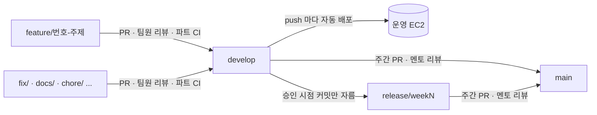
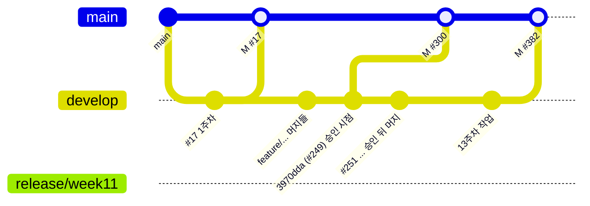

# 브랜치 전략

작업 브랜치에서 `develop` 으로 팀원끼리 리뷰하며 모으고, 매주 한 번 `main` 으로 올려 멘토 리뷰를 받는다. 11주차부터는 멘토가 승인한 커밋만 올리려고 `release/weekN` 브랜치를 도입했다. 근거: [프로젝트 상세 설명 §2.2](../프로젝트%20상세%20설명.md#22-브랜치리뷰릴리스-흐름), `git log`, `gh pr list --base main`.

## 1. 흐름

| 단계 | 브랜치 | 리뷰 | 자동화 |
|---|---|---|---|
| 1. 작업 | `feature/<이슈번호>-<주제>` 등 | — | — |
| 2. 통합 | `develop` (기본 브랜치) | 팀원 상호 리뷰 | 파트 경로별 `ai-ci`·`backend-ci`·`frontend-ci`, Discord 한 줄 알림(`team-notify`) |
| 3. 배포 | `develop` push | — | `deploy.yml`: 세 CI 를 같은 커밋으로 다시 돌려 모두 통과하면 OIDC → SSM 으로 EC2 배포 |
| 4. 주간 릴리스 | `develop` 또는 `release/weekN` → `main` | 멘토(minsang0850) | `assign-mentor`(멘토 자동 지정), `notify-discord`(리뷰 알림), `convention-check`(컨벤션 안내) |

- 운영 배포는 `main` 이 아니라 `develop` 에서 나간다(`deploy.yml`). `main` 은 멘토가 승인한 주간 스냅샷이다.
- 배포 상세는 [배포 문서](../dev/deploy.md).

## 2. 주간 main PR 기록

| 주차 | PR | head | 머지일 | 결과 |
|---|---|---|---|---|
| 1주차 | #17 | develop | 2026-09-14 | 변경 요청 → 승인 |
| 2주차 | #45 | develop | 2026-09-21 | 변경 요청 → 승인 |
| 7주차 | #78 | develop | 2026-09-28 | 변경 요청 → 승인 |
| 8주차 | #128 | develop | 2026-10-05 | 변경 요청 → 승인 |
| 9주차 | #175 | develop | 2026-10-13 | 변경 요청 → 승인 |
| 10주차 | #230 | develop | 2026-10-28 | 변경 요청 → 승인 |
| 11주차 | #239 → **#300** | develop → `release/week11` | 2026-11-04 | #239 승인 뒤 닫고 #300 으로 다시 올림 |
| 13주차 | #382 | develop | 2026-11-08 | 변경 요청 → 승인 |

- 매주 멘토가 먼저 변경을 요청하고(CHANGES_REQUESTED), 반영 뒤 재리뷰에서 승인(APPROVED)하는 흐름이 반복됐다.
- 주차 표기는 PR 제목 그대로다. `main` 대상 PR 은 위 9건(#17, #45, #78, #128, #175, #230, #239, #300, #382)이 전부이고 3~6주차·12주차 제목의 PR 은 없다(2026-11-11 `gh pr list --base main --state all`). 1·2·7·8주차 PR 의 머지일은 한 주 간격으로 이어진다. 주차 번호가 건너뛴 이유는 저장소 기록에 없다 `[확인 필요]`.
- 본문은 PR 템플릿(이번에 한 일 / 리뷰에서 봐주셨으면 하는 곳 / 고민한 점 / 지난 리뷰 반영)을 따른다.

## 3. release 브랜치를 도입한 이유

1. 11주차 main PR #239 는 head 가 `develop` 이었다. 멘토가 10/31 에 승인했지만 바로 머지하지 못했다.
2. 그 사이 `develop` 에 머지된 작업(#251, #260, #262 등)이 확인받지 않은 채 #239 에 함께 붙었다. head 가 움직이는 브랜치라서 생긴 문제다.
3. 그래서 승인한 커밋 `3970dda` 를 그대로 가리키는 `release/week11` 을 만들고 #300 으로 다시 올렸다. 멘토는 head SHA 만 확인하고 다시 승인했고, 머지 뒤 #239 는 닫았다.
4. #300 본문에서 "앞으로 main PR 은 `develop` 대신 주차별 `release/weekN` 브랜치로 올리겠다"고 정했다.

이후 상태: 13주차 #382 는 다시 `develop` 을 head 로 올렸다. 재리뷰 범위를 head `41b554f` 로 명시해 승인받았지만, `release/weekN` 규칙이 계속 지켜지지는 않았다 `[확인 필요: 이유와 앞으로의 운영 — 팀 논의]`. 원격에 남은 release 브랜치는 `release/week11` 하나다(2026-11-09).

## 4. 브랜치 이름 규칙

### 정해 둔 형식

`<종류>/<이슈번호>-<짧은-주제>` (예: `feature/561-audio-retention`, `fix/217-judge-retry-selection`, `task/505-discord-channel-button`).

### 실제 관찰 (`origin` 원격 브랜치, 2026-11-09 `git branch -r`)

| 접두어 | 수 | 예 | 비고 |
|---|---|---|---|
| `feature/` | 161 | `feature/348-meeting-schema` | 가장 많다 |
| `fix/` | 49 | `fix/217-judge-retry-selection` | |
| `feat/` | 44 | `feat/229-evidence-seqs` | `feature/` 와 같은 뜻으로 섞여 쓰임 |
| `docs/` | 26 | `docs/manual-upload-overlap` | |
| `chore/` | 17 | `chore/claude-team-settings` | |
| `codex/` | 9 | `codex/572-release-readiness` | Codex 에이전트가 만든 브랜치 이름 |
| `refactor/` | 6 | | |
| `task/` | 4 | `task/505-discord-channel-button` | |
| `test/` | 1 | | |
| `release/` | 1 | `release/week11` | |

- `feature/`·`feat/`·`fix/` 브랜치 중 26개는 이슈 번호가 없다(예: `feature/asr-suspect-gate`, `feature/auto-create-switch`). 이슈 없이 PR 본문에서 리뷰 지적을 근거로 시작한 작업이 많다.
- `feature/` 와 `feat/` 통일 여부 `[팀 논의]`.

## 관련 문서

- [코딩 컨벤션](conventions.md) — 커밋·PR 제목 규칙
- [코드 리뷰 기록](code-reviews.md) — #239 → #300 사례
- [그라운드룰](ground-rules.md)
