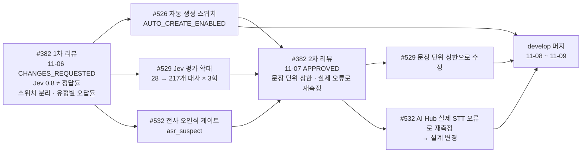

# 코드 리뷰 기록

주간 멘토 리뷰에서 받은 지적이 어떻게 반영되고 재리뷰로 확인됐는지, 대표 사례를 모았다. 팀원끼리 한 상호 리뷰 사례도 함께 적는다. 리뷰 원문은 각 PR 의 리뷰·인라인 스레드에 있다(`gh pr view <번호> --comments`, `gh api repos/{owner}/{repo}/pulls/<번호>/comments`로 확인, 2026-11-09).

## 리뷰 체계 요약

| 구분 | 대상 | 리뷰어 | 방식 |
|---|---|---|---|
| 멘토 리뷰 | 주간 `main` 대상 PR | minsang0850 | 1차 CHANGES_REQUESTED(🔧 고칠점 · 🤔 고민 · 👍 잘한점, 심각도 HIGH/MEDIUM/LOW) → 팀 반영 → 2차 재리뷰에서 반영 표와 함께 APPROVED |
| 상호 리뷰 | `develop` 대상 PR | 팀원 | 인라인 `[권장]`·`[질문]`·`[사소]`·`[nit]` → 작성자가 "반영했습니다 (커밋)" 답글 |

상호 리뷰는 팀원이 PR 의 변경을 읽고 직접 코멘트를 달았다. 작성자는 답글과 반영 커밋으로 답했고, 그 뒤 파트 안에서 머지했다.

멘토는 매 리뷰 끝에 **무엇을 검증했고 무엇은 검증하지 않았는지**(CI 실행 번호와 통과 수, 실행하지 않은 로컬·운영 E2E)를 적었다. 팀도 PR 본문에 "돌리지 못한 것"을 같은 방식으로 적었다.

---

## 주간 멘토 리뷰 전체

`main` 대상 PR 9건의 리뷰 본문과 인라인 스레드를 모두 읽어 정리했다(2026-11-11, GitHub API). 지적 수는 멘토가 단 최상위 인라인 코멘트를 🔧 고칠점 / 🤔 고민 / 👍 잘한점으로 나눈 값이다.

| 주차(PR 제목) | PR | 변경 요청 → 승인 | 고칠점 / 고민 / 잘한점 | HIGH | 멘토가 짚은 주제 | 반영한 곳 |
|---|---|---|---|---|---|---|
| 1주차 | #17 | 09-09 → 09-12 | 36 / 10 / 12 | 11 | 트랙 사이 시작 시각 기준, AI·BE 계약이 갈라짐, BE 테스트 0개, WER 이 아닌 CER 로 판정 | #21, #23, #31, #41, #46, #115 |
| 2주차 | #45 | 09-16 → 09-19 | 38 / 6 / 13 | 20 | 실패한 전사를 완료로 닫음, 복구에서 빠지는 트랙, 승인 검증과 원자적 선점, 문장 번호를 할 일 키로 씀 | #57, #83, #95, #38, #55, #74, #82, #76, #91 |
| 7주차 | #78 | 09-23 → 09-27 | 11 / 4 / 17 | 2 | Notion 반영을 DB 트랜잭션과 분리, 빈 응답을 0건으로 처리, 결정 발화와 담당자 발화 구분 | #80, #85, #137, #96, #123 |
| 8주차 | #128 | 10-01 → 10-03 | 8 / 4 / 9 | 5 | 1단계 응답 오류로 회의가 빈 채 닫힘, 같은 회의 안 번복, 수정 제안이 본 기준값 보존, 신뢰도 숫자보다 승인 정책 먼저 | #137, #158, #206, #159, #161, #188, #134, #232 |
| 9주차 | #175 | 10-08 → 10-10 | 6 / 2 / 9 | 4 | 서버 ID 로 워크스페이스 조회, 세 파트 CI 가 통과한 커밋만 배포, 탈락 항목 로그, 승인 대기를 반영 완료로 표시 | #171, #183, #187, #208, #200, #211, #189 |
| 10주차 | #230 | 10-15 → 10-17 | 4 / 2 / 10 | 1 | 오자동 생성률을 잰 뒤 유형별로 auto, 검색 0건은 중복 없음이 아님, 합친 카드의 담당자 출처, STT 장애 전환 절차 | #234, #281, #334, #410, #421 |
| 11주차 | #239 → #300 | 10-29 코멘트, 10-31 승인 → 11-04 다시 승인 | 0 / 2 / 4 | 0 | auto 근거의 기본 검사 순서, 담당자 출처와 승인 대기 중복을 먼저 닫기, 승인 뒤 head 가 움직임 | #421, #514, #533, `release/week11` |
| 13주차 | #382 | 11-06 → 11-07 | 2 / 4 / 7 | 2 | Jev 0.8 은 정답률이 아님, 검증과 자동 생성 스위치 분리, 문장 단위 상한, 실제 STT 오류로 재측정 | #526, #529, #532, #421, #416, #442, #422 |

- PR 제목의 주차는 처음 두 번(#17, #45)은 개발 주차로, 그 뒤는 캠프 주차로 적었다. 그래서 3 ~ 6주차가 비어 보인다. 12주차 작업은 13주차 #382 에 합쳐 올렸다.
- 멘토가 리뷰에서 확인한 CI 테스트 수는 아래처럼 늘었다.

| 시점 | AI | BE | FE | E2E |
|---|---|---|---|---|
| #17 (09-09) | | 0 | | |
| #45 (09-16) | 357 | | | |
| #78 (09-23) | | | 344 | |
| #239 (10-29) | 1,064 | 872 | 1,797 | |
| #382 (11-06) | 1,831 | 3,669 | 3,245 | 264 |

---

## 사례 1. #382 auto 개방 기준 → #526 · #529 · #532 (대표 사례)

13주차 main PR #382. 자동 생성(auto)을 언제 열지에 대한 지적이 세 개의 후속 PR 로 나뉘어 반영되고, 재리뷰에서 다시 방향을 받은 흐름이다.

### 지적 요지 (1차, 2026-11-06)

- 운영은 Jev 키 없이 review/hold 를 유지하는 쪽을 권한다.
- **0.8 은 정답률 80% 가 아니라 "원문에 명시됐나"에 대한 모델 판정값**이다.
- 자동 생성과 검증 실행을 별도 스위치로 나누고, PM 수정·반려율과 auto 후보 오답률을 유형별로 본 뒤 단계적으로 열 것.

### 반영

| PR | 작성자 | 반영 내용 | 결과 |
|---|---|---|---|
| #526 | Y-Jimin | BE 에 `AUTO_CREATE_ENABLED` 추가. 끄면 auto 새 항목을 review 로 내리되 근거 상태는 그대로 저장하고 "켰으면 auto 였을 항목"을 로그로 남긴다. 기본값은 켜짐(배포만으로 동작이 바뀌지 않게) | 2026-11-08 머지 |
| #529 | Y-Jimin | Jev 근거 판정 평가를 28 → 217개 대사(정답 False 56%, 유형 A~H)로 늘려 실제 Jev 로 3회(651회 호출). 판정 로직·기준값은 바꾸지 않음. 0.8 유지 | 2026-11-09 머지 |
| #532 | Y-Jimin | 근거 문장이 잘못 전사되면("진도" → "짐도") Jev 가 그대로 certain 을 줄 수 있다. 제목 명사 중 워크스페이스 용어 목록에 없는 말을 Jev 로 확인하고, 의심되면 `asr_suspect` 사유로 auto 만 막는다 | 2026-11-09 머지 |

팀은 #382 대화 탭에 반영 내용을 정리해 답했고(2026-11-07), 여기서 "3/249 = 1.2%, 95% 상한 3.5%"처럼 실행 단위로 계산한 수치를 보고했다.

### 재리뷰 (2차, 2026-11-07, APPROVED)

| 멘토 의견 | 팀 대응 |
|---|---|
| 👍 기준값을 지키는 평가가 아니라 틀리는 유형을 찾는 평가로 넓혔다 | — |
| 🤔 3회 반복은 독립 표본이 아니다. 문장 기준으로 다시 계산하면 할 일 1/83(상한 약 6.5%), 마감 1/44(상한 약 12%) | #529 를 문장 단위로 고쳐 머지. 반복은 흔들림 측정에만 쓴다 |
| 🤔 새 189개는 합성이다. 실제 회의 전사 문장을 섞어 볼 것 | 후속 과제로 이어 간다 |
| 🤔 #532 는 맞는 방향. `task_status` 를 낮추지 않고 별도 사유로 막은 설계에 동의. 다만 93% 는 자모 하나를 바꾼 합성 오류로 잰 값이니 실제 STT 오류로 다시 잴 것 | #532 를 AI Hub 회의 음성(KconfSpeech 1,397발화) + 운영 STT 로 다시 쟀더니 처음 구현은 명사 오류의 **14%** 만 잡았다. 설계를 "용어 목록 + Jev 확인"으로 바꿔 **47%** (맞는 발화 막음 19%)로 올렸다. 결정 기록 [0051](https://github.com/kakaotechcampus-4/ktc4-kyungpook-3/blob/develop/ai/docs/basis_for_decision/ai/2026-11-07-0051-asr-suspect-gate.md) |
| 🤔 외래어 오탐은 워크스페이스 태스크 제목 전체를 용어로 쓰면 줄어든다 | #532 에 BE 워크스페이스 용어(`workspace_asr_term`, PM 승인 제목 큐)를 더함 |
| 🤔 #526 기간에 "켰으면 auto 였을 항목"에 `asr_suspect` 여부를 같이 남겨 PM 수정 비율을 비교할 것 | 항목 ID 가 든 로그를 남긴다. KPI view 의 `asr_flag` 별 제목 수정 비율로 비교한다(#675) |
| 🔧 LOW PR 본문을 재리뷰 범위에 맞춰 갱신 | 같은 날 본문에 "추가분"과 "배포 전 확인" 절 추가 |
| 승인 전제: 세 PR 이 머지되기 전에는 운영 `.env` 에 `JEV_API_KEY` 를 넣지 않는다 | 팀 공유하겠다고 답함 |

**얻은 것**: "평가 숫자가 좋다"에서 멈추지 않고 표본 독립성·합성 데이터 편향을 짚어 준 덕에, #532 는 실제 데이터로 재측정해 설계 자체를 바꿨다.

---

## 사례 2. #382 1차 인라인 지적 → 4개 수정 PR

같은 #382 1차 리뷰의 인라인·기존 미해결 지적이다. 파트가 다른 네 사람이 나눠 반영했고, 2차 리뷰에서 멘토가 표로 확인했다.

| 지적 | 심각도 | 반영 PR | 작성자 | 2차 리뷰 확인 내용 |
|---|---|---|---|---|
| 병합된 담당자의 근거 화자 | 🔧 HIGH | #421 | dw021213 | 담당 발화가 오면 근거·화자를 그 발화로 옮긴다 |
| claim 직전 수신자 연결 확인 | 🔧 HIGH | #416 | wkddnjswns | 연결이 끊긴 수신자의 메시지만 `DISCORD_NOT_LINKED` 로 닫는다 |
| 수정 승인 대기를 반영 완료와 구분 | 🔧 HIGH | #442 | hotpringles | `approval_status=approved` 일 때만 반영으로 본다 |
| 저장된 전사와 추출 근거 연결 | 🔧 MEDIUM | #422 | dw021213 | `evidence_seqs` 가 `/sources` 번호와 같고 BE 상한 100 에 맞췄다 |
| 웹 업로드를 AI 가 가져오는 연결 | 🤔 | #289·#326·#343·#389 | letsgojh | job_id 를 `intake.json` 에 남겨 재시작 때 이어 조회 |
| 대화 하나의 답장 범위 | 🤔 | — | — | 팀 결정으로 남김 |

**결과**: 2차 리뷰 "현재 HEAD 에서 병합을 막을 결함은 찾지 못했다" → APPROVED.

---

## 사례 3. #128 재시도 결과 선택 → #230 → #570 (여러 주에 걸친 지적)

| 시점 | 내용 |
|---|---|
| #128 (8주차, 2026-10-01) | 🤔 실패한 finding 부터 다시 처리하는 쪽을 권함. 인라인: 항목 수로 재시도 결과를 고르는 문제. 2차 승인 때도 "기존 세 건(회의 안 번복, 잘못된 날짜의 조용한 누락, 항목 수로 재시도 결과 선택)은 후속 수정 대상으로 유지" |
| #230 (10주차, 2026-10-15) | 같은 회의 합치기가 좋아져 항목 수가 줄어든 재시도 결과를 "항목이 많은 결과 우선" 정책이 버릴 수 있다고 다시 짚고 #217 을 연결 |
| #570 (dw021213, 2026-11-09 머지) | 판단 결과에 근거 문장 번호를 싣고, 다시 돌린 결과를 실행 하나가 아니라 **얘기(근거 번호가 겹치는 결과) 단위로 합친다**. BE 계약은 그대로 |
| #580 (dw021213) | 1단계 추출 실패를 그 자리에서 한 번 더 부른다(머지) |

**얻은 것**: 한 번에 고치지 못한 지적도 멘토가 매주 "아직 남은 항목"으로 추적했고, 팀은 이슈(#217)로 이어 받아 결국 닫았다.

---

## 사례 4. #239 승인 뒤 head 이동 → #300 release 브랜치

| 단계 | 내용 |
|---|---|
| 문제 | 11주차 #239 는 head 가 `develop` 이라, 10/31 승인 뒤 develop 에 머지된 작업이 확인 없이 PR 에 붙었다 |
| 반영 | 승인 커밋 `3970dda` 를 가리키는 `release/week11` 로 #300 을 다시 올림. 본문에 포함 머지 목록과 "head SHA 만 확인해 달라"를 적음 |
| 재리뷰 | 멘토가 같은 SHA 를 확인하고 승인. 남은 지적(auto 근거 상태, 담당자 출처·중복, Notion 복구 절차)은 "해결됐다는 뜻은 아니다"라며 목록으로 다시 남김 |
| 결과 | 2026-11-04 #300 머지, #239 닫음. 브랜치 전략에 `release/weekN` 도입([브랜치 전략](branch-strategy.md#3-release-브랜치를-도입한-이유)) |

이 사례에서 남은 지적 중 "담당자 출처"는 #241(hwnv, `evidence_seqs` 연결)과 #421 로, "auto 근거 상태"는 사례 1로 이어졌다.

---

---

## 여러 주에 걸쳐 추적된 지적

한 번에 닫지 못한 지적은 멘토가 다음 주에 "아직 남은 항목"으로 다시 짚었고, 팀은 이슈로 이어 받아 닫았다.

| 지적 | 짚인 리뷰 | 닫은 PR | 걸린 기간 |
|---|---|---|---|
| 결정 발화와 담당자 발화가 섞여 담당자가 틀림 | #78 → #128 → #230 HIGH → #239 → #382 HIGH | #421 | 6주 |
| 승인 대기 중인 수정 제안을 반영 완료로 표시 | #175 HIGH → #230 → #382 HIGH | #211(BE 응답 구분), #442(FE 분류) | 4주 |
| 항목 수로 재시도 결과를 고름 | #128 → #175 → #230 | #570 | 5주 |
| 검색 0건을 중복 없음으로 봄 | #230 → #239 | #514, #533. 승인 대기 새 항목의 중복 #141 은 열려 있다 | 3주 |

## 측정으로 이어진 지적

멘토가 "재 보라"고 한 것과 그 결과다. 수치의 조건과 원자료 위치는 각 결정 기록에 있다.

| 멘토 제안 | 잰 것 | 결과 | 기록 |
|---|---|---|---|
| WER 이 아니라 CER 로 판정 (#17) | 판정 지표를 CER 로 바꾸고 모델 선정 근거를 남김 | 이후 모든 STT 비교의 기준 | #21 |
| t3.medium 에서 6트랙이 예산 안에 드는지, 최대 메모리와 대기 시간 (#17, #45, #78) | 팀 서버에서 62분 회의를 세 번 측정 | 로컬 CPU 85분, Elice 65초. 운영 기본을 Elice 로 정함 | #182, 결정 [0019](https://github.com/kakaotechcampus-4/ktc4-kyungpook-3/blob/develop/ai/docs/basis_for_decision/member/2026-10-07-0019-elice-api-default-local-fallback.md) |
| 순서 보존과 결정 발화 보존을 나눠 재라 (#230) | 실제 회의 3개로 말 필터를 끄고 비교 | CER 5.45 → 4.78%, 짧은 대답 2/7 → 3/7 | #281 |
| 장애 때 전환 절차와 복구 시간을 연습으로 확인 (#230, #382) | GPU 대기 서버로 전환 리허설 | 전환과 복귀는 됐고 15구간 중 2구간이 빈 전사였다. 원인(이름 프롬프트)을 찾아 GPU 호출에서 뺐다. | #528, #581 |
| 0.8 은 정답률이 아니다. 유형별 오답률을 보라 (#382) | Jev 평가를 28 → 217개 대사로 늘려 3회 반복 | 할 일 1/83(95% 상한 6.5%), 마감 1/44(상한 11.8%) | #529 |
| 93% 는 합성 오류로 잰 값이다. 실제 STT 오류로 재라 (#382 2차) | AI Hub 회의 음성 1,397발화와 운영 STT | 첫 구현은 명사 오류의 14% 만 막았다. 설계를 바꿔 47%(맞는 발화 막음 19%) | #532, 결정 [0051](https://github.com/kakaotechcampus-4/ktc4-kyungpook-3/blob/develop/ai/docs/basis_for_decision/ai/2026-11-07-0051-asr-suspect-gate.md) |

## 기술 멘토링에서 받은 방향

PR 리뷰와 별도로 스프린트마다 기술 멘토링을 받았다. 사전 질문과 답은 팀 노션 "기술멘토링 피드백 일지"에 있다.

| 시점 | 팀이 물은 것 | 멘토의 방향 | 반영 |
|---|---|---|---|
| 4주차 (09-06) | 기획 최종안 | 진행률 % 는 실무에서 믿지 않는 숫자다. 상태 전환과 블로커를 일급 데이터로 다뤄라 | 태스크 상태에 `막힘`을 두고, DM 전달 뒤 72시간 답이 없으면 막힘으로 바꾼다 |
| 4주차 (09-06) | 승인 흐름 | 승인 요청이 회의마다 쌓이면 새 결재함이 된다. 회의당 승인 요청 건수를 지표로 봐라 | Grafana KPI view 의 승인 카드 집계(#684) |
| 10주차 | 음성 판단 파이프라인을 채팅에 그대로 써도 되는가 | 화자·시각·출처를 지킨 공통 형식으로 넣고, 실제 채팅 사례를 평가 세트에 넣어라. 리액션이 담당 수락으로 읽히지 않게 하라 | 채팅은 같은 판단 경로를 쓰되 auto 를 확인 필요로 낮췄다. 결정 [0042](https://github.com/kakaotechcampus-4/ktc4-kyungpook-3/blob/develop/ai/docs/basis_for_decision/ai/2026-11-04-0042-chat-daily-poll-as-chat-meeting.md) |
| 10주차 | 신뢰도 숫자 대 조건 규칙 | 조건을 각각 검사해 모두 만족할 때만 auto 후보로 보내라. 조건별 통과 여부와 탈락 사유를 남겨라 | BE `auto_blockers` 의 탈락 사유 코드(#232) |
| 10주차 | auto 를 언제 여는가 | 바로 적용하지 말고 "이 규칙이었다면 auto 였을 결과"를 기록해 PM 의 승인·수정·반려와 비교하라. auto 비율보다 잘못된 생성 비율을 먼저 봐라 | `AUTO_CREATE_ENABLED` 스위치와 "켰으면 auto 였을 항목" 로그(#526) |

## 상호 리뷰 수치

`develop` 대상 PR 에 팀원이 남긴 리뷰 기록이다(2026-11-11 집계, 봇 제외).

| 항목 | 값 |
|---|---|
| 팀 인라인 코멘트 | 474개. 6개 이상 달린 PR 27건 |
| 리뷰 반영 커밋 | 제목에 "리뷰 반영"이 든 커밋 499개 |

FE 변경은 `frontend-ci`(lint, 단위, E2E)와 주간 멘토 리뷰로 확인했다. `develop` PR 의 팀 리뷰는 코멘트로 주고받고 승인(APPROVE)은 `main` PR 에서 받는다.

## 상호 리뷰 사례

### A. #526 자동 생성 스위치 — 리뷰어 hwnv (BE), 작성자 Y-Jimin (AI)

AI 담당이 BE 코드를 고친 PR 을 BE 담당이 리뷰했다.

| 지적 | 반영 |
|---|---|
| [권장] 끔 값 4개만 알아보고 나머지는 켜짐으로 읽는다. 안전장치인데 `flase` 같은 오타면 조용히 auto 가 열린다 | 켬 값만 켜짐으로, 모르는 값은 꺼짐 + 값마다 warning 1회 (f0625bdb) |
| [권장] 로그에 항목 ID 가 없어 PM 결과와 항목 단위로 맞추기 어렵다 | `db.flush()` 뒤로 옮겨 `extraction_id`·`item_id` 를 싣는다 (f0625bdb) |
| [사소] `docker compose restart` 는 env_file 을 다시 읽지 않는다 | 결정 기록·`.env.example`·docstring 에 `up -d` 로 다시 만든다고 명시 (5b08cc06) |
| [사소] legacy auto 가 켜짐에서 실제로 auto 가 되는지 단언이 없다 | 켜짐 테스트 추가 (f0625bdb) |

### B. #533 다른 회의 같은 항목 합치기 — 리뷰어 Y-Jimin·hwnv, 작성자 wkddnjswns (BE)

| 지적 | 반영 |
|---|---|
| [질문] Y-Jimin: 담당자 변경이 아닌 merge 항목도 별칭을 찾아 해결 대기 목록에 쌓인다 | merge 이면서 category 가 assignee 가 아니면 담당자 필드를 보지 않음 (ab4aa08e) |
| [사소] hwnv: 잠금 쿼리에 워크스페이스 조건이 없어 다른 워크스페이스 승인이 기다릴 수 있다 | `workspace_id` 조건 추가, 조건을 빼면 실패하는 테스트 (4b0af395) |
| [질문] hwnv: 찾아 둔 담당자를 지우는 합치기가 hold 가 아니라 review 가 된다 | 카드 gate 를 hold 로 올림. AI `_merge_into` 와 규칙을 같게 유지 (24c4cae5) |
| [nit] Y-Jimin: 못 찾은 담당자 원문이 사라지고 hold 도 풀린다 | 원문과 hold 를 그대로 둠 (fab43f88) |

### C. #464 · #463 담당자 별칭 학습 (리뷰어 wkddnjswns·Y-Jimin, 작성자 hwnv)

PM 이 승인하며 고른 담당자의 호칭을 다음 회의부터 기억하는 기능이다. 두 PR 에 코멘트 36개가 달렸다.

| 지적 | 반영 |
|---|---|
| 1인칭 "저도", "저희들은"이 별칭으로 학습된다 | 1인칭 거르기를 낱말 나열에서 규칙 하나로 정리 (08c9445c) |
| 한 글자 별칭이 확정 매칭된다 | 한 글자 별칭은 확인 필요로 둠 (9d3efdf8) |
| 같은 별칭을 동시에 고치면 꼬인다 | 동시 PATCH 에 잠금 |

### D. #378 채팅 자동 수집 (리뷰어 wkddnjswns·hwnv, 작성자 Y-Jimin)

| 지적 | 반영 |
|---|---|
| 시간대가 없는 시각을 받는다 | `AwareDatetime` 으로 받음 |
| 처리 중에 멈춘 채팅 회의가 남는다 | sweeper 에 `chat_stalled` 추가 |
| 폴러가 동시에 두 번 돌 수 있다 | `flock` 으로 한 번만 |

제안 두 건은 이유를 답글에 적고 반영하지 않았다.

### E. #345 리마인드 답장 판단 (리뷰어 Y-Jimin·letsgojh, 작성자 dw021213)

| 지적 | 반영 |
|---|---|
| 답장 하나가 태스크 두 개를 말하면 | 대상을 정하지 못한 답장은 PM 이 고르게 함 |
| BE 가 400 을 주면 같은 요청을 되풀이한다 | 400 은 한 번만 보고하고 멈춤 |
| 판단에 걸리는 시간 | 재서 답글에 적음(평균 9.4초, 최대 24.8초). 시간 창은 그대로 두기로 하고 결정 [0043](https://github.com/kakaotechcampus-4/ktc4-kyungpook-3/blob/develop/ai/docs/basis_for_decision/ai/2026-11-04-0043-reminder-reply-judgment.md)에 남김 |

### F. #670 회의 녹음 7일 보관 (리뷰어 wkddnjswns·dw021213, 작성자 hwnv)

| 지적 | 반영 |
|---|---|
| 재생 주소의 유효 시간이 보관 만료를 넘는다 | 유효 시간을 남은 보관 기간으로 제한 |
| 업로드가 전사를 밀어낸다 | 업로드 처리 예약을 `_schedule_drain` 으로 분리 |

### G. #611 최종 제출 문서 (리뷰어 wkddnjswns, 작성자 Y-Jimin)

문서 PR 에 인라인 코멘트 43개가 달렸다. 문서가 실제 동작과 다르게 적힌 곳(Notion 연결이 필수인지, 원문 듣기, auto 조건), 팀 역할표, 깨진 링크를 짚었고 모두 고쳤다.

**공통 관찰**: 지적마다 "반영했습니다 (커밋 해시)"로 답하고, 반영 방식을 고른 이유와 추가한 테스트를 함께 적었다. 반영하지 않거나 다른 방법을 고를 때도 이유를 남겼다(예: #532 에서 BE 가 아니라 AI 쪽에서 50개로 자름).

## 관련 문서

- [브랜치 전략](branch-strategy.md)
- [그라운드룰 — 리뷰 응답 규칙](ground-rules.md#4-리뷰-응답-규칙)
