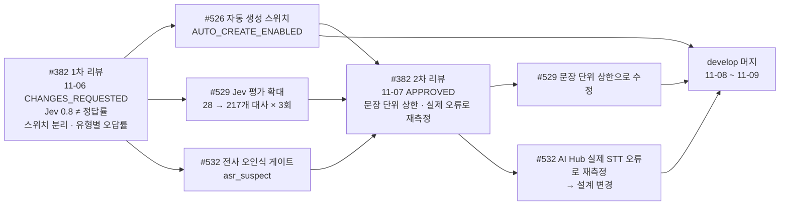

# 코드 리뷰 기록

주간 멘토 리뷰에서 받은 지적이 어떻게 반영되고 재리뷰로 확인됐는지, 대표 사례를 모았다. 팀원끼리 한 상호 리뷰 사례도 함께 적는다. 리뷰 원문은 각 PR 의 리뷰·인라인 스레드에 있다(`gh pr view <번호> --comments`, `gh api repos/{owner}/{repo}/pulls/<번호>/comments`로 확인, 2026-11-09).

## 리뷰 체계 요약

| 구분 | 대상 | 리뷰어 | 방식 |
|---|---|---|---|
| 멘토 리뷰 | 주간 `main` 대상 PR | minsang0850 | 1차 CHANGES_REQUESTED(🔧 고칠점 · 🤔 고민 · 👍 잘한점, 심각도 HIGH/MEDIUM/LOW) → 팀 반영 → 2차 재리뷰에서 반영 표와 함께 APPROVED |
| 상호 리뷰 | `develop` 대상 PR | 팀원 | 인라인 `[권장]`·`[질문]`·`[사소]`·`[nit]` → 작성자가 "반영했습니다 (커밋)" 답글 |

멘토는 매 리뷰 끝에 **무엇을 검증했고 무엇은 검증하지 않았는지**(CI 실행 번호와 통과 수, 실행하지 않은 로컬·운영 E2E)를 적었다. 팀도 PR 본문에 "돌리지 못한 것"을 같은 방식으로 적었다.

> 📷 **사진 자리**: #382 멘토 2차 리뷰의 "1차 지적 반영" 표 화면 (파일: ../assets/collab-review-382-table.png)

---

## 사례 1. #382 auto 개방 기준 → #526 · #529 · #532 (대표 사례)

13주차 main PR #382. 자동 생성(auto)을 언제 열지에 대한 지적이 세 개의 후속 PR 로 나뉘어 반영되고, 재리뷰에서 다시 방향을 받은 흐름이다.

### 지적 요지 (1차, 2026-11-06)

- 운영은 Jev 키 없이 review/hold 를 유지하는 쪽을 권한다.
- **0.8 은 정답률 80% 가 아니라 "원문에 명시됐나"에 대한 모델 판정값**이다.
- 자동 생성과 검증 실행을 별도 스위치로 나누고, PM 수정·반려율과 auto 후보 오답률을 유형별로 본 뒤 단계적으로 열 것.

### 반영

| PR | 작성자 | 반영 내용 | 결과 |
|---|---|---|---|
| #526 | Y-Jimin | BE 에 `AUTO_CREATE_ENABLED` 추가. 끄면 auto 새 항목을 review 로 내리되 근거 상태는 그대로 저장하고 "켰으면 auto 였을 항목"을 로그로 남긴다. 기본값은 켜짐(배포만으로 동작이 바뀌지 않게) | 2026-11-08 머지 |
| #529 | Y-Jimin | Jev 근거 판정 평가를 28 → 217개 대사(정답 False 56%, 유형 A~H)로 늘려 실제 Jev 로 3회(651회 호출). 판정 로직·기준값은 바꾸지 않음. 0.8 유지 | 2026-11-09 머지 |
| #532 | Y-Jimin | 근거 문장이 잘못 전사되면("진도" → "짐도") Jev 가 그대로 certain 을 줄 수 있다. 제목 명사 중 워크스페이스 용어 목록에 없는 말을 Jev 로 확인하고, 의심되면 `asr_suspect` 사유로 auto 만 막는다 | 2026-11-09 머지 |

팀은 #382 대화 탭에 반영 내용을 정리해 답했고(2026-11-07), 여기서 "3/249 = 1.2%, 95% 상한 3.5%"처럼 실행 단위로 계산한 수치를 보고했다.

### 재리뷰 (2차, 2026-11-07, APPROVED)

| 멘토 의견 | 팀 대응 |
|---|---|
| 👍 기준값을 지키는 평가가 아니라 틀리는 유형을 찾는 평가로 넓혔다 | — |
| 🤔 3회 반복은 독립 표본이 아니다. 문장 기준으로 다시 계산하면 할 일 1/83(상한 약 6.5%), 마감 1/44(상한 약 12%) | #529 를 문장 단위로 고쳐 머지. 반복은 흔들림 측정에만 쓴다 |
| 🤔 새 189개는 합성이다. 실제 회의 전사 문장을 섞어 볼 것 | 후속 `[확인 필요: 반영 여부]` |
| 🤔 #532 는 맞는 방향. `task_status` 를 낮추지 않고 별도 사유로 막은 설계에 동의. 다만 93% 는 자모 하나를 바꾼 합성 오류로 잰 값이니 실제 STT 오류로 다시 잴 것 | #532 를 AI Hub 회의 음성(KconfSpeech 1,397발화) + 운영 STT 로 다시 쟀더니 처음 구현은 명사 오류의 **14%** 만 잡았다. 설계를 "용어 목록 + Jev 확인"으로 바꿔 **47%** (맞는 발화 막음 19%)로 올렸다. 결정 기록 [0051](https://github.com/kakaotechcampus-4/ktc4-kyungpook-3/blob/develop/ai/docs/basis_for_decision/ai/2026-11-07-0051-asr-suspect-gate.md) |
| 🤔 외래어 오탐은 워크스페이스 태스크 제목 전체를 용어로 쓰면 줄어든다 | #532 에 BE 워크스페이스 용어(`workspace_asr_term`, PM 승인 제목 큐)를 더함 |
| 🤔 #526 기간에 "켰으면 auto 였을 항목"에 `asr_suspect` 여부를 같이 남겨 PM 수정 비율을 비교할 것 | 팀이 하겠다고 답함 `[확인 필요: 구현 여부]` |
| 🔧 LOW PR 본문을 재리뷰 범위에 맞춰 갱신 | 같은 날 본문에 "추가분"과 "배포 전 확인" 절 추가 |
| 승인 전제: 세 PR 이 머지되기 전에는 운영 `.env` 에 `JEV_API_KEY` 를 넣지 않는다 | 팀 공유하겠다고 답함 |

**얻은 것**: "평가 숫자가 좋다"에서 멈추지 않고 표본 독립성·합성 데이터 편향을 짚어 준 덕에, #532 는 실제 데이터로 재측정해 설계 자체를 바꿨다.

---

## 사례 2. #382 1차 인라인 지적 → 4개 수정 PR

같은 #382 1차 리뷰의 인라인·기존 미해결 지적이다. 파트가 다른 네 사람이 나눠 반영했고, 2차 리뷰에서 멘토가 표로 확인했다.

| 지적 | 심각도 | 반영 PR | 작성자 | 2차 리뷰 확인 내용 |
|---|---|---|---|---|
| 병합된 담당자의 근거 화자 | 🔧 HIGH | #421 | dw021213 | 담당 발화가 오면 근거·화자를 그 발화로 옮긴다 |
| claim 직전 수신자 연결 확인 | 🔧 HIGH | #416 | wkddnjswns | 연결이 끊긴 수신자의 메시지만 `DISCORD_NOT_LINKED` 로 닫는다 |
| 수정 승인 대기를 반영 완료와 구분 | 🔧 HIGH | #442 | hotpringles | `approval_status=approved` 일 때만 반영으로 본다 |
| 저장된 전사와 추출 근거 연결 | 🔧 MEDIUM | #422 | dw021213 | `evidence_seqs` 가 `/sources` 번호와 같고 BE 상한 100 에 맞췄다 |
| 웹 업로드를 AI 가 가져오는 연결 | 🤔 | #289·#326·#343·#389 | letsgojh | job_id 를 `intake.json` 에 남겨 재시작 때 이어 조회 |
| 대화 하나의 답장 범위 | 🤔 | — | — | 팀 결정으로 남김 |

**결과**: 2차 리뷰 "현재 HEAD 에서 병합을 막을 결함은 찾지 못했다" → APPROVED.

---

## 사례 3. #128 재시도 결과 선택 → #230 → #570 (여러 주에 걸친 지적)

| 시점 | 내용 |
|---|---|
| #128 (8주차, 2026-10-01) | 🤔 실패한 finding 부터 다시 처리하는 쪽을 권함. 인라인: 항목 수로 재시도 결과를 고르는 문제. 2차 승인 때도 "기존 세 건(회의 안 번복, 잘못된 날짜의 조용한 누락, 항목 수로 재시도 결과 선택)은 후속 수정 대상으로 유지" |
| #230 (10주차, 2026-10-15) | 같은 회의 합치기가 좋아져 항목 수가 줄어든 재시도 결과를 "항목이 많은 결과 우선" 정책이 버릴 수 있다고 다시 짚고 #217 을 연결 |
| #570 (dw021213, 2026-11-09 머지) | 판단 결과에 근거 문장 번호를 싣고, 다시 돌린 결과를 실행 하나가 아니라 **얘기(근거 번호가 겹치는 결과) 단위로 합친다**. BE 계약은 그대로 |
| #580 (dw021213) | 1단계 추출 실패를 그 자리에서 한 번 더 부른다(머지) |

**얻은 것**: 한 번에 고치지 못한 지적도 멘토가 매주 "아직 남은 항목"으로 추적했고, 팀은 이슈(#217)로 이어 받아 결국 닫았다.

---

## 사례 4. #239 승인 뒤 head 이동 → #300 release 브랜치

| 단계 | 내용 |
|---|---|
| 문제 | 11주차 #239 는 head 가 `develop` 이라, 10/31 승인 뒤 develop 에 머지된 작업이 확인 없이 PR 에 붙었다 |
| 반영 | 승인 커밋 `3970dda` 를 가리키는 `release/week11` 로 #300 을 다시 올림. 본문에 포함 머지 목록과 "head SHA 만 확인해 달라"를 적음 |
| 재리뷰 | 멘토가 같은 SHA 를 확인하고 승인. 남은 지적(auto 근거 상태, 담당자 출처·중복, Notion 복구 절차)은 "해결됐다는 뜻은 아니다"라며 목록으로 다시 남김 |
| 결과 | 2026-11-04 #300 머지, #239 닫음. 브랜치 전략에 `release/weekN` 도입([브랜치 전략](branch-strategy.md#3-release-브랜치를-도입한-이유)) |

이 사례에서 남은 지적 중 "담당자 출처"는 #241(hwnv, `evidence_seqs` 연결)과 #421 로, "auto 근거 상태"는 사례 1로 이어졌다.

---

## 상호 리뷰 사례

### A. #526 자동 생성 스위치 — 리뷰어 hwnv (BE), 작성자 Y-Jimin (AI)

AI 담당이 BE 코드를 고친 PR 을 BE 담당이 리뷰했다.

| 지적 | 반영 |
|---|---|
| [권장] 끔 값 4개만 알아보고 나머지는 켜짐으로 읽는다. 안전장치인데 `flase` 같은 오타면 조용히 auto 가 열린다 | 켬 값만 켜짐으로, 모르는 값은 꺼짐 + 값마다 warning 1회 (f0625bdb) |
| [권장] 로그에 항목 ID 가 없어 PM 결과와 항목 단위로 맞추기 어렵다 | `db.flush()` 뒤로 옮겨 `extraction_id`·`item_id` 를 싣는다 (f0625bdb) |
| [사소] `docker compose restart` 는 env_file 을 다시 읽지 않는다 | 결정 기록·`.env.example`·docstring 에 `up -d` 로 다시 만든다고 명시 (5b08cc06) |
| [사소] legacy auto 가 켜짐에서 실제로 auto 가 되는지 단언이 없다 | 켜짐 테스트 추가 (f0625bdb) |

### B. #533 다른 회의 같은 항목 합치기 — 리뷰어 Y-Jimin·hwnv, 작성자 wkddnjswns (BE)

| 지적 | 반영 |
|---|---|
| [질문] Y-Jimin: 담당자 변경이 아닌 merge 항목도 별칭을 찾아 해결 대기 목록에 쌓인다 | merge 이면서 category 가 assignee 가 아니면 담당자 필드를 보지 않음 (ab4aa08e) |
| [사소] hwnv: 잠금 쿼리에 워크스페이스 조건이 없어 다른 워크스페이스 승인이 기다릴 수 있다 | `workspace_id` 조건 추가, 조건을 빼면 실패하는 테스트 (4b0af395) |
| [질문] hwnv: 찾아 둔 담당자를 지우는 합치기가 hold 가 아니라 review 가 된다 | 카드 gate 를 hold 로 올림. AI `_merge_into` 와 규칙을 같게 유지 (24c4cae5) |
| [nit] Y-Jimin: 못 찾은 담당자 원문이 사라지고 hold 도 풀린다 | 원문과 hold 를 그대로 둠 (fab43f88) |

**공통 관찰**: 지적마다 "반영했습니다 (커밋 해시)"로 답하고, 반영 방식을 고른 이유와 추가한 테스트를 함께 적었다. 반영하지 않거나 다른 방법을 고를 때도 이유를 남겼다(예: #532 에서 BE 가 아니라 AI 쪽에서 50개로 자름).

> 📷 **사진 자리**: #533 인라인 스레드에서 지적 → "반영했습니다 (커밋)" 답글이 이어진 화면 (파일: ../assets/collab-review-533-thread.png)

## 관련 문서

- [브랜치 전략](branch-strategy.md)
- [그라운드룰 — 리뷰 응답 규칙](ground-rules.md#4-리뷰-응답-규칙)
- [AI 에이전트 운영 규칙 — ai-pr-reply](ai-agent-rules.md#4-ai-파트-하네스-mm-harness)
