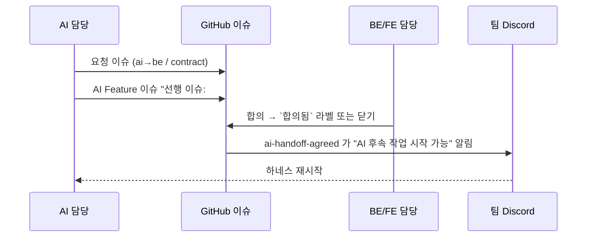

# 그라운드룰

팀이 지킨 일하는 방식을 정리한다. 저장소 문서·워크플로·라벨로 확인한 규칙과, PR 기록에서 반복해서 관찰된 관행을 구분해 적는다.

## 1. 파트 배치와 역할

| 파트 | 인원 | 책임 범위 | 진입 문서 |
|---|---|---|---|
| AI | 3 (dw021213, Y-Jimin, letsgojh) | 녹음 봇·워커, 전사(STT), 할 일 판단(judge), 초안, BE 인계 | [ai/README.md](../../ai/README.md) |
| Backend | 2 (wkddnjswns, hwnv) | API·DB, 매칭·게이트·승인, Notion 동기화, 리마인드, 배포 | [backend/README.md](../../backend/README.md) |
| Frontend | 1 (hotpringles) | 웹 화면 전체, 디자인 시스템, 접근성, 모바일·PWA | [frontend/README.md](../../frontend/README.md) |
| 멘토 | 1 (minsang0850) | 주간 `main` 대상 PR 리뷰 | — |

- 파트 경계는 코드 경로(`ai/`, `backend/`, `frontend/`)로 나눈다. 다른 파트 코드를 고치는 PR 은 그 파트 담당에게 리뷰를 요청한다(예: AI 담당이 BE 코드를 고친 #526·#532 본문의 "BE 담당 리뷰 부탁").
- AI 는 BE 와 HTTP API 로만 이야기한다(`ai/CLAUDE.md` 규칙 3). 파트 경계를 코드 구조로도 지킨다.
- 공식 역할표 문서는 없다. 위 배치는 커밋·PR 기록 기준이다 `[확인 필요]`.

## 2. 파트 간 계약과 요청

### 계약 문서

| 경계 | 대표 계약 | 비고 |
|---|---|---|
| AI ↔ BE | [backend-ai-contract.md](../../backend/docs/contracts/backend-ai-contract.md) | 회의·발화·추출·업로드·봇 API, 오류 코드, 합의 상태 |
| 웹 ↔ BE | [frontend-api-contract.md](../../frontend/docs/contracts/frontend-api-contract.md) | 화면용 API |
| 공유 타입 | [ai/shared/schemas.py](../../ai/shared/schemas.py) | BE 와의 계약. 바꾸면 계약 문서도 함께 고친다 |

- 계약은 대표 문서 중심으로 갱신하고 **구현 사실과 합의 상태를 구분**한다([공통 규칙](../agent-rules.md) "개발 후 기록").
- 계약 갱신은 팀 스킬 `contract-update` 로 한다([AI 에이전트 운영 규칙](ai-agent-rules.md)).

### 요청 문서와 라벨

다른 파트에 일을 부탁할 때는 이슈와 요청 문서를 함께 쓴다.

| 수단 | 쓰임 |
|---|---|
| `<part>/docs/requests/*.md` | 요청·수신 파트, 배경, 요청 작업, 완료조건, 처리 상태. 예: [bot-restart-lock.md](../../backend/docs/requests/bot-restart-lock.md)(BE 배포 → AI 녹음 봇). AI 쪽은 [ai/docs/request/](../../ai/docs/request/) |
| 라벨 `ai→be` | AI 작업에서 생긴 BE 전달·요청 |
| 라벨 `ai→fe` | AI 작업에서 생긴 FE 전달·요청 |
| 라벨 `contract` | 파트 간 API·데이터 계약 변경 |
| 라벨 `합의됨` | 파트 간 합의가 끝난 이슈. AI 하네스가 선행 이슈 확인에 쓴다 |

- 워크플로 [`ai-handoff-agreed.yml`](../../.github/workflows/ai-handoff-agreed.yml): 위 세 라벨 중 하나가 붙은 이슈에 `합의됨` 이 붙거나 이슈가 닫히면, 그 이슈를 "선행 이슈"로 적어 둔 열린 AI 요청 이슈를 찾아 팀 Discord 에 "AI 후속 작업 시작 가능"을 알린다.
- 하네스는 사용자 PC 세션에서 돌아 웹훅이 직접 깨울 수 없다. 사람이 알림을 보고 다시 시작한다(워크플로 주석).

## 3. 기록 의무

출처: [공통 에이전트 규칙](../agent-rules.md), [문서 안내](../README.md). 사람과 에이전트 모두 따른다.

| 기록 | 위치 | 언제 | 누가 |
|---|---|---|---|
| 결과 | `<part>/docs/plan/mN/result.md` | 의미 있는 개발 뒤. 파트 README 의 마일스톤 상태도 갱신 | 에이전트 |
| 결정 근거 (basis-for-decision) | `<part>/docs/plan/mN/basis-for-decision/`, AI 는 [ai/docs/basis_for_decision/](../../ai/docs/basis_for_decision/) | 여러 선택지 중 하나를 고를 때 | 에이전트·사람 |
| 계약 | `<part>/docs/contracts/` | 인터페이스 변경 때 | 에이전트 |
| 트러블슈팅 | `<part>/docs/plan/mN/trouble-shooting/` | 문제를 겪은 사람이 | **사람만** |
| 이슈 단위 결과(FE) | `frontend/docs/issues/<번호>-<이름>/result.md` | 마일스톤 밖 이슈 작업 | 에이전트 |

- 파일명은 `YYYY-MM-DD-<slug>.md`. AI 결정 기록은 `YYYY-MM-DD-NNNN-<slug>.md` 로 번호를 이어 쓴다([ai/docs/README.md](../../ai/docs/README.md)).
- 전체 개발 계획(`frontend-plan.md`, `backend-plan.md`, `ai/docs/plan/전체 계획.md`)은 보호 문서다. 에이전트는 고치지 않는다.
- 트러블슈팅은 에이전트가 읽고 정리안만 제시한다(`troubleshooting-review` 스킬). 원본 반영은 사람이 한다.
- 빈 결과나 가상의 기록을 미리 만들지 않는다. 검증하지 않은 것을 완료로 적지 않는다.

## 4. 리뷰 응답 규칙

문서화된 규칙과 관찰된 관행을 나눠 적는다.

| 구분 | 내용 | 근거 |
|---|---|---|
| 규칙 | 재리뷰 요청 PR 은 본문 "지난 리뷰 반영" 절에 어떤 피드백을 어디서 반영했는지, 반영하지 않은 것은 이유를 적는다 | [PR 템플릿](../../.github/pull_request_template.md) |
| 규칙 | 멘토 리뷰용 PR 은 "리뷰에서 봐주셨으면 하는 곳"을 구체적으로 쓴다 | PR 템플릿 |
| 관행 | 인라인 지적마다 먼저 "확인했고 반영하겠습니다", 고친 뒤 "반영했습니다 (커밋 해시): 무엇을 어떻게" 로 답한다 | #526·#532·#533 리뷰 스레드 |
| 관행 | 반영하지 않을 때는 이유를 답글과 결정 기록에 남긴다(예: #532 에서 BE 가 아니라 AI 쪽에서 50개로 자르기로 한 이유) | #532 |
| 관행 | 리뷰 반영 커밋은 제목에 `리뷰 반영 -` 을 붙인다. develop 최근 커밋 2,000개 중 378개 | `git log`, 2026-11-09 |
| 관행 | 팀 결정이 필요한 지적은 "팀 결정으로 남김"으로 표시하고 다음 리뷰에서 상태를 표로 보고한다 | #382 2차 리뷰 표, #239 본문 |
| 도구 | CodeRabbit 은 코멘트로 요청할 때만 리뷰한다 | #113 |

AI 파트는 이 응답 과정을 하네스 `ai-pr-reply` 로 돌린다([AI 에이전트 운영 규칙](ai-agent-rules.md#4-ai-파트-하네스-mm-harness)).

## 5. 커뮤니케이션

| 채널 | 무엇을 | 근거 |
|---|---|---|
| 팀 Discord — 한 줄 알림 | 이슈·PR 열림·닫힘, `main` 이 아닌 PR 의 리뷰·코멘트. 봇(CodeRabbit 등) 이벤트는 거른다 | [`team-notify.yml`](../../.github/workflows/team-notify.yml) (#122) |
| 팀 Discord — 하루 두 번 보고 | 09시·21시 KST, 열린 PR·머지된 PR 목록. 예약 누락에 대비해 세 번 걸고 먼저 돈 실행만 보낸다 | [`team-digest.yml`](../../.github/workflows/team-digest.yml) |
| 팀 Discord — 멘토 리뷰 | `main` 대상 PR 의 리뷰 요청·리뷰 결과 | [`notify-discord.yml`](../../.github/workflows/notify-discord.yml) (운영진 배포 파일) |
| 팀 Discord — 파트 간 합의 | 선행 이슈 합의 시 AI 후속 작업 알림 | [`ai-handoff-agreed.yml`](../../.github/workflows/ai-handoff-agreed.yml) |
| GitHub 이슈·PR | 설계 확정은 이슈 댓글로 남긴다(예: #141 설계 확정 댓글을 #533 본문이 링크) | #533 |

- 알림 워크플로에는 `concurrency` 를 넣지 않는다. 대기하던 실행이 취소되면 그 알림이 사라지기 때문이다(워크플로 주석).
- 정기 회의 일정·방식은 저장소로 확인하지 못했다 `[확인 필요]`.

> 📷 **사진 자리**: team-digest 의 아침 보고 메시지 예시 (파일: ../assets/collab-team-digest.png)

## 관련 문서

- [AI 에이전트 운영 규칙](ai-agent-rules.md)
- [브랜치 전략](branch-strategy.md)
- [코드 리뷰 기록](code-reviews.md)
