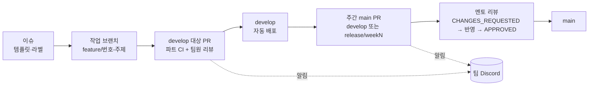

# 협업 문서

6명이 세 파트(AI·Backend·Frontend)로 나눠 한 저장소에서 일한 방식을 정리한다. 그라운드룰, AI 코딩 에이전트 운영 규칙, 브랜치 전략, 코딩 컨벤션, 코드 리뷰 기록으로 나눴다.

## 팀 구성

GitHub 아이디 기준이다. 커밋·PR·변경 경로로 추정한 파트 배치이고, 공식 역할표 문서는 저장소에 없다 `[확인 필요]`. 근거: [프로젝트 상세 설명 §2.1](../프로젝트%20상세%20설명.md#21-팀-구성-github-아이디-기준).

| 파트 | GitHub 아이디 | 주로 맡은 일 |
|---|---|---|
| AI | dw021213 | 녹음 봇·워커, STT·GPU 폴백, 리마인드 DM·답장 판단, 근거 seq. BE 리마인드 스케줄러·카카오 로그인에도 참여 |
| AI | Y-Jimin | legacy 추출, Jev 근거 검증, 전사 오인식 검사, auto 스위치(#526, #532), 채팅 수집, 주간 멘토 리뷰 PR 작성과 대응 |
| AI | letsgojh | judge 핵심(Terra 1단계, final_judge, Luna 초안, 오케스트레이터), 웹 업로드(수동 업로드) 파이프라인 |
| Backend | wkddnjswns | API·DB 이관(SQLite→PostgreSQL), Notion 동기화, 메시지·리마인드 API, CI/CD·배포 |
| Backend | hwnv | 업로드 API, Notion OAuth, 녹음 재생 연결, 담당자 별칭 매칭 |
| Frontend | hotpringles | 프론트엔드 전체(M0~M8), 디자인 시스템, 접근성, 모바일 |
| 멘토 | minsang0850 | 주간 `main` 대상 PR 리뷰 |

규모(2026-11-07 조사): 커밋 약 2,500개, 머지된 PR 257건, 첫 커밋 2026-08-20. 머지 PR 작성자 분포는 hotpringles 85, wkddnjswns 52, letsgojh 46, dw021213 43, Y-Jimin 20, hwnv 11.

## 쪽 목록

| 쪽 | 내용 |
|---|---|
| [그라운드룰](ground-rules.md) | 파트 배치, 파트 간 계약·요청, 결정 기록 의무, 리뷰 응답 규칙, Discord 알림 |
| [AI 에이전트 운영 규칙](ai-agent-rules.md) | Claude Code·Codex 를 팀 규칙으로 관리한 방식, 팀 스킬, AI 파트 하네스, AI 기록과 사람 기록의 구분 |
| [브랜치 전략](branch-strategy.md) | 작업 브랜치 → develop → (release/weekN) → main, 브랜치 이름 규칙 |
| [코딩 컨벤션](conventions.md) | 파트별 lint·포맷, 커밋 메시지, PR 제목·본문, 이슈 템플릿, CODEOWNERS |
| [코드 리뷰 기록](code-reviews.md) | 주간 멘토 리뷰의 지적 → 반영 → 재리뷰 사례, 팀원 상호 리뷰 사례 |

## 한눈에 보는 협업 흐름

> 📷 **사진 자리**: 팀 Discord 채널에 PR·리뷰 알림이 쌓인 화면 (파일: ../assets/collab-discord-notify.png)

## 관련 문서

- [공통 에이전트 규칙](../agent-rules.md)
- [문서 안내](https://github.com/kakaotechcampus-4/ktc4-kyungpook-3/blob/develop/docs/README.md)
- [프로젝트 상세 설명 §2 팀과 협업 방식](../프로젝트%20상세%20설명.md#2-팀과-협업-방식)
