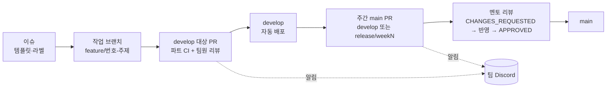

# 협업 문서

6명이 세 파트(AI·Backend·Frontend)로 나눠 한 저장소에서 일한 방식을 정리한다. 그라운드룰, 브랜치 전략, 코딩 컨벤션, 코드 리뷰 기록으로 나눴다. 리뷰는 팀원이 PR 에 직접 코멘트를 달고, 작성자가 반영한 뒤 파트 안에서 머지했다.

## 팀 구성

GitHub 아이디 기준이다. 팀 역할은 팀 노션의 "1인 1역 정하기"에서 정한 것이고, 맡은 일은 커밋·PR·변경 경로로 확인했다. 근거: [프로젝트 상세 설명 §2.1](../프로젝트%20상세%20설명.md#21-팀-구성-github-아이디-기준).

| 파트 | GitHub 아이디 | 팀 역할 | 주로 맡은 일 |
|---|---|---|---|
| AI | Y-Jimin | 팀장(PM) | legacy 추출, Jev 근거 검증, 전사 오인식 검사, auto 스위치(#526, #532), 채팅 수집, 주간 멘토 리뷰 PR 작성과 대응 |
| AI | letsgojh | AI 리드 | judge 핵심(Terra 1단계, final_judge, Luna 초안, 오케스트레이터), 웹 업로드(수동 업로드) 파이프라인 |
| AI | dw021213 | 플래너 | 녹음 봇·워커, STT·GPU 폴백, 리마인드 DM·답장 판단, 근거 seq. BE 리마인드 스케줄러·카카오 로그인에도 참여 |
| Backend | wkddnjswns | BE 리드 | API·DB 이관(SQLite→PostgreSQL), Notion 동기화, 메시지·리마인드 API, CI/CD·배포 |
| Backend | hwnv | 메이커 | 업로드 API, Notion OAuth, 녹음 재생 연결, 담당자 별칭 매칭, Grafana 모니터링 |
| Frontend | hotpringles | FE 리드 | 프론트엔드 전체(M0~M8), 디자인 시스템, 접근성, 모바일 |
| 멘토 | minsang0850 | | 주간 `main` 대상 PR 리뷰, 기술 멘토링 |

규모(2026-11-11 조사, GitHub GraphQL 과 `git log`):

| 항목 | 값 |
|---|---|
| 첫 커밋 | 2026-08-20 |
| 비머지 커밋 | 3,136개. 그중 제목에 "리뷰 반영"이 있는 커밋 499개 |
| 머지된 PR | 395건 (`develop` 383, `main` 8, 그 밖 4) |
| `main` 밖 머지 PR 작성자 | hotpringles 146, dw021213 79, wkddnjswns 71, letsgojh 47, Y-Jimin 28, hwnv 16 |
| 멘토 리뷰 | `main` PR 9건에 멘토 인라인 코멘트 218개(멘토 답글까지 222개). 매주 변경 요청 뒤 재리뷰 |
| 팀 상호 리뷰 | `develop` 머지 PR 133건에 다른 팀원의 리뷰, 인라인 코멘트 474개 |

## 쪽 목록

| 쪽 | 내용 |
|---|---|
| [그라운드룰](ground-rules.md) | 파트 배치, 파트 간 계약·요청, 결정 기록 의무, 리뷰 응답 규칙, Discord 알림 |
| [브랜치 전략](branch-strategy.md) | 작업 브랜치 → develop → (release/weekN) → main, 브랜치 이름 규칙 |
| [코딩 컨벤션](conventions.md) | 파트별 lint·포맷, 커밋 메시지, PR 제목·본문, 이슈 템플릿, CODEOWNERS |
| [코드 리뷰 기록](code-reviews.md) | 주간 멘토 리뷰의 지적 → 반영 → 재리뷰 사례, 팀원 상호 리뷰 사례 |

## 한눈에 보는 협업 흐름

## 관련 문서

- [팀 노션 페이지](https://app.notion.com/p/elice-track/3-MANAGER-3bb2bb98425780ce8568e784af0f0229): 위클리 보고서, 회의록, 요청 문서, To-Do 와 트러블슈팅 로그의 원본
- [문서 안내](https://github.com/kakaotechcampus-4/ktc4-kyungpook-3/blob/develop/docs/README.md)
- [프로젝트 상세 설명 §2 팀과 협업 방식](../프로젝트%20상세%20설명.md#2-팀과-협업-방식)
