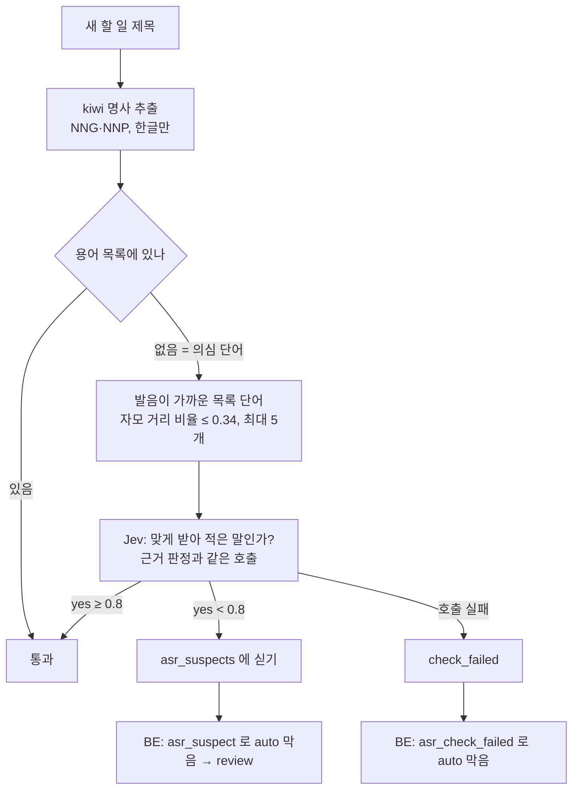

# 전사 오인식 검사

STT 가 "진도"를 "짐도"로 잘못 받아 적으면, 근거 원문에도 "짐도"가 있으니 Jev 근거 검증은 `certain` 을 준다. 그대로면 틀린 제목이 PM 확인 없이 보드에 들어간다. 이 검사는 새 할 일 제목의 명사가 맞게 전사됐는지를 따로 보고, 의심이 남으면 auto 를 막는다. 코드는 [`ai/judge/asr_check.py`](../../../ai/judge/asr_check.py), 결정은 [0051](../../../ai/docs/basis_for_decision/ai/2026-11-07-0051-asr-suspect-gate.md)(#532).

멘토 리뷰(#382) 1번 "원문 명시 여부와 태스크 신뢰도는 별개다"에 대한 한 가지 답이다.

## 입력

| 입력 | 내용 |
|---|---|
| 새 할 일 제목 | Luna 초안의 제목. 실제로 틀리게 나가는 결과물이라 제목만 본다(근거 문장의 오인식을 초안이 이미 고쳤으면 막지 않는다) |
| 근거 원문 | Jev 가 문맥을 볼 발화 줄 |
| 용어 목록 | 아래 6가지의 합집합 |

### 용어 목록 (목록에 있는 명사는 의심하지 않는다)

| 출처 | 내용 | 코드 |
|---|---|---|
| 공통 명사 | kiwi 형태소 번호 상위 `MM_ASR_SEED_NOUNS`(기본 1000) 중 한글 명사. 번호는 대체로 빈도 순 | `seed_nouns()` |
| 정적 업무 용어 | [`judge/asr_terms.txt`](../../../ai/judge/asr_terms.txt) (배포, 회의록 등 할 일 제목에 흔한 업무 명사) | `load_terms()` |
| 같은 회의에서 2명 이상이 말한 명사 | STT 는 한 사람의 같은 발음을 같은 꼴로 거듭 잘못 듣는다. 두 사람이 같은 꼴로 말했으면 맞게 들었을 가능성이 크다 | `team_nouns()` |
| 워크스페이스 용어 | BE `workspace_asr_term`. 지난 회의들의 "2명 이상 명사"와 PM 승인 제목의 명사가 쌓인다 | `_workspace_terms()` |
| PM 승인 제목 큐 | BE 가 task_create 승인 때 최종 제목(PM 이 고쳤으면 고친 제목)을 `asr_title_queue` 에 넣는다. BE 에는 형태소 분석기가 없어 AI 가 받아 명사를 뽑아 워크스페이스 용어로 올리고 큐에서 지운다 | `GET/POST /workspaces/{id}/asr-terms` |
| 팀원 이름·별칭 | BE 팀원 이름과 별칭 | `_member_words()` |

유사 검색에서 본 기존 태스크 제목의 명사도 더한다. 워크스페이스 용어에는 **검증된 말만** 들어간다. 오인식이 목록에 들어가 계속 통과하는 오염을 막기 위해서다.

## 처리

1. **1단계 의심 단어**: 제목 명사 중 목록에 없는 말.
2. **2단계 Jev 확인**: 의심 단어마다 "근거 원문에서 말한 사람이 실제로 한 말을 맞게 받아 적은 것인가?"를 묻고, 발음이 가까운 팀 용어를 후보로 함께 보여 준다. 근거 판정(task·due)과 **같은 Jev 호출**이라 호출 수가 늘지 않는다.
3. 검사하지 못하면 막는다. Jev 실패면 의심 단어가 있는 항목만, 분석기를 못 올리면 모든 새 항목이 `check_failed`. 워크스페이스 용어를 못 받으면 기본 목록으로 돈다(의심 단어가 늘 뿐 Jev 가 확인한다).

검사하지 않는 것: update 항목(항상 review), 채팅(전사를 거치지 않고 auto 도 열리지 않음).

## 출력

`asr_suspects: [{word, source, candidates}]` (선택 필드, 최대 50개).

| 값 | 뜻 | 게이트 |
|---|---|---|
| `[]` | 검사했고 의심 없음 | 영향 없음 |
| `null` | 옛 AI(필드 없음) | 영향 없음 |
| `source=title` 항목 | Jev 가 확인하지 못한 의심 단어와 교정 후보 | `asr_suspect` 로 auto 막음 |
| `source=check_failed` | 검사 못 함(`word` 빈 문자열) | `asr_check_failed` 로 auto 막음 |

이 검사는 auto 를 막기만 하고 열지 않는다. hold 는 그대로다. 확인 카드에 의심 단어·교정 후보를 보이는 화면은 FE 후속이다.

## 왜 이 방식인가

### 게이트에 싣는 방법

| 대안 | 결과 |
|---|---|
| **새 필드 `asr_suspects` (채택)** | 이유를 PM 에게 보일 수 있다. 선택 필드라 하위 호환 |
| 의심이면 `task_status` 를 inferred 로 낮춤 | 계약은 그대로지만 근거 상태가 Jev 판정이 아니게 되어 #529 평가와 운영 지표가 섞이고, 이유를 보일 수 없다 |

### 의심 단어를 찾는 방법: 첫 구현을 되돌린 이야기

| 대안 | 결과 |
|---|---|
| (2026-11-07 첫 구현) 형태소 분석기 미등록어 + 업무 용어와 자모 하나 차이. LLM 없이 코드만 | 합성 세트에서 93% 를 잡았지만, 실제 STT 오류로 재니 **14%** 였다 |
| **(2026-11-08 채택) 워크스페이스 용어 목록 밖 제목 명사를 Jev 로 확인** | 원래 설계. 첫 구현 때 BE 테이블·API 범위를 줄이려 빠졌고 그 이유를 기록하지 않았다. 실측에서 한계가 드러나 되돌렸다 |
| 일반 국어사전 단어 목록 | 실제 STT 오류 대부분이 사전에 있는 낱말이라 첫 구현과 같은 한계 |

## 어떻게 평가했나

### 첫 구현 합성 평가 (2026-11-07)

자모 하나를 바꿔 넣은 오류로 튜닝 세트와 **처음 보는 세트(holdout)** 를 나눠 쟀다. 처음 보는 세트에서 오류 93% 차단, 정상 10% 차단([`asr-check-tuning.json`](../../../ai/judge/eval_results/2026-11-07-asr-check-tuning.json), [`asr-check-holdout.json`](../../../ai/judge/eval_results/2026-11-07-asr-check-holdout.json)). 하지만 이 세트는 **검사기가 가정한 오류 모양**으로 만든 것이었다. 실제 STT 오류 발화의 97% 는 사전에 있는 낱말이라 이 수치는 실제를 대표하지 않았다.

### AI Hub 실제 STT 오류 (2026-11-08)

- 데이터: AI Hub 회의 음성 KconfSpeech D20(교육/일반, 스튜디오 방송) 10회의 중 4회의 **1,397발화(약 2시간)** 를 운영 STT(Elice)로 전사. 나머지 6회의 정답 대본에서 두 사람 이상이 말한 명사 727개를 "지난 회의"로 삼아 워크스페이스 용어 대신 썼다(재는 회의와 목록 회의를 분리).
- AI Hub 에는 태스크 제목이 없어 **발화의 명사를 제목 대신** 봤다. 전사 명사 중 정답에 없는 것이 있으면 "명사가 틀린 발화"(230개), 나머지 1,167개는 "명사가 맞는 발화".
- 방법: [`judge/eval_asr_real.py`](../../../ai/judge/eval_asr_real.py). Jev 응답 누락 0. 원문은 레포 밖, 숫자만 [`eval_results/2026-11-08-asr-real-kconfspeech.json`](../../../ai/judge/eval_results/2026-11-08-asr-real-kconfspeech.json).

| 방법 | 명사 오류 차단율 (95% 구간) | 정상인데 막은 비율 (오차단율) |
|---|---|---|
| 첫 구현(미등록어·자모 규칙) | 14% (32/230) | 10% (114/1167) |
| 새 설계, 1단계만(의심 단어 전부 막음) | 62% (56~68%) | 61% |
| 새 설계, Jev 기준 0.5 | 28% (22~34%) | 6% (5~7%) |
| 새 설계, Jev 기준 0.7 | 40% (34~47%) | 13% (11~15%) |
| **새 설계, Jev 기준 0.8 (채택)** | **47% (41~53%)**, 108/230 | **19% (17~21%)**, 222/1167 |
| 새 설계, Jev 기준 0.9 | 53% (47~60%) | 31% |

- 같은 오탐 수준(10% 안팎)에서 새 설계가 첫 구현보다 약 2.5배 더 잡는다. Jev 는 실제로 틀린 명사(yes 중앙값 약 0.64)와 맞는 명사(약 0.95)를 가른다.
- 기본 목록 크기 N 은 1단계 상한으로 정했다: N=0 64%, 1,000 62%, 10,000 34%, 50,000 14%. Jev 가 근거 판정과 같은 호출이라 비용 걱정 없이 작은 N 을 골랐다.
- 0.8 은 측정으로 고른 최적값이 아니다. 근거 판정 기준을 따른 잠정값이고, 같은 데이터로 다시 고르면 그 데이터에 맞춘 값이 되므로 운영 결과로 다시 정한다.
- [`asr_check.py`](../../../ai/judge/asr_check.py) 의 `YES_THRESHOLD` 주석에는 "명사 오류 43%·정상 16%"로 적혀 있어 위 결과 파일(47%·19%)과 다르다. 결정 기록 [0051](../../../ai/docs/basis_for_decision/ai/2026-11-07-0051-asr-suspect-gate.md) 의 채택 값도 47%(41~53%)·19%(17~21%)라 주석이 옛 값이다. 주석 수정은 AI 파트 몫이다.

## 한계와 다음 단계

- **절반 가까이 놓친다.** 흔한 명사(목록 안)로 틀린 오류는 1단계에서 빠지고, 동사·형용사 오류는 보지 않는다.
- **오차단 19% 는 발화 기준 값이다.** 발화가 제목보다 명사가 많아 실제 제목에서는 더 낮을 것으로 보지만 재지 않았다.
- **데이터가 교육 방송이다.** IT 회의의 외래어 분포와 다르다. 실제 IT 회의 전사(정답 대본 있음)로 다시 재야 한다.
- **초반에는 워크스페이스 용어가 비어** Jev 확인과 review 가 많다. 목록이 쌓이면 준다.
- **분석기가 문맥에 따라 다르게 쪼갠다**("핀테크볼트 연동" → 핀테크+볼트). 쪼갠 꼴이 목록에 없으면 의심 단어가 된다.
- **자원**: kiwi 를 처음 쓸 때 약 2초, 메모리 약 300MB(워커 MemoryMax 3G 안). 형태소 번호 순서에 기대므로 `kiwipiepy==0.24.1` 로 고정했다.
- 다음: 스위치를 끈 기간(`AUTO_CREATE_ENABLED=false`, 권고이며 운영값 [확인 필요])에 "켰으면 auto 였을 항목" 중 `asr_suspect` 로 막힌 쪽과 안 막힌 쪽의 PM 제목 수정 비율을 보고 `MM_ASR_YES_THRESHOLD`·`MM_ASR_SEED_NOUNS` 를 다시 정한다. PM 이 용어 목록을 보고 고치는 화면은 후속.
