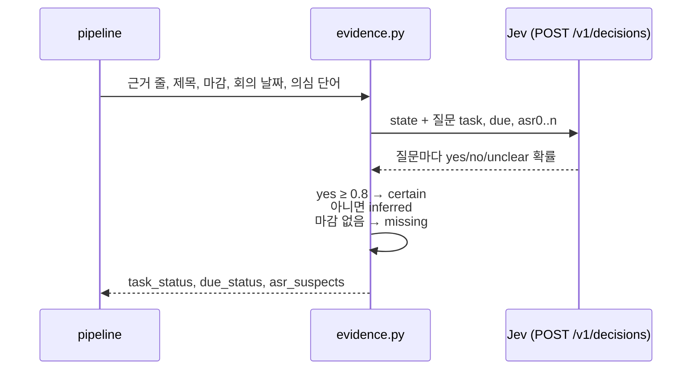

# 근거 검증 (Jev)

judge 새 항목마다 "할 일과 마감이 근거 원문에 명시됐나"를 값을 만든 모델이 아닌 판정 모델 Jev 에게 다시 묻는다. 결과 `certain / inferred / missing` 은 BE auto 조건의 핵심 입력이다. 코드는 [`ai/judge/evidence.py`](https://github.com/kakaotechcampus-4/ktc4-kyungpook-3/blob/develop/ai/judge/evidence.py), [`ai/jev.py`](https://github.com/kakaotechcampus-4/ktc4-kyungpook-3/blob/develop/ai/jev.py).

## 입력

| 입력 | 내용 |
|---|---|
| 근거 원문 | 1단계가 고른 근거 발화 줄(지시 → 수락처럼 여러 줄일 수 있다) |
| 할 일 | Luna 가 쓴 제목 |
| 마감 | Luna 가 계산한 날짜 + **그 날짜의 요일** + 원문 표현("금요일까지") |
| 회의 날짜 | 날짜와 요일("2026-11-02 (월요일)") |
| 의심 단어(선택) | [전사 오인식 검사](asr-check.md)의 질문. 같은 호출에 싣는다 |

## 처리

- Jev 는 Elice MLAPI 의 판정 API(`typesafe/jev-latest`)다. 문장을 생성하지 않고 정해 준 선택지마다 확률을 준다.
- 질문 두 개(할 일·마감)와 의심 단어 질문을 **한 번의 호출**로 묻는다.

| 질문 | yes | no | unclear |
|---|---|---|---|
| task | 하겠다는 약속·결정·지시가 원문에 명시 | 명시 안 됨, 부정·번복 | 조건부·질문·제안이라 확정 아님 |
| due | 원문의 마감 표현이 이 일의 마감이고, 계산하면 이 날짜 하나로 정해진다 | 원문에 없음, 다른 일의 날짜, 계산이 다름 | "~쯤", "이번 주 안에"처럼 날짜 하나로 안 정해짐 |

## 출력

| 값 | 뜻 | 게이트 영향 |
|---|---|---|
| `certain` | yes 확률 ≥ 0.8. "원문으로 확인됐다고 Jev 가 판단했다"는 뜻이지 정답일 확률이 아니다 | auto 가능(다른 조건도 만족해야) |
| `inferred` | 확인 못 함. 확률 미달, **호출 실패, 키 없음**도 여기 | `task_not_certain` / `due_not_certain` 으로 막음 |
| `missing` | 마감이 없다(날짜도 표현도 없음) | 마감 없음은 auto 를 막지 않는다. 날짜를 보냈는데 missing 이면 `due_mismatch` |

- Luna 가 마감을 뽑았는데 날짜 검증에서 걸러지면(과거 날짜 등) 표현만 남겨 `inferred` 로 둔다.
- update 항목과 legacy 경로에는 적용하지 않는다(update 는 항상 review).

## 왜 이 방식인가: 만든 모델이 스스로 채점하지 않게

LLM 에게 자기가 만든 값의 상태를 매기게 하면 거의 다 `certain` 이 나와 auto 조건이 의미를 잃는다(#232). 잘못된 certain 은 PM 확인 없이 틀린 Task 를 만들고, 잘못된 inferred 는 PM 이 한 번 더 볼 뿐이라 **두 오류의 비용이 다르다**.

| 대안 | 내용 | 결과 |
|---|---|---|
| A. 코드로 원문 대조 | 표현 목록·정규식·날짜 계산기로 확인 | 처음 구현했다가 버림. "14일까지"(월 없음), "맡아주세요"(목록 밖 지시)가 inferred, "아직 못 했습니다"(부정)가 certain 이 됐다. 말의 모양을 규칙이 따라가지 못한다 |
| **B. 별도 판정 질문 (채택)** | 값을 만든 뒤 다른 모델에 "원문에 명시됐나"를 묻는다 | 확률이 숫자로 와서 파싱이 필요 없다. 값을 만든 Luna 와 다른 모델이라 자기 답을 너그럽게 보는 위험이 줄어든다 |
| C. Luna 가 `ambiguous` 자기 표시 | #232 원안 | 거의 certain 이 나오는 문제를 그대로 가져 버림 |

- 기준 0.8: BE 의 담당자 확정 기준과 맞춘 값이다. Jev 의 `confidence` 는 계산식이 공개되지 않았고 고른 답(no 일 수도)에 대한 값이라, 방향이 분명한 yes 확률을 쓴다.
- 요일을 함께 준다: 첫 평가에서 Jev 가 "금요일까지"인데 토요일 날짜를 yes 0.82 로 통과시켰다. 요일을 넣은 뒤 같은 평가에서 잘못된 certain 0.
- 자세한 비교: [결정 0031](https://github.com/kakaotechcampus-4/ktc4-kyungpook-3/blob/develop/ai/docs/basis_for_decision/ai/2026-11-02-0031-evidence-status-by-source-check.md).

## 어떻게 평가했나

### 1차 (2026-11-03): 대사 19개 × 2회

잘못된 certain 0건, 할 일 37/38, 마감 22/24. 놓친 3건은 yes 0.78~0.79. 멘토 리뷰(#382)는 0.8 이 정답률이 아니라는 점을 짚었다. 19개 표본은 0건이어도 실제 비율의 95% 상한(Wilson)이 17%라 표본을 늘렸다.

### 2차 (2026-11-07, #529): 대사 217개 × 3회 = Jev 651회

- 데이터: [`judge/golden_set_evidence/`](https://github.com/kakaotechcampus-4/ktc4-kyungpook-3/tree/develop/ai/judge/golden_set_evidence) 기존 28개 + 189개. 유형 A~H(명시 약속+마감 30, 마감 없음 18, 확정 아님 40, 마감 문제 38, 여러 줄 21, 제목과 원문 불일치 12, 전사 잡음 15, 채팅체 15). 189개 중 106개(56%)는 정답이 False(auto 로 새면 안 되는 것).
- 방법: [`judge/eval_evidence.py`](https://github.com/kakaotechcampus-4/ktc4-kyungpook-3/blob/develop/ai/judge/eval_evidence.py). 3회 반복은 독립 표본이 아니므로 **대사 단위**로 센다(한 번이라도 틀리면 틀린 대사). 반복은 흔들림을 보는 데만 쓴다.
- 대사 라벨과 지표 계산은 [`tests/test_eval_evidence.py`](https://github.com/kakaotechcampus-4/ktc4-kyungpook-3/blob/develop/ai/tests/test_eval_evidence.py) 가 실제 API 없이 지킨다.

| 판정 (대사 단위) | 잘못된 certain (auto 로 새는 쪽) | 95% 상한 | 놓친 certain (PM 확인이 느는 쪽) |
|---|---|---|---|
| 할 일 | 1/83 = 1.2% | **6.5%** | 2/134 (재현율 98.5%) |
| 마감 | 1/44 = 2.3% | **11.8%** | 24/65 (재현율 63.1%) |

잘못된 certain 두 건은 3회 모두 같았다(흔들린 것이 아니라 일관되게 틀림).

- 할 일: "회의록 **템플릿**은 제가 만들게요" 인데 제목 "회의록 **작성**" 을 yes 0.94~0.99. 원문의 일과 제목의 일이 조금 다르면 못 가린다.
- 마감: "이십일 까지"(20일)를 11-21 로 계산한 것을 yes 0.81~0.84. 한글 숫자 날짜 계산을 놓친다.

기준값별(실행 단위 651회, 잘못된 certain / 놓친 certain):

| 기준값 | 할 일 | 마감 |
|---|---|---|
| 0.7 | 4 / 4 | 9 / 17 |
| 0.75 | 4 / 6 | 5 / 27 |
| **0.8 (지금)** | **3 / 6** | **3 / 55** |
| 0.85 | 3 / 19 | 0 / 84 |
| 0.9 | 3 / 32 | 0 / 124 |

- 할 일은 기준값을 올려도 잘못된 certain 이 남는다(0.97 로 확신). 기준값이 아니라 질문으로 풀 문제다.
- 마감은 0.85 에서 잘못된 certain 0 이지만 맞는 마감의 57% 만 certain 이 된다.
- 반복 사이에 판정이 바뀐 것은 11개, 모두 마감, yes 0.75~0.86 구간이다.
- 유형별로 확정 아님(C) 0/40(상한 8.8%), 마감 문제(D) 0/30(상한 11.4%). 잘못된 certain 은 F(1/12)와 G(1/7)에서만 나왔다.
- 결론: **0.8 유지.** 결과 요약 [`eval_results/2026-11-07-evidence-extended.json`](https://github.com/kakaotechcampus-4/ktc4-kyungpook-3/blob/develop/ai/judge/eval_results/2026-11-07-evidence-extended.json), 기록 [jev-evidence-eval-extended](https://github.com/kakaotechcampus-4/ktc4-kyungpook-3/blob/develop/ai/docs/basis_for_decision/ai/2026-11-07-jev-evidence-eval-extended.md).

### E2E (2026-11-07, PR #504)

실제 Jev → BE 까지 돌려 명시 마감 certain(yes 0.95) → auto 태스크 생성, 흐린 마감 inferred(unclear 0.88) → review, 마감 없음 → missing 을 확인했다([jev-evidence-e2e](https://github.com/kakaotechcampus-4/ktc4-kyungpook-3/blob/develop/ai/docs/basis_for_decision/ai/2026-11-07-jev-evidence-e2e.md)).

## 신뢰 상한을 어떻게 읽나

- 이 평가는 **"근거 원문에 명시됐나"를 재는 것이지 태스크가 맞는지의 정답률이 아니다**(멘토 리뷰와 같은 결론). 전사 자체가 틀린 경우는 [전사 오인식 검사](asr-check.md)가 따로 본다.
- 정답 False 대사가 할 일 83개, 마감 44개라 0건이 나와도 상한이 약 4.4%·8% 밑으로 내려가지 않는다.
- 그래서 auto 개방은 이 수치가 아니라 운영의 PM 승인·수정·반려 결과로 정한다. 처음 운영은 `AUTO_CREATE_ENABLED=false`(BE #526)로 검증만 돌리도록 권고했다. 코드 기본은 켜짐이고 운영 값은 [확인 필요]다.

## 한계와 다음 단계

- **합성 대사다.** 실제 회의 분포의 비율이 아니다. 실제 회의 전사에서 뽑은 문장을 섞은 표를 후속으로 낸다(#382 재리뷰).
- **회의 날짜가 월요일 하루뿐.** 다른 요일 기준의 상대 날짜는 재지 않았다.
- **기준 근처 흔들림.** yes 0.78 ↔ 0.82 처럼 실행마다 certain/inferred 가 갈린다.
- **Jev 운영 의존.** `JEV_API_KEY` 가 없거나 호출이 실패하면 모두 inferred 라 auto 가 열리지 않는다(안전 쪽 실패).
- **비용.** 새 항목마다 Jev 1회(응답 1초 안팎). Jev 단가는 확인하지 않았다 **[확인 필요]**.
- 후속 후보: 할 일 질문에 "제목의 일과 원문이 맡은 일이 같은가"를 더 분명히 묻기(F 유형), 한글 숫자 날짜를 질문 전에 숫자로 바꾸기. 질문을 바꾸면 이 평가를 다시 돌린다.
