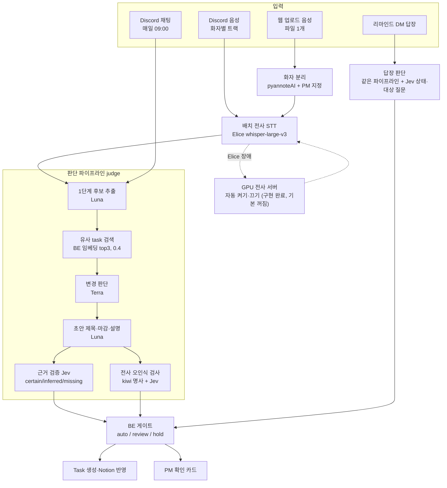

# AI 판단 심화

회의 음성·채팅·DM 답장을 받아 "무엇을 태스크로 만들지, 무엇을 PM 에게 물을지"를 정하는 AI 파트의 판단 로직을 푼다. 테크스펙([에이전트 설계](../../techspec/agent-design.md), [지표](../../techspec/metrics.md))은 결론과 수치만 적는다. 여기서는 왜 이렇게 만들었는지, 어떻게 평가했는지, 무엇이 아직 모자란지를 적는다.

## 이 쪽들을 읽는 법

- 기능마다 **입력 → 처리 → 출력 → 왜 이 방식인가 → 어떻게 평가했나** 순서로 쓴다.
- 수치에는 날짜·데이터·반복 횟수를 함께 적는다. 조건이 다른 수치끼리는 직접 비교하지 않는다.
- 세부 비교와 버린 선택지는 결정 기록(`ai/docs/basis_for_decision/`)에 있다. 여기서는 요약하고 링크한다.
- 평가는 합성 데이터와 대본 낭독 녹음으로 쟀다. 어떤 데이터로 쟀는지는 수치 옆에 적었다.

## AI 파트가 하는 일 한 장

AI 는 값과 근거 상태를 만들어 보낼 뿐, auto·review·hold 를 직접 정하지 않는다. 게이트는 BE 가 `auto_blockers` 로 정한다([판단 파이프라인](judge-pipeline.md#게이트-auto--review--hold)).

## 쪽 목록

| 쪽 | 다루는 것 | 멘토 심사에서 먼저 볼 곳 |
|---|---|---|
| [판단 파이프라인](judge-pipeline.md) | 후보 추출 → 유사 검색 → Terra → 초안 → 검증 → 게이트, legacy 와 judge 경로 | 값마다 출처 하나, 실패 두 갈래, 숫자 점수 대신 조건 게이트 |
| [근거 검증 (Jev)](evidence-check.md) | certain/inferred/missing, 만든 모델이 스스로 채점하지 않게 분리 | 217개×3회 평가, 잘못된 certain 비율과 95% 상한 |
| [전사 오인식 검사](asr-check.md) | 제목 명사 중 용어 목록 밖의 말을 Jev 로 확인, 남으면 auto 금지 | 첫 구현의 합성 93% 가 실제 14% 였던 이야기, AI Hub 실측 47%·19% |
| [리마인드 답장 판단](reply-judgment.md) | 재촉 DM 답장 → 상태·마감·담당 변경 줄, 자동 반영 조건 | 합성 30건 평가, 판단 창(#552) |
| [전사 (STT)](stt.md) | Elice vs 로컬 vs GPU, 화자 분리, CER 비교, GPU 자동 전환(#581, 구현 완료·기본 꺼짐) | 서버 용량 측정, 업체 비교, LoRA 미채택 |

## 공통 원칙 (모든 쪽에 해당)

| 원칙 | 왜 | 어디서 |
|---|---|---|
| 값마다 출처가 한 곳 | 담당자·근거는 1단계, 새 항목/수정·대상·상태는 Terra, 제목·마감·설명은 Luna, 근거 상태는 Jev. 문제가 생기면 어느 단계를 고칠지 바로 안다 | [`ai/judge/pipeline.py`](https://github.com/kakaotechcampus-4/ktc4-kyungpook-3/blob/develop/ai/judge/pipeline.py) 머리 주석 |
| 값을 만든 모델이 스스로 채점하지 않는다 | LLM 이 자기 결과를 평가하면 거의 다 certain 이 된다(#232) | [근거 검증](evidence-check.md) |
| 확인 못 하면 보수적으로 | Jev 실패 → inferred, 분석기 실패 → `check_failed`. 둘 다 auto 를 막는다 | [근거 검증](evidence-check.md), [전사 오인식 검사](asr-check.md) |
| 검사는 auto 를 막기만 하고 열지 않는다 | 잘못된 auto 는 PM 확인 없이 틀린 Task 를 만든다. 잘못된 review 는 PM 이 한 번 더 볼 뿐이다 | BE [`matching.py`](https://github.com/kakaotechcampus-4/ktc4-kyungpook-3/blob/develop/backend/app/services/matching.py) `auto_blockers` |
| 측정 전에 기준을 정하고, 같은 데이터로 기준값을 다시 고르지 않는다 | 그 데이터에 맞춘 값이 된다 | [LoRA 결정 0052](https://github.com/kakaotechcampus-4/ktc4-kyungpook-3/blob/develop/ai/docs/basis_for_decision/ai/2026-11-07-0052-lora-not-adopted.md), [0051](https://github.com/kakaotechcampus-4/ktc4-kyungpook-3/blob/develop/ai/docs/basis_for_decision/ai/2026-11-07-0051-asr-suspect-gate.md) |
| 자동 반영은 스위치 하나로 켜고 끈다. 운영에서는 켜 둔다 | 잘못 만든 태스크가 늘면 코드 변경 없이 auto 를 review 로 내릴 수 있다 | BE `AUTO_CREATE_ENABLED`(#526) |

## 평가 스크립트 한눈에

모두 실제 API 를 불러 비용이 들어 pytest 에 넣지 않고 손으로 돌린다. pytest(`ai/tests/`)는 가짜 LLM·Jev 로 로직만 지킨다.

| 스크립트 | 무엇을 재나 | 쪽 |
|---|---|---|
| [`judge/eval_golden_set.py`](https://github.com/kakaotechcampus-4/ktc4-kyungpook-3/blob/develop/ai/judge/eval_golden_set.py) | 1단계 후보 추출 골든셋 | [판단 파이프라인](judge-pipeline.md) |
| [`judge/eval_final_judge.py`](https://github.com/kakaotechcampus-4/ktc4-kyungpook-3/blob/develop/ai/judge/eval_final_judge.py) | Terra 2단계 판단 | [판단 파이프라인](judge-pipeline.md) |
| [`judge/eval_pipeline.py`](https://github.com/kakaotechcampus-4/ktc4-kyungpook-3/blob/develop/ai/judge/eval_pipeline.py) | 파이프라인 E2E(실제 LLM, 가짜 BE) | [판단 파이프라인](judge-pipeline.md) |
| [`judge/eval_embedding_search.py`](https://github.com/kakaotechcampus-4/ktc4-kyungpook-3/blob/develop/ai/judge/eval_embedding_search.py) | 유사 검색 threshold | [판단 파이프라인](judge-pipeline.md) |
| [`judge/eval_evidence.py`](https://github.com/kakaotechcampus-4/ktc4-kyungpook-3/blob/develop/ai/judge/eval_evidence.py) | Jev 근거 판정 | [근거 검증](evidence-check.md) |
| [`judge/eval_asr_real.py`](https://github.com/kakaotechcampus-4/ktc4-kyungpook-3/blob/develop/ai/judge/eval_asr_real.py) | 전사 오인식 검사(AI Hub 실제 STT 오류) | [전사 오인식 검사](asr-check.md) |
| [`judge/eval_reply.py`](https://github.com/kakaotechcampus-4/ktc4-kyungpook-3/blob/develop/ai/judge/eval_reply.py) | 답장 판단 | [리마인드 답장 판단](reply-judgment.md) |
| [`stt/eval/`](https://github.com/kakaotechcampus-4/ktc4-kyungpook-3/blob/develop/ai/stt/eval/README.md) | CER, 처리 시간, 용량 | [전사 (STT)](stt.md) |

## 관련 문서

- AI 파트 안내: [`ai/README.md`](https://github.com/kakaotechcampus-4/ktc4-kyungpook-3/blob/develop/ai/README.md)
- BE↔AI 계약: [`backend/docs/contracts/backend-ai-contract.md`](https://github.com/kakaotechcampus-4/ktc4-kyungpook-3/blob/develop/backend/docs/contracts/backend-ai-contract.md)
- 결정 기록: [`ai/docs/basis_for_decision/ai/`](https://github.com/kakaotechcampus-4/ktc4-kyungpook-3/tree/develop/ai/docs/basis_for_decision/ai), [`ai/docs/basis_for_decision/member/`](https://github.com/kakaotechcampus-4/ktc4-kyungpook-3/tree/develop/ai/docs/basis_for_decision/member)
- 테크스펙: [아키텍처](../../techspec/architecture.md), [에이전트 설계](../../techspec/agent-design.md), [테스트 전략](../../techspec/test-strategy.md), [지표](../../techspec/metrics.md)
