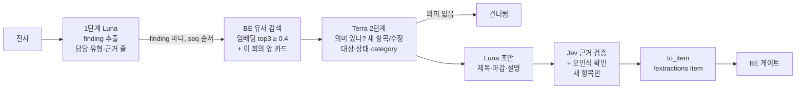

# 판단 파이프라인

회의 전사를 받아 "새 할 일인가, 기존 태스크 수정인가, 무엇이 바뀌었나"를 정해 BE 에 넘기는 흐름이다. 코드는 [`ai/judge/pipeline.py`](https://github.com/kakaotechcampus-4/ktc4-kyungpook-3/blob/develop/ai/judge/pipeline.py), 게이트는 BE [`matching.py`](https://github.com/kakaotechcampus-4/ktc4-kyungpook-3/blob/develop/backend/app/services/matching.py) 에 있다.

## 입력

| 입력 | 내용 | 출처 |
|---|---|---|
| 전사(Transcript) | 발화 줄(`seq`, 화자, 시각, 문장). 채팅이면 메시지 줄 | 배치 전사 결과, 채팅 폴러 |
| 회의 날짜 | "다음 주 화요일"을 날짜로 바꾸는 기준. 채팅은 메시지 작성일 | 매니페스트 |
| 기존 태스크 후보 | BE 유사 검색 결과(제목, 현재 상태·마감·담당) | `POST /workspaces/{id}/tasks/similar` |
| 앞 대화(선택) | 채팅의 앞 메시지 30개. 판단 문맥으로만 쓰고 근거로 쓰지 않는다 | 채팅 폴러 |

## 처리

| 단계 | 하는 일 | 모델 | 정하는 값 |
|---|---|---|---|
| 1. 후보 추출 | 전사 전체를 보고 결정·진척 보고(finding)를 고른다. 담당자 유형 7가지(`first`·`second`·`thirdname`·`thirdpronoun`·`thirdrole`·`group`·`none`)와 근거 줄 번호를 붙인다 | Luna | 담당자, 근거 원문·화자 |
| 2. 유사 task 검색 | finding 요약으로 BE 가 임베딩 코사인 유사도 상위 3개 중 0.4 이상을 돌려준다. 같은 회의에서 앞서 만든 카드도 후보로 보인다(#140) | text-embedding-3-small (BE 저장) | 후보 목록 |
| 3. 변경 판단 | 후보의 현재 값과 비교해 의미 있는 변경인지, 새 항목인지 어느 후보의 수정인지, 상태, category(`schedule`·`assignee`·`status`·`scope`·`decision`)를 정한다. 후보는 번호로만 고른다 | Terra | 새/수정, 대상, 상태, 분류 |
| 4. 초안 | 제목, 마감일, 설명 한 문장 | Luna | 제목, 마감, 설명 |
| 5. 검증 | 새 항목만. 근거 원문에 할 일·마감이 명시됐나, 제목 명사가 맞게 전사됐나를 한 번의 Jev 호출로 묻는다 | Jev | `task_status`, `due_status`, `asr_suspects` |
| 6. 합치기 | 셋을 합치기만 하고 새로 판단하지 않는다. update 에서 바뀌는 필드가 없으면 카드를 만들지 않는다(scope 는 예외) | 코드 | `/extractions` item |

실패는 두 갈래로 나눈다.

| 실패 | 처리 |
|---|---|
| 회의 전체가 못 도는 실패(LLM 키 없음, 1단계 실패) | 예외. 단계 실패로 세고 워커 재시도(60초부터 두 배, 5회) |
| finding 하나의 실패(유사 검색·Terra·Luna 한 번 실패) | 그 finding 만 `failures` 에 남기고 나머지는 계속 |
| 판단 못 한 finding 이 남음 | 인계 전에 파이프라인을 최대 2번 더 돌린다(`MM_EXTRACT_RETRY_MAX`). 결과는 근거 줄 번호가 겹치는 얘기 단위로 합친다(0054) |
| 1단계 응답을 못 씀(파싱 실패 등) | 같은 프롬프트로 그 자리에서 한 번 더 부른다(#580). 11/8 업로드 테스트에서 이 실패 하나로 82초가 헛걸렸다 |

## 출력

`POST /extractions` 의 item 목록. 새 항목은 `action=create`, 수정은 `action=update` 와 `target_task_id` 를 싣는다. 근거 발화 `seq` 목록(최대 100)을 함께 보내 BE 가 원문·화자·시각을 웹에 보여 준다. 필드 정의는 [BE↔AI 계약](https://github.com/kakaotechcampus-4/ktc4-kyungpook-3/blob/develop/backend/docs/contracts/backend-ai-contract.md).

### 게이트: auto / review / hold

게이트는 BE 가 정한다. AI 가 보낸 근거 상태(`task_status`·`due_status`)·유사 검색 수·오인식 의심과 BE 의 담당자 매칭을 합쳐, judge 새 항목은 **막는 사유(`auto_blockers`)가 하나도 없을 때만 auto** 다. 사유는 근거 미확인, 담당자 미확정·추측, 마감 추측, 비슷한 태스크, 오인식 의심 등이다.

- 담당자를 언급했는데 못 찾으면 **hold**(PM 이 채움), 그 밖은 **review**. 기존 태스크 수정(update)은 항상 review 다.
- 채팅 회의는 auto 를 review 로 낮추고, `AUTO_CREATE_ENABLED=false`(#526)면 모두 review 다.
- 사유 전체 표, 담당자 매칭·별칭, 강등 순서는 [담당자 매칭과 게이트](../backend/gate-matching.md).

## legacy 경로와 judge 경로

추출기는 환경 변수 `MM_EXTRACT_PATH` 로 고른다([`capture/judge_path.py`](https://github.com/kakaotechcampus-4/ktc4-kyungpook-3/blob/develop/ai/capture/judge_path.py)). 키가 있으면 자동으로 바꾸지 않고 명시 플래그로 둔 것은, 토큰 하나가 빠졌을 때 말없이 다른 모양의 결과가 BE 로 가는 것을 막기 위해서다(0016).

| | legacy (`extract/`) | judge (`judge/`) |
|---|---|---|
| 코드 기본값 | 기본(값이 비면 legacy) | `MM_EXTRACT_PATH=judge` |
| 흐름 | 문장 쪼개기 → 관련 문장 필터(LLM) → 구조화 추출(LLM) → 반복 결과 합치기 → 날짜 검증 | 위 6단계 |
| 기존 태스크 변경 | 보지 않음. 새 할 일만 | 유사 검색 + Terra 로 수정·상태 변경까지 |
| 게이트 근거 | 항목 신뢰도 숫자(`decide_gate`, 0.8 이상 auto) | 조건 게이트(`auto_blockers`) |
| Jev | 부르지 않음 | 근거·오인식 검증 |
| 채팅·답장 | 쓰지 않음 | 채팅과 답장은 플래그와 상관없이 항상 judge |
| 기준 문서 | [`extract/README.md`](https://github.com/kakaotechcampus-4/ktc4-kyungpook-3/blob/develop/ai/extract/README.md), [`TASK_CRITERIA.md`](https://github.com/kakaotechcampus-4/ktc4-kyungpook-3/blob/develop/ai/extract/TASK_CRITERIA.md) | [`judge/pipeline.py`](https://github.com/kakaotechcampus-4/ktc4-kyungpook-3/blob/develop/ai/judge/pipeline.py) |

운영 서버가 지금 어느 경로인지는 저장소로 확인할 수 없다 **[확인 필요]**. `JEV_API_KEY` 가 없거나 legacy 면 judge auto 는 열리지 않는다.

## 왜 이 방식인가

| 결정 | 실제로 비교한 대안 | 고른 이유 | 기록 |
|---|---|---|---|
| 단계를 나누고 값마다 출처 하나 | LLM 한 번에 전부 뽑기(legacy 의 구조화 추출) | 기존 태스크 변경을 보려면 후보의 현재 값과 비교해야 한다. 한 번에 뽑으면 틀렸을 때 어느 판단이 틀렸는지 가를 수 없다 | [2026-09-29 파이프라인](https://github.com/kakaotechcampus-4/ktc4-kyungpook-3/blob/develop/ai/docs/basis_for_decision/ai/2026-09-29-judge-pipeline.md) |
| 유사도 0.4 는 "후보로 넘길 문턱"일 뿐 | threshold 만으로 같은 task 판정 | 명확한 불일치 최고 0.33, 명확한 매치 최저 0.42 사이. 부정문("로그인은 안 하기로")도 0.52 가 나와 같은지 판단은 Terra 가 한다 | [0010](https://github.com/kakaotechcampus-4/ktc4-kyungpook-3/blob/develop/ai/docs/basis_for_decision/ai/2026-09-22-0010-embedding-similarity-threshold.md) |
| Terra 에 규칙 폴백 없음, 후보는 번호로 | 유사도 규칙 폴백, task_id 문자열 응답 | 규칙은 "이미 반영된 내용" 판단을 못 한다. 문자열 ID 는 지어낼 수 있다 | [0011](https://github.com/kakaotechcampus-4/ktc4-kyungpook-3/blob/develop/ai/docs/basis_for_decision/ai/2026-09-23-0011-final-judge-no-rules-fallback-and-candidate-index.md) |
| 부분 실패면 다시 돌린 뒤 인계 | 바로 인계 / 끝까지 재시도 / 실패한 finding 만 다시 | BE 는 회의당 추출을 한 번만 받는다. finding 하나 때문에 회의 전체를 막지 않는다 | [0016](https://github.com/kakaotechcampus-4/ktc4-kyungpook-3/blob/develop/ai/docs/basis_for_decision/member/2026-09-30-0016-judge-path-flag-and-unjudged-findings.md) |
| 재실행 결과를 얘기 단위로 합침 | 항목 많은 실행 하나 고르기 / 모든 실행 항목 보내기 | 실행 하나를 고르면 다른 실행에서 성공한 finding 을 버린다(#128 멘토 리뷰). 모두 보내면 카드가 겹친다 | [0054](https://github.com/kakaotechcampus-4/ktc4-kyungpook-3/blob/develop/ai/docs/basis_for_decision/ai/2026-11-07-0054-merge-judge-reruns-by-story.md) |
| 숫자 점수 대신 조건 게이트 | 신뢰도 하나로 auto/review/hold | LLM 의 자기 신뢰도는 거의 항상 높다. 사유를 남기면 PM 화면과 운영 로그에서 왜 막혔는지 보인다 | [0031](https://github.com/kakaotechcampus-4/ktc4-kyungpook-3/blob/develop/ai/docs/basis_for_decision/ai/2026-11-02-0031-evidence-status-by-source-check.md), #232 |
| 새 할 일의 이름 지목은 원문만 보냄 | 문맥으로 고친 이름 보내기 | 추측한 이름이 BE 별칭으로 학습되지 않게 | [0057](https://github.com/kakaotechcampus-4/ktc4-kyungpook-3/blob/develop/ai/docs/basis_for_decision/ai/2026-11-07-0057-thirdname-sends-original-mention.md) |

## 어떻게 평가했나

| 날짜 | 무엇 | 데이터·방법 | 결과 | 근거 |
|---|---|---|---|---|
| 2026-09-22 | 유사 검색 threshold | fixture task 10개, 시나리오 50개(채점 36개), 실제 임베딩 API | 35/36 통과 | [0010](https://github.com/kakaotechcampus-4/ktc4-kyungpook-3/blob/develop/ai/docs/basis_for_decision/ai/2026-09-22-0010-embedding-similarity-threshold.md) |
| 2026-09-28 | Terra 2단계 | 골든셋 `golden_set_stage2/`, 2회 | 26/26 두 번 | [terra-progress-cases](https://github.com/kakaotechcampus-4/ktc4-kyungpook-3/blob/develop/ai/docs/basis_for_decision/ai/2026-09-28-terra-progress-cases.md) |
| 2026-09-29 | 파이프라인 E2E | 실제 LLM, 가짜 BE, `golden_set_pipeline/meeting_01.json` | 기대 6/6 을 6회 연속, failures 0 | [2026-09-29 파이프라인](https://github.com/kakaotechcampus-4/ktc4-kyungpook-3/blob/develop/ai/docs/basis_for_decision/ai/2026-09-29-judge-pipeline.md) |
| 2026-10-02 | 1단계 골든셋 | Luna, 3회 반복, 긴 문장·짧은 문장 세트 | 긴 문장 306~309/325, 짧은 문장 14/15~16 (규칙 기반 227/325) | [`eval_results/2026-10-02-final-main.json`](https://github.com/kakaotechcampus-4/ktc4-kyungpook-3/blob/develop/ai/judge/eval_results/2026-10-02-final-main.json) |
| 2026-10-02 | 1인칭 화자 세트 | dev·test 분리 | dev 22/23, test 25/26 | [`eval_results/`](https://github.com/kakaotechcampus-4/ktc4-kyungpook-3/tree/develop/ai/judge/eval_results) |
| 2026-11-04 | 암묵적 진척 보고 | 골든셋 39 → 58개 | 새 사실 보고 12/12, 완료 오판 0 | [terra-implicit-progress](https://github.com/kakaotechcampus-4/ktc4-kyungpook-3/blob/develop/ai/docs/basis_for_decision/ai/2026-11-04-terra-implicit-progress-status.md) |
| 2026-11-07 | 1인칭 오분류 재측정 | 화자 세트 16건×3 | 57/57. 같은 프롬프트 누적 171건 중 2건(약 1%) 오분류(#502) | 프로젝트 상세 설명 8.2 |

- 기본 원칙: 한 번 어긋났다고 프롬프트를 바로 고치지 않고 `--repeat` 로 반복해 흔들림부터 본다(LLM 온도를 낮출 수 없다).
- pytest 는 가짜 LLM 으로 합치기·실패 처리·게이트 입력 모양을 지킨다([`tests/test_pipeline.py`](https://github.com/kakaotechcampus-4/ktc4-kyungpook-3/blob/develop/ai/tests/test_pipeline.py)).

## 한계와 다음 단계

- **골든셋이 작고 합성이다.** 1단계 325문장, Terra 26건, E2E 회의 1개. 실제 회의 분포의 정확도가 아니다. 운영에서 PM 의 승인·수정·반려 비율로 다시 재야 한다.
- **LLM 비결정성.** 같은 입력도 실행마다 다르다. 재실행 합치기(0054)는 이를 흡수하려는 장치지만, 엇갈린 얘기의 항목도 그대로 게이트를 지난다(틀리면 PM 이 auto 되돌리기).
- **비용·시간을 운영에서 재지 않았다.** 회의 하나의 호출은 최대 1 + 2F(F = finding 수)에 Jev F 회. 재실행하면 최대 3배. Elice 클라이언트에 호출 제한 시간이 없어 SDK 기본값(600초)을 쓴다.
- **유사도 0.4 는 fixture 10개로 정했다.** 실제 태스크 제목이 쌓이면 다시 보정한다.
- **같은 Task 의 수정 카드가 두 장** 나올 수 있다(근거 줄이 겹치지 않을 때). 두 번째 승인은 BE 충돌 확인에 걸린다.
- 다음: 스위치를 끈 기간(`AUTO_CREATE_ENABLED=false`, 권고이며 운영값 [확인 필요])의 "켰으면 auto 였을 항목" 로그와 PM 결과를 맞춰 auto 개방을 정한다(#526).
