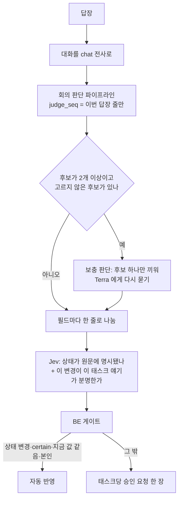

# 리마인드 답장 판단

마감이 다가온 태스크에 PM 이 승인한 재촉 DM 이 나가면, 팀원이 디스코드나 웹으로 답장한다. 이 답장을 읽어 "어느 태스크의 무엇이 바뀌었나"를 줄로 나누고, 확실한 상태 변경만 자동 반영한다. 코드는 [`ai/judge/reply.py`](https://github.com/kakaotechcampus-4/ktc4-kyungpook-3/blob/develop/ai/judge/reply.py), BE 쪽은 `backend/app/services/replies.py`, 결정은 [0043](https://github.com/kakaotechcampus-4/ktc4-kyungpook-3/blob/develop/ai/docs/basis_for_decision/ai/2026-11-04-0043-reminder-reply-judgment.md)(#331, PR #345).

## 입력

| 입력 | 내용 |
|---|---|
| 대화 줄 | PM 의 재촉 메시지와 앞 답장(문맥), 마지막이 이번 답장 |
| 후보 태스크 | BE 가 정한다. 마지막 리마인드 묶음의 태스크 + 열린 시계(72시간)의 태스크. 유사 검색 대신 이것만 쓴다 |
| 후보의 지금 값 | 상태·마감·담당. 자동 반영 때 "판단이 본 값이 지금도 그대로인가"를 대조한다 |

답장이 저장되는 트랜잭션에서 BE 가 `reply_judgment` 행을 만들고(후보가 없으면 안 만듦), 봇이 리스 3분으로 가져간다. 웹 답장도 같은 길을 탄다.

## 처리

- 회의 판단을 그대로 쓴다. `judge_seq` 로 이번 답장에 근거가 있는 finding 만 판단하고, 앞 줄은 1단계의 문맥으로만 쓴다(앞 답장 내용을 이번 근거로 치지 않는다).
- **보충 판단**: 1단계가 한 문장에 든 두 태스크를 finding 하나로 묶거나 "다 했어요"를 걸러내면, 언급된 태스크가 빠지거나 PM 이 답장을 모르게 된다. 그래서 고르지 않은 후보마다 다시 묻는다.
- **Jev 질문 두 개**(`verify_reply`): 상태 질문은 제안 상태(`done`·`blocked`·`in_progress`·`todo`)마다 기준이 다르다. 대상 질문은 붙이려는 변경을 함께 보여 주고 "다른 후보와 구분되게 이 태스크 얘기가 분명한가"를 묻는다. 대상을 확인하지 못하면 상태도 certain 이 아니다(잘못 붙이면 그 태스크의 시계가 닫히기 때문).

## 출력: 판단 범주

답장 하나를 태스크·필드마다 한 줄(`reply_change`)로 나눈다.

| 줄(`field`) | 뜻 | 처리 |
|---|---|---|
| `status` | 상태 변경(완료, 막힘, 진행 중, 아직 안 함) | 근거 certain 이고 조건을 모두 만족하면 자동 반영 |
| `due_date` | 마감 변경 | PM 확인 |
| `assignee` | 담당 변경 | PM 확인 |
| `scope` | 범위 결정. 담을 필드는 없지만 실제 결정 | PM 확인 |
| `due_clear` | 마감을 없애는 말. 계약상 아직 보낼 수 없어 따로 표시 | PM 확인 |
| `unknown` | 어느 후보인지 모름, 또는 새 태스크 얘기(답장으로 새 태스크를 만들지 않음) | PM 이 태스크를 고른다 |
| `failed` | 판단 실패 | PM 알림 |

AI 는 무엇을 반영할지 정하지 않는다. **자동 반영 조건은 BE 가 지금 값과 대조해 가른다**: 상태 변경 + 근거 certain + 판단 때 본 값이 지금 값과 같음 + 담당이 대화 주인. 회의 경로와 같은 원칙이고, 판단 사이에 PM 이 고친 값을 덮지 않는다.

## 왜 이 방식인가

| 결정 | 비교한 대안 | 고른 이유 |
|---|---|---|
| 답장 저장과 같은 트랜잭션에서 판단 행 생성 | 맡길 때 행 생성 | 웹·디스코드가 같은 길. 행이 없으면 "리마인드 답장이 아님" 하나로 읽힌다 |
| 리스 3분 + attempt 로 다시 맡김 | 한 번만 맡기고 10분 뒤 알림 | 배포 재시작마다 PM 에게 판단 실패 알림이 가지 않는다 |
| `judge_seq` 로 이번 답장 finding 만 | 뒤에서 `evidence_at_ms` 로 거르기 | 앞 카드에 합치는 규칙 때문에 이번 변경까지 버릴 수 있다 |
| 게이트는 BE | AI 가 auto 를 정해서 보냄 | BE 가 지금 값 확인을 어차피 해야 해 정책이 두 곳에 나뉜다 |
| 1단계 프롬프트는 안 고치고 보충 판단 | 1단계 프롬프트 수정 | 1단계 프롬프트는 회의 골든셋에 닿는다 |
| 같은 변경이 대기 카드에 있으면 그 카드에 잇기(#467) | 매번 새 카드 | 카드와 알림이 겹치고, 거절한 변경이 다른 카드로 들어갈 수 있었다([reply-duplicate-card](https://github.com/kakaotechcampus-4/ktc4-kyungpook-3/blob/develop/ai/docs/basis_for_decision/ai/2026-11-06-reply-duplicate-card.md)) |

### 판단 창 (#552, 2026-11-08)

멘토 리뷰는 "BE 가 어떤 결과에 5xx 를 계속 내면 봇이 리스마다 같은 답장을 다시 받아 LLM 을 다시 부르고, 같은 대화의 뒤 답장도 막힌다"고 짚었다. 실제로는 답장 후 10분(`JUDGE_WINDOW`)이 지나면 스케줄러가 판단을 `timed_out` 으로 닫고 PM 에게 알리는 시간 상한이 이미 있었다(한 차례 최대 4회 = 10분 ÷ 3분 리스). 남은 빈틈은 그 상한이 스케줄러 틱에 달렸다는 것이었다.

| 대안 | 결과 |
|---|---|
| 숫자 attempt 상한 N | 버림. PM 이 고른 재판단이 앞 차례 횟수를 이어받고, 차례별로 세려면 컬럼·마이그레이션이 든다. N=3 이면 9분이라 얻는 것도 거의 없다 |
| **claim 이 판단 창을 직접 봄 (채택)** | 창이 지난 행은 가져가는 순간 닫고 같은 대화의 다음 답장으로 넘어간다. API·DB 변경 없음 |

판단이 10분 안에 끝나지 않으면 PM 에게 한 번 알리고 답장을 응답으로 친다. 기록: [`reply-judgment-attempt-cap`](https://github.com/kakaotechcampus-4/ktc4-kyungpook-3/blob/develop/backend/docs/plan/m6/basis-for-decision/2026-11-08-reply-judgment-attempt-cap.md).

## 어떻게 평가했나

- 데이터: 합성 답장 사례 30건([`judge/golden_set_reply/cases.json`](https://github.com/kakaotechcampus-4/ktc4-kyungpook-3/blob/develop/ai/judge/golden_set_reply/cases.json)). 코드를 고치기 전에 만들어 둔 사례다.
- 방법: [`judge/eval_reply.py`](https://github.com/kakaotechcampus-4/ktc4-kyungpook-3/blob/develop/ai/judge/eval_reply.py) 가 운영 입구 `judge_reply` 를 그대로 돌려 변경 줄을 정답과 견준다. 자동 반영의 나머지 조건(지금 값, 담당자)은 BE 몫이라 재지 않는다.

| 지표 | 정의 | 보충 판단 전 3회 | 보충 판단 후 3회 | 최종 코드 2회 (2026-11-04) |
|---|---|---|---|---|
| 나뉨 정확도 | (태스크, 필드) 집합이 정답과 같은 사례 | 82/90 | 85/90 | **60/60** |
| 자동 반영 정밀도 | 정답도 auto 인 줄 / status+certain 줄 | 34/34 | 38/38 | **26/26** |
| 잘못된 certain | 정답이 auto 가 아닌 status+certain 줄 | 0 / 49 | 0 / 52 | **0 / 38** |
| 놓친 자동 반영 | 정답 auto 인데 certain 아님 | 5 / 39 | 1 / 39 | **0 / 26** |
| 판단 실패 | | 0 | 0 | 0 |

- 시간: 60건 차례로 평균 약 9.4초, 최대 24.8초(BE 호출 시간 제외). 한 줄로 10분에 약 60통.
- 비용: 답장 1건 평균 Terra 1.2, Luna 2.0, Jev 0.8~0.9회. 장부 단가 추정으로 약 17원 + Jev. Elice 실제 단가와 Jev 단가는 확인하지 않았다.
- BE 쪽은 pytest 로 판단 접수·게이트·시계·중복 카드를 지킨다(`tests/api/test_reply_judgment.py` 등).
