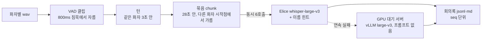
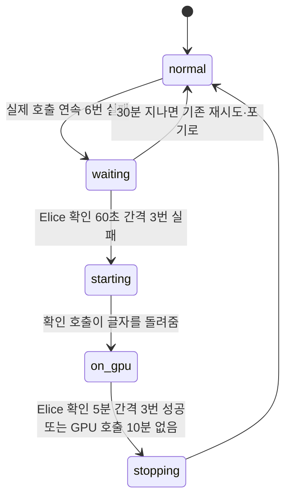

# 전사 (STT)

회의 음성을 화자·시각이 붙은 회의록으로 바꾸는 단계다. 판단 파이프라인의 모든 근거가 이 회의록에서 나오므로, 전사 오류는 뒤 단계로 그대로 번진다([전사 오인식 검사](asr-check.md)). 코드는 [`ai/stt/`](../../../ai/stt), 평가 도구는 [`ai/stt/eval/`](../../../ai/stt/eval/README.md).

## 입력

| 입력 경로 | 음성 모양 | 화자 구분 |
|---|---|---|
| Discord 녹음 | 화자별 트랙(16kHz 모노 wav), 모든 트랙이 회의 시계 하나 위에 있다 | 트랙이 곧 화자. 화자 분리 불필요 |
| 웹 업로드 | 파일 하나(최대 100MiB), 모든 화자가 한 트랙 | pyannoteAI 로 나눈 뒤 PM 이 라벨마다 팀원 지정 |

함께 쓰는 힌트: BE 팀원 이름(최대 15명, 약 170토큰)을 프롬프트로 싣는다.

## 처리

- **배치 전사**: 회의가 끝난 뒤 저장된 트랙을 전사한다. 처음에는 회의 중 실시간 전사(0003)였으나 복잡도에 비해 얻는 것이 적어 번복했다([0008](../../../ai/docs/basis_for_decision/member/2026-09-16-0008-batch-transcription-by-speaker-chunks.md)).
- **트랙을 통째로 넣지 않는다**: 무음 구간에서 whisper 가 문장을 반복하거나 지어낸다(74.7초 파일이 CER 87%).
- **품질 장치**:

| 장치 | 효과 | 기록 |
|---|---|---|
| 팀원 이름 힌트 | 9/29 녹음 이름 자리 0/4 → 3/4 | [0020](../../../ai/docs/basis_for_decision/member/2026-10-09-0020-name-hint-prompt.md), [0024](../../../ai/docs/basis_for_decision/member/2026-10-13-0024-member-name-hint.md) |
| 다른 화자가 말을 시작한 자리에서 묶음 가르기 | 교차 대화에서 건너뛴 줄 6 → 0, CER 5.33 → 5.20% | [0023](../../../ai/docs/basis_for_decision/member/2026-10-13-0023-ordered-chunks.md) |
| 1.5초 미만 묶음에 앞 줄 프롬프트 + 최소 발화 100ms | CER 4.78 → 4.67%, 짧은 대답 3/7 → 5/7 | [0031](../../../ai/docs/basis_for_decision/member/2026-11-03-0031-short-chunk-context.md) |
| 배치에서는 말 필터(Silero) 끔 | 짧은 대답을 살림 | [0030](../../../ai/docs/basis_for_decision/member/2026-11-02-0030-batch-without-speech-gate.md) |
| (넣지 않음) 기존 할 일 제목 힌트 | CER 이 나빠짐 | [0025](../../../ai/docs/basis_for_decision/member/2026-10-13-0025-title-hint-not-now.md) |
| (넣지 않음) 노이즈 필터 | 효과 없음 | [0007](../../../ai/docs/basis_for_decision/member/2026-09-14-0007-no-denoise-before-stt.md) |

## 출력

`transcripts/session_<회의ID>.jsonl`(줄마다 `seq`, 화자, 시작·끝 시각, 문장)과 사람이 읽는 `.md`. 발화는 `POST /meetings/{id}/sources` 로 BE 에 저장되고, 판단 결과의 근거 `seq` 가 이 줄을 가리킨다. 회의 음성은 인계 뒤 삭제한다(#568).

## 왜 이 방식인가: 엔진 선택

목표는 "60분 회의를 끝나고 10분 안에 전사"다(기획안의 초안 10분 기준).

| 대안 | 측정 (2026-10-06, t3.medium, [서버 용량](../../../ai/stt/eval/results/2026-10-06-server-capacity/README.md)) | 판단 |
|---|---|---|
| 로컬 faster-whisper large-v3-turbo | 62.42분 회의에 84.93분(RTF 1.36). 전사 프로세스 메모리 최대 2,305MiB 라 워커 2개는 스왑 없이 안 들어감 | 목표 불가. 장애 대비로만 |
| 로컬 small | 회의 1분당 약 25초, CER 8.20·8.68%(5% 기준 넘음) | 품질·시간 모두 미달 |
| **Elice API whisper-large-v3 (채택)** | 62.42분 회의 65.07초(회의당 동시 6호출), 회의 5개 동시 9.58초 실패 0, 메모리 120~490MiB, CER 은 로컬 turbo 와 비슷 | 목표를 맞추는 유일한 안. 호출 비용과 공급자 장애를 감수 |
| GPU 서버 상시 주 전사기 (g4dn.xlarge) | CER Elice 와 같음, 62.42분 회의 159.8초. 상시 월 약 $479 | 상시는 손익 불일치. 장애 때만 켬 |

결정: [0019](../../../ai/docs/basis_for_decision/member/2026-10-07-0019-elice-api-default-local-fallback.md), [0039](../../../ai/docs/basis_for_decision/ai/2026-11-04-0039-gpu-stt-server.md).

### 업체 비교 (2026-10-14)

같은 녹음 6개를 여러 API 에 보냈다([결과](../../../ai/stt/eval/results/2026-10-14-stt-vendors/README.md)). CER 은 공백·부호를 뺀 글자 기준이다(한국어는 띄어쓰기만 달라도 WER 이 크게 오른다).

| 모델 | 전체 CER |
|---|---|
| Elice whisper-large-v3 (운영) | 11.52% |
| OpenAI gpt-transcribe | 10.22% |
| 리턴제로 sommers | 11.17% |
| **Soniox stt-async-v5** | **7.54%** |

트랙을 통째로(무음만 빼고) 보낸 조건이라 운영 파이프라인(28초 묶음)의 CER 과 다르다. 업체 변경은 정하지 않았다. 새 계정, 회의 음성의 외부 전송, 비용을 팀이 정해야 한다 **[확인 필요: 업체 유지 결정 여부]**.

### 화자 분리: pyannoteAI

업로드 음성만 필요하다. t3.medium 에서 로컬 pyannote 는 돌릴 수 없다고 보고(직접 재지는 않음) 호스팅 API 로 정했다([0028](../../../ai/docs/basis_for_decision/ai/2026-11-01-0028-manual-upload-hosted-diarization-and-diarized-state.md)). 라벨마다 다른 라벨과 겹치지 않는 2초 이상 구간을 최대 3개 골라 10초 샘플로 보고하고, PM 이 듣고 팀원을 지정한다. 겹친 발화는 처리하지 않는다(0027). 화자 분리 정확도(DER)는 재지 않았다 **[확인 필요]**.

### LoRA 미채택 (2026-11-07)

AI Hub 회의 음성 274.4시간(1차)·484.5시간(2차)으로 large-v3 LoRA 를 학습했다. 성공 기준(6인 정렬본 m01·m02 둘 다 나빠지지 않고 평균 CER 0.5%p 이상 개선)을 측정 전에 정했다. 2차 LoRA 는 카페 소음 1인(21.1 → 18.7%)과 2인 녹음은 좋아졌지만 실제 6인 회의가 나빠졌다(6.72 → 9.14%). 기본 large-v3 를 유지한다. 비용 $56.50 ([0052](../../../ai/docs/basis_for_decision/ai/2026-11-07-0052-lora-not-adopted.md), [결과](../../../ai/stt/eval/results/2026-11-07-lora/README.md)).

## GPU 자동 전환 (#581, 0056)

Elice 옛 주소가 9/29 부터 약 7일 응답하지 않은 일이 있었다. GPU 대기 서버는 처음에 개인 AWS 키를 가진 담당자 한 명만 켤 수 있었다. 워커가 스스로 켜고 끄게 바꿨다([0056](../../../ai/docs/basis_for_decision/ai/2026-11-08-0056-gpu-stt-auto-failover.md), [`stt/failover.py`](../../../ai/stt/failover.py), [`stt/gpu_switch.py`](../../../ai/stt/gpu_switch.py)).

| 항목 | 값 |
|---|---|
| 스위치 | Lambda 함수 URL(켜기·끄기·상태만). 누적 상한은 SSM 장부 한 곳 |
| 상한 | 하루 6시간·켜기 6번, 누적 15시간($9.7) |
| 프롬프트 | GPU 로 가는 호출은 이름·문맥 프롬프트를 싣지 않는다 |
| 수동 조작 | 비공개 운영 채널 `/gpu on\|off\|status` |
| 들이는 순서 | `manual` 배포 → 저장 회의 리허설 → `auto` |

프롬프트를 빼는 이유: 리허설(#528)에서 GPU 서버가 15구간 중 2구간을 오류 없이 비워 돌려줬고, 원인이 이름 프롬프트였다. CER 은 GPU 프롬프트 19.89%, GPU 무프롬프트 6.72%, Elice 무프롬프트 6.72%(회의 1건, 대본 372자). 빈 응답 감지기보다 원인을 막는 쪽을 골랐다.

## 어떻게 평가했나

CER 은 공백·문장부호를 지운 글자열의 편집 거리 / 정답 글자 수다. 원자료(음성·전사 전문)는 동료 목소리라 레포 밖에 두고, 레포에는 표·요약·비용 장부만 둔다.

| 날짜 | 무엇 | 결과 | 근거 |
|---|---|---|---|
| 2026-09-16/17 | 실제 6인 녹음 2개 정렬본, Elice 묶음 | CER 6.52% / 4.73% | [2026-09-16-batch](../../../ai/stt/eval/results/2026-09-16-batch/README.md) |
| 2026-10-06 | 서버 용량(t3.medium) | 위 엔진 비교 표 | [server-capacity](../../../ai/stt/eval/results/2026-10-06-server-capacity/README.md) |
| 2026-10-06 | 비용(계산값) | 회의 1시간당 162~338원(호출마다 최소 1분 과금이면 438~1,030원) | 같은 문서 |
| 2026-10-09 | 이름 힌트 | 이름 자리 0/4 → 3/4 | [name-hint](../../../ai/stt/eval/results/2026-10-09-name-hint/README.md) |
| 2026-10-13 | 화자 경계 묶음 가르기 | 건너뛴 줄 6 → 0 | [ordered-chunks](../../../ai/stt/eval/results/2026-10-13-ordered-chunks/README.md) |
| 2026-11-03 | 짧은 묶음 앞 줄 프롬프트 (실제 회의 3개) | CER 4.78 → 4.67% | [short-chunk-context](../../../ai/stt/eval/results/2026-11-03-short-chunk-context/README.md) |
| 2026-11-04 | GPU(T4) large-v3 | CER Elice 와 같음, 62.42분 회의 159.8초, 콜드 스타트 22.1분 → 5.0분 | [gpu-serving](../../../ai/stt/eval/results/2026-11-04-gpu-serving/README.md) |
| 2026-11-05/06 | 운영 서버에서 GPU 호출 | 꺼 둔 서버 켜서 첫 응답 약 160초, 전사 포함 약 5.4분 | [gpu-fallback-prod](../../../ai/stt/eval/results/2026-11-05-gpu-fallback-prod/README.md) |
| 2026-11-08 | 자동 전환(가짜 서버·가짜 시계) | 상태 전이 확인. 리뷰 결함 14건 재현 후 수정. 실제 Lambda·GPU 로는 아직 | [gpu-stt-auto-failover](../../../ai/docs/basis_for_decision/ai/2026-11-08-gpu-stt-auto-failover.md) |

상수(VAD 침묵, 묶음 길이 등)는 기본값 주변을 흔들어 "평탄·경사·절벽"을 보는 민감도 측정으로 정했다([`stt/eval/README.md`](../../../ai/stt/eval/README.md), [2026-09-26-units](../../../ai/stt/eval/results/2026-09-26-units/README.md)).

## 한계와 다음 단계

- **녹음이 모두 대본 낭독이다.** 자유 발화 성능을 재지 못했다. 회의 수도 적다(실제 회의 3개 기준 CER 4.67%).
- **단어 시각이 없다.** Elice 새 엔드포인트가 단어 시각을 주지 않아 회의록이 턴이 아니라 묶음 단위로 남는다.
- **더 낮은 CER 업체(Soniox 7.54%)가 있었지만 바꾸지 않았다.**
- **외부 의존.** STT·LLM·Jev·임베딩이 Elice 에 몰려 있다. GPU 자동 전환은 실제 Lambda·운영 서버로 아직 리허설하지 않았고, 무프롬프트 빈 구간 0 은 회의 1건 값이다.
- **GPU 경로는 개인 AWS 를 지난다.** 회의 음성이 개인 계정을 지나는 경로를 #360 에 공지했다. 2026-12-31 장애 대응 기간이 끝나면 Lambda·대기 서버를 지운다.
- **업로드 화자 분리 정확도 미측정.** 겹친 발화는 두 화자로 두 번 전사될 수 있다(0027).
- 다음: 대본 없는 실제 회의 녹음과 정답이 쌓이면 다시 재고, 수천 시간 규모 학습에서 개선이 확인되면 LoRA 를 다시 본다.
