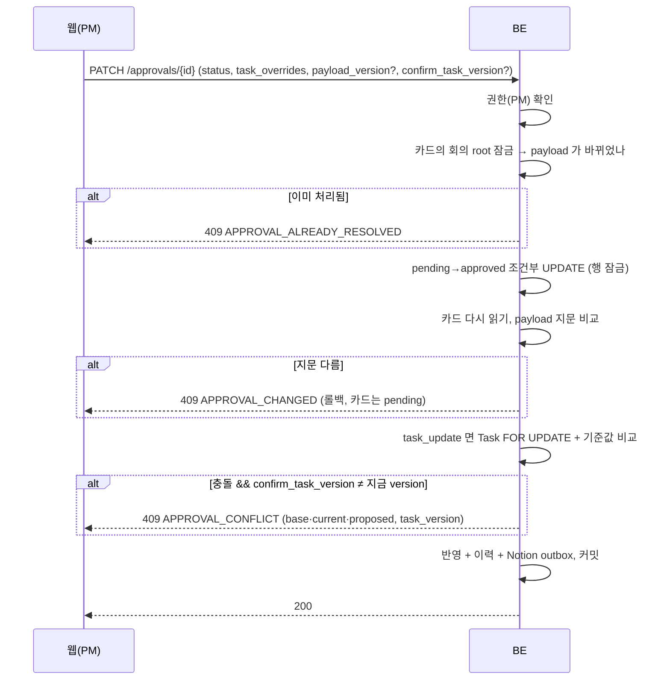

# 승인과 충돌

review·hold 항목은 승인 카드(`ApprovalRequest`)가 되고, PM 이 값을 고쳐 승인하거나 반려한다. 카드가 기다리는 동안 태스크도 카드도 바뀔 수 있어서, "PM 이 본 것과 반영되는 것이 같다"를 서버가 지켜야 한다. 코드는 [`api/approvals.py`](https://github.com/kakaotechcampus-4/ktc4-kyungpook-3/blob/develop/backend/app/api/approvals.py), [`services/tasks.py`](https://github.com/kakaotechcampus-4/ktc4-kyungpook-3/blob/develop/backend/app/services/tasks.py), [`services/pending_merge.py`](https://github.com/kakaotechcampus-4/ktc4-kyungpook-3/blob/develop/backend/app/services/pending_merge.py).

## 문제

| 상황 | 그대로 두면 |
|---|---|
| AI 가 태스크를 본 뒤 PM 이 같은 필드를 직접 고침 | 늦게 승인된 제안이 PM 의 변경을 말없이 덮는다 |
| 카드를 연 뒤 다른 회의 항목이 그 카드에 합쳐짐(#533) | PM 이 못 본 마감·담당자로 태스크가 생기고, 못 본 글자가 별칭으로 저장된다 |
| PM 둘이 같은 카드를 동시에 처리 | 태스크가 두 번 생긴다 |
| auto 로 만든 태스크가 중복·오판 | 고칠 "값"이 없다. 지우면 근거도 사라진다 |
| 범위 결정("소셜 로그인은 빼기로")만 있는 수정 | 바뀌는 필드가 없어 승인해도 어디에도 남지 않았다(#205) |

## 동작

### 카드 종류와 고칠 수 있는 값

| 종류 | 만드는 곳 | 승인하면 | PM 이 고칠 수 있는 값 |
|---|---|---|---|
| `task_create` | review·hold 새 항목, auto 되돌리기 | 최종 값으로 태스크 생성(상태는 항상 `todo`) | 제목, 담당자, 마감 |
| `task_update` | 기존 태스크 수정 항목, 답장 판단 | 충돌 검사 뒤 필드 반영 | 상태, 마감(담당자 줄이 있는 답장 카드는 담당자도) |

`task_overrides` 는 승인할 때만 받는다. 제안과 다른 값만 반영하고 이력에 **PM 이 직접 바꾼 것(`manual`)** 으로 남기며, 원래 제안은 payload 에 그대로 둔다. 마감·담당자는 `null`(미정)을 받고 제목·상태는 받지 않는다.

### 409 세 가지

| 코드 | 무엇을 막나 | 기준 | PM 이 할 일 |
|---|---|---|---|
| `APPROVAL_ALREADY_RESOLVED` | 같은 카드 두 번 처리 | `status = pending` 조건부 UPDATE, `rowcount = 0` | 새로고침 |
| `APPROVAL_CHANGED` | 카드를 본 뒤 합치기로 내용이 바뀜(#547) | `payload_version` = payload 문자열 sha256 앞 16자. 요청의 값 비교는 task_create 카드만(다르면 409, 안 보내면 이 검사는 없다). 이와 별개로 값을 안 보내도, 카드가 묶인 회의 root 잠금을 기다리는 사이 합치기가 먼저 끝나 payload 가 바뀌었으면 카드 종류와 상관없이 409 | 상세를 다시 받아 비교 후 재승인 |
| `APPROVAL_CONFLICT` | 제안 뒤 태스크의 같은 필드가 바뀜 | 필드마다 `base_values`(AI 가 본 값) ≠ 지금 값이고, 지금 값 ≠ 제안 값. 대상 제목(`base_title`)이 바뀌어도 충돌 | 충돌을 본 `task_version` 을 `confirm_task_version` 으로 다시 보냄. 그사이 또 바뀌면 다시 409 |

기준값은 **AI 가 유사 검색에서 본 값(`target_snapshot`)** 이다. 등록 시점의 DB 값을 쓰면, AI 가 검색하고 판단하는 사이 PM 이 고친 값이 기준값이 되어 충돌 없이 덮인다(#157). 스냅샷이 없으면 등록 시점 값을 쓴다. 지금 값이 이미 제안 값과 같으면 잃는 것이 없어 충돌로 보지 않는다. 반영에 실패하면 승인도 롤백해 카드는 pending 으로 남는다.

### 낙관적 동시성: 무엇을 잠그고 무엇을 비교하나

| 대상 | 방식 |
|---|---|
| 카드 상태 | 조건부 UPDATE(`WHERE status='pending'`). PostgreSQL 에서 이 UPDATE 가 카드 행을 잠가, 합치기(카드 `FOR UPDATE`)는 커밋까지 기다린다 |
| 카드 내용 | 지문 비교. 컬럼·마이그레이션 없이 payload 를 쓰는 모든 경로가 자동으로 잡힌다 |
| 태스크 | 기준값 비교 + `Task.version`(바뀔 때마다 +1). 확인과 반영 사이 끼어들기는 `FOR UPDATE` |
| 잠금 순서 | 추출은 태스크 → 합칠 카드(ID 순). `task_update` 카드는 합칠 수 없어 잠그지 않는다(카드→태스크 순 승인과 교착 방지) |

### 자동 반영 되돌리기

`POST /extractions/{id}/items/{item_id}/revert`(PM). auto 로 만든 태스크를 지우고 **처음부터 review 였던 것과 같은 모양의 생성 카드** 를 만든다. 승인하면 다시 생기고 반려하면 없이 끝난다. 다음이면 되돌리지 않는다(`AUTO_TASK_NOT_REVERTIBLE`).

| 사유 | 이유 |
|---|---|
| `task_changed`(version ≠ 1) | 진행 상황·PM 수정값이 카드에 담기지 않고 사라진다. 직접 고친다 |
| `pending_approval` | 그 태스크를 대상으로 한 대기 카드가 있다 |
| `already_reverted`, `not_auto_created`, `task_missing` | 두 번 되돌리기, auto 가 아닌 항목 |

### 다른 회의 항목 합치기(#533)

AI 가 유사 검색에서 승인 대기 `task_create` 카드를 고르면 `action=merge` 로 보낸다. BE 는 새 카드 대신 그 카드 payload 에 합친다([`pending_merge.py`](https://github.com/kakaotechcampus-4/ktc4-kyungpook-3/blob/develop/backend/app/services/pending_merge.py), DB 를 만지지 않는 순수 함수).

- 새 마감·상태가 있으면 덮고, 마감 지우기는 전달되지 않는다. 제목·대표 근거는 처음 회의 것이고 뒤 회의 근거는 `merged_items` 에 쌓인다.
- 담당자를 말한 항목(`category=assignee`)일 때만 카드 담당자를 바꾸고, 그 항목을 `assignee_item_id` 로 남긴다. 별칭은 이 항목에서만 배운다.
- 대상 카드가 없거나 처리됐거나 다른 공간이면 400 대신 새 카드로 만든다(`merge_target_unavailable` 로그). 회의 전체를 막지 않는다.
- 승인하면 그 카드에 연결된 모든 추출 항목에 같은 `task_id` 가 채워진다.
- 회의를 지우면 남은 회의의 기여로 카드를 다시 구성하고, 마지막 기여가 지워지면 빈 카드를 남기지 않는다([meeting-deletion](https://github.com/kakaotechcampus-4/ktc4-kyungpook-3/blob/develop/backend/docs/plan/m3/basis-for-decision/2026-11-09-meeting-deletion.md)).

### 범위 변경 이력(#544)

`category=scope` 인 `task_update` 를 승인하면 필드 반영 뒤 `changed_field: "scope"`, `new_value: doc_text` 이력 한 줄을 남긴다. 범위만 있으면 `version` 을 올리지 않고 Notion 동기화도 요청하지 않는다. 충돌·반려면 이력이 없고, 되돌리기 대상이 아니다.

## 왜 이 방식인가

| 결정 | 비교한 대안 | 고른 이유 | 기록 |
|---|---|---|---|
| 카드 버전은 payload 해시 | 정수 컬럼 +1 / `updated_at` | 마이그레이션이 없고 payload 를 쓰는 코드가 늘어도 빠뜨릴 일이 없다 | [approval-payload-version](https://github.com/kakaotechcampus-4/ktc4-kyungpook-3/blob/develop/backend/docs/plan/m6/basis-for-decision/2026-11-08-approval-payload-version.md) |
| 새 코드 `APPROVAL_CHANGED` | `APPROVAL_CONFLICT` 재사용 | FE 가 기존 409 details 를 태스크 충돌로 읽는다. 둘을 구분해 달라고 했다 | 같은 기록 |
| 반려도 지문 검사 | 승인만 | 반려는 합쳐진 다른 회의 항목까지 반려한다 | 같은 기록 |
| 합친 내용은 payload JSON 안 | 카드-항목 연결 테이블 | 모델·마이그레이션을 늘리지 않는다 | [pending-merge](https://github.com/kakaotechcampus-4/ktc4-kyungpook-3/blob/develop/backend/docs/plan/m6/basis-for-decision/2026-11-07-pending-merge.md) |
| 되돌리기는 삭제 + 생성 카드 | 태스크를 직접 고치게 함 | auto 가 틀렸을 때 위험한 건 값 하나보다 중복·오판이다. 그건 고칠 값이 없다 | `revert_auto_item` 주석 |
| 범위는 이력 한 줄 | Task 에 범위 컬럼 | 대응하는 필드가 없다. 이력이면 타임라인에 보인다 | [scope-change-history](https://github.com/kakaotechcampus-4/ktc4-kyungpook-3/blob/develop/backend/docs/plan/m6/basis-for-decision/2026-11-08-scope-change-history.md) |

## 어떻게 검증했나

| 범위 | 테스트 |
|---|---|
| 기준값 충돌·`confirm_task_version`·제목 변경 | [`tests/api/test_approval_conflict.py`](https://github.com/kakaotechcampus-4/ktc4-kyungpook-3/blob/develop/backend/tests/api/test_approval_conflict.py) |
| 값 고쳐 승인, 고칠 수 있는 필드 | `tests/api/test_approval_task_overrides.py` |
| payload 지문 409 | [`tests/api/test_approval_payload_version.py`](https://github.com/kakaotechcampus-4/ktc4-kyungpook-3/blob/develop/backend/tests/api/test_approval_payload_version.py) |
| 합치기 규칙·합친 카드 승인·동시 합치기 | `tests/services/test_pending_merge.py`, `tests/api/test_approval_merged_card.py`, `tests/api/test_pending_merge_concurrency.py`(PostgreSQL) |
| 범위 이력 | `tests/api/test_approval_scope_history.py`, `test_reply_scope_history.py` |
| auto 되돌리기 | `tests/api/test_extractions_judge_auto.py`(revert 사례), `test_extraction_approval_status.py` |

2026-11-08 범위 이력 작업 뒤 `pytest` 2285 passed, 1528 skipped(PostgreSQL 전용, CI 에서 돈다)([M6 결과](https://github.com/kakaotechcampus-4/ktc4-kyungpook-3/blob/develop/backend/docs/plan/m6/result.md)).

## 한계와 다음 단계

- **`payload_version` 은 API 에서 선택 필드다.** FE 는 상세에서 받은 값을 task_create 승인과 반려 요청에 싣는다(#547). task_update 카드는 값이 없다. 값을 빼고 보내는 클라이언트에는 화면에서 본 뒤 바뀐 것을 잡는 검사가 없다.
- 제목 비교는 앞뒤 공백만 무시한다. 띄어쓰기만 바뀌어도 충돌로 묻는다.
- 지문은 내용이 같아도 저장 형식이 바뀌면 달라진다(막는 쪽으로 틀림).
- 범위 결정은 Notion 페이지에 남지 않는다. Notion 만 보는 팀원은 모른다.
- 추출 조회(`GET /extractions/{id}`) 응답에는 지문이 없다. 회의록 화면에서 승인하려면 승인 상세를 받아야 한다.
