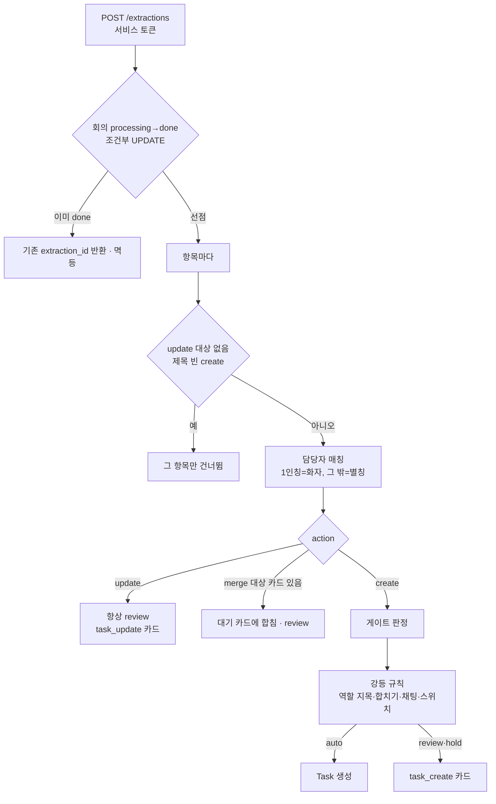

# 담당자 매칭과 게이트

AI 가 넘긴 항목(`POST /extractions`)을 받아 담당자를 실제 팀원으로 찾고, 이 항목을 바로 태스크로 만들지(auto), PM 에게 물을지(review), PM 이 담당자를 채워야 하는지(hold) 정하는 BE 로직이다. 코드는 [`api/extractions.py`](https://github.com/kakaotechcampus-4/ktc4-kyungpook-3/blob/develop/backend/app/api/extractions.py) `create_extraction`, 규칙은 [`services/matching.py`](https://github.com/kakaotechcampus-4/ktc4-kyungpook-3/blob/develop/backend/app/services/matching.py).

## 문제

| 문제 | 왜 어려운가 |
|---|---|
| 회의 속 이름은 표기가 제각각이다 | "하은이가", "환 님이", "민수 씨는". 조사·호칭이 붙었는지 겉보기로 알 수 없다("하은"의 "은"은 이름) |
| AI 가 추측한 이름이 섞인다 | "너가", "그분이", "디자이너분이"를 AI 가 문맥으로 풀어 이름을 보낼 수 있다. 맞아 보여도 추측이다 |
| 잘못된 auto 는 비싸다 | PM 확인 없이 틀린 태스크·중복 태스크가 생긴다. 잘못된 review 는 PM 이 한 번 더 볼 뿐이다 |
| 요청 하나에 항목이 여럿 | 항목 하나가 이상하다고 요청 전체를 거절하면 봇이 재시도하다 회의 전체가 반영되지 않는다 |

## 동작

### 1. 담당자 매칭

| 담당자 유형(`assignee_type`) | 찾는 방법 | 결과 |
|---|---|---|
| `first`(1인칭 "제가") | 화자로 찾는다: ① `evidence_speaker_member_id` → ② 화자 Discord uid → ③ 근거 줄 중 마지막(결론) 발화의 화자. 원문 "제가"는 별칭으로 조회하지 않는다 | 찾으면 확신도 1.0, 못 찾으면 원문을 힌트로 hold |
| `thirdname`·`second`·`thirdpronoun`·`thirdrole` | `assignee_raw` 를 별칭으로 찾는다(`resolve_assignee`) | 1명 matched / 2명 이상 ambiguous(0.3) / 없음 not_found(0.0) |
| `group`·`none` | 찾지 않는다 | 담당자 없음. 게이트에서 "언급 없음" |

별칭 찾기(`name_candidates`)는 님·씨·조사를 뗀 후보를 모두 만들어 **긴 것부터** 보고, 처음 걸린 후보의 행만으로 판정한다. "하은이가" → `하은이가`, `하은이`, `하은`. 탈퇴한 팀원의 별칭은 보지 않는다. 판정은 `AliasResolutionLog` 에 남아 "해결 대기 별칭" 목록이 된다.

별칭은 세 곳에서 생긴다.

| 출처 | 확신도·검증 | 만드는 곳 |
|---|---|---|
| 팀원 이름(`display_name`) | 1.0, 검증됨. 전체 이름과 성 뗀 이름("김하은" → 김하은, 하은) | [`member_aliases.py`](https://github.com/kakaotechcampus-4/ktc4-kyungpook-3/blob/develop/backend/app/services/member_aliases.py) `sync_name_aliases` |
| Discord 닉네임(`discord_profile`) | 0.8, 미검증. 한글만으로 된 서버 별명·표시 이름만 | 같은 파일 `add_discord_nickname_alias` |
| PM 등록(`manual`)·승인 학습(`learned`) | 학습은 0.9, 검증됨 | 팀원 API, [`alias_learning.py`](https://github.com/kakaotechcampus-4/ktc4-kyungpook-3/blob/develop/backend/app/services/alias_learning.py) |

미검증 별칭이나 **한 글자 별칭**으로 찾으면 담당자는 채우되 `needs_check`(확인 필요)로 둔다. 조사를 떼면 "하은" → "하" 같은 한 글자 후보가 생겨 팀에 없는 사람이 자동 배정될 수 있어서다(#463 리뷰).

### 2. 추측 이름을 별칭으로 배우지 않기

PM 이 승인하며 담당자를 직접 고르면 발화 표현("화은이가" 같은 오인식 포함)을 그 팀원의 별칭으로 저장한다(#459). 대신 추측이 별칭으로 굳지 않게 막는다.

| 규칙 | 이유 |
|---|---|
| 배우는 유형은 `thirdname`(이름 지목)뿐 | "너"·"그분"은 가리키는 사람이 매번 다르다. 역할 지목은 AI 가 원문 대신 추측 이름을 보낼 수 있어 뺐다(#464 리뷰) |
| 추출 때 담당자를 못 찾은 항목만 | 이미 찾힌 표현을 다시 배울 필요가 없다 |
| 1인칭이 주어로 쓰인 꼴은 막음(`_SELF_REFERENCE`) | AI 가 "제가"를 thirdname 으로 오분류한 기록(#502). "제"·"우리"가 별칭이 되면 그 말이 늘 한 사람으로 채워진다 |
| 찾기 후보 중 하나라도 누가 가졌으면 안 배움 | "하은은"을 저장하면 두 명의 "하은" 중 한 명으로 항상 확정된다(#464 리뷰) |
| 실패해도 승인은 성공 | 별칭은 덤. 동시 저장 충돌은 savepoint 만 되돌린다 |

AI 쪽도 새 할 일의 이름 지목은 문맥으로 고친 이름이 아니라 원문을 보낸다([AI 0057](https://github.com/kakaotechcampus-4/ktc4-kyungpook-3/blob/develop/ai/docs/basis_for_decision/ai/2026-11-07-0057-thirdname-sends-original-mention.md)).

### 3. 게이트

**기존 태스크 수정(update)은 항상 review** 다. 유사도·LLM 판단이 틀릴 수 있어서다. 바뀌는 값이 없으면 카드도 만들지 않는다(범위 결정 `scope`, 담당자 못 찾음은 예외).

새 항목(create)은 경로마다 다르다(`decide_create_gate`).

| 경로 | auto | review | hold |
|---|---|---|---|
| judge | `auto_blockers` 가 빈 목록 | 그 밖 | 담당자를 언급했는데 한 명으로 못 찾음(확신도 < 0.5) |
| legacy | 항목 신뢰도 ≥ 0.8 이고 `needs_check` 아님 | 0.5 ≤ 신뢰도 < 0.8, 또는 0.8 이상이지만 확인 필요 | 신뢰도 < 0.5 |
| 경로 불명·신뢰도 없음 | 열지 않음 | 기본 | 담당자 못 찾음 |

legacy 의 항목 신뢰도(`item_confidence`)는 할 일·담당자·마감 확신도의 최솟값이다. 언급하지 않은 담당자·마감은 0.0 이 아니라 계산에서 뺀다(빼지 않으면 늘 hold).

judge 의 막는 사유(`auto_blockers`, 하나라도 있으면 auto 아님):

| 사유 | 조건 |
|---|---|
| `missing_signals` | `task_status`·`due_status`·`similar_count` 중 하나라도 없음(옛 AI). 이것만 돌려준다 |
| `task_not_certain` | 할 일 근거가 certain 아님 |
| `assignee_not_confirmed` | 언급한 담당자를 못 찾음·확인 필요·확신도 < 0.8 |
| `assignee_inferred` | 유형이 `second`·`thirdpronoun`·`thirdrole`(이름이 찾아져도 추측) |
| `due_not_certain` / `due_mismatch` | 마감이 inferred / 상태와 날짜 유무가 어긋남(missing 인데 날짜가 있거나 그 반대) |
| `similar_task_found` | AI 유사 검색 결과가 1개 이상 |
| `unsearched_task_exists` / `unsearched_pending_exists` | 임베딩이 없어 검색에 안 잡힌 태스크·대기 카드가 있음. 같은 요청에서 앞서 auto 로 만든 태스크도 여기 걸린다 |
| `asr_suspect` / `asr_check_failed` | 전사 오인식 의심 단어가 남음 / 검사를 못 함 |

정해진 게이트는 아래 순서로 **auto 만 review 로 내린다**(hold 는 그대로).

| 순서 | 강등 | 이유 |
|---|---|---|
| 1 | 역할 지목(`thirdrole`) | legacy 에서도 추측 이름이 별칭에 걸려 확신도가 오를 수 있다(#459) |
| 2 | 대기 카드에 합치는 항목, 합치려다 대상을 못 쓴 항목 | PM 이 아직 안 본 카드를 고치는 일이고, 대상을 못 쓴 항목은 중복 검사를 못 거쳤다 |
| 3 | 채팅 회의 | 전사를 거치지 않고 맥락이 약하다. "채팅이 아니었으면 auto"였던 항목을 로그로 센다([AI 0042](https://github.com/kakaotechcampus-4/ktc4-kyungpook-3/blob/develop/ai/docs/basis_for_decision/ai/2026-11-04-0042-chat-daily-poll-as-chat-meeting.md)) |
| 4 | `AUTO_CREATE_ENABLED` 꺼짐 | 자동 반영을 한 번에 내리는 스위치(#526). 경로와 무관. 기본은 켜짐이고 운영에서도 켜 둔다 |

강등 순서를 이렇게 둔 것은 로그가 "채팅·스위치 때문에만 막힌 항목"을 정확히 세게 하려는 것이다. 스위치는 `true`·`1`·`on`·`yes`·빈 값이면 켜짐, `false`·`0`·`off`·`no` 면 꺼짐, **모르는 값(오타)은 꺼짐** 으로 보고 경고를 남긴다.

## 왜 이 방식인가

| 결정 | 비교한 대안 | 고른 이유 | 기록 |
|---|---|---|---|
| judge 는 숫자 대신 조건 목록 | 신뢰도 하나로 auto/review/hold | LLM 자기 신뢰도는 거의 항상 높다. 사유를 남기면 PM 화면과 로그에서 왜 막혔는지 보인다 | #232, [AI 0031](https://github.com/kakaotechcampus-4/ktc4-kyungpook-3/blob/develop/ai/docs/basis_for_decision/ai/2026-11-02-0031-evidence-status-by-source-check.md) |
| 자동 생성 스위치를 검증과 분리 | Jev 를 끄기 / 문턱 올리기 | 검증 데이터가 오염되지 않고 바꾸는 곳이 BE 게이트 한 곳 | [auto-create-switch](https://github.com/kakaotechcampus-4/ktc4-kyungpook-3/blob/develop/backend/docs/plan/m6/basis-for-decision/2026-11-07-auto-create-switch.md) |
| 승인 때만 별칭 학습, thirdname 만 | 추출 때 자동 저장 / 역할 지목까지 | 사람이 고른 담당자만 확인된 값이다. 역할 지목은 원문과 추측을 BE 가 구분 못 한다 | [learn-alias-on-approval](https://github.com/kakaotechcampus-4/ktc4-kyungpook-3/blob/develop/backend/docs/plan/m3/basis-for-decision/2026-11-06-learn-alias-on-approval.md) |
| 이름·닉네임 별칭 자동 채움 | PM 이 모두 등록 | 첫 회의부터 이름으로 찾혀야 한다. 닉네임은 미검증으로 넣어 auto 를 열지 않는다 | [member-alias-auto-fill](https://github.com/kakaotechcampus-4/ktc4-kyungpook-3/blob/develop/backend/docs/plan/m3/basis-for-decision/2026-11-06-member-alias-auto-fill.md) |
| 임베딩 없는 대기 카드도 막음 | 태스크만 확인 | 승인 대기 카드와 같은 일이 auto 로 또 생기는 것을 막는다 | [pending-approval-search](https://github.com/kakaotechcampus-4/ktc4-kyungpook-3/blob/develop/backend/docs/plan/m6/basis-for-decision/2026-11-07-pending-approval-search.md) |

## 어떻게 검증했나

| 범위 | 테스트 |
|---|---|
| 별칭 후보·한 글자·ambiguous | [`tests/services/test_matching_alias.py`](https://github.com/kakaotechcampus-4/ktc4-kyungpook-3/blob/develop/backend/tests/services/test_matching_alias.py), `test_matching_speaker.py`, `test_member_aliases.py` |
| `auto_blockers` 사유별 | [`tests/services/test_matching_auto_blockers.py`](https://github.com/kakaotechcampus-4/ktc4-kyungpook-3/blob/develop/backend/tests/services/test_matching_auto_blockers.py), `test_auto_blockers_asr.py` |
| 추출 등록 end-to-end(게이트·강등·스위치) | [`tests/api/test_extractions_judge_auto.py`](https://github.com/kakaotechcampus-4/ktc4-kyungpook-3/blob/develop/backend/tests/api/test_extractions_judge_auto.py), `test_extractions_judge.py`, `test_extractions_jev_evidence.py`, `test_extractions_merge.py` |
| 승인 학습·1인칭 차단 | [`tests/services/test_alias_learning.py`](https://github.com/kakaotechcampus-4/ktc4-kyungpook-3/blob/develop/backend/tests/services/test_alias_learning.py)(규칙이 만드는 조합 전부), `tests/api/test_alias_learning_approval.py` |
