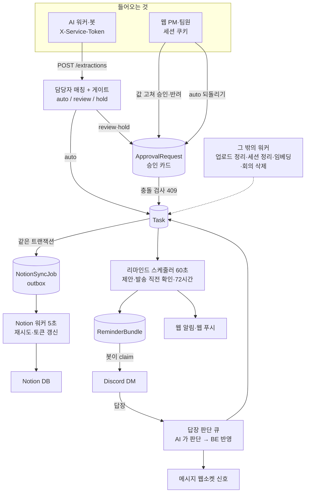

# 백엔드 설계 심화

AI 가 넘긴 판단을 "실제로 태스크에 반영해도 되는가"로 바꾸고, 사람의 확인·외부 서비스·시간이 걸리는 일을 안전하게 처리하는 BE 의 로직을 푼다. 테크스펙의 [요구사항·리스크](../../techspec/requirements-risks.md)(가드레일·예외 처리·장애 대응·보안)는 결론만 적고, 여기서는 그 칸이 코드로 어떻게 구현됐는지, 왜 그렇게 했는지, 무엇이 아직 모자란지를 적는다.

## 이 쪽들을 읽는 법

- 쪽마다 **문제 → 동작 → 왜 이 방식인가 → 어떻게 검증했나 → 한계와 다음 단계** 순서로 쓴다.
- 근거는 코드(`backend/app/`)와 결정 기록(`backend/docs/plan/mN/basis-for-decision/`)이다. 여기서는 요약하고 링크한다.
- 테스트는 대부분 SQLite 로 로컬에서 돌고, 행 잠금·동시성 테스트는 PostgreSQL 이 있어야 해서 CI 에서 돈다(로컬에서는 skip).

## BE 가 하는 일 한 장

AI 는 값과 근거 상태를 만들 뿐이다. 태스크를 만들지, PM 에게 물을지, 언제 DM 을 보낼지는 모두 BE 가 정한다. 워커는 모두 API 프로세스 안의 스레드로 돈다([`app/main.py`](../../../backend/app/main.py) lifespan, 운영은 `--workers 1`).

## 쪽 목록

| 쪽 | 다루는 것 | 먼저 볼 곳 |
|---|---|---|
| [담당자 매칭과 게이트](gate-matching.md) | `POST /extractions` 의 담당자 찾기, 별칭, auto/review/hold, `auto_blockers` | 숫자 대신 조건 게이트, 추측 이름을 별칭으로 배우지 않기 |
| [승인과 충돌](approval-conflict.md) | 값 고쳐 승인·반려, 409 세 가지, auto 되돌리기, 다른 회의 항목 합치기, 범위 변경 이력 | 기준값(`base_values`)과 payload 지문으로 하는 낙관적 동시성 |
| [Notion 동기화](notion-sync.md) | OAuth 연결, outbox, 재시도, 토큰 갱신, 결과 모르는 생성 | DB 와 외부 API 를 한 트랜잭션으로 묶지 않는 방법 |
| [리마인드 스케줄러와 백그라운드 작업](reminder-scheduler.md) | 재촉 제안 → 승인 → DM → 답장 판단 → 72시간 막힘, 웹소켓·푸시, 그 밖의 워커 | 틱이 상태만 보고 움직여 재시작에 강함 |
| [보안](security.md) | 비밀번호·세션 해시·로그인 잠금·이메일 인증·카카오, 권한, 서비스 토큰, OAuth state, 탈퇴·회의 삭제·동의 기록 | 막힌 요청은 DB 를 안 건드림, 탈퇴의 정리 영수증 |

## 도메인 모델 요약

원본은 [`backend/app/models/models.py`](../../../backend/app/models/models.py)(테이블 45개). 묶음별로 줄였다.

| 묶음 | 테이블 | 핵심 |
|---|---|---|
| 계정 | `User`, `Session`, `PasswordResetToken`, `SignupEmailCode`, `UserConsent`, `WithdrawalReceipt`, `PrivacyCleanup` | 세션·재설정 토큰은 해시만 저장. 탈퇴는 영수증과 정리 작업 행을 같은 커밋에 |
| 워크스페이스 | `Workspace`, `Member`, `Invitation`, `Integration`, `WorkspaceMessageSettings`, `WorkspaceOnboardingStepState` | `Member.role` 은 `pm`/`member`. Notion·Discord 연결은 `Integration` 한 행씩 |
| 담당자 별칭 | `MemberAlias`, `AliasResolutionLog`, `AliasReview` | 별칭 출처(`display_name`·`discord_profile`·`manual`·`learned`)와 검증 여부 |
| 회의 | `Meeting`, `MeetingUpload`, `MeetingPurge`, `Source` | `Source` 는 발화 한 줄(`seq`, 화자, 시각). 회의 삭제는 행을 남기고 원문을 비움 |
| 추출 | `Extraction`, `ExtractionItem`, `Evidence` | 항목마다 `gate`, 근거 상태, 연결된 `task_id`/`approval_id` |
| 태스크 | `Task`, `TaskHistory`, `NotionSyncJob`, `ApprovalRequest` | `Task.version` 은 바뀔 때마다 +1. 이력은 필드 단위, 출처(`meeting`·`chat`·`manual`·`reminder_reply`·`scheduler`) |
| 메시지·리마인드 | `MessageThread`, `ThreadMessage`, `MessageThreadRead`, `ReminderBundle`, `Reminder`, `BotDmPart`, `ReminderWatch`, `SchedulerSuggestion`, `ReplyJudgment`, `ReplyChange` | 팀원마다 대화 하나, 재촉은 묶음으로 나감, 시계(`ReminderWatch`)가 72시간을 잼 |
| 알림 | `Notification`, `PushSubscription` | 웹 안 알림과 기기 푸시 |
| 요약·전사 힌트 | `Topic`, `TopicMeeting`, `TopicItem`, `Decision`, `WorkspaceAsrTerm`, `AsrTitleQueue` | 프로젝트 맵, 전사 오인식 검사의 용어 목록 |

## 공통 원칙

| 원칙 | 왜 | 어디서 |
|---|---|---|
| 잘못된 항목 하나로 요청 전체를 실패시키지 않는다 | 봇이 같은 요청을 재시도하다 회의 전체가 반영되지 않는다 | `extractions.create_extraction` 의 항목별 `continue` |
| 상태 전환은 조건부 UPDATE 로 선점한다 | 두 요청이 동시에 들어와도 한쪽만 진행한다 | 회의 `processing → done`, 승인 `pending → approved` |
| 외부 호출은 트랜잭션 밖, 요청은 outbox 로 | DB 커밋과 외부 API 결과를 한 번에 맞출 수 없다 | [Notion 동기화](notion-sync.md), 봇 DM claim |
| 모르는 값은 막는 쪽으로 | 잘못된 auto 는 PM 확인 없이 틀린 태스크를 만든다 | `AUTO_CREATE_ENABLED` 오타 → 꺼짐, 근거 상태 없음 → `missing_signals` |
| 비밀값은 해시나 서명으로만 | DB 가 새도 세션·토큰을 쓸 수 없게 | [보안](security.md) |

## 관련 문서

- 파트 안내: [`backend/README.md`](../../../backend/README.md), 문서 안내 [`backend/docs/README.md`](../../../backend/docs/README.md)
- 계약: [BE↔AI](../../../backend/docs/contracts/backend-ai-contract.md), [FE API](../../../frontend/docs/contracts/frontend-api-contract.md)
- AI 쪽 판단: [AI 판단 심화](../ai/index.md)
- 테크스펙: [아키텍처](../../techspec/architecture.md), [인터페이스](../../techspec/interface.md), [요구사항·리스크](../../techspec/requirements-risks.md)
