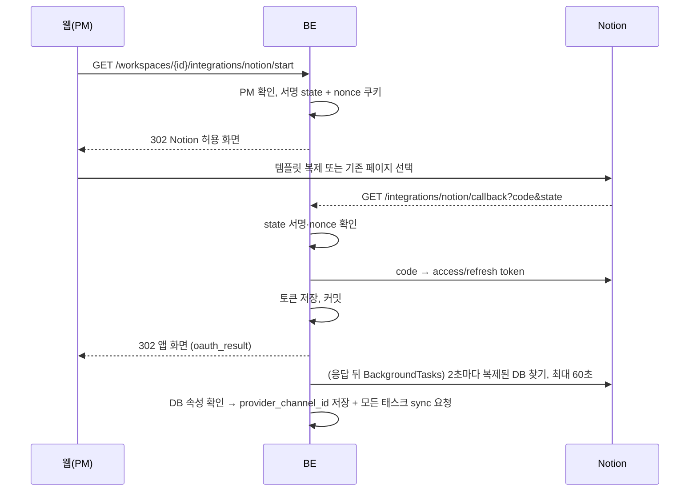
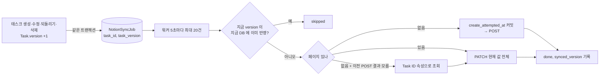

# Notion 동기화

승인된 태스크를 팀의 Notion 보드에 반영한다. 방향은 **BE → Notion 한 방향** 이다(Notion 에서 고친 값을 읽어 오는 코드는 없다). 코드는 연결 [`notion_oauth.py`](../../../backend/app/services/notion_oauth.py)·[`notion_connect.py`](../../../backend/app/services/notion_connect.py)·[`api/integrations.py`](../../../backend/app/api/integrations.py), 반영 [`notion_sync.py`](../../../backend/app/services/notion_sync.py)·[`notion.py`](../../../backend/app/services/notion.py).

## 문제

| 문제 | 그대로 두면 |
|---|---|
| 로컬 DB 와 Notion 은 한 트랜잭션으로 묶을 수 없다 | "Notion 엔 페이지가 생겼는데 로컬 커밋 실패", "타임아웃이라 롤백했는데 실제로는 생김" |
| Notion 장애·429 | 요청 안에서 부르면 태스크 API 자체가 실패한다 |
| 같은 태스크가 연달아 바뀜 | 늦게 처리된 옛 요청이 최신 값을 덮는다 |
| 토큰 만료·연결 끊김 | 요청이 계속 실패하며 재시도 자리를 차지한다 |
| 템플릿 복제가 십몇 초 걸린다 | OAuth callback 에서 기다리면 사용자가 멈춘 화면을 본다 |

## 동작

### 연결(OAuth)

| 갈래 | 처리 |
|---|---|
| 템플릿을 복제함 | 새 사본의 DB 로 옮긴다. 백그라운드가 DB 를 찾아 속성(워커가 쓰는 속성과 같은가)을 확인한 뒤 붙인다 |
| 기존 페이지를 고름(재연결) | 쓰던 DB 를 새 토큰으로 읽어 본다. 못 쓰면 아무것도 바꾸지 않고 `old_database_unusable` 로 돌려보낸다 |
| DB 찾기 실패(시간 초과·DB 없음·속성 다름) | 행은 남기고 **토큰만 비운다**. "연결됨인데 반영 안 됨" 반쪽 상태를 남기지 않고, 행 없음(연결한 적 없음)과 구분해 `revoked` 로 알린다 |
| 같은 공간 callback 이 동시에 두 번 | 유일 제약 위반 → `concurrent_connect` 실패 |

연결 상태(`GET .../integrations`): `connected` / `connecting`(DB 찾는 중, 60+60초 안) / `revoked`(토큰 비었음·DB 실패·작업 사라짐) / `not_connected`(행 없음). state 서명 규칙은 [보안](security.md#oauth-state).

### 반영(outbox)

| 항목 | 동작 |
|---|---|
| 요청 넣기 | 연결 상태와 상관없이 항상 넣는다. 넣는 순간 연결을 보고 거르면, 새 DB 가 붙는 순간과 겹친 태스크를 양쪽 모두 놓친다 |
| 순서·중복 | 항상 태스크의 **현재 값 전체** 를 보내고 `notion_synced_version` 에 보낸 버전을 남긴다. 지금 버전이 이미 반영됐으면 Notion 을 부르지 않는다 |
| 같은 태스크 동시 처리 | `in_progress` 작업이 있는 태스크는 꺼내지 않는다 |
| 대상 DB 가 바뀜 | 기록된 페이지는 옛 DB 것이라 쓰지 않고 지금 DB 에 새로 만든다 |
| 지운 태스크 | 페이지가 있으면 보관(archive), 없으면 만들지 않는다 |
| 워커가 죽음 | `in_progress` 로 300초 넘게 남은 작업은 대기열로 돌린다(시도 한도를 넘었으면 failed) |

### 실패 시 동작

| 응답 | 처리 |
|---|---|
| 429·409·5xx·네트워크 오류 | 재시도. `Retry-After` 가 있으면 그 값, 없으면 10초 × 2^(시도−1), 최대 600초. 최대 5회 |
| 400·403·404 | 다시 보내도 같으므로 바로 `failed`. 태스크 응답의 `notion_sync_status=failed` |
| 401 | `refresh_token` 으로 한 번 갱신(아래). 갱신되면 기다리지 않고 바로 다시 보낸다. 마지막 시도였어도 새 토큰으로 한 번은 더 |
| 결과를 모르는 POST(타임아웃·5xx·중단) | `notion_create_attempted_at` 이 남아 있어 다음 시도는 POST 대신 "Task ID" 속성으로 먼저 조회 → 중복 페이지 방지 |
| 수동 재시도 | `POST /tasks/{id}/notion-sync/retry`(PM). 실패 작업의 시도 횟수를 초기화한다. 이미 반영됐으면 거절 |

**토큰 갱신.** Notion 은 갱신할 때마다 새 `refresh_token` 을 주고 옛것은 받지 않는다. 그래서 연결 행을 잠그고 다시 읽은 뒤 갱신하고, 새 토큰을 바로 커밋한다. 그 사이 다른 워커가 이미 바꿨으면 그 토큰으로 다시 보낸다. 갱신이 거절되면 토큰을 비워 `revoked` 로 보이고, 작업은 시도로 세지 않은 채 **다시 연결할 때까지 꺼내지 않는다**(재시도 자리를 차지하지 않게). 401 을 받으면 태스크 행 기록을 먼저 커밋하고 연결 행을 잠근다. DB 를 붙이는 쪽이 연결 행 → 태스크 순서라 반대로 잡으면 교착한다.

## 왜 이 방식인가

| 결정 | 비교한 대안 | 고른 이유 |
|---|---|---|
| outbox + 워커 | 요청 안에서 Notion 호출(예전 방식) | Notion 장애가 태스크 API 를 실패시키지 않고, 커밋과 요청이 같이 남거나 같이 사라진다 |
| 현재 값 전체 + 버전 | 변경분만 보내기 | 요청이 늦게·중복으로 처리돼도 결과가 같다(멱등) |
| 생성 전 시각 커밋 후 조회 | 그냥 다시 POST | 결과를 모르는 POST 를 반복하면 페이지가 둘 생긴다 |
| 실패 연결은 토큰만 비움 | 행 삭제 | "연결한 적 없음"과 "끊김"을 PM 이 구분해야 다시 연결한다 |
| DB 찾기는 응답 뒤 | callback 에서 기다림 | 복제에 십몇 초 걸린다 |

결정 기록은 `backend/docs/plan` 에 따로 없고 근거는 모듈 머리 주석과 [backend README Notion 연동](../../../backend/README.md#notion-연동)에 있다.

## 어떻게 검증했나

| 범위 | 테스트 |
|---|---|
| outbox·재시도·버전 건너뛰기·결과 모르는 생성·토큰 갱신 | [`tests/services/test_notion_sync.py`](../../../backend/tests/services/test_notion_sync.py) |
| Notion API 호출 모양·오류 분류 | `tests/services/test_notion.py` |
| 템플릿 DB 찾기·속성 확인·토큰 비우기 | `tests/services/test_notion_connect.py` |
| OAuth 주소·state·callback 갈래 | `tests/services/test_notion_oauth.py`, `tests/api/test_notion_oauth_api.py` |

실제 Notion 을 부르는 테스트는 없다(가짜 transport). 운영 연결 확인 결과 [확인 필요].

> 📷 **사진 자리**: 태스크 승인 뒤 Notion 보드에 같은 카드가 생긴 화면과 웹의 동기화 상태 표시 (파일: ../../assets/design-backend-notion-sync.png)

## 한계와 다음 단계

- **한 방향이다.** Notion 에서 고친 값은 BE 로 돌아오지 않고, 다음 BE 변경 때 덮인다.
- 워커는 프로세스당 하나 전제다(`--workers 1`). 늘리면 같은 작업을 두 워커가 볼 수 있다.
- 끝난 작업 행을 지우지 않는다. Notion 을 안 쓰는 공간도 태스크를 고칠 때마다 한 줄씩 쌓인다.
- 범위 결정(scope)은 Notion 에 남지 않는다([승인과 충돌](approval-conflict.md#범위-변경-이력544)).
- 400·403 으로 실패하면 PM 이 원인을 고친 뒤 수동 재시도해야 한다. 자동 알림은 [확인 필요].
