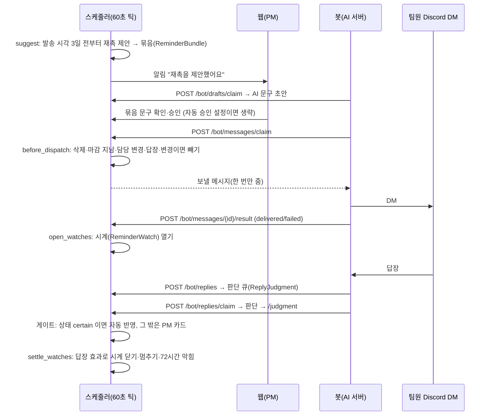

# 리마인드 스케줄러와 백그라운드 작업

마감 전 재촉을 제안하고, PM 이 승인한 문구를 봇이 DM 으로 보내고, 답장을 AI 가 판단해 태스크에 반영하고, 72시간 무응답이면 막힘으로 바꾸는 흐름이다. 코드는 [`services/scheduler.py`](https://github.com/kakaotechcampus-4/ktc4-kyungpook-3/blob/develop/backend/app/services/scheduler.py), [`services/messages.py`](https://github.com/kakaotechcampus-4/ktc4-kyungpook-3/blob/develop/backend/app/services/messages.py), [`services/replies.py`](https://github.com/kakaotechcampus-4/ktc4-kyungpook-3/blob/develop/backend/app/services/replies.py), 봇 경로 [`api/bot_messages.py`](https://github.com/kakaotechcampus-4/ktc4-kyungpook-3/blob/develop/backend/app/api/bot_messages.py).

## 문제

| 문제 | 그대로 두면 |
|---|---|
| 서버가 재시작·배포된다 | 예약 작업(cron 식)이면 꺼진 동안의 일을 놓치거나 두 번 한다 |
| 승인 뒤 발송 전에 상황이 바뀐다 | 이미 답했거나 담당자가 바뀐 팀원에게 재촉이 나간다 |
| 답장 판단은 AI 가 하고 몇 분 걸린다 | 판단 중에 72시간 시계가 막힘을 걸어 버린다 |
| DM 이 실제로 안 갔다 | 받지도 않은 재촉으로 "무응답"이 된다 |
| 행 하나의 실패 | 다른 워크스페이스의 재촉까지 멈춘다 |

## 동작

### 전체 흐름

### 틱 하나(`run_tick`)가 하는 일

| 순서 | 단계 | 내용 |
|---|---|---|
| 1 | `suggest` | 마감이 있는 미완료 태스크(담당자 활성)마다, 발송 시각(기본 마감 1일 전 09:00 KST, 설정으로 조정)의 3일 전부터 제안을 만든다. 이미 제안했거나 예약 재촉이 있거나 팀원이 마지막으로 답했으면 건너뜀 |
| 2 | `dispatch_due` | 발송 직전 확인(아래) → 자동 승인 → 승인된 묶음을 봇 메시지로. 탈퇴한 팀원 묶음은 취소 |
| 3 | `open_watches` | 나간 리마인드마다 시계를 연다. 같은 태스크의 이전 시계는 멈추고, 자동 막힘이 걸린 채면 되돌릴 값을 이어받는다 |
| 4 | `replies.expire` | 큐에 들어온 지 10분 지난 판단 대기 답장을 `timed_out` 으로 닫고 PM 에게 알린다 |
| 5 | `settle_watches` | 열린 시계를 답장·변경·시각에 따라 닫거나 막는다 |
| 6 | `send_pending_pushes` | 남은 웹 푸시를 보낸다 |

틱은 **지금 상태만 보고** 할 일을 정한다. 그래서 서버가 꺼졌다 켜지면 밀린 일을 한 번에 처리하고, 같은 시각에 두 번 돌려도 결과가 같다. 항목마다 PostgreSQL advisory lock(`pg_try_advisory_xact_lock`)을 잡고 커밋하며, 실패한 항목은 로그만 남기고 다음 틱에 다시 본다.

### 발송 직전 확인(`before_dispatch`)

봇이 메시지를 가져갈 때마다 돈다. 잠그지 않고 사유부터 본 뒤 뺄 것만 잠가 다시 확인한다(PM 조작을 세우지 않으려고).

| 사유 | 조건 |
|---|---|
| `deleted` | 태스크가 지워짐 |
| `expired` | 마감이 이미 지남 |
| `reassigned` | 제안 뒤 담당자가 바뀜 |
| `replied` | 제안 뒤 팀원 답장이 옴 |
| `changed` | 제안 뒤 상태·마감이 바뀜(스케줄러·답장이 바꾼 것은 제외) |

빠진 재촉은 PM 에게 알리고, 승인됐던 묶음은 승인이 풀려 PM 이 다시 본다(#314 규칙).

### 72시간 무응답 막힘과 답장의 효과

시계는 **DM 전달 보고(`delivered`) 시각부터** 72시간을 잰다. 전달에 실패한 재촉으로는 막지 않고, 실패 상태로 72시간이 지나면 시계를 멈춘다. 시한이 되면 태스크를 `blocked`, 사유 "리마인드에 72시간 동안 응답이 없어요"(출처 `scheduler`)로 바꾸고 이전 상태를 시계에 남긴다. PM 은 `/tasks/{id}/auto-block/undo` 로 되돌릴 수 있다.

답장이 시계에 뜻하는 바는 판단이 끝난 뒤 `replies.clock_effect` 가 정한다.

| 효과 | 언제 | 시계 |
|---|---|---|
| `WAIT` | 판단 대기 중 | 아무것도 안 함(막지도 풀지도 않음) |
| `KEEP_BLOCKED` | 답장이 "막혔다"고 함 | 시계만 닫고 막힘 유지 |
| `ANSWERED` | 이 태스크에 대한 줄이 있음, 판단 실패·시간 초과(사람 답장이 온 것은 사실) | 자동 막힘을 풀고 닫음 |
| `PAUSE` | PM 이 어느 태스크 답장인지 골라야 함(`needs_pm`) | 멈춘 시간만큼 시한을 민다 |

### 답장 판단 결과 반영

봇이 `/bot/replies/claim` 으로 답장 한 통을 맡고(대화마다 가장 오래된 것부터, 3분 리스), 판단 결과를 보내면 게이트·반영·카드·기록·알림이 한 트랜잭션이다. 같은 attempt 재전송은 200, 다른 attempt 는 409. 큐에 들어온 지 10분이 지나면 맡기지 않는다(한 답장 최대 4회 시도, [reply-judgment-attempt-cap](https://github.com/kakaotechcampus-4/ktc4-kyungpook-3/blob/develop/backend/docs/plan/m6/basis-for-decision/2026-11-08-reply-judgment-attempt-cap.md)).

| 변경 줄 | 결과 |
|---|---|
| 상태 변경, Jev certain, 그 팀원 담당, 판단이 본 값이 지금도 같음 | **자동 반영**(`applied`, 출처 `reminder_reply`). PM 은 `/reply-changes/{id}/undo` 로 되돌림 |
| "막혔다"인데 이미 막힘 | `noted` |
| 그 밖(마감·담당·범위, inferred 등) | `task_update` 승인 카드(`proposed`) |
| 지금 값과 같음 | `skipped` |

AI 쪽 판단 방법은 [리마인드 답장 판단](../ai/reply-judgment.md).

### 실시간 신호와 푸시

| 경로 | 방식 |
|---|---|
| 메시지 웹소켓(#557) | [`api/message_socket.py`](https://github.com/kakaotechcampus-4/ktc4-kyungpook-3/blob/develop/backend/app/api/message_socket.py). 본문은 보내지 않고 "새 줄 생김" 신호만 보낸다. FE 는 신호를 받으면 기존 조회를 다시 부른다(권한 검사를 조회 한 곳에 둔다). 같은 출처(Origin = Host)만 받고, 세션을 30초마다 다시 확인한다. 신호는 커밋 뒤에만 나가 롤백된 글은 신호가 없다([`thread_signals.py`](https://github.com/kakaotechcampus-4/ktc4-kyungpook-3/blob/develop/backend/app/services/thread_signals.py)). 연결당 64개 넘게 밀리면 끊어 다시 붙게 한다 |
| 웹 안 알림 | `Notification`. `dedupe_key` 로 같은 알림을 한 번만 |
| 웹 푸시 | [`push.py`](https://github.com/kakaotechcampus-4/ktc4-kyungpook-3/blob/develop/backend/app/services/push.py), VAPID. 키가 없으면 웹 안 알림만. 404·410 이면 구독 삭제, 400·401·403 은 재시도 안 함(키 설정 문제일 수 있어 구독은 남김). TTL 24시간 |

### 그 밖의 백그라운드 작업

모두 API 프로세스 안의 스레드다([`app/main.py`](https://github.com/kakaotechcampus-4/ktc4-kyungpook-3/blob/develop/backend/app/main.py)). 주기는 환경 변수, 0 이하면 끈다.

| 워커 | 주기(기본) | 하는 일 | 실패·중단 대비 |
|---|---|---|---|
| 리마인드 스케줄러 | 60초 | 위 틱 | 항목별 커밋, advisory lock |
| Notion 동기화 | 5초 | [Notion 동기화](notion-sync.md) | 300초 리스, 지수 백오프 |
| 임베딩 채우기 | 5초 | 임베딩 없는 태스크를 `text-embedding-3-small` 로 채움(50개씩). 키 없으면 안 띄움 | 입력 오류(400·413·422)는 그 태스크만 건너뜀, 그 밖은 백오프 최대 300초. 임베딩 없는 태스크가 있으면 auto 를 막음 |
| 업로드 정리 | 300초 | [`upload_sweeper.py`](https://github.com/kakaotechcampus-4/ktc4-kyungpook-3/blob/develop/backend/app/services/upload_sweeper.py): AI 가 가져가지 않은 업로드 24시간(`upload_unclaimed`), 진행 없음 3시간, 화자 지정 대기 7일, 채팅 `/end` 뒤 7시간 → `failed` + 녹음 폴더 삭제 | 공간→회의 잠금 뒤 조건부 UPDATE. AI 보고가 먼저 오면 건너뜀 |
| 세션 정리 | 3600초 | 만료 세션 DELETE 한 문장 | 여러 번 돌려도 같음 |
| 회의 삭제 정리 | 10초 | 삭제 접수된 회의의 BE 파일 정리, AI 정리 확인 대기 | claim token 해시·120초 리스 |
| 요약 큐 | 봇이 claim | [`summary.py`](https://github.com/kakaotechcampus-4/ktc4-kyungpook-3/blob/develop/backend/app/services/summary.py): 추출 등록 때 요약 요청 표시 → 봇이 맡아 요약 저장. 실패 알림 API 없이 15분 리스가 지나면 다시 맡김, 최대 2회 | claim token 해시가 같은 리스의 저장만 허용 |

## 왜 이 방식인가

| 결정 | 비교한 대안 | 고른 이유 | 기록 |
|---|---|---|---|
| 상태만 보는 틱 | 시각마다 예약 작업 | 재시작·중복 실행에 결과가 같다 | `scheduler.py` 머리 주석 |
| 72시간은 전달 보고부터 | 제안·발송 시각부터 | 전달 안 된 재촉으로 막으면 팀원 잘못이 아니다 | `_run_clock` |
| 판단 재시도는 시간 창(10분) | 횟수 상한 | 봇 재시작·배포에도 판단 실패 알림 전에 한 번 더 돈다 | [reply-judgment-attempt-cap](https://github.com/kakaotechcampus-4/ktc4-kyungpook-3/blob/develop/backend/docs/plan/m6/basis-for-decision/2026-11-08-reply-judgment-attempt-cap.md) |
| 자동 막힘 여부는 되돌리기 API 조건으로 | 이력에서 판정 | 화면 표시와 되돌리기 가능 여부가 어긋나지 않게 | [task-auto-blocked](https://github.com/kakaotechcampus-4/ktc4-kyungpook-3/blob/develop/backend/docs/plan/m2/basis-for-decision/2026-11-05-task-auto-blocked.md) |
| 소켓은 신호만 | 본문 push | 권한 검사를 조회 한 곳에 둔다 | `message_socket.py` 머리 주석, #557 (BE 결정 기록은 없고 근거는 이 머리 주석과 FE 558 result 의 신호 뒤 조회 재호출). 테스트 경계는 [socket-test-session-boundary](https://github.com/kakaotechcampus-4/ktc4-kyungpook-3/blob/develop/backend/docs/plan/m0/basis-for-decision/2026-11-09-socket-test-session-boundary.md) |
| 재촉 이유와 근거를 묶음에 | 문구만 | PM 이 왜 나가는지 보고 승인한다 | [bundle-reason-evidence](https://github.com/kakaotechcampus-4/ktc4-kyungpook-3/blob/develop/backend/docs/plan/m6/basis-for-decision/2026-11-06-bundle-reason-evidence.md) |

## 어떻게 검증했나

| 범위 | 테스트 |
|---|---|
| 제안·발송 직전·시계·막힘 | [`tests/api/test_scheduler.py`](https://github.com/kakaotechcampus-4/ktc4-kyungpook-3/blob/develop/backend/tests/api/test_scheduler.py), `test_scheduler_rules.py`, `test_scheduler_settings.py`, `test_scheduler_outage.py`(꺼졌다 켜짐) |
| 동시성 | `test_scheduler_concurrency.py`, `test_scheduler_extraction_lock.py`, `test_messages_concurrency.py`(PostgreSQL) |
| 답장 판단·게이트·시계 효과 | `test_reply_judgment.py`, `test_replies.py`, `test_reply_clock.py`, `test_reply_review.py` |
| 재촉 이유 | `test_reminder_reason.py` |
| 웹소켓·알림 | `test_message_socket.py`, `test_message_notifications.py`, `test_notifications_api.py` |
| 업로드·세션 정리 | `tests/services/test_upload_sweeper.py`, `test_upload_sweeper_concurrency.py`, `tests/test_session_sweep_worker.py` |

시각은 `now` 를 인자로 받아 테스트가 시간을 돌린다(72시간을 기다리지 않는다).

## 한계와 다음 단계

- 워크스페이스 시간대는 서울 고정(`UTC+9`)이다. 시간대 칼럼이 없다.
- 웹소켓 연결표와 로그인 제한이 프로세스 메모리라 `--workers 1` 전제다. 늘리면 신호가 일부 연결에만 닿는다.
- 기기가 24시간 넘게 꺼져 있으면 그 푸시는 버려지고 웹 안 알림만 남는다.
- 72시간 막힘이 실제 운영에서 몇 번 걸렸는지는 [확인 필요].
