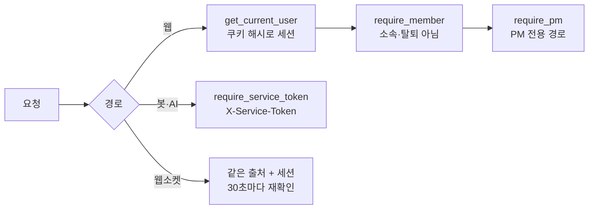

# 보안

로그인·권한·서비스 간 인증·OAuth, 그리고 탈퇴·회의 삭제·동의 기록처럼 개인정보를 다루는 BE 장치를 모았다. 테크스펙 [요구사항·리스크 보안 절](../../techspec/requirements-risks.md#보안)의 표가 결론이고, 여기서는 구현과 이유를 적는다. 진입점은 [`api/auth.py`](https://github.com/kakaotechcampus-4/ktc4-kyungpook-3/blob/develop/backend/app/api/auth.py), [`api/deps.py`](https://github.com/kakaotechcampus-4/ktc4-kyungpook-3/blob/develop/backend/app/api/deps.py).

## 문제

| 위협·요구 | 막을 것 |
|---|---|
| DB 유출 | 세션·재설정 토큰·가입 코드를 그대로 쓸 수 있으면 안 된다 |
| 무차별 대입 | 비밀번호 추측, 재설정 메일로 팀 메일 발송 한도 소진 |
| 가입 여부 노출 | 응답·시간 차이로 "이 이메일이 가입돼 있다"를 알려 주면 안 된다 |
| 권한 | 팀원이 승인·연동을 바꾸거나, 사용자 세션으로 봇 경로를 부르면 안 된다 |
| OAuth 위조 | 다른 사람의 callback 재사용, 다른 공간·다른 제공자로 연결 |
| 개인정보 | 탈퇴자의 이름·연결, 회의 음성·원문이 필요 이상 남으면 안 된다 |

## 동작

### 인증

| 장치 | 구현 | 코드 |
|---|---|---|
| 비밀번호 | PBKDF2-HMAC-SHA256 260,000회, 무작위 salt. 비교는 `hmac.compare_digest`. 없는 계정도 더미 해시로 한 번 계산해 응답 시간을 맞춘다 | [`passwords.py`](https://github.com/kakaotechcampus-4/ktc4-kyungpook-3/blob/develop/backend/app/services/passwords.py) |
| 세션(#437) | 쿠키 `session_token`(7일)에는 원문, DB 에는 **sha256 해시만**. 쿠키 값을 해시해 찾는다. 만료 세션은 401 을 주고, 지우는 일은 정리 워커(1시간) 몫. 로그아웃은 그 행 하나, 재설정 확인은 그 계정 세션 전부를 지운다 | [`sessions.py`](https://github.com/kakaotechcampus-4/ktc4-kyungpook-3/blob/develop/backend/app/services/sessions.py) |
| 로그인 잠금 | 같은 이메일 15분 10회, 같은 공인 IP 15분 50회 실패 → 15분 429 `TOO_MANY_LOGIN_ATTEMPTS`(`Retry-After`). 막힌 동안은 **해시 계산도 DB 연결도 없이** 끊는다. 이메일·IP 막힘, 있는·없는 이메일 응답이 같다. IPv6 는 /64, 사설 주소는 IP 제한 생략 | [`login_limit.py`](https://github.com/kakaotechcampus-4/ktc4-kyungpook-3/blob/develop/backend/app/services/login_limit.py) |
| 비밀번호 재설정 | 30분 1회용 토큰(해시 저장). 계정당 60초 1회·1시간 5회, 공인 IP 시간당 5회(#550), 전체 시간당 10통. 확인이 커밋되면 그 이메일의 로그인 막힘도 푼다 | [`password_reset.py`](https://github.com/kakaotechcampus-4/ktc4-kyungpook-3/blob/develop/backend/app/services/password_reset.py), [`password_reset_limit.py`](https://github.com/kakaotechcampus-4/ktc4-kyungpook-3/blob/develop/backend/app/services/password_reset_limit.py) |
| 가입 이메일 인증 | 6자리 코드 10분, 코드당 5회, 재발송 60초, 시간당 5회, 전체 시간당 20통. DB 에는 HMAC 만. 맞으면 이메일을 담은 서명 증명(30분)을 준다 | [`signup_codes.py`](https://github.com/kakaotechcampus-4/ktc4-kyungpook-3/blob/develop/backend/app/services/signup_codes.py) |
| 카카오 로그인 | state·nonce 확인 → 카카오 사용자 조회. 이미 가입한 카카오 계정이면 세션을 만든다. 아니면 서명된 대기 쿠키(HttpOnly, Secure, SameSite=Lax, 30분)에 카카오 id 와 닉네임만 담고 가입 화면으로 보낸다. 카카오가 이메일을 줘도 저장하지 않고 같은 이메일의 기존 계정과 잇지도 않는다(#610). 가입 화면에서는 이메일 인증 없이 이름·아이디만 정하며 비밀번호는 없다 | [`kakao_oauth.py`](https://github.com/kakaotechcampus-4/ktc4-kyungpook-3/blob/develop/backend/app/services/kakao_oauth.py) |

**#549 재검토.** 이메일 기준 잠금은 남이 내 이메일로 10번 틀려 15분 막을 수 있다. (이메일, IP) 조합 키도 다시 봤지만 버리고, 429 화면에서 재설정 안내(FE)로 완화했다. 429 에 이메일·IP 구분을 싣지 않는 것은 공격자에게 무엇을 바꿀지 신호가 되기 때문이다.

### 권한

| 구분 | 내용 |
|---|---|
| PM 전용 | 승인·반려, 태스크 생성·수정·되돌리기, auto 되돌리기, 팀원·별칭 관리, 연동 연결, 업로드, 설정 쓰기, 화자 지정·녹음 재생·삭제 영수증 조회 |
| 소속이면 누구나 | 조회 대부분(화자 지정·녹음 재생·삭제 영수증은 PM), 승인 요청 생성(요청자는 바디가 아니라 로그인한 팀원), 자기 대화 답장 |
| 마지막 PM 보호 | 로그인 계정이 있는 PM 이 0명이 되면 409 `LAST_PM_REQUIRED` |
| 서비스 토큰 | 봇·AI 경로 전부. `SERVICE_TOKEN` 이 비면 **모두 거절**. 바이트로 `compare_digest`(ASCII 아닌 헤더도 500 대신 401). 사용자 세션으로 대신할 수 없다 |

### OAuth state

Notion·Discord 연결과 카카오 로그인이 같이 쓴다([`oauth_state.py`](https://github.com/kakaotechcampus-4/ktc4-kyungpook-3/blob/develop/backend/app/services/oauth_state.py)).

| 장치 | 이유 |
|---|---|
| `base64url(JSON).HMAC-SHA256`, DB 저장 없음 | callback 주소에 workspace_id 를 넣을 수 없어 시작 때 값을 서명해 돌려받는다 |
| 키 32자 미만이면 서명 거부 | 짧은 키는 무차별 대입에 약하다 |
| 제공자·종류(`v`)를 서명 안에 | 한 제공자의 state 를 다른 callback 에 못 쓴다 |
| nonce 짝 쿠키, 쓰면 지움 | state 를 한 번만 쓰게 한다 |
| 유효 600초, 복귀 경로는 앱 안 경로만(512자) | 오래된 링크 재사용과 외부 주소로의 리다이렉트를 막는다 |
| 서명이지 암호화가 아님 | 토큰·비밀번호를 넣지 않는다 |

### 개인정보 수명

| 대상 | 정책 | 근거 |
|---|---|---|
| 계정 탈퇴(#584) | `GET /auth/withdrawal-plan` 으로 공간별 처리(보존·단독 공간 삭제·PM 이전 필요)를 보여 주고, `DELETE /auth/me`(202)가 잠금 안에서 다시 검사한다. 계정·세션·푸시·프로필 정리를 **한 트랜잭션**, 파일·AI 사본 정리는 같은 커밋에 남긴 정리 작업(`PrivacyCleanup`)과 개인정보 없는 영수증으로 따로 확인한다 | [withdrawal-cleanup-protocol](https://github.com/kakaotechcampus-4/ktc4-kyungpook-3/blob/develop/backend/docs/plan/m1/basis-for-decision/2026-11-09-withdrawal-cleanup-protocol.md) |
| 탈퇴자의 공동 기록 | Member 행은 남기되 이름 "탈퇴한 사용자", 계정·Discord·Notion 연결은 NULL. DB CHECK 로 강제해 프로필 재연결을 막는다. 대화·이력의 참조는 유지 | [withdrawn-record-actor](https://github.com/kakaotechcampus-4/ktc4-kyungpook-3/blob/develop/backend/docs/plan/m1/basis-for-decision/2026-11-09-withdrawn-record-actor.md) |
| 회의 삭제 | 회의 행은 남기고 제목·전사·추출·근거를 지운다. 태스크는 남는다. 늦게 온 AI 쓰기는 410. BE·AI 파일 정리가 끝날 때까지 pending | [meeting-deletion](https://github.com/kakaotechcampus-4/ktc4-kyungpook-3/blob/develop/backend/docs/plan/m3/basis-for-decision/2026-11-09-meeting-deletion.md) |
| 회의 음성(#568) | 업로드 녹음은 추출 등록 커밋 직후 BE 가 지운다. 디스코드 트랙은 AI 워커가 인계 직후, 포기·멈춘 회의는 7일 뒤 지운다(정책 시행 2026-11-09 이후 회의만) | [AI 0055](https://github.com/kakaotechcampus-4/ktc4-kyungpook-3/blob/develop/ai/docs/basis_for_decision/ai/2026-11-08-0055-meeting-audio-retention.md) |
| 약관 동의(#569) | `user_consent` 에 문서·버전·시각을 버전마다 한 행. 지금 버전은 `CURRENT_VERSIONS` 한 곳, 올리면 모두 다시 동의(`required`). 옛 버전으로 보내면 400 | [consent-records](https://github.com/kakaotechcampus-4/ktc4-kyungpook-3/blob/develop/backend/docs/plan/m1/basis-for-decision/2026-11-08-consent-records.md) |

## 왜 이 방식인가

| 결정 | 비교한 대안 | 고른 이유 | 기록 |
|---|---|---|---|
| 세션 해시 저장 + 데이터만 바꾸는 마이그레이션 | 원문 저장 유지 / 컬럼 이름 변경 | DB 가 새도 세션을 못 쓴다. 이미 로그인한 사용자는 그대로 | [session-token-hash](https://github.com/kakaotechcampus-4/ktc4-kyungpook-3/blob/develop/backend/docs/plan/m1/basis-for-decision/2026-11-06-session-token-hash.md) |
| 로그인 잠금은 프로세스 메모리 | DB 테이블 | 막힌 요청을 DB 연결 없이 끊고, 공격 중 실패마다 쓰기가 생기지 않는다. 재시작이 비상 해제 수단 | [login-rate-limit](https://github.com/kakaotechcampus-4/ktc4-kyungpook-3/blob/develop/backend/docs/plan/m1/basis-for-decision/2026-11-06-login-rate-limit.md) |
| 재설정 메일 IP·전체 상한 | 계정별 제한만 | 가입된 주소 여러 개로 팀 Gmail 하루 한도(약 500통)를 바닥낼 수 있다 | [reset-mail-cap](https://github.com/kakaotechcampus-4/ktc4-kyungpook-3/blob/develop/backend/docs/plan/m1/basis-for-decision/2026-11-08-reset-mail-cap.md) |
| 탈퇴자 Member 보존 | 기록 주체 테이블 신설(FK 16개 이전) | 공동 기록의 참조를 그대로 두는 비용이 더 작다 | [withdrawn-record-actor](https://github.com/kakaotechcampus-4/ktc4-kyungpook-3/blob/develop/backend/docs/plan/m1/basis-for-decision/2026-11-09-withdrawn-record-actor.md) |
| 카카오 callback 은 계정을 만들지 않고, 카카오 가입을 카카오만으로 끝내며 이메일 기반 기존 계정 병합을 두지 않음(#610) | callback 에서 바로 가입 / 인증된 카카오 이메일로 기존 계정에 병합(#610 이전 안) | 카카오 이메일을 저장하지 않으므로 같은 이메일 계정을 선점하거나 잇는 경로가 없다. 카카오 가입 계정은 이메일·비밀번호 없이 카카오 id 로만 로그인한다 | [kakao-login-decision](https://github.com/kakaotechcampus-4/ktc4-kyungpook-3/blob/develop/backend/docs/plan/m1/basis-for-decision/2026-11-06-kakao-login-decision.md) |

## 어떻게 검증했나

| 범위 | 테스트 |
|---|---|
| 세션 해시·마이그레이션·정리 | `tests/api/test_session_hash_api.py`, `tests/services/test_sessions.py`, `tests/test_migration_hash_session_token.py`, `tests/test_session_sweep_worker.py` |
| 로그인 잠금·응답 시간 | [`tests/api/test_login_rate_limit.py`](https://github.com/kakaotechcampus-4/ktc4-kyungpook-3/blob/develop/backend/tests/api/test_login_rate_limit.py), `test_login_lock.py`, `test_login_timing.py`, `tests/services/test_login_limit.py` |
| 재설정·가입 코드·카카오 | `test_password_reset_api.py`, `test_password_reset_service.py`, `tests/services/test_password_reset_limit.py`, `test_signup_code_api.py`, `test_kakao_login_api.py` |
| 권한·서비스 토큰 | `tests/api/test_pm_permission.py`, `test_auth_guard.py` |
| OAuth state | `tests/services/test_oauth_state.py` |
| 탈퇴·회의 삭제·동의 | `test_account_withdrawal.py`, `test_withdrawal_concurrency.py`(PostgreSQL), `test_withdrawn_actor.py`, `test_meeting_deletion.py`, `test_consents_api.py` |

재설정 메일은 2026-11-08 운영에서 실제 발송을 확인했다(#451, [reset-mail-cap](https://github.com/kakaotechcampus-4/ktc4-kyungpook-3/blob/develop/backend/docs/plan/m1/basis-for-decision/2026-11-08-reset-mail-cap.md)). 배포 쪽 장치(OIDC→SSM, API 는 `127.0.0.1`, Caddy HTTPS)는 [deploy/README.md](https://github.com/kakaotechcampus-4/ktc4-kyungpook-3/blob/develop/deploy/README.md).

## 한계와 다음 단계

- 로그인·재설정 IP 제한이 메모리라 `--workers 1` 전제. 재시작하면 횟수가 풀린다.
- 전체 메일 상한은 IP 여러 개로 채울 수 있다. 로그(`reason=global`)로 알아채고 IP 를 막는 운영 대응이다.
- 서버는 약관에 동의하지 않은 사용자의 다른 API 를 막지 않는다(FE 가 동의 화면을 띄운다).
- 가입의 `EMAIL_ALREADY_EXISTS` 로 가입 여부가 드러난다(남은 노출).
- 탈퇴 정리는 로컬 사본까지다. 외부 공급사(STT·LLM)의 원격 보관과 이미 나간 Discord 메시지는 회수했다고 주장하지 않는다.
- 운영 `SERVICE_TOKEN`·`OAUTH_STATE_SECRET` 교체 주기 [확인 필요].
