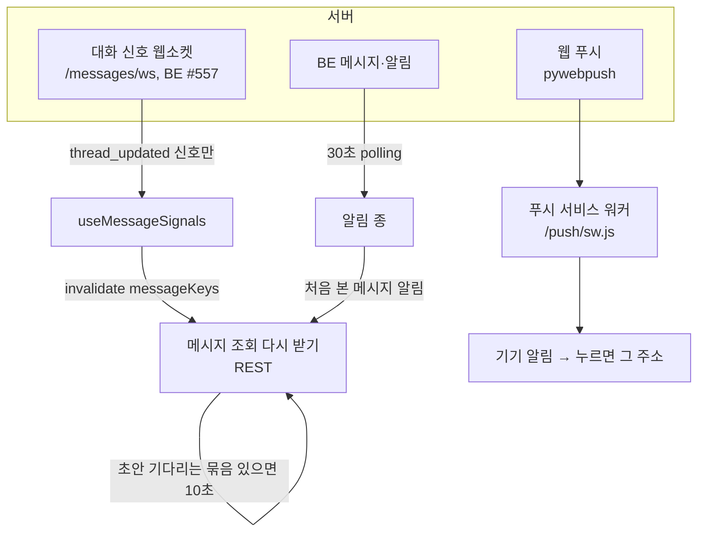

# 메시지·알림 실시간

리마인드 DM 확인(PM), 팀원과의 대화·웹 답장, 알림 종·브라우저 푸시, 진행 토스트를 "얼마나 빨리, 어떤 길로" 화면에 반영하는지의 설계다. 화면 정책은 D-174(메시지 정책), 갱신 방식은 [2026-11-06 결정](https://github.com/kakaotechcampus-4/ktc4-kyungpook-3/blob/develop/frontend/docs/plan/m8/basis-for-decision/2026-11-06-message-sync-and-e2e.md)과 #558 [결과](https://github.com/kakaotechcampus-4/ktc4-kyungpook-3/blob/develop/frontend/docs/issues/558-message-websocket/result.md)에 있다.

## 문제

| 문제 | 그대로 두면 |
|---|---|
| AI 초안 도착, 스케줄러의 자동 취소, DM 전달 결과, 팀원 답장은 서버에서 일어난다 | 화면 재진입·탭 복귀 때만 보이고, PM 은 승인 직전 문구가 바뀐 것을 409 를 받고서야 안다 |
| BE 에 처음엔 SSE·WebSocket 이 없었다 | 상시 polling 은 대부분의 시간에 쓸모없는 요청이다 |
| 팀원은 웹을 열어 두지 않는다 | 재촉이 와도 모른다. 웹 푸시와 설치형 앱이 필요하다 |
| 로그아웃·계정 전환 중에도 연결·주기 조회가 남을 수 있다 | 다음 세션의 캐시에 앞 세션 데이터가 닿는다 |

## 동작

### 메시지 화면 구성

| 구역 | 누가 | 하는 일 |
|---|---|---|
| 보내기 전 확인 | PM | 태스크 × 수신자 단위 묶음. `이대로 발송`·`보내지 않음`·고쳐 쓰기·시점 변경. AI 초안을 기다리면 표시 |
| 내 리마인드 | PM | 자기에게 온 재촉을 목록 맨 위 별도 구역(#417) |
| 대화 | PM·팀원 | 팀원별 대화. 팀원은 자기 대화에 웹 답장(Enter), PM 은 남의 대화에 쓰기(#519). AI 가 태스크를 못 정한 답장은 PM 이 그 아래에서 고른다 |

- 승인할 때 PM 이 본 판(`draft_version`)을 싣는다. 그사이 문구가 바뀌면 409 `BUNDLE_CHANGED` → "승인하지 못했다"고 알리고 새 문구를 다시 불러와 그 문구로 승인한다.
- 되돌릴 수 없는 동작은 라벨에 동작을 쓴다(`이대로 발송`, 디자인 시스템 §1-3).

### 서버 변화를 아는 세 길

| 길 | 언제 | 내용 |
|---|---|---|
| ① 웹소켓 신호 (#558) | 메시지 화면이 떠 있는 동안 | 소켓은 **내용 없이 신호만** 보낸다. 열릴 때와 `thread_updated` 를 받을 때 REST 로 다시 받는다 |
| ② 알림 목록 연동 | 앱 어디서나, 30초 polling | 종이 받은 목록에서 처음 본 메시지 알림(`reminder_sent`·`nudge_suggested` 등 4종)이 있으면 메시지 쿼리를 무효화. 첫 목록은 기준점이라 무효화하지 않는다 |
| ③ 초안 polling | 받은 응답에 `draft_status` 가 `needed`·`claimed` 인 묶음이 있을 때만 | 10초. `refetchInterval` 을 함수로 줘 그 쿼리의 데이터로 켜고 끈다. 백그라운드 탭에서는 멈춘다 |

### 웹소켓 연결·재연결 ([`messageSignals.ts`](https://github.com/kakaotechcampus-4/ktc4-kyungpook-3/blob/develop/frontend/src/entities/message/api/messageSignals.ts))

| 닫힘 | 처리 |
|---|---|
| `4401` 세션 없음·만료·로그아웃 | 멈춤. 다시 붙지 않는다 |
| `4403` 이 공간 소속 아님·탈퇴 | 멈춤 |
| 그 밖(1006 네트워크 끊김, 1011·1012·1013) | 1·2·4·8·16·30초 간격으로 다시 붙고, 그 뒤 30초 반복. 열리면 간격을 처음으로 |

- 주소는 REST 와 같은 API 기준 주소에서 만든다. 라우터 위치를 쓰다 `ws://undefined` 가 된 이슈를 피했다.
- 연결을 연 세션의 취소 신호를 넘겨, 로그아웃·계정 전환이면 화면이 떠 있어도 닫는다. 멈추면 그 소켓의 핸들러를 바로 떼어 늦게 온 이벤트가 닿지 않게 한다.
- 끊긴 동안의 신호는 서버가 다시 보내지 않는다. 그래서 다시 열리면 무조건 한 번 다시 받는다. 받는 중인 조회는 끊고(`cancelQueries`) 다시 받는다. `cancelRefetch` 만 쓰면 데이터 없는 첫 조회가 안 끊겨 신호 전 응답이 무효 표시를 지우는 결함을 리뷰 두 곳이 찾았다.
- 끊겨도 화면에 표시하지 않는다. ②·③ 과 탭 복귀 재조회가 폴백이다.

### 읽음

- **알림**: 종을 열어 항목을 누르면 `POST .../notifications/{id}/read` 후 그 주소로 간다. 읽지 않은 수는 종 위 숫자(99+)와 `aria-label` "읽지 않은 알림 N개".
- **메시지**: BE API 는 있다(#480, #517: `GET /messages/unread-count`, 읽음 처리 `POST .../threads/{id}/read`). FE 는 아직 탭 막대에 표시하지 않는다(D-180).

### 웹 푸시와 PWA

| 항목 | 내용 | 근거 |
|---|---|---|
| 푸시 워커 | 앱의 서비스 워커는 푸시 하나. 고정 주소 `/push/sw.js` 로 빌드해 MSW 워커(`/`)와 범위가 겹치지 않게 했다. 워커는 `window` 가 없어 순수 모듈만 가져온다 | [vite.config.ts](https://github.com/kakaotechcampus-4/ktc4-kyungpook-3/blob/develop/frontend/vite.config.ts), [`pushWorker.ts`](https://github.com/kakaotechcampus-4/ktc4-kyungpook-3/blob/develop/frontend/src/features/browser-push/worker/pushWorker.ts) |
| 권한 묻기 | 설정 알림 절, 그리고 팀원이 리마인드 대화를 열면 대화 머리 아래 띠. **버튼을 누를 때만** 권한을 묻는다. 닫으면 다시 보이지 않는다 | #411, [`pushPrompt.ts`](https://github.com/kakaotechcampus-4/ktc4-kyungpook-3/blob/develop/frontend/src/features/browser-push/model/pushPrompt.ts) |
| iOS | 홈 화면에 설치한 앱에서만 푸시가 된다. 그 상태면 띠가 설치 안내(`install`)로 바뀐다 | 같은 파일 |
| 푸시를 누르면 | 그 대화·태스크 주소로. 로그인이 풀렸으면 `?next=` 로 로그인 뒤 돌아온다. `next` 는 앱 안 보호 경로만 받는다(`//evil.com`, 여러 번 인코딩한 `//` 등은 버림) | #411, `returnPath.ts` |
| 설치형 앱 | `manifest.webmanifest` 의 `display: standalone`, iOS 시작 이미지 29장, `index.html` 정적 마스코트 스플래시 | #430, #510 |

### 토스트

| 종류 | 규칙 |
|---|---|
| 일반 토스트(Radix Toast) | 5초, 행동 버튼이 있으면 10초 |
| 진행 토스트(고정) | 회의 정리 중(펼침·접힘)·화자 지정 필요·완료·실패를 오른쪽 아래 한 장으로 이어 보인다. 화면을 오가도 따라오고 펼침 상태가 그대로. 팀원은 정리 중·완료만(#424) |
| 쓰기 결과 미확인 | 응답을 못 읽으면 "서버에는 반영됐을 수 있어요" + `새로고침`(D-184) |
| 오류 | 입력 칸·버튼 옆에 둔다. 사라지면 대체 경로를 놓치므로 오류를 토스트로만 보이지 않는다(디자인 시스템 §12) |

메시지 화면에서는 토스트가 답장 줄·발송 버튼을 가리지 않게 위치를 화면별로 정했다(F-2~F-5, 휴대폰은 아래 탭 막대 위 24px).

> 📷 **사진 자리**: 메시지 화면 — 보내기 전 확인 묶음과 팀원 대화의 웹 답장 칸 (파일: ../../assets/design-frontend-messages.png)

> 📷 **사진 자리**: 팀원 리마인드 대화 위 「기기 알림 켜기」 띠와 휴대폰 기기 알림 (파일: ../../assets/design-frontend-push-prompt.png)

## 왜 이 방식인가

| 결정 | 실제로 비교한 대안 | 고른 이유 | 기록 |
|---|---|---|---|
| 초안 기다릴 때만 polling | 메시지 화면 상시 polling | 초안이 없는 대부분의 시간엔 쓸모없는 요청 | 2026-11-06 결정 |
| 초안 간격 10초 | AI 워커 주기와 같은 30초 | 30초면 보이기까지 최대 60초 남짓. 10초면 초안 하나에 조회 3번쯤(부하는 재지 않음) | 같은 결정 |
| 알림 목록으로 메시지 갱신 | 서비스 워커 `push` 를 열린 화면에 전달 | 푸시를 켠 기기에서만 동작한다. 목록은 모든 기기가 30초마다 이미 받는다 | 같은 결정 |
| 소켓은 신호만, 내용은 REST | 소켓으로 메시지 본문 전달 | 조회·권한·스키마 검증 경로를 하나로 둔다. 끊긴 동안 놓친 것도 다시 받기 한 번으로 메운다 | #558 결과, 계약 §5.7 |
| 4401·4403 은 멈춤 | 모든 닫힘에 재연결 | 세션 만료·탈퇴에 계속 붙으면 헛요청만 쌓인다 | 같은 결과 |
| 권한은 버튼을 누를 때만 | 화면 진입 때 바로 묻기 | 브라우저가 한 번 막으면 되돌리기 어렵다 | #411 |

## 어떻게 검증했나

| 무엇 | 근거 | 결과 |
|---|---|---|
| 소켓 연결·닫힘 코드·재연결 간격 | `messageSignals.test.ts` 24개, MSW 소켓 `messageSocket.test.ts` 6개, 화면 `messagesSignals.test.tsx` 9개 | 통과(2026-11-09). 일부러 깨면 실패하는 것도 확인 |
| 신호 전 응답이 늦게 와도 새 글이 보임 | 화면 테스트 3개 | 고치기 전 실패, 고친 뒤 통과 |
| 브라우저(MSW, Chromium 1280) | `.verify/558/`(git 제외) | 신호 뒤 135ms 에 대화에 보임, 1012 뒤 재연결, 4401 뒤 멈춤, 화면을 떠나면 닫힘. 7개 통과 |
| Vite 프록시 업그레이드 | 가짜 백엔드 | 101 업그레이드, `Host`·`Origin` 이 개발 서버 주소 |
| 메시지 E2E | `messages-approve`·`-reply`·`-reminder`·`-toast`·`-layout` | 승인 → 예정, 409 `BUNDLE_CHANGED` 뒤 새 문구로 승인, 초안 도착 자동 갱신, 웹 답장, 알림 띠, 토스트 위치 |
| 푸시 | `browserPush.test.tsx`, `browserPushPrompt.test.tsx`, `pushAccountSync.test.tsx` | MSW 기준 |

## 한계와 다음 단계

- **실제 BE·배포(Caddy)를 거친 웹소켓은 확인하지 않았다.** 로컬 BE 는 PostgreSQL 이 필요한데 당시 Docker 가 꺼져 있었다(#558 남은 것). 운영 BE 는 프로세스 하나(`--workers 1`)라 소켓이 한 곳에 모인다는 전제다.
- **실기기 푸시는 부분 확인**이다(프로젝트 상세 §11 "실기기 검증 부분적"). 알림·푸시 실서버 확인은 #364·#366 **[확인 필요: 진행 상태]**.
- 소켓은 메시지 화면에서만 연다. 알림 종은 여전히 30초 polling 이라 다른 화면의 알림은 최대 30초 늦다.
- 팀원 Discord 답장·DM 전달 결과는 소켓 신호로 오는지 BE 송신 범위에 달렸다. MSW 는 웹 답장 쓰기 경로에서만 신호를 보낸다 **[확인 필요: BE 의 Discord 답장 신호]**.
- 메시지 읽지 않은 수는 BE API 가 있으니(#480, #517) FE 가 붙이면 위·아래 탭에 같이 붙인다.
