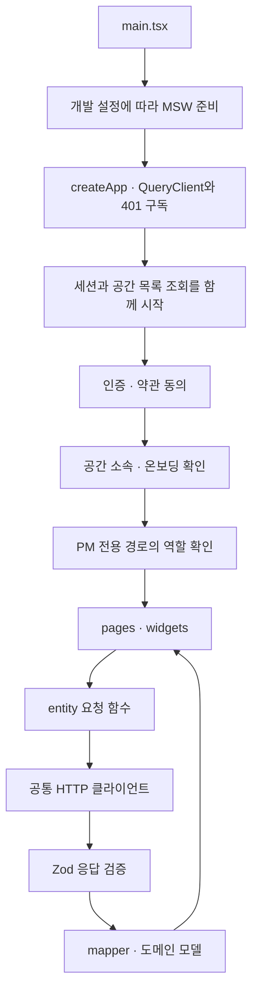

# 프론트엔드 구조

2026-11-11 소스 대조 기준이다. PM과 팀원이 회의 결과를 확인하고, 필요한 항목을 수정·승인하고, 후속 업무를 관리하는 화면 구조를 설명한다. 배포 환경의 동작 성공 여부는 [검증 기록](verification.md)에서 구분한다.

## 개요

프론트엔드는 React 기반 웹 앱이다. AI 판단과 서버의 권한 판정을 받아 화면에 표시한다. 회의 처리 추적은 화면 이동 뒤에도 유지하고, 공간별 데이터는 캐시 키로 구분한다.

코드는 Feature-Sliced Design 계층으로 나눈다. 상위 화면은 도메인 모델을 사용한다. 서버 응답의 검증과 변환은 entity 요청 경계가 맡는다. 계층 의존과 화면의 DTO 직접 참조는 [ESLint 설정](https://github.com/kakaotechcampus-4/ktc4-kyungpook-3/blob/develop/frontend/eslint.config.js)이 제한한다.

## 핵심 개념

| 구분 | 소유 위치 | 책임 |
|---|---|---|
| 서버 상태 | TanStack Query | 세션·공간·회의·태스크 조회와 캐시 |
| 주소에 남길 상태 | URL | 태스크 보기·필터와 화면 선택 |
| 일시적인 UI 상태 | Zustand | 토스트·미저장 변경·회의 처리 추적 |
| 서버 응답 | `shared/types/api` | DTO 타입과 응답 스키마 |
| 도메인 모델 | `entities` | 응답 검증·변환과 도메인 API |
| 세션 범위 | `shared/api/sessionScope.ts` | 이전 세션의 요청 취소와 늦은 후속 처리 차단 |

DTO는 `entities`와 모의 API인 `shared/mock`에서도 사용한다. 화면 계층은 DTO를 직접 다루지 않는다.

## 앱이 시작되고 화면이 열리는 과정

1. [main.tsx](https://github.com/kakaotechcampus-4/ktc4-kyungpook-3/blob/develop/frontend/src/main.tsx)의 `enableMocking()`이 개발 환경과 MSW 설정을 확인한다. 실제 API 모드에서는 이전 MSW worker를 정리한다. 실제 요청 실패를 모의 응답으로 바꾸지는 않는다.
2. [createApp()](https://github.com/kakaotechcampus-4/ktc4-kyungpook-3/blob/develop/frontend/src/app/createApp.ts)이 QueryClient, 401 구독, 화면 코드 사전 로딩 연결을 만든다.
3. [startBootQueries()](https://github.com/kakaotechcampus-4/ktc4-kyungpook-3/blob/develop/frontend/src/app/bootQueries.ts)가 세션과 공간 목록 조회를 겹쳐 시작한다. 업무 데이터는 해당 화면이 인증과 권한 조건을 확인한 뒤 조회한다.
4. [라우터](https://github.com/kakaotechcampus-4/ktc4-kyungpook-3/blob/develop/frontend/src/app/router/routes.tsx)가 인증, 약관 동의, 공간 소속, 온보딩 조건을 확인한다. 업로드와 승인 상세에는 PM 가드를 추가한다.
5. entity가 `request<unknown>()`의 결과를 [parseResponse()](https://github.com/kakaotechcampus-4/ktc4-kyungpook-3/blob/develop/frontend/src/shared/api/parseResponse.ts)로 검증한다. mapper가 DTO를 도메인 모델로 바꿔 화면에 전달한다.
6. mutation 뒤에는 관련 캐시를 갱신하거나 다시 조회한다. Notion 반영 완료도 승인 성공만으로 표시하지 않고 서버의 동기화 상태를 확인한다.

주요 화면은 경로별 lazy 로딩으로 분리한다. `NotFoundPage`처럼 정적으로 불러오는 예외도 있다. [셸 탭 정의](https://github.com/kakaotechcampus-4/ktc4-kyungpook-3/blob/develop/frontend/src/widgets/app-shell/model/shellTabs.ts)는 데스크톱 여섯 탭을 관리한다. 모바일 하단에는 다섯 탭을 두고 프로젝트 맵은 계정 메뉴에 배치한다.

## 코드 위치

| 계층 | 담당하는 일 | 시작할 위치 |
|---|---|---|
| `app` | 앱 생명주기·라우터·가드·레이아웃·전역 공급자 | [createApp.ts](https://github.com/kakaotechcampus-4/ktc4-kyungpook-3/blob/develop/frontend/src/app/createApp.ts), [routes.tsx](https://github.com/kakaotechcampus-4/ktc4-kyungpook-3/blob/develop/frontend/src/app/router/routes.tsx) |
| `pages` | 라우트와 URL 상태를 화면 구성에 연결 | [pages](https://github.com/kakaotechcampus-4/ktc4-kyungpook-3/tree/develop/frontend/src/pages) |
| `widgets` | 여러 도메인을 연결하는 화면 영역 | [widgets](https://github.com/kakaotechcampus-4/ktc4-kyungpook-3/tree/develop/frontend/src/widgets) |
| `features` | 승인·업로드·되돌리기 같은 사용자 행동 | [features](https://github.com/kakaotechcampus-4/ktc4-kyungpook-3/tree/develop/frontend/src/features) |
| `entities` | 도메인 API·모델·응답 변환 | [entities](https://github.com/kakaotechcampus-4/ktc4-kyungpook-3/tree/develop/frontend/src/entities) |
| `shared` | HTTP·응답 스키마·공통 UI·모의 API | [shared](https://github.com/kakaotechcampus-4/ktc4-kyungpook-3/tree/develop/frontend/src/shared) |

의존은 상위 계층에서 하위 계층으로 흐른다. 서버 필드가 바뀌면 응답 스키마와 entity 변환을 먼저 확인한다. 화면 이동 문제가 생기면 라우터와 가드를 확인한다.

## 오류와 세션 경계에서 지키는 것

[QueryClient 정책](https://github.com/kakaotechcampus-4/ktc4-kyungpook-3/blob/develop/frontend/src/shared/api/queryClient.ts)은 네트워크 오류·408·5xx 조회를 1초 뒤 한 번 재시도한다. mutation은 자동 재시도하지 않는다. 잘못된 성공 응답인 `INVALID_RESPONSE`에서는 주기 조회와 포커스·연결 복귀 재조회를 멈춘다. 사용자의 명시적인 재시도는 허용한다.

[세션 범위](https://github.com/kakaotechcampus-4/ktc4-kyungpook-3/blob/develop/frontend/src/shared/api/sessionScope.ts)는 세대와 `AbortSignal`을 함께 사용한다. 세션을 끝낼 때 세대부터 올린 뒤 이전 요청을 취소한다. [clearUserScope()](https://github.com/kakaotechcampus-4/ktc4-kyungpook-3/blob/develop/frontend/src/features/auth/lib/userScope.ts)는 이전 사용자의 조회·캐시·토스트·처리 추적·미저장 변경을 정리한다.

FE 가드는 화면 접근을 안내하는 장치다. 실제 권한은 서버가 검사한다. 또한 세션 범위를 제공하는 구조와 모든 쓰기에 적용이 끝났다는 주장은 구분해야 한다. 적용 범위와 남은 예외는 [#594 결과](https://github.com/kakaotechcampus-4/ktc4-kyungpook-3/blob/develop/frontend/docs/plan/m3/work-items/594-stale-session-writes/result.md)에 기록돼 있다.

이 설명은 소스 대조 결과다. 실제 서버 연동, 배포 커밋, 실기기 검증을 완료했다는 의미는 아니다.
