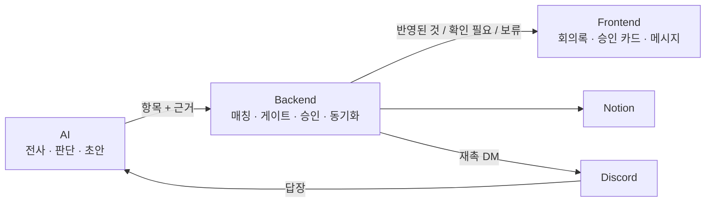

# 설계 심화

테크스펙은 칸마다 결론과 근거 수치만 쓴다. 이 절에서는 "왜 이렇게 만들었나"를 파트별로 푼다. 각 쪽은 **문제 → 동작 → 왜 이 방식인가(비교한 대안) → 어떻게 검증했나 → 한계** 순서로 쓴다. 세부 비교는 저장소의 결정 기록으로 링크한다.

## AI — 에이전트 판단

| 쪽 | 다루는 것 |
|---|---|
| [개요](ai/index.md) | AI 파트 전체 흐름과 공통 원칙 |
| [판단 파이프라인](ai/judge-pipeline.md) | 후보 추출 → 유사 검색 → 변경 판단 → 초안 → 검증 |
| [근거 검증 (Jev)](ai/evidence-check.md) | 만든 모델이 스스로 채점하지 않게 검증을 분리한 이유와 평가 |
| [전사 오인식 검사](ai/asr-check.md) | 용어 목록과 의심 단어 확인, 실측 차단율·오차단율 |
| [답장 판단](ai/reply-judgment.md) | 재촉 DM 답장에서 상태·마감 변경 읽기 |
| [전사 (STT)](ai/stt.md) | 엔진 선택, CER 비교, GPU 자동 전환(구현 완료·기본 꺼짐) |

## Backend — 가드레일과 후속 관리

| 쪽 | 다루는 것 |
|---|---|
| [개요](backend/index.md) | BE가 맡는 일과 도메인 모델 |
| [매칭과 게이트](backend/gate-matching.md) | 담당자 매칭, auto / review / hold 결정 |
| [승인과 충돌](backend/approval-conflict.md) | 값 고쳐 승인, 409 충돌, 되돌리기, 항목 합치기 |
| [Notion 동기화](backend/notion-sync.md) | outbox와 재시도 |
| [재촉 스케줄러](backend/reminder-scheduler.md) | 리마인드, DM, 답장 반영, 백그라운드 작업 |
| [보안](backend/security.md) | 인증, 권한, 서비스 토큰, 탈퇴·음성 보관 |

## Frontend — 화면 설계

| 쪽 | 다루는 것 |
|---|---|
| [개요](https://github.com/kakaotechcampus-4/ktc4-kyungpook-3/blob/develop/frontend/docs/index.md) | FE 구조와 화면 지도 |
| [계약 먼저, MSW 먼저](https://github.com/kakaotechcampus-4/ktc4-kyungpook-3/blob/develop/frontend/docs/contract-first-msw.md) | 모의 API로 먼저 만들고 실제 API에 대조한 방식 |
| [AI 결과 보여 주기](https://github.com/kakaotechcampus-4/ktc4-kyungpook-3/blob/develop/frontend/docs/ai-result-ui.md) | 배지, 근거 원문, 승인 카드, 권한별 화면 |
| [실시간 메시지](https://github.com/kakaotechcampus-4/ktc4-kyungpook-3/blob/develop/frontend/docs/realtime-messages.md) | 웹소켓, 웹 푸시, PWA |
| [접근성과 성능](https://github.com/kakaotechcampus-4/ktc4-kyungpook-3/blob/develop/frontend/docs/a11y-performance.md) | 디자인 시스템, 접근성, 모바일, 성능 |

## 보안 점검

| 쪽 | 다루는 것 |
|---|---|
| [보안 점검 (2026-11-11)](security-audit.md) | BE·AI·FE·배포 전체 점검 범위와 고친 것 |
