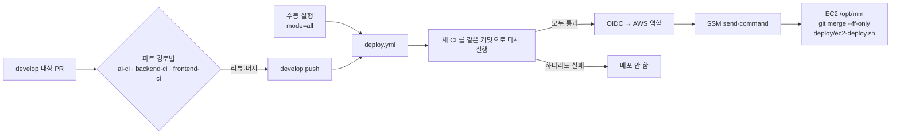
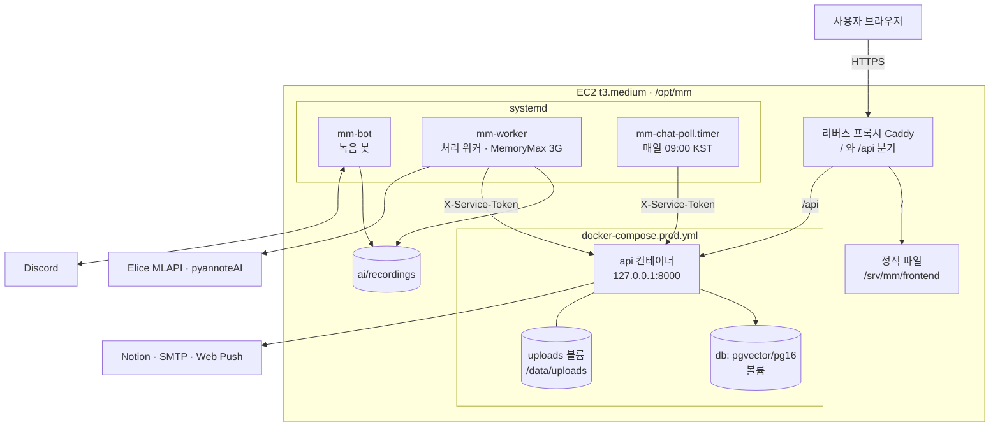

# 배포와 CI/CD

GitHub Actions 워크플로와 운영 서버 배포 구성을 정리한다. 배포 절차·되돌리기의 원문은 [deploy README](https://github.com/kakaotechcampus-4/ktc4-kyungpook-3/blob/develop/deploy/README.md)이고, 여기서는 요약한다.

## CI/CD 워크플로

모든 워크플로는 [`.github/workflows/`](https://github.com/kakaotechcampus-4/ktc4-kyungpook-3/tree/develop/.github/workflows)에 있다.

### 개발·배포

| 워크플로 | 트리거 | 하는 일 |
|---|---|---|
| [frontend-ci](https://github.com/kakaotechcampus-4/ktc4-kyungpook-3/blob/develop/.github/workflows/frontend-ci.yml) | develop 대상 PR(`frontend/**`), `workflow_call` | Node 24. **check**: typecheck → lint → format:check → test(Vitest). **build**: `vite build` 후 dist 아티팩트. **e2e**: Playwright(Chromium) `test:e2e`, `test:e2e:consent`, 리포트 아티팩트 |
| [backend-ci](https://github.com/kakaotechcampus-4/ktc4-kyungpook-3/blob/develop/.github/workflows/backend-ci.yml) | develop 대상 PR(`backend/**`, `deploy/ec2-deploy.sh`), `workflow_call` | **lint**: ruff. **test**: pgvector 서비스 컨테이너와 pytest. **migrations**: 빈 PostgreSQL 에 `alembic upgrade head` + `alembic check`. **image**: 운영 Dockerfile 빌드 후 import 확인 |
| [ai-ci](https://github.com/kakaotechcampus-4/ktc4-kyungpook-3/blob/develop/.github/workflows/ai-ci.yml) | develop 대상 PR(`ai/**`, `deploy/ec2-deploy.sh`), `workflow_call` | Python 3.12 + uv, `libopus0` 설치 후 pytest |
| [deploy](https://github.com/kakaotechcampus-4/ktc4-kyungpook-3/blob/develop/.github/workflows/deploy.yml) | develop push, 수동 실행(mode: changed / all) | 세 CI 를 같은 커밋으로 다시 돌린다. 모두 통과하면 OIDC 로 AWS 역할을 받아 SSM 으로 EC2 에서 배포 스크립트를 실행한다 |
| [oidc-test](https://github.com/kakaotechcampus-4/ktc4-kyungpook-3/blob/develop/.github/workflows/oidc-test.yml) | 수동 | OIDC 역할 확인용 |

### 협업 보조

| 워크플로 | 트리거 | 하는 일 |
|---|---|---|
| [team-notify](https://github.com/kakaotechcampus-4/ktc4-kyungpook-3/blob/develop/.github/workflows/team-notify.yml) | 이슈·PR 열림/닫힘, 리뷰 제출, 코멘트 | 팀 Discord 에 한 줄 알림(#122) |
| [team-digest](https://github.com/kakaotechcampus-4/ktc4-kyungpook-3/blob/develop/.github/workflows/team-digest.yml) | 매일 09·21시 KST 무렵(cron), 수동 | 열린 PR·머지된 PR 보고 |
| [ai-handoff-agreed](https://github.com/kakaotechcampus-4/ktc4-kyungpook-3/blob/develop/.github/workflows/ai-handoff-agreed.yml) | 이슈 라벨·닫힘 | 선행 이슈가 합의되면 기다리던 AI 요청을 알림 |
| [assign-mentor](https://github.com/kakaotechcampus-4/ktc4-kyungpook-3/blob/develop/.github/workflows/assign-mentor.yml) | main 대상 PR 열림 | 멘토 리뷰어 지정 (운영진 배포 파일) |
| [notify-discord](https://github.com/kakaotechcampus-4/ktc4-kyungpook-3/blob/develop/.github/workflows/notify-discord.yml) | main 대상 PR 리뷰 요청·리뷰 제출 | 리뷰 요청·결과 알림 (운영진 배포 파일) |
| [convention-check](https://github.com/kakaotechcampus-4/ktc4-kyungpook-3/blob/develop/.github/workflows/convention-check.yml) | main 대상 PR 열림 | 컨벤션 안내 (운영진 배포 파일) |

- 배포는 한 번에 하나씩 돈다. 대기 중인 배포가 있을 때 새 push 가 오면 대기분은 취소되고 새 커밋이 배포된다.
- 서버에서는 develop 에 있는 커밋인지 확인한 뒤에만 fast-forward 한다. AWS 키를 저장소에 두지 않고 OIDC 로 역할을 받는다.

## 배포 구성

AWS EC2 한 대(t3.medium, 2 vCPU·4GB, Ubuntu 24.04)에 세 파트를 함께 올린다([프로젝트 상세 설명 §7](../프로젝트%20상세%20설명.md#7-인프라배포운영)).

| 구성 | 파일 | 내용 |
|---|---|---|
| backend | [`backend/docker-compose.prod.yml`](https://github.com/kakaotechcampus-4/ktc4-kyungpook-3/blob/develop/backend/docker-compose.prod.yml) | db(pgvector/pg16)와 api. api 는 `127.0.0.1:8000` 에만 열고, 시작할 때 `alembic upgrade head` 후 uvicorn `--workers 1`(내부 워커가 프로세스마다 떠서 늘리지 않는다) |
| frontend | `deploy/ec2-deploy.sh` | `npm ci` → `npm run build` → `rsync` 로 `/srv/mm/frontend` 에 복사. 같은 오리진이라 CORS 불필요 |
| ai | [`ai/deploy/systemd/`](https://github.com/kakaotechcampus-4/ktc4-kyungpook-3/tree/develop/ai/deploy/systemd) | `mm-bot.service`(녹음 봇), `mm-worker.service`(처리 워커, Nice 10, MemoryMax 3G, SIGTERM 이면 하던 회의를 마치고 종료), `mm-chat-poll.service` + `.timer`(매일 09:00 KST, flock, 최대 6시간) |
| 배포 스크립트 | [`deploy/ec2-deploy.sh`](https://github.com/kakaotechcampus-4/ktc4-kyungpook-3/blob/develop/deploy/ec2-deploy.sh) | 바뀐 파트만 다시 올린다(아래) |
| 요약 활성화 | [`deploy/enable-summary.py`](https://github.com/kakaotechcampus-4/ktc4-kyungpook-3/blob/develop/deploy/enable-summary.py) | 활성 `mm-worker` 에 `MM_SUMMARY_LLM=luna` drop-in 설치·검사 |
| GPU 전사 | [`ai/deploy/gpu-stt/`](https://github.com/kakaotechcampus-4/ktc4-kyungpook-3/tree/develop/ai/deploy/gpu-stt) | Elice 전사 장애 때 쓰는 GPU 대기 서버 절차 |

- 리버스 프록시(Caddy) 설정 파일은 저장소에 없다. 저장소로는 설정 위치·내용을 알 수 없고, 서버에서 직접 관리한다.
- 녹음 업로드(`POST /api/v1/workspaces/{id}/meetings/upload`)는 백엔드가 본문을 받는 동안 `UPLOAD_MAX_BYTES` + 1MiB 를 넘으면 413 으로 끊는다. 리버스 프록시에서도 이 경로의 본문 상한을 약 210MB 로 두는 것을 권한다(Caddy 는 `request_body` 의 `max_size`). 다른 경로는 이 상한과 상관없다. 서버 설정에 적용됐는지는 저장소로 확인할 수 없다([M5 결과](https://github.com/kakaotechcampus-4/ktc4-kyungpook-3/blob/develop/backend/docs/plan/m5/result.md)).
- systemd 유닛은 `/etc/systemd/system/` 에 복사해 설치한다. 유닛 파일 변경은 자동 배포에 포함되지 않는다(채팅 폴링 유닛만 예외적으로 이미 설치된 서버에서 덮어쓴다). 저장소 유닛은 "예시"이고 운영 계정은 drop-in 으로 덮는다.

## 배포 절차 요약

`deploy/ec2-deploy.sh` 가 하는 일([원문](https://github.com/kakaotechcampus-4/ktc4-kyungpook-3/blob/develop/deploy/README.md#흐름)):

1. 마지막으로 끝까지 성공한 배포(`.git/mm-deployed-sha`)와 지금 커밋을 비교해 바뀐 파트를 고른다. `.md`, `docs/`, `tests/`, 평가 결과만 바뀌면 그 파트는 건너뛴다. `mode=all` 이면 전부 올린다.
2. **backend**: `docker compose -f backend/docker-compose.prod.yml up -d --build` → 헬스 확인 → 옛 이미지 정리.
3. **frontend**: 빌드 후 정적 파일 복사.
4. **ai**: `requirements.txt` 가 바뀌었으면 의존성 설치 → 요약 drop-in 설치·검사와 워커 재시작(`enable-summary.py`) → 녹음 중이 아니면 봇 재시작 → 채팅 폴링 유닛 동기화. 꺼져 있는 유닛은 켜지 않는다.
5. 건너뛴 일 없이 끝까지 올렸을 때만 `mm-deployed-sha` 를 갱신한다. 아니면 다음 배포가 다시 올린다.

녹음 보호:

- 봇 재시작 전에 `ai/recordings/restart.lock` 을 잡는다. 60초 안에 못 잡거나 녹음 중이면 봇 재시작을 건너뛰고 Actions 에 경고를 띄운다. 기준 커밋도 그대로 둔다.
- 녹음이 끝난 뒤 Actions → deploy → Run workflow 로 다시 올린다.

## 되돌리기와 복구

| 상황 | 방법 |
|---|---|
| 코드만 되돌릴 때 | develop 에서 `git revert` 후 머지 → CI 통과하면 자동 배포. 옛 이미지는 지워져 있어 백엔드는 다시 빌드한다 |
| 마이그레이션이 든 커밋 | 권장: 되돌리는 내용을 **새 마이그레이션**으로 만들어 앞으로 배포한다. revert 가 꼭 필요하면 먼저 `pg_dump` 백업 → `alembic downgrade` → revert 머지 순서 |
| 녹음 중이라 봇이 안 올라갔을 때 | 녹음 종료 뒤 수동 실행 |
| 기능 스위치를 바꿀 때 | `backend/.env` 수정 후 `docker compose ... up -d` 로 컨테이너를 다시 만든다(restart 로는 반영 안 됨). AI 는 해당 systemd 유닛 재시작 |

- `mm-deployed-sha` 는 다음 배포의 비교 기준일 뿐, 서비스나 DB 를 되돌리지 않는다.
- 백업·downgrade 명령은 아직 운영에서 실행해 본 적이 없다(#359).

마이그레이션 호환 원칙(되돌려도 이전 코드가 새 스키마 위에서 돌 수 있게):

- 새 컬럼은 nullable 이거나 서버 기본값을 둔다.
- 삭제·이름 변경은 두 번의 배포로 나눈다.
- NOT NULL 은 값을 채우는 마이그레이션 뒤에 건다.
- backend-ci 는 빈 DB 에서만 검사한다. 운영 데이터 위의 업그레이드는 검사하지 않는다.

## 기능별 운영 절차

아래는 원문 링크만 둔다.

- [자동 회의 요약 활성화 (#560)](https://github.com/kakaotechcampus-4/ktc4-kyungpook-3/blob/develop/deploy/README.md#자동-회의-요약-560)
- [회의 삭제 활성화 (#576)](https://github.com/kakaotechcampus-4/ktc4-kyungpook-3/blob/develop/deploy/README.md#회의-삭제-활성화-576)
- [계정 탈퇴와 정리 작업 (#575)](https://github.com/kakaotechcampus-4/ktc4-kyungpook-3/blob/develop/deploy/README.md#계정-탈퇴와-정리-작업-575)
- [채팅 폴링 타이머 첫 설치·수동 실행 (#599)](https://github.com/kakaotechcampus-4/ktc4-kyungpook-3/blob/develop/deploy/README.md#채팅-폴링-타이머-599)
- [GPU 전사 대기 서버](https://github.com/kakaotechcampus-4/ktc4-kyungpook-3/blob/develop/ai/deploy/gpu-stt/README.md)

## 관련 문서

- [환경 변수](env.md) · [테스트](testing.md) · [로컬 실행](local-setup.md)
- [아키텍처](../techspec/architecture.md)
