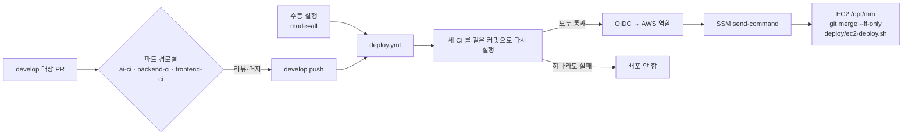
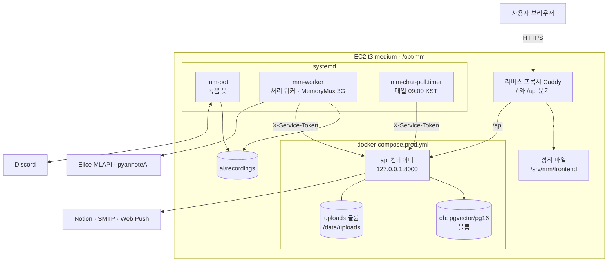

# 배포와 CI/CD

GitHub Actions 워크플로와 운영 서버 배포 구성을 정리한다. 배포 절차·되돌리기의 원문은 [deploy README](https://github.com/kakaotechcampus-4/ktc4-kyungpook-3/blob/develop/deploy/README.md)이고, 여기서는 요약한다.

## CI/CD 워크플로

모든 워크플로는 [`.github/workflows/`](https://github.com/kakaotechcampus-4/ktc4-kyungpook-3/tree/develop/.github/workflows)에 있다.

### 개발·배포

| 워크플로 | 트리거 | 하는 일 |
|---|---|---|
| [frontend-ci](https://github.com/kakaotechcampus-4/ktc4-kyungpook-3/blob/develop/.github/workflows/frontend-ci.yml) | develop 대상 PR(`frontend/**`, `docs/policy/**`, `backend/app/services/consents.py`), `workflow_call` | Node 24. **check**: typecheck → lint → format:check → test(Vitest). **build**: `vite build` 후 dist 아티팩트. **e2e**: Playwright(Chromium) `test:e2e`, `test:e2e:consent`, 리포트 아티팩트 |
| [backend-ci](https://github.com/kakaotechcampus-4/ktc4-kyungpook-3/blob/develop/.github/workflows/backend-ci.yml) | develop 대상 PR(`backend/**`, `deploy/ec2-deploy.sh`, `deploy/monitoring/**`), `workflow_call` | **lint**: ruff. **test**: pgvector 서비스 컨테이너와 pytest. **migrations**: 빈 PostgreSQL 에 `alembic upgrade head` + `alembic check`. **image**: 운영 Dockerfile 빌드 후 import 확인 |
| [ai-ci](https://github.com/kakaotechcampus-4/ktc4-kyungpook-3/blob/develop/.github/workflows/ai-ci.yml) | develop 대상 PR(`ai/**`, `deploy/ec2-deploy.sh`), `workflow_call` | Python 3.12 + uv, `libopus0` 설치 후 pytest |
| [deploy](https://github.com/kakaotechcampus-4/ktc4-kyungpook-3/blob/develop/.github/workflows/deploy.yml) | develop push, 수동 실행(mode: changed / all) | 세 CI 를 같은 커밋으로 다시 돌린다. 모두 통과하면 OIDC 로 AWS 역할을 받아 SSM 으로 EC2 에서 배포 스크립트를 실행한다 |
| [oidc-test](https://github.com/kakaotechcampus-4/ktc4-kyungpook-3/blob/develop/.github/workflows/oidc-test.yml) | 수동 | OIDC 역할 확인용 |

### 협업 보조

| 워크플로 | 트리거 | 하는 일 |
|---|---|---|
| [team-notify](https://github.com/kakaotechcampus-4/ktc4-kyungpook-3/blob/develop/.github/workflows/team-notify.yml) | 이슈·PR 열림/닫힘, 리뷰 제출, 코멘트 | 팀 Discord 에 한 줄 알림(#122) |
| [team-digest](https://github.com/kakaotechcampus-4/ktc4-kyungpook-3/blob/develop/.github/workflows/team-digest.yml) | 매일 09·21시 KST 무렵(cron), 수동 | 열린 PR·머지된 PR 보고 |
| [ai-handoff-agreed](https://github.com/kakaotechcampus-4/ktc4-kyungpook-3/blob/develop/.github/workflows/ai-handoff-agreed.yml) | 이슈 라벨·닫힘 | 선행 이슈가 합의되면 기다리던 AI 요청을 알림 |
| [assign-mentor](https://github.com/kakaotechcampus-4/ktc4-kyungpook-3/blob/develop/.github/workflows/assign-mentor.yml) | main 대상 PR 열림 | 멘토 리뷰어 지정 (운영진 배포 파일) |
| [notify-discord](https://github.com/kakaotechcampus-4/ktc4-kyungpook-3/blob/develop/.github/workflows/notify-discord.yml) | main 대상 PR 리뷰 요청·리뷰 제출 | 리뷰 요청·결과 알림 (운영진 배포 파일) |
| [convention-check](https://github.com/kakaotechcampus-4/ktc4-kyungpook-3/blob/develop/.github/workflows/convention-check.yml) | main 대상 PR 열림 | 컨벤션 안내 (운영진 배포 파일) |

- 배포는 한 번에 하나씩 돈다. 대기 중인 배포가 있을 때 새 push 가 오면 대기분은 취소되고 새 커밋이 배포된다.
- 서버에서는 develop 에 있는 커밋인지 확인한 뒤에만 fast-forward 한다. AWS 키를 저장소에 두지 않고 OIDC 로 역할을 받는다.

## 배포 구성

AWS EC2 한 대(t3.medium, 2 vCPU·4GB, Ubuntu 24.04)에 세 파트를 함께 올린다([프로젝트 상세 설명 §7](../프로젝트%20상세%20설명.md#7-인프라배포운영)).

| 구성 | 파일 | 내용 |
|---|---|---|
| backend | [`backend/docker-compose.prod.yml`](https://github.com/kakaotechcampus-4/ktc4-kyungpook-3/blob/develop/backend/docker-compose.prod.yml) | db(pgvector/pg16)와 api. api 는 `127.0.0.1:8000` 에만 열고, 시작할 때 `alembic upgrade head` 후 uvicorn `--workers 1`(내부 워커가 프로세스마다 떠서 늘리지 않는다) |
| frontend | `deploy/ec2-deploy.sh` | `npm ci` → `npm run build` → `rsync` 로 `/srv/mm/frontend` 에 복사. 같은 오리진이라 CORS 불필요 |
| ai | [`ai/deploy/systemd/`](https://github.com/kakaotechcampus-4/ktc4-kyungpook-3/tree/develop/ai/deploy/systemd) | `mm-bot.service`(녹음 봇), `mm-worker.service`(처리 워커, Nice 10, MemoryMax 3G, SIGTERM 이면 하던 회의를 마치고 종료), `mm-chat-poll.service` + `.timer`(매일 09:00 KST, flock, 최대 6시간) |
| 배포 스크립트 | [`deploy/ec2-deploy.sh`](https://github.com/kakaotechcampus-4/ktc4-kyungpook-3/blob/develop/deploy/ec2-deploy.sh) | 바뀐 파트만 다시 올린다(아래) |
| 요약 활성화 | [`deploy/enable-summary.py`](https://github.com/kakaotechcampus-4/ktc4-kyungpook-3/blob/develop/deploy/enable-summary.py) | 활성 `mm-worker` 에 `MM_SUMMARY_LLM=luna` drop-in 설치·검사 |
| 모니터링 | [`deploy/monitoring/`](https://github.com/kakaotechcampus-4/ktc4-kyungpook-3/tree/develop/deploy/monitoring) | Grafana Cloud 로 보내는 Alloy 설정, PDC 에이전트 스크립트, 읽기 계정·시드 제외 SQL. **자동 배포에 포함되지 않는다**(서버에서 사람이 설치) |
| GPU 전사 | [`ai/deploy/gpu-stt/`](https://github.com/kakaotechcampus-4/ktc4-kyungpook-3/tree/develop/ai/deploy/gpu-stt) | Elice 전사 장애 때 쓰는 GPU 대기 서버 절차 |

- 리버스 프록시(Caddy) 설정의 원본은 [`deploy/caddy/Caddyfile`](https://github.com/kakaotechcampus-4/ktc4-kyungpook-3/blob/develop/deploy/caddy/Caddyfile)이다. 서버의 `/etc/caddy/Caddyfile` 로는 자동 배포되지 않고 운영자가 손으로 반영한다(아래 [앞단 프록시](#앞단-프록시-caddy)).
- 녹음 업로드(`POST /api/v1/workspaces/{id}/meetings/upload`)는 백엔드가 본문을 받는 동안 `UPLOAD_MAX_BYTES` + 1MiB 를 넘으면 413 으로 끊는다. 앞단 Caddy 도 `/api/*` 본문을 `max_size 710MiB` 로 막는다(2026-11-11 서버에서 확인, [M5 결과](https://github.com/kakaotechcampus-4/ktc4-kyungpook-3/blob/develop/backend/docs/plan/m5/result.md)).
- systemd 유닛은 `/etc/systemd/system/` 에 복사해 설치한다. 유닛 파일 변경은 자동 배포에 포함되지 않는다(채팅 폴링 유닛만 예외적으로 이미 설치된 서버에서 덮어쓴다). 저장소 유닛은 "예시"이고 운영 계정은 drop-in 으로 덮는다.

## 환경 분리 현황

환경은 **로컬**과 **운영** 둘이다. 저장소에 운영용 compose 는 `backend/docker-compose.prod.yml` 하나, 배포 워크플로는 `deploy.yml` 하나(대상 인스턴스 변수 하나), 프록시 설정의 도메인도 하나뿐이다. 아래 표는 설정 파일이 정한 내용이고, 운영 서버에 지금 떠 있는 상태나 서버 `.env` 의 값은 저장소로 확인할 수 없다.

| 항목 | 로컬 | 운영 | 출처 |
|---|---|---|---|
| DB | compose 의 `db` 서비스(pgvector/pg16) 하나만 띄운다. 개발용 고정 계정이고 호스트 포트(기본 5432)를 연다 | 같은 EC2 의 compose `db` 서비스(pgvector/pg16). 외부 관리형 DB 가 아니다. 호스트에 포트를 열지 않고 api 컨테이너만 `db:5432` 로 붙는다. 데이터는 `pgdata` 볼륨 | `backend/docker-compose.yml:4-13`, `backend/docker-compose.prod.yml:7-21, 36` |
| 마이그레이션 | `run.sh` 가 `alembic upgrade head` 뒤 uvicorn 을 띄운다 | api 컨테이너가 시작할 때마다 `alembic upgrade head` 를 먼저 한다 | `backend/run.sh`, `backend/Dockerfile:32` |
| Backend 실행 | 호스트에서 uvicorn `--reload`, `:8000` | api 컨테이너. `127.0.0.1:8000` 에만 열어 같은 서버의 프록시만 붙는다 | `backend/run.sh`, `backend/docker-compose.prod.yml:28-55` |
| Frontend | Vite 개발 서버(`npm run dev`). `VITE_ENABLE_MSW=true` 면 백엔드 없이 모의 API 로 뜬다 | `npm run build` 결과를 `/srv/mm/frontend` 로 복사하고 Caddy 가 서빙한다. 빌드에 환경 변수가 필요 없다 | `frontend/.env.example`, `deploy/ec2-deploy.sh:157-163`, `deploy/caddy/Caddyfile:30-33` |
| AI | 터미널에서 `python -m capture.run_recorder`, `python -m capture.worker` 를 직접 띄운다 | systemd 유닛 `mm-bot`, `mm-worker`, `mm-chat-poll`(+타이머). 작업 폴더는 `/opt/mm/ai` | [로컬 실행](local-setup.md), `ai/deploy/systemd/*.service` |
| 도메인·HTTPS | `localhost` | Caddy 가 `managers-manager.duckdns.org` 를 받아 `/api/*` 는 `127.0.0.1:8000` 으로, 나머지는 정적 파일로 보낸다 | `deploy/caddy/Caddyfile:1, 10-33` |
| 시크릿 보관 위치 | 파트별 `.env`. 저장소에는 값이 빈 `.env.example` 만 있고 `.env` 는 git 이 무시한다 | 서버 파일에만 둔다. Backend 는 `/opt/mm/backend/.env`(compose 가 `env_file` 로 읽는다), AI 는 `/opt/mm/ai/.env` 와 systemd drop-in, GPU 전사는 `/etc/mm/gpu-stt.env`, 모니터링은 `/etc/mm-monitoring/*.env`. GitHub 에는 AWS 키가 없고 Actions 변수 `AWS_ACCOUNT_ID`·`EC2_INSTANCE_ID` 와 OIDC 로 받는 배포 역할만 쓴다 | `.gitignore:18-19`, `backend/docker-compose.prod.yml:3, 32`, `deploy/README.md`, `ai/deploy/gpu-stt/README.md`, `.github/workflows/deploy.yml:57-64` |
| 배포 트리거 | 없음. 사람이 직접 띄운다 | `develop` 에 push 되면 자동으로 돈다. 수동 실행(Actions → deploy → Run workflow, mode: changed / all)도 되지만 `develop` 이 아닌 브랜치에서는 모든 잡이 건너뛰어진다 | `.github/workflows/deploy.yml:8-17, 35-49` |
| 배포 게이트 | 없음 | `deploy` 잡이 `needs: [ai-ci, backend-ci, frontend-ci]` 로 묶여 있다. 셋 중 하나라도 실패하거나 건너뛰면 배포 잡이 돌지 않는다 | `.github/workflows/deploy.yml:34-49` |
| 롤백 방법 | 해당 없음 | `git revert` 를 머지해 다시 배포한다. 마이그레이션이 든 커밋은 따로 다룬다. 절차는 아래 [되돌리기와 복구](#되돌리기와-복구) | `deploy/ec2-deploy.sh:6-8, 35-38, 209-214`, `deploy/README.md` "되돌리기" |

- `ec2-deploy.sh` 가 받는 "git 갱신 전 커밋" 인자는 롤백용이 아니다. 성공한 배포 기록(`.git/mm-deployed-sha`)이 없는 첫 배포에서 비교 기준으로만 쓴다.
- 기능 스위치의 코드 기본값과 예시 파일 값은 [환경 변수](env.md)에 있다.
- 예정: `deploy/monitoring/README.md` 는 AWS 실습 계정 종료에 맞춰 11/20 에 서버를 옮긴다고 적고 있다. 옮긴 뒤 도메인이나 서버 경로가 바뀌면 이 표를 다시 맞춘다.

### 배포를 지키는 방법

운영에 올리기 전과 올린 뒤를 아래 장치가 지킨다.

| 지킬 것 | 장치 |
|---|---|
| 올리기 전에 깨진 코드를 걸러 낸다 | 배포 직전에 같은 커밋으로 세 파트 CI 를 모두 다시 돌린다. 바뀐 파트만이 아니라 매번 셋 다 돌린다 |
| 마이그레이션을 먼저 돌려 본다 | backend-ci 의 migrations 잡이 빈 PostgreSQL 에 `alembic upgrade head` 와 `alembic check` 를 돌린다 |
| 올린 뒤 살아 있는지 본다 | 백엔드를 올린 뒤 `/health` 를 최대 60초 확인하고, systemd 유닛은 재시작 10초 뒤 `active` 인지 본다. 실패하면 배포가 실패로 끝나고 기준 커밋을 그대로 둬 다음 배포가 다시 올린다 |
| 잘못 올린 것을 되돌린다 | `git revert` 재배포와 마이그레이션 호환 원칙([되돌리기와 복구](#되돌리기와-복구)) |
| 엉뚱한 커밋이 올라가지 않게 한다 | 서버가 `develop` 에 있는 커밋인지 확인한 뒤 fast-forward 만 한다. 배포는 한 번에 하나씩 돈다 |

출처: `.github/workflows/deploy.yml:25-49, 80-81`, `.github/workflows/backend-ci.yml`, `deploy/ec2-deploy.sh:61-68, 85-100, 209-214`.

## 앞단 프록시 Caddy

2026-11-11 운영 서버(Caddy v2.11.6)의 설정을 읽어 확인했다(#692).

| 항목 | 결과 |
|---|---|
| 요청 크기 | `/api/*` 본문을 `request_body max_size 710MiB` 로 자른다 |
| 연결 수 | 제한 없음. 기본 Caddy 에는 IP 별·동시 연결 제한이 없고 플러그인이 필요하다 |
| 클라이언트 IP | `trusted_proxies` 를 두지 않아 클라이언트가 보낸 `X-Forwarded-For` 를 버리고 실제 접속 주소로 덮어 넘긴다 |
| 보안 헤더 | 없었다. 이 저장소 판에서 더했다 |

BE 의 `FORWARDED_ALLOW_IPS: "*"` 는 두 조건이 지켜질 때만 안전하다. API 가 `127.0.0.1:8000` 에만 열려 있어 Caddy 를 거치지 않고는 닿을 수 없어야 하고, Caddy 앞에 CDN·다른 프록시가 없어야 한다. 앞에 무언가를 두면 클라이언트 IP 가 그 주소가 되므로 Caddy 에 `trusted_proxies` 를 함께 설정한다. 위조한 `X-Forwarded-For` 가 바뀌는 것은 `caddy:2.11` 컨테이너에 이 설정을 띄우고 업스트림이 받은 값을 출력하게 해 확인했다(`X-Forwarded-For: 1.2.3.4` 를 보내도 업스트림은 실제 접속 주소를 받음).

더한 헤더는 모든 응답(정적 파일, API, Caddy 가 직접 내는 404)에 붙는다.

| 헤더 | 값 |
|---|---|
| `Strict-Transport-Security` | `max-age=31536000`(preload 없음) |
| `X-Content-Type-Options` | `nosniff` |
| `Referrer-Policy` | `strict-origin-when-cross-origin` |
| `Content-Security-Policy` | `frame-ancestors 'none'` |
| `X-Frame-Options` | `DENY` |

스크립트·스타일까지 막는 전체 CSP 는 아직 두지 않았다. 인라인 스플래시 스크립트(해시 허용), 웹소켓 연결, 푸시 서비스 워커(`/push/sw.js`)를 운영에서 확인한 뒤 따로 더한다. 서버 반영 절차는 [deploy README](https://github.com/kakaotechcampus-4/ktc4-kyungpook-3/blob/develop/deploy/README.md#앞단-프록시-caddy-692)에 있다.

## 배포 절차 요약

`deploy/ec2-deploy.sh` 가 하는 일([원문](https://github.com/kakaotechcampus-4/ktc4-kyungpook-3/blob/develop/deploy/README.md#흐름)):

1. 마지막으로 끝까지 성공한 배포(`.git/mm-deployed-sha`)와 지금 커밋을 비교해 바뀐 파트를 고른다. `.md`, `docs/`, `tests/`, 평가 결과만 바뀌면 그 파트는 건너뛴다. `mode=all` 이면 전부 올린다.
2. **backend**: `docker compose -f backend/docker-compose.prod.yml up -d --build` → 헬스 확인 → 옛 이미지 정리.
3. **frontend**: 빌드 후 정적 파일 복사.
4. **ai**: `requirements.txt` 가 바뀌었으면 의존성 설치 → 요약 drop-in 설치·검사와 워커 재시작(`enable-summary.py`) → 녹음 중이 아니면 봇 재시작 → 채팅 폴링 유닛 동기화. 꺼져 있는 유닛은 켜지 않는다.
5. 건너뛴 일 없이 끝까지 올렸을 때만 `mm-deployed-sha` 를 갱신한다. 아니면 다음 배포가 다시 올린다.

녹음 보호:

- 봇 재시작 전에 `ai/recordings/restart.lock` 을 잡는다. 60초 안에 못 잡거나 녹음 중이면 봇 재시작을 건너뛰고 Actions 에 경고를 띄운다. 기준 커밋도 그대로 둔다.
- 녹음이 끝난 뒤 Actions → deploy → Run workflow 로 다시 올린다.

## 되돌리기와 복구

| 상황 | 방법 |
|---|---|
| 코드만 되돌릴 때 | develop 에서 `git revert` 후 머지 → CI 통과하면 자동 배포. 옛 이미지는 지워져 있어 백엔드는 다시 빌드한다 |
| 마이그레이션이 든 커밋 | 권장: 되돌리는 내용을 **새 마이그레이션**으로 만들어 앞으로 배포한다. revert 가 꼭 필요하면 먼저 `pg_dump` 백업 → `alembic downgrade` → revert 머지 순서 |
| 녹음 중이라 봇이 안 올라갔을 때 | 녹음 종료 뒤 수동 실행 |
| 기능 스위치를 바꿀 때 | `backend/.env` 수정 후 `docker compose ... up -d` 로 컨테이너를 다시 만든다(restart 로는 반영 안 됨). AI 는 해당 systemd 유닛 재시작 |

- `mm-deployed-sha` 는 다음 배포의 비교 기준일 뿐, 서비스나 DB 를 되돌리지 않는다.
- 백업·downgrade 명령은 아직 운영에서 실행해 본 적이 없다(#359).

마이그레이션 호환 원칙(되돌려도 이전 코드가 새 스키마 위에서 돌 수 있게):

- 새 컬럼은 nullable 이거나 서버 기본값을 둔다.
- 삭제·이름 변경은 두 번의 배포로 나눈다.
- NOT NULL 은 값을 채우는 마이그레이션 뒤에 건다.
- backend-ci 는 빈 DB 에서만 검사한다. 운영 데이터 위의 업그레이드는 검사하지 않는다.

## 기능별 운영 절차

아래는 원문 링크만 둔다.

- [자동 회의 요약 활성화 (#560)](https://github.com/kakaotechcampus-4/ktc4-kyungpook-3/blob/develop/deploy/README.md#자동-회의-요약-560)
- [회의 삭제 활성화 (#576)](https://github.com/kakaotechcampus-4/ktc4-kyungpook-3/blob/develop/deploy/README.md#회의-삭제-활성화-576)
- [계정 탈퇴와 정리 작업 (#575)](https://github.com/kakaotechcampus-4/ktc4-kyungpook-3/blob/develop/deploy/README.md#계정-탈퇴와-정리-작업-575)
- [채팅 폴링 타이머 첫 설치·수동 실행 (#599)](https://github.com/kakaotechcampus-4/ktc4-kyungpook-3/blob/develop/deploy/README.md#채팅-폴링-타이머-599)
- [앞단 프록시 Caddy 반영 (#692)](https://github.com/kakaotechcampus-4/ktc4-kyungpook-3/blob/develop/deploy/README.md#앞단-프록시-caddy-692)
- [모니터링 설치 (#675, 자동 배포에 포함되지 않음)](https://github.com/kakaotechcampus-4/ktc4-kyungpook-3/blob/develop/deploy/monitoring/README.md)
- [GPU 전사 대기 서버](https://github.com/kakaotechcampus-4/ktc4-kyungpook-3/blob/develop/ai/deploy/gpu-stt/README.md)

## 관련 문서

- [환경 변수](env.md) · [테스트](testing.md) · [로컬 실행](local-setup.md)
- [아키텍처](../techspec/architecture.md)
