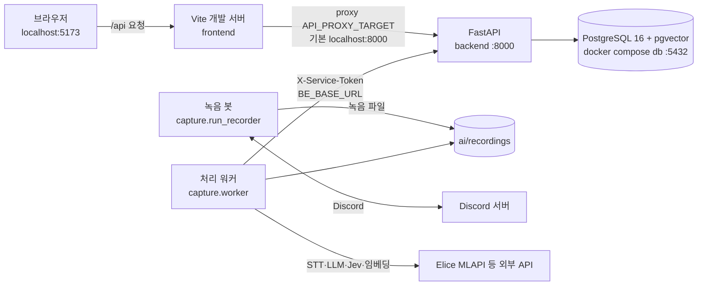
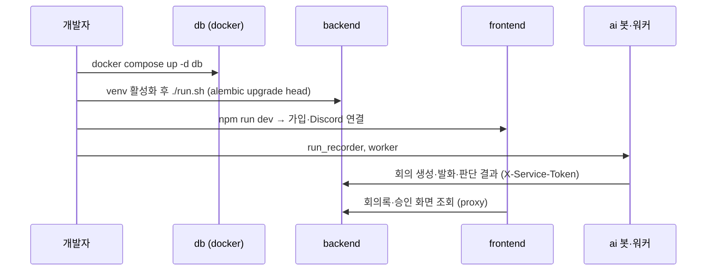

# 로컬 실행

세 파트(frontend, backend, ai)를 내 컴퓨터에서 띄우는 최소 절차다. 자세한 옵션과 문제 해결은 파트 README 에 있다.

## 구성



- 브라우저는 백엔드를 직접 부르지 않는다. 백엔드에 CORS 가 없어서 Vite proxy 를 거친다([frontend README](https://github.com/kakaotechcampus-4/ktc4-kyungpook-3/blob/develop/frontend/README.md#백엔드-연동)).
- AI 봇·워커는 백엔드에 HTTP 로 회의·발화·판단 결과를 넘긴다. 이때 `BE_SERVICE_TOKEN`(AI)과 `SERVICE_TOKEN`(BE)이 같아야 한다([환경 변수](env.md)).

## 사전 준비

| 항목 | 버전·내용 | 쓰는 곳 | 근거 |
|---|---|---|---|
| Node.js | 24 LTS (`engines: >=24 <25`, `.nvmrc` = 24) | frontend | `frontend/package.json`, `frontend/.nvmrc` |
| Python | 3.12 | backend, ai | 파트 README, CI 설정 |
| uv | 가상환경·패키지 설치 | backend, ai | 파트 README |
| Docker (Docker Desktop) | `pgvector/pgvector:pg16` 컨테이너 | backend DB | `backend/docker-compose.yml` |
| git | py-cord 를 PR 브랜치에서 설치 | ai | `ai/README.md` |
| libopus0 | Linux 에서 음성 수신용 (`sudo apt install libopus0`) | ai | `ai/README.md`, `ai-ci.yml` |
| Discord 봇 토큰 | 녹음 봇 실행에 필요. 포털에서 SERVER MEMBERS 인텐트를 켠다 | ai, backend | `ai/.env.example` |
| 외부 API 키 | Elice MLAPI(STT·Terra·Luna·Jev·임베딩), pyannoteAI 등. 없으면 해당 기능만 꺼지거나 규칙 기반으로 돈다 | ai, backend | [환경 변수](env.md) |

> Discord 음성 수신은 2026-03 부터 DAVE(E2EE) 가 필수다. PyPI 의 py-cord 2.8.x 로는 녹음이 안 된다. `ai/requirements.txt` 의 PR 브랜치를 그대로 쓴다.

## 파트별 최소 실행

### backend

```bash
cd backend
uv venv --python 3.12 .venv
uv pip install -r requirements-dev.txt   # 운영 의존성 + pytest, ruff
cp .env.example .env                     # OAUTH_STATE_SECRET, SERVICE_TOKEN 등을 채운다
docker compose up -d db                  # PostgreSQL(pgvector) 기동
source .venv/bin/activate                # Windows Git Bash 는 .venv/Scripts/activate. run.sh 가 alembic·uvicorn 을 PATH 로 부른다
./run.sh                                 # alembic upgrade head + uvicorn --reload (:8000)
```

- 뜨면 `http://localhost:8000/docs` 에서 Swagger UI 로 API 를 본다.
- 5432 포트가 이미 쓰이면 `POSTGRES_PORT=5433 docker compose up -d db` 로 띄우고 `DATABASE_URL` 포트도 바꾼다.
- `run.sh` 가 `.env` 를 읽는다. `run.sh` 없이 uvicorn 을 직접 띄우면 `.env` 를 읽지 않는다.
- 자세한 내용: [backend README](https://github.com/kakaotechcampus-4/ktc4-kyungpook-3/blob/develop/backend/README.md#실행)

### frontend

```bash
cd frontend
npm ci
npm run dev        # http://localhost:5173
```

- 기본은 실제 API 를 부른다(`VITE_ENABLE_MSW=false`). `/api` 는 `API_PROXY_TARGET`(비우면 `http://localhost:8000`)으로 넘어간다.
- 백엔드 없이 화면만 볼 때는 `frontend/.env` 에 `VITE_ENABLE_MSW=true` 를 둔다. 모의 계정은 `pm@example.com` / `mock-password`, 시작 상태는 `?msw-scenario=` 로 고른다.
- 배포 백엔드에 붙일 때: `API_PROXY_TARGET=https://managers-manager.duckdns.org npm run dev`
- 연결 확인: `http://localhost:5173/api/v1/auth/me` 가 `401 UNAUTHENTICATED` 봉투를 돌려주면 백엔드와 붙은 것이다.
- 자세한 내용: [frontend README](https://github.com/kakaotechcampus-4/ktc4-kyungpook-3/blob/develop/frontend/README.md)

### ai

```bash
cd ai
uv venv --python 3.12 .venv
uv pip install -r requirements.txt
source .venv/bin/activate
cp .env.example .env               # DISCORD_BOT_TOKEN, BE_BASE_URL, BE_SERVICE_TOKEN, 모델 키를 채운다

python -m capture.run_recorder     # 녹음 봇. Discord 에서 /join → /record → (말하기) → /stop
python -m capture.worker           # 처리 워커. 저장된 회의를 전사·판단하고 BE 로 넘긴다
```

- 판단 파이프라인(judge)으로 돌리려면 `.env` 에 `MM_EXTRACT_PATH=judge` 와 `TERRA_*`, `LUNA_*`, `BE_*` 를 채운다.
- 전사는 기본이 로컬 모델(`MM_STT_BACKEND=local`, large-v3-turbo)이다. 외부 API 로 전사하려면 `MM_STT_BACKEND=elice` 와 `ELICE_*` 를 채운다.
- 녹음 없이 오디오 파일 하나로 처리해 볼 때: `python -m upload.prepare <오디오> --started-at <ISO>`
- 자세한 내용: [ai README](https://github.com/kakaotechcampus-4/ktc4-kyungpook-3/blob/develop/ai/README.md#설치-이-디렉토리-ai-안에서)

## 세 파트를 함께 띄우는 순서

1. **DB**: `backend/` 에서 `docker compose up -d db`. healthcheck 가 통과할 때까지 기다린다.
2. **backend**: `.venv` 를 활성화한 뒤 `./run.sh`. 마이그레이션을 먼저 올리고 `:8000` 에 뜬다.
3. **frontend**: `npm run dev`. 브라우저로 `http://localhost:5173` 에 들어가 가입·워크스페이스·Discord 연결을 한다.
   - Discord·Notion·카카오 OAuth 를 로컬에서 쓰려면 각 개발자 콘솔에 `http://localhost:5173/api/v1/...` 콜백을 등록하고 `backend/.env` 의 `*_REDIRECT_URI` 와 맞춘다.
4. **ai 봇**: `python -m capture.run_recorder`. 웹에서 연결한 Discord 서버에 봇이 들어가 있어야 한다.
5. **ai 워커**: `python -m capture.worker`. `BE_BASE_URL=http://localhost:8000` 과 `BE_SERVICE_TOKEN`(= backend 의 `SERVICE_TOKEN`)이 있어야 인계 단계가 돈다. 비어 있으면 전사·추출까지만 하고 멈춘다.



## 자주 막히는 곳

| 증상 | 확인할 것 |
|---|---|
| 프론트가 계속 모의 데이터를 보여 준다 | `frontend/.env` 의 `VITE_ENABLE_MSW` 값 |
| 백엔드가 OAuth 연결 시작에서 실패한다 | `OAUTH_STATE_SECRET`(32자 이상) |
| `/stop` 후 "저장된 오디오가 없습니다" | py-cord 를 PR 브랜치로 설치했는지 |
| 워커가 인계 단계에서 멈춘다 | `BE_BASE_URL`, `BE_SERVICE_TOKEN` 과 BE 의 `SERVICE_TOKEN` 일치 |
| 슬래시 명령이 안 보인다 | `DISCORD_GUILD_ID` 를 비우면 글로벌 등록이라 반영에 최대 1시간 걸린다 |
| Windows 에서 `./run.sh`, `source .venv/bin/activate` | 팀 README 는 bash 기준이다. Git Bash 에서 `source .venv/Scripts/activate` 로 활성화한 뒤 `./run.sh` 를 실행한다 |

## 관련 문서

- [환경 변수](env.md) · [테스트](testing.md) · [배포](deploy.md)
- [파트별 전체 흐름](../파트별%20전체%20흐름.md)
