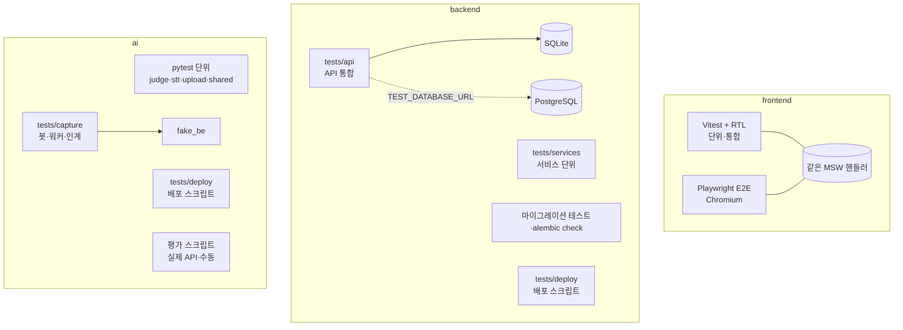

# 테스트

파트별 테스트를 돌리는 방법과 테스트의 종류, 규모를 정리한다. 모든 자동 테스트는 **실제 외부 API 없이** 돈다. 같은 테스트가 CI(GitHub Actions)에서도 돈다([배포](deploy.md#cicd-워크플로)).

## 원칙: 실제 외부 API 없이 돈다

| 파트 | 외부 의존을 무엇으로 대신하나 |
|---|---|
| frontend | MSW 핸들러. 앱 개발 모드·Vitest·Playwright 가 **같은 핸들러**를 쓴다. Discord·Notion OAuth 는 모의 OAuth 화면(`/__mock/oauth/...`) |
| backend | 기본 SQLite in-memory. Notion·Discord·SMTP·임베딩 클라이언트는 테스트 안에서 가짜로 바꾼다. PostgreSQL 전용 검사(잠금·경합, pgvector)는 `TEST_DATABASE_URL` 이 있을 때만 돈다 |
| ai | LLM·Jev·임베딩은 Null/Fake 클라이언트, 백엔드는 `tests/capture/fake_be.py`(BE 회의 API 의 상태 전이·409 를 흉내 냄), py-cord 없이 스텁 데이터로 돈다 |

- 실제 API 를 부르는 측정은 **평가 스크립트**로 따로 두고 손으로 돌린다(과금·키 필요). CI 에 넣지 않는다.
- DB 가 없어서 건너뛴(skip) 검사를 통과로 세지 않는다([backend README](https://github.com/kakaotechcampus-4/ktc4-kyungpook-3/blob/develop/backend/README.md#실행)).

## 실행 명령

### frontend (`frontend/`)

```bash
npm run typecheck        # tsc --noEmit
npm run lint             # eslint
npm run format:check     # prettier
npm run test             # Vitest + React Testing Library (단위·통합)
npm run build            # vite build

npx playwright install chromium   # 처음 한 번
npm run test:e2e                  # Playwright E2E. Vite 개발 서버(MSW)를 5211 포트로 띄워 Chromium 으로 돈다
npm run test:e2e:consent          # 약관 동의 화면 E2E (별도 설정 playwright.consent.config.ts)
```

- 테스트마다 `?msw-scenario=` 로 모의 데이터를 초기화한다(`e2e/support.ts`).
- 실패하면 `playwright-report/`·`test-results/` 에 스크린샷이 남는다. `npx playwright show-report` 로 본다. CI 는 retries 1, 다시 돌릴 때만 trace 를 남긴다.
- 포트가 겹치면 `E2E_PORT=5212 npm run test:e2e`.
- 사용자 흐름 검증 절차와 증거 보관은 `.claude/skills/verify-managers-manager` 스킬을 따른다. [확인 필요: 제출 문서에 스킬 언급 여부]

### backend (`backend/`)

```bash
.venv/bin/python -m pytest                  # SQLite 변형
TEST_DATABASE_URL=postgresql+psycopg://... .venv/bin/python -m pytest   # PostgreSQL 변형도 함께 (격리된 테스트 DB 필요)
.venv/bin/python -m ruff check .            # 린트 (ruff.toml)
DATABASE_URL=postgresql+psycopg://mm:mm@localhost:5432/<빈 DB> .venv/bin/alembic upgrade head && DATABASE_URL=postgresql+psycopg://mm:mm@localhost:5432/<빈 DB> .venv/bin/alembic check   # CI 는 빈 mm_migrate DB 를 쓴다. DATABASE_URL 이 없으면 개발 DB(mm)에서 돈다
```

### ai (`ai/`)

```bash
.venv/bin/python -m pytest      # py-cord·외부 API 없이 실행
```

평가 스크립트(실제 API, 손으로 돌림):

| 스크립트 | 무엇을 재나 |
|---|---|
| `python -m judge.eval_golden_set` | 판단 1단계 골든셋(그룹·반복 횟수 지정 가능) |
| `python -m judge.eval_final_judge` | 판단 2단계(Terra) |
| `python -m judge.eval_pipeline` | 판단 파이프라인 전체 |
| `python -m judge.eval_evidence` | Jev 근거 상태 |
| `python -m judge.eval_reply` | 리마인드 답장 판단 |
| `python -m judge.eval_asr_real` | 전사 오인식 검사 |
| `python -m judge.eval_embedding_search` | 유사 task 검색 |
| `python -m extract.eval_golden_set` | legacy 추출 골든셋 |
| `python -m stt.eval.eval` | 전사 CER (`--init` 으로 준비) |

결과는 `ai/judge/eval_results/`, `ai/stt/eval/results/` 에 날짜별로 남긴다. 수치는 [AI 로직](../design/ai/index.md)과 [지표](../techspec/metrics.md)에 정리한다.

## 테스트 종류



| 파트 | 종류 | 위치 | 내용 |
|---|---|---|---|
| FE | 단위·통합 | `frontend/src/**/*.test.ts(x)` | 컴포넌트·훅·API 클라이언트. 화면 단위는 RTL 로 그린다. Storybook 은 쓰지 않는다(#482) |
| FE | E2E | `frontend/e2e/*.e2e.ts` | 로그인·온보딩·회의·승인·메시지·대시보드·회의 삭제·탈퇴 흐름, 레이아웃·명도 대비 |
| BE | API 통합 | `backend/tests/api/` | 엔드포인트별 요청·응답·권한·409 경합. 일부는 SQLite·PostgreSQL 두 변형 |
| BE | 서비스 단위 | `backend/tests/services/` | 매칭·별칭 학습·임베딩·Discord·Notion 등 |
| BE | 마이그레이션 | `backend/tests/test_migration_*.py` | 데이터 이관 마이그레이션 |
| BE·AI | 배포 | `*/tests/deploy/` | `deploy/ec2-deploy.sh` 를 돌려 본다. 그래서 이 스크립트가 바뀌면 ai-ci·backend-ci 가 돈다 |
| AI | 단위 | `ai/tests/test_*.py`, `stt/`, `upload/`, `shared/` | 판단·근거·답장·요약·임베딩·전사 |
| AI | 통합 | `ai/tests/capture/` | 녹음 → 전사 → 판단 → BE 인계를 가짜 BE 로 끝까지 |

## 테스트 규모

[프로젝트 상세 설명 §8.4](../프로젝트%20상세%20설명.md#84-테스트-규모-2026-11-07-무렵) 기준(**2026-11-07 무렵**):

| 파트 | 테스트 | 기록된 통과 |
|---|---|---|
| AI | 파일 82, 함수 1,576 | 1,290 passed (2026-11-06) |
| BE | 파일 71, 함수 1,316 (2026-11-07 집계) | `tests/api` 1,461 passed, 1,241 skipped(PostgreSQL 전용 변형) (2026-11-07, SQLite). skipped 수는 [프로젝트 상세 설명](../프로젝트%20상세%20설명.md) 5.5절의 기록이다 |
| FE | 단위·통합 파일 262, E2E 28 파일 122 테스트 | 3,119 / 3,121 (실패 2 는 부하 시간 초과, #482) |

참고로 **2026-11-09** `develop` 에서 파일·함수 수만 다시 세면(정적 집계, 실행 결과 아님) AI 파일 107·`def test_` 2,032, BE 파일 128·`def test_` 2,318, FE 단위·통합 파일 305, E2E spec 39 이다. AI 는 두 집계의 범위가 같다. 같은 방법(`ai/` 아래 `test_*.py` 파일과 `def test_` 줄)으로 2026-11-07 마지막 `develop` 커밋(`41b554fc`)을 세면 표와 같은 82·1,576 이 나온다. BE 는 같은 방법으로 그 커밋을 세면 87·1,583(`tests/api` 만 63·1,263)이라 표의 71·1,316 과 맞지 않고, FE 는 집계 방법 기록이 없다. BE·FE 의 범위가 같은지는 [확인 필요]. 위 표의 BE 파일·함수 수(71·1,316)는 2026-11-07 집계라 이후 늘어난 테스트가 반영되지 않았다. 제출 직전에 파일·함수 수와 실행 결과를 다시 집계해 바꾼다.

## 관련 문서

- [테스트 전략](../techspec/test-strategy.md) · [배포·CI](deploy.md) · [로컬 실행](local-setup.md)
- [frontend README](https://github.com/kakaotechcampus-4/ktc4-kyungpook-3/blob/develop/frontend/README.md#검사) · [backend README](https://github.com/kakaotechcampus-4/ktc4-kyungpook-3/blob/develop/backend/README.md) · [ai README](https://github.com/kakaotechcampus-4/ktc4-kyungpook-3/blob/develop/ai/README.md#테스트)
