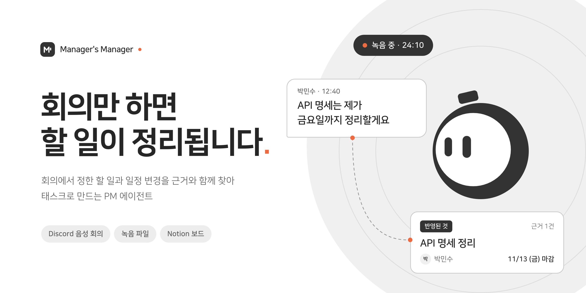

# Manager's Manager 문서

회의만 하면 할 일이 정리되는 PM 에이전트, Manager's Manager의 문서 포털입니다.

## 무엇을 하나요

팀 회의에서 정한 할 일·담당자·마감·일정 변경은 말로만 남기 쉽습니다. Manager's Manager는 회의 음성·채팅에서 **새 할 일과 기존 할 일의 변경**을 찾아 근거와 함께 정리하고, 확실한 것은 바로 반영하고 애매한 것만 PM에게 확인을 받습니다. 회의 뒤에는 마감 전 재촉과 답장 판단으로 후속 관리까지 이어집니다.

## 문서 안내

| 문서 | 이런 분께 | 시작 페이지 |
|---|---|---|
| 사용자 가이드 | 서비스를 처음 써 보는 PM·팀원·심사위원 | [시작하기](user/getting-started.md) · [처음 쓰는 분을 위한 안내](user/quick-guide.md) |
| 개발자 가이드 | 코드를 실행·테스트·배포하려는 개발자 | [로컬 실행](dev/local-setup.md) |
| 테크스펙 | 설계·에이전트 구조·안정성·품질 평가가 궁금한 분 | [테크스펙 요약](techspec/index.md) |
| 설계 심화 | AI·BE·FE를 왜 이렇게 만들었고 어떻게 검증했는지 | [설계 심화](design/index.md) |
| 프론트엔드 발표 문서 | FE 테크스펙·구조·문제 해결·선택·검증 근거를 찾는 분 | [프론트엔드 개요](design/frontend/index.md) |
| 협업 문서 | 팀의 그라운드룰·브랜치 전략·컨벤션·코드 리뷰 | [협업 개요](collab/index.md) |
| API 문서 | 엔드포인트·스키마 | [API 문서](api/index.md) |

## 제출 항목과 문서

| 제출 항목 | 문서 |
|---|---|
| 배포 서비스 URL (테스트 계정·샘플 데이터) | [사용자 가이드](user/getting-started.md) |
| GitHub 저장소 (README, 실행·배포, 테스트, CI/CD) | [README](https://github.com/kakaotechcampus-4/ktc4-kyungpook-3) · [개발자 가이드](dev/local-setup.md) |
| 테크스펙 | [테크스펙](techspec/index.md) |
| 협업문서 | [협업 문서](collab/index.md) |

## 원자료

이 포털은 저장소에 쌓인 계획·결과·결정 기록·계약을 정리한 것입니다. 원자료는 [문서 안내](https://github.com/kakaotechcampus-4/ktc4-kyungpook-3/blob/develop/docs/README.md)와 [프로젝트 상세 설명](프로젝트%20상세%20설명.md)에서 찾을 수 있습니다.
