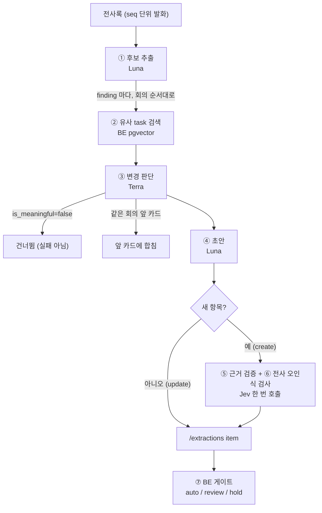
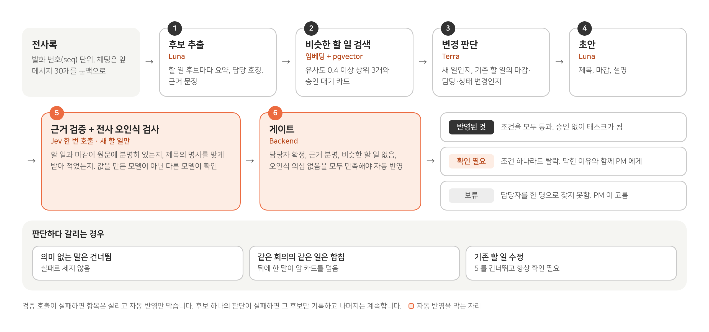

# 에이전트 설계

회의 전사록 하나를 승인용 항목(`/extractions` item)으로 바꾸는 판단 파이프라인(judge)의 단계, 단계별 모델·도구·입출력·상태·예외, 그리고 BE 게이트를 정리한다. 단계별 설계 이유는 [판단 파이프라인](../design/ai/judge-pipeline.md)에 있다.

## 파이프라인 한눈에

- 코드: `ai/judge/pipeline.py`(`run`, `to_item`), `ai/judge/semantic_judge.py`, `ai/judge/final_judge.py`, `ai/draft/doc_draft.py`, `ai/judge/evidence.py`, `ai/judge/asr_check.py`, BE `backend/app/services/matching.py`, `backend/app/api/extractions.py`.
- 시작 결정 기록: [2026-09-29 판단 파이프라인](https://github.com/kakaotechcampus-4/ktc4-kyungpook-3/blob/develop/ai/docs/basis_for_decision/ai/2026-09-29-judge-pipeline.md).

## 단계별 명세

| # | 단계 | 모델·도구 | 입력 | 출력 | 실패·예외 처리 |
|---|---|---|---|---|---|
| ① | 후보 추출 | Luna(`gpt-5.6-luna`) | 전사록(채팅은 앞 메시지 30개를 참고 문맥으로) | finding 목록: 요약 문장, 담당자 유형 7종, 담당 호칭, 근거 문장·seq | 응답을 못 쓰면 그 자리에서 1번 더 부름(#580). 또 실패하면 회의 전체 실패 → 회의 단위 재시도 |
| ② | 유사 task 검색 | BE `POST /workspaces/{id}/tasks/similar`, 임베딩 `text-embedding-3-small` + pgvector | finding 요약 문장 | 코사인 유사도 상위 3개 중 0.4 이상, 승인 대기 카드 최대 2개 | 그 finding 만 `failures`(similar) |
| ③ | 변경 판단 | Terra(`gpt-5.6-terra`) | finding + 후보(기존 task·같은 회의 앞 카드의 현재 값) | `is_meaningful`, `is_new`, 대상 task, 상태, 카테고리(schedule·assignee·status·scope·decision) | 그 finding 만 실패(judge). 대상 후보 없음은 실패(target). 규칙 폴백 없음(현재 값 비교가 필요, 결정 0011) |
| ④ | 초안 | Luna | finding + 판단 + 대상 task | 제목, 마감일·마감 원문, 설명(`doc_text`) | 그 finding 만 실패(draft) |
| ⑤ | 근거 검증 | Jev(`typesafe/jev-latest`) | 근거 원문, 제목, 회의 날짜, 마감 날짜·요일, 마감 원문 | `task_status`, `due_status` = certain / inferred / missing | 호출 실패 → inferred(auto 막힘). 새 항목만 |
| ⑥ | 전사 오인식 검사 | kiwipiepy 형태소 + 용어 목록 + Jev(⑤와 같은 호출) | 제목 명사 중 용어 목록에 없는 말, 발음이 가까운 후보 최대 5개 | `asr_suspects[]` | Jev 실패·분석기 실패 → `check_failed`(보수적으로 막음). 채팅·수정 항목은 검사 안 함 |
| ⑦ | 게이트 | BE `auto_blockers`, `decide_create_gate` | item + 담당자 매칭 결과 | auto / review / hold | 아래 표 |

- 판단 못 한 finding 이 남으면 파이프라인을 `MM_EXTRACT_RETRY_MAX` 번까지 다시 돌릴 수 있다. 기본값은 0 이다. 실패한 호출은 그 자리에서 한 번 더 하므로 회의 전체를 다시 돌리지 않는다(결정 [0063](https://github.com/kakaotechcampus-4/ktc4-kyungpook-3/blob/develop/ai/docs/basis_for_decision/ai/2026-11-10-0063-retry-the-failed-call-in-place.md)). 다시 돌린 경우 결과는 실행 하나를 고르지 않고 얘기 단위로 합친다(결정 [0016](https://github.com/kakaotechcampus-4/ktc4-kyungpook-3/blob/develop/ai/docs/basis_for_decision/member/2026-09-30-0016-judge-path-flag-and-unjudged-findings.md), [0054](https://github.com/kakaotechcampus-4/ktc4-kyungpook-3/blob/develop/ai/docs/basis_for_decision/ai/2026-11-07-0054-merge-judge-reruns-by-story.md)).
- 상대 날짜("내일")의 기준일은 회의 날짜다. 채팅은 메시지 작성일(KST).

## 상태: 값마다 출처가 하나

| 값 | 출처 |
|---|---|
| 담당자 호칭·유형, 근거 문장·seq | ① finding |
| 새 항목/수정, 대상 task, 상태, 카테고리 | ③ Terra |
| 제목, 마감, 설명 | ④ Luna |
| 근거 상태, 오인식 의심 단어 | ⑤⑥ Jev |
| 유사 검색 결과 수(`similar_count`) | ② BE |
| 담당자 member_id, 게이트 | ⑦ BE |

같은 회의에서 같은 일을 가리키는 뒤 발화는 앞 카드에 합친다(회의 순서대로 판단해 뒤 말이 앞을 덮음). 합칠 때 `task_status` 는 낮은 쪽, 마감은 마감을 정한 뒤 발화 기준이다.

## 실패를 두 갈래로 나눈다

| 범위 | 경우 | 처리 |
|---|---|---|
| 회의 전체 | LLM 키 없음(`PipelineUnavailableError`), 1단계 2회 연속 실패 | 단계 `failed(extract)` → 워커가 대기를 늘리며 재시도 |
| finding 하나 | 유사 검색·Terra·대상 없음·Luna 초안 실패 | `failures` 에 남기고 나머지 finding 은 계속 |
| 검증 | Jev·분석기 실패 | 결과를 보수 쪽(inferred, `check_failed`)으로 두어 auto 만 막음. 항목은 살림 |

## 게이트 (BE)

| 게이트 | 조건 |
|---|---|
| auto | judge 새 항목이 아래 auto 조건을 **모두** 만족하고 `AUTO_CREATE_ENABLED` 가 켜짐 |
| review | auto 조건 하나라도 탈락, 기존 task 수정(update)은 항상, 채팅 회의는 auto 를 review 로 낮춤 |
| hold | 담당자를 지목했는데 한 명으로 찾지 못함(PM 이 채워야 함) |

auto 조건(`backend/app/services/matching.py` `auto_blockers`, 탈락 사유 코드):

| 조건 | 탈락 사유 |
|---|---|
| 할 일 근거 certain | `task_not_certain` |
| 담당자를 언급했으면 한 명으로 확정(검증된 별칭·화자, 확신도 0.8 이상) | `assignee_not_confirmed` |
| 담당 유형이 추론형(2인칭·대명사·역할)이 아님 | `assignee_inferred` |
| 마감 근거 certain 또는 missing, 날짜 유무와 일치 | `due_not_certain`, `due_mismatch` |
| 유사 task 0건이고 임베딩 없는 활성 task·승인 대기 카드도 없음 | `similar_task_found`, `unsearched_task_exists`, `unsearched_pending_exists` |
| 전사 오인식 의심 단어 없음 | `asr_suspect`, `asr_check_failed` |
| AI 가 근거 값을 보냄 | `missing_signals` |

auto 로 만든 태스크도 PM 이 되돌릴 수 있다(태스크를 소프트 삭제하고 같은 내용의 승인 요청을 다시 만든다).

## 왜 이 구조인가

| 선택 | 이유 | 근거 |
|---|---|---|
| 만든 모델이 스스로 채점하지 않게 Jev 분리 | 값을 만든 LLM 의 자기 표시는 거의 다 certain. 다른 모델에 "근거 원문에 명시됐나"를 다시 묻고 yes 확률 0.8 이상만 certain | 결정 [0031](https://github.com/kakaotechcampus-4/ktc4-kyungpook-3/blob/develop/ai/docs/basis_for_decision/ai/2026-11-02-0031-evidence-status-by-source-check.md), [근거 검증](../design/ai/evidence-check.md) |
| 기존 task 변경 판단을 분리(②③) | "금요일까지로 미루죠" 같은 변경을 새 할 일과 구분. 임베딩으로 후보를 좁히고 Terra 가 현재 값과 비교 | 결정 [0010](https://github.com/kakaotechcampus-4/ktc4-kyungpook-3/blob/develop/ai/docs/basis_for_decision/ai/2026-09-22-0010-embedding-similarity-threshold.md)(threshold 0.4 = 명확한 불일치 최고 0.33 과 명확한 매치 최저 0.42 사이), [0011](https://github.com/kakaotechcampus-4/ktc4-kyungpook-3/blob/develop/ai/docs/basis_for_decision/ai/2026-09-23-0011-final-judge-no-rules-fallback-and-candidate-index.md) |
| 숫자 점수 대신 조건 게이트 | 탈락 사유가 운영 로그에 남아 감사·재현 가능 | BE #232 |
| 근거 검증과 오인식 검사를 같은 Jev 호출로 | 호출 수가 늘지 않음 | 결정 [0051](https://github.com/kakaotechcampus-4/ktc4-kyungpook-3/blob/develop/ai/docs/basis_for_decision/ai/2026-11-07-0051-asr-suspect-gate.md), [전사 오인식 검사](../design/ai/asr-check.md) |
| 수정 항목은 항상 PM 확인 | 유사도·판단이 틀리면 기존 데이터를 망가뜨림. 승인 때 409 충돌 검사 | [요구사항·리스크](requirements-risks.md) |

## 같은 구조를 쓰는 다른 에이전트

| 에이전트 | 흐름 | 자동 반영 조건 | 링크 |
|---|---|---|---|
| 리마인드 답장 판단 | 팀원 DM 답장 → 회의 파이프라인에 넣어 상태·마감·담당 변경 판단 → Jev 상태 검증 | 상태 변경이 certain, 본인, 판단이 본 값이 지금도 그대로일 때만 BE 가 반영. 나머지는 PM 확인 카드 | `ai/judge/reply.py`, 결정 [0043](https://github.com/kakaotechcampus-4/ktc4-kyungpook-3/blob/develop/ai/docs/basis_for_decision/ai/2026-11-04-0043-reminder-reply-judgment.md), [답장 판단](../design/ai/reply-judgment.md) |
| 리마인드 문구 초안 | BE 가 묶음을 내주면 Luna 가 DM 가운데 문구 작성 → PM 승인 뒤 발송 | 자동 발송 없음(설정으로 묶음 자동 승인 가능) | `ai/draft/reminder_draft.py` |
| 회의 요약 | 인계 뒤 BE 요약 대기열 → Luna 요약 → BE 저장 | — | BE 계약 [회의 요약](https://github.com/kakaotechcampus-4/ktc4-kyungpook-3/blob/develop/backend/docs/contracts/backend-ai-contract.md#회의-요약) |

## legacy 경로

`MM_EXTRACT_PATH` 코드 기본값은 `legacy`(LLM 두 번: 관련 문장 필터 → 구조화 추출, 확신도 0.8/0.5 로 게이트)다. Jev 근거 상태·오인식 검사는 judge 경로에서만 쓰인다. 운영 서버의 경로는 환경 변수 `MM_EXTRACT_PATH` 로 정한다. 채팅 회의는 이 값과 상관없이 judge 경로다. 상세: [ai/extract/README.md](https://github.com/kakaotechcampus-4/ktc4-kyungpook-3/blob/develop/ai/extract/README.md).
