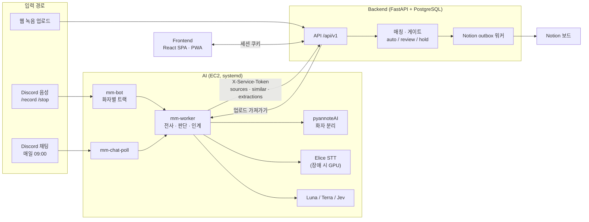
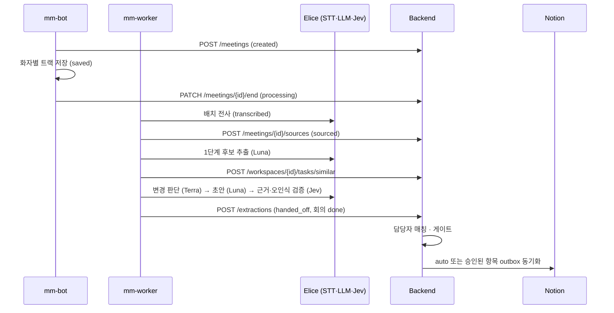

# 아키텍처 설계

전체 구조, 회의 하나의 처리 흐름, 단계 상태와 재시작, 기술 스택, 배포 구성을 정리한다. 판단 파이프라인 내부는 [에이전트 설계](agent-design.md)에 있다.

## 구성 요소

| 구분 | 구성 요소 | 하는 일 | 위치 |
|---|---|---|---|
| Frontend | React 19 + Vite SPA (PWA) | PM·팀원 화면: 회의록, 승인, 태스크, 메시지, 설정 | [frontend/](../../frontend/README.md) |
| Backend | FastAPI + PostgreSQL 16/pgvector | 인증·권한, 매칭, 게이트, 승인, 이력, 리마인드, Notion 동기화 | [backend/](../../backend/README.md) |
| AI | 녹음 봇 `mm-bot` | Discord `/record`·`/stop`, 화자별 트랙 저장, 리마인드 DM | [ai/capture/](../../ai/README.md) |
| AI | 처리 워커 `mm-worker` | 전사 → 판단 → BE 인계, 업로드 가져가기, 회의 요약 | `ai/capture/worker.py` |
| AI | 채팅 폴러 `mm-chat-poll` | 매일 09:00 KST 채팅 수집 | `ai/capture/chat_poll.py` |
| 외부 | Discord | 음성·채팅·DM, OAuth | |
| 외부 | Notion | 태스크 보드 동기화(OAuth) | |
| 외부 | Elice MLAPI | STT(whisper-large-v3), LLM Luna·Terra(`gpt-5.6-luna`·`gpt-5.6-terra`), Jev(`typesafe/jev-latest`), 임베딩(`text-embedding-3-small`) | `ai/llm.py`, `ai/jev.py`, `ai/embedding.py` |
| 외부 | pyannoteAI | 웹 업로드 화자 분리 | `ai/upload/` |
| 외부 | GPU 대기 서버(g4dn.xlarge) | Elice 장애 때 전사 | `ai/deploy/gpu-stt/` |

## 전체 흐름

> 📷 **사진 자리**: 전체 구성도(서버 한 대 안의 컨테이너·systemd 유닛과 외부 서비스) 다듬은 그림 (파일: ../assets/techspec-architecture.png)

## 입력 경로 세 가지

| 경로 | 시작 | 화자 구분 | 판단 경로 | 게이트 특이점 |
|---|---|---|---|---|
| Discord 음성 | 봇 `/record`, 서버 ID 로 워크스페이스 고정(연결 없으면 녹음 안 함) | 화자별 트랙(분리 불필요) | `MM_EXTRACT_PATH`(legacy 기본 / judge) | — |
| 웹 업로드 | PM 이 음성 1개 업로드(최대 100MiB), `MM_UPLOAD_INTAKE=1` 인 워커가 가져감 | pyannoteAI → PM 이 라벨마다 팀원 지정 | 동일 | 디스코드 회의보다 먼저 처리 |
| Discord 채팅 | PM 이 고른 채널, BE 커서 이후 메시지를 하루치 "채팅 회의"로 | 메시지 작성자 | 항상 judge | auto 를 review 로 낮춤 |

근거: [프로젝트 상세 §3.2](../프로젝트%20상세%20설명.md), 결정 [0028](../../ai/docs/basis_for_decision/ai/2026-11-01-0028-manual-upload-hosted-diarization-and-diarized-state.md), [0042](../../ai/docs/basis_for_decision/ai/2026-11-04-0042-chat-daily-poll-as-chat-meeting.md).

## 회의 하나의 처리 순서 (음성, judge 경로)

1. 녹음 → 트랙 저장 → 배치 전사(28초 묶음, 회의당 동시 6호출).
2. 발화를 `seq` 단위로 BE 에 저장한다. 근거 연결의 키다.
3. 판단 파이프라인([에이전트 설계](agent-design.md))이 `/extractions` 항목을 만든다.
4. BE 가 담당자를 매칭하고 게이트(auto / review / hold)를 정한다. 기존 task 수정은 항상 review.
5. PM 승인 → Task 반영 → Notion outbox 동기화.
6. 인계가 끝난 회의의 트랙 음성은 워커가 지운다(포기한 회의는 7일 뒤, 결정 [0055](../../ai/docs/basis_for_decision/ai/2026-11-08-0055-meeting-audio-retention.md)).

## 단계 상태와 재시작 (매니페스트)

| 항목 | 내용 |
|---|---|
| AI 단계 | `recording → saved → transcribed → sourced → extracted → handed_off` |
| 업로드 추가 단계 | `diarized`(화자 지정 전) → `mapped`(지정 후). 업로드 가져오기 상태: `claiming → claimed → converted → submitted → done` |
| 실패 기록 | `failed` + `failed_stage`(stt / sources / extract / handoff) |
| 재시작 | 워커가 매니페스트를 읽어 마지막으로 끝난 단계 다음부터 다시 한다. 회의 단위 재시도는 대기를 두 배씩 늘리고 포기하면 `--retry` 로 7일 안에 다시 처리 |
| 멱등 | `POST /extractions` 는 이미 `done` 이면 기존 결과를 돌려준다. 재전송이 중복 카드를 만들지 않는다 |
| BE 회의 상태 | `created / recording / processing / awaiting_speakers / done / failed`, 처리 단계 `stt → sources → extract → handoff` 를 웹에 표시 |
| 외부 작업 이어 받기 | pyannoteAI 는 제출만 하고 job ID 를 기록해 다음 바퀴에 결과를 조회(결정 [0040](../../ai/docs/basis_for_decision/ai/2026-11-03-0040-upload-intake-in-worker-submit-then-fetch.md)) |

근거: 결정 [0017](../../ai/docs/basis_for_decision/member/2026-10-05-0017-transcript-sources-stage.md), [0026](../../ai/docs/basis_for_decision/member/2026-10-13-0026-worker-only.md).

## 기술 스택

| 파트 | 스택 |
|---|---|
| Frontend | React 19, TypeScript, Vite, React Router 7, TanStack Query 5, Zustand, Axios, React Hook Form + Zod, Tailwind CSS 4, Radix UI, MSW 2, Vitest + RTL, Playwright. FSD 계층을 ESLint 로 강제 |
| Backend | Python 3.12, FastAPI, SQLAlchemy 2, Alembic, PostgreSQL 16 + pgvector(`vector(1536)`), httpx, pywebpush. 응답 봉투 `{data, error}` |
| AI | Python 3.12, py-cord(voice, 커밋 고정, capture 에만), Elice MLAPI(OpenAI 호환), faster-whisper(로컬 예비), kiwipiepy 0.24.1(형태소), pytest |
| 인프라 | AWS EC2 t3.medium 1대(2 vCPU, 4GB), Docker Compose, Caddy(HTTPS·라우팅), systemd, GitHub Actions(OIDC → SSM) |

## 배포 구성

| 항목 | 내용 |
|---|---|
| 서버 | EC2 `t3.medium` 1대, Ubuntu 24.04, 디스크 50GB. 사양 변경·서버 추가 불가 제약 |
| BE | `docker-compose.prod.yml`(db: pgvector/pg16, api `127.0.0.1:8000`). 프로세스 하나(`--workers 1`)에 백그라운드 워커(리마인드 스케줄러 60초, Notion 동기화 5초, 임베딩 채우기 5초, 업로드 sweeper 300초 등) |
| FE | 정적 빌드를 Caddy 가 서빙. `/api` 와 같은 오리진이라 CORS 불필요 |
| AI | systemd `mm-bot`, `mm-worker`(MemoryMax 3G), `mm-chat-poll` + 타이머 |
| 자동 배포 | develop push → 세 파트 CI 를 같은 커밋으로 → 모두 통과 시 SSM 으로 `/opt/mm` fast-forward → 바뀐 파트만 재시작. BE 는 시작 때 `alembic upgrade head` |
| 녹음 보호 | 녹음 중이면 봇을 재시작하지 않음(`restart.lock`), 워커는 SIGTERM 에 하던 회의를 마치고 종료 |
| GPU 전사 자동 전환 (#581) | 실제 호출 연속 6번 실패 + Elice 확인 3번 실패 → Lambda 스위치로 g4dn.xlarge 를 켬. Elice 확인 3번 연속 성공이면 복귀, GPU 호출 10분 없으면 끔. 하루 6시간·누적 15시간($9.7) 상한. `manual` 로 배포 → 리허설 → `auto` 순서 |

- GPU 운영 모드(현재 `manual` 인지 `auto` 인지) **[확인 필요]**.
- 상세: [배포 문서](../../deploy/README.md), [개발 배포 안내](../dev/deploy.md), 결정 [0039](../../ai/docs/basis_for_decision/ai/2026-11-04-0039-gpu-stt-server.md)·[0056](../../ai/docs/basis_for_decision/ai/2026-11-08-0056-gpu-stt-auto-failover.md).

## 왜 이 구조인가 (요약)

| 결정 | 근거 수치 | 링크 |
|---|---|---|
| 외부 STT 기본, 로컬·GPU 는 장애 대응 | 로컬 turbo RTF 1.36(62분 회의 85분), Elice 65초. GPU 상시 운영 손익분기 월 오디오 1,863시간 | 결정 [0019](../../ai/docs/basis_for_decision/member/2026-10-07-0019-elice-api-default-local-fallback.md), [STT](../ai-logic/stt.md) |
| 회의 뒤 배치 전사 | 실시간 전사를 번복(0003 → 0008) | [STT](../ai-logic/stt.md) |
| AI 는 HTTP API 로만 BE 와 대화 | 서비스 토큰으로 봇 경로 보호 | [인터페이스](interface.md) |
| Notion 은 outbox | 요청 안에서 Notion 을 부르지 않음, 재시도·중복 방지 | [요구사항·리스크](requirements-risks.md) |
