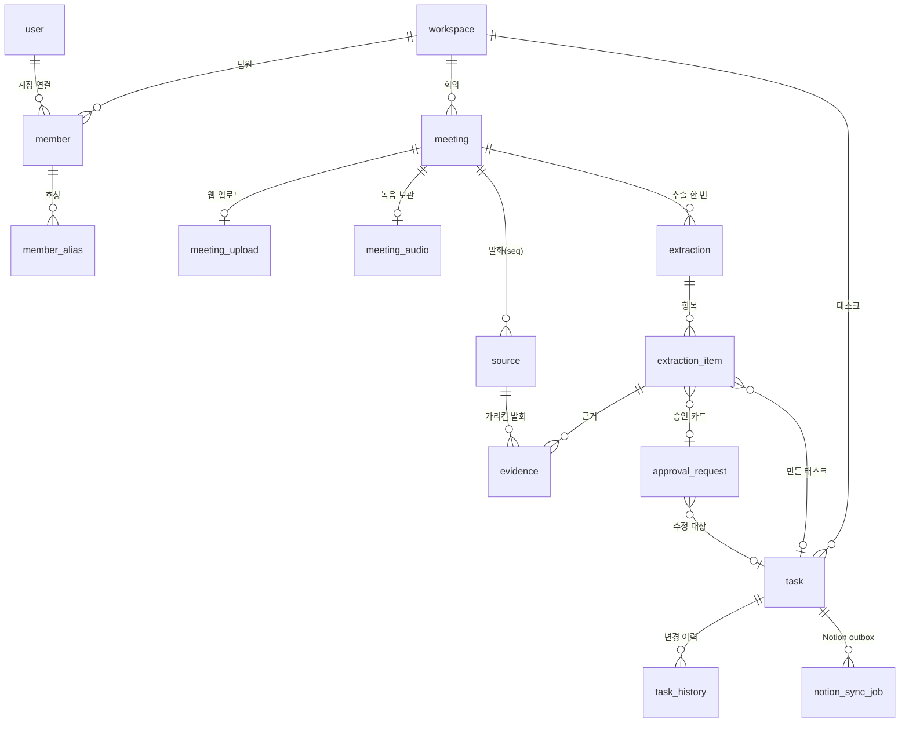

# 데이터 모델

Backend 의 PostgreSQL 16(pgvector) 스키마를 정리한다. 표는 48개이고 정의는 [backend/app/models/models.py](https://github.com/kakaotechcampus-4/ktc4-kyungpook-3/blob/develop/backend/app/models/models.py), 변경 이력은 Alembic 마이그레이션에 있다. AI 파트는 DB 에 직접 닿지 않고 HTTP API 로만 읽고 쓴다([인터페이스 명세](interface.md)).

## 핵심 관계

회의에서 태스크까지 이어지는 표만 그렸다.

## 표 묶음

| 묶음 | 표 | 하는 일 |
|---|---|---|
| 계정과 공간 | `user`, `session`, `password_reset_token`, `signup_email_code`, `user_consent`, `workspace`, `workspace_onboarding_step`, `integration`, `member`, `member_alias`, `alias_resolution_log`, `alias_review`, `invitation`, `withdrawal_receipt`, `privacy_cleanup` | 로그인과 세션, 동의 기록, 워크스페이스와 팀원, Discord·Notion 연결, 담당자 호칭과 그 확인 기록, 탈퇴 처리 |
| 회의와 전사 | `meeting`, `meeting_upload`, `meeting_audio`, `meeting_purge`, `source` | 회의 상태와 처리 단계, 업로드 파일, 녹음 보관 기한, 삭제 진행, 발화 한 줄 |
| 추출과 승인 | `extraction`, `extraction_item`, `evidence`, `approval_request` | AI 가 보낸 추출 결과, 항목마다의 게이트와 근거 상태, 근거 발화 연결, PM 승인 카드 |
| 태스크 | `task`, `task_history`, `notion_sync_job` | 태스크와 임베딩, 무엇이 어떤 경로로 바뀌었는지, Notion 반영 대기열 |
| 메시지와 리마인드 | `message_thread`, `thread_message`, `message_thread_read`, `reminder_bundle`, `reminder`, `bot_dm_part`, `reminder_watch`, `scheduler_suggestion`, `reply_judgment`, `reply_change`, `notification`, `push_subscription`, `workspace_message_settings` | PM·팀원 대화, 재촉 묶음과 DM 전달 기록, 72시간 시계, 답장 판단과 그 결과, 웹 푸시 |
| 전사 용어 | `workspace_asr_term`, `asr_title_queue` | 팀이 쓰는 낱말 목록과 PM 이 승인한 제목 대기열 |
| 프로젝트 맵 | `topic`, `topic_alias`, `topic_task_detach`, `topic_meeting`, `topic_item`, `decision` | 주제로 묶은 회의·결정·태스크 |

## 상태값

| 표 | 값 | 쓰임 |
|---|---|---|
| `meeting.status` | `created` / `recording` / `processing` / `awaiting_speakers` / `done` / `failed` | 웹의 회의 목록과 처리 화면. 처리 단계(`stt → sources → extract → handoff`)는 따로 둔다 |
| `meeting.source` | `discord` / `manual_upload` / `chat` | 입력 경로. 게이트가 경로를 본다(채팅은 자동 반영을 낮춘다) |
| `extraction_item.gate` | `auto` / `review` / `hold` | 화면의 반영된 것 / 확인 필요 / 보류 |
| `approval_request.type` | `task_create` / `task_update` | 새 태스크 승인과 기존 태스크 수정 승인. 충돌 확인 방식이 다르다 |
| `approval_request.status` | `pending` / `approved` / `rejected` | 요약은 승인된 값만 쓴다 |
| `task.status` | `todo` / `in_progress` / `blocked` / `done` | `blocked` 는 72시간 무응답이나 "막혔다"는 답장으로 바뀐다 |

## 핵심 표의 필드

회의에서 태스크까지 이어지는 표의 주요 필드다. 전체 정의는 `models.py` 에 있다.

### meeting

| 필드 | 타입 | 뜻 |
|---|---|---|
| `meeting_id` | String(36), PK | 회의 ID |
| `workspace_id` | FK | 워크스페이스 |
| `source` | String(20) | 입력 경로. `discord` / `manual_upload` / `chat` |
| `status` | String(32) | 회의 상태 |
| `failed_stage` | String(32), null | 실패한 단계 |
| `processing_stage` | String(16), null | AI 가 알린 처리 단계. `stt` / `sources` / `extract` / `handoff` |
| `processing_stt_done`, `processing_stt_total` | Integer, null | 전사가 끝난 트랙 수와 전체 트랙 수 |
| `started_at`, `ended_at` | DateTime | 녹음 시작과 종료 |
| `duration_ms` | Integer, null | 녹음 길이 |
| `title`, `title_original`, `title_edited_at` | String(200), DateTime | 제목, 처음 제목, 사람이 고친 시각 |
| `replaces_meeting_id` | FK, null | 다시 만든 회의가 가리키는 이전 회의 |
| `deleted_at`, `deletion_ready` | DateTime, Boolean | 삭제 진행 상태 |

### source

| 필드 | 타입 | 뜻 |
|---|---|---|
| `source_id` | String(36), PK | 발화 ID |
| `meeting_id` | FK | 회의 |
| `seq` | Integer | 회의 안 발화 번호. 회의와 번호의 쌍이 유일하다 |
| `speaker_discord_user_id` | String(64), null | 말한 사람의 디스코드 계정 |
| `speaker_name` | String(100), null | 말한 사람의 표시 이름 |
| `member_id` | FK, null | 연결된 팀원 |
| `start_ms`, `end_ms` | Integer | 발화 시작과 끝 |
| `text` | Text | 전사문 |
| `text_edit` | Text, null | 사람이 고친 전사문 |

### extraction_item

| 필드 | 타입 | 뜻 |
|---|---|---|
| `item_id` | String(36), PK | 추출 항목 ID |
| `extraction_id` | FK | 추출 |
| `action` | String | 새 태스크인지 기존 태스크 수정인지 |
| `task_title` | String(300) | 할 일 제목 |
| `assignee_raw`, `assignee_type` | String, null | 원문의 담당자 호칭과 호칭 종류 |
| `assignee_member_id` | FK, null | 매칭된 팀원 |
| `assignee_needs_check` | Boolean | 담당자 확인이 필요한지 |
| `due_date`, `due_raw` | Date, String, null | 마감일과 원문 표현 |
| `gate` | String(10) | `auto` / `review` / `hold` |
| `category`, `status` | String(16), null | 변경 종류와 상태 값 |
| `task_evidence_status`, `due_evidence_status` | String(16), null | 할 일과 마감의 근거 검증 결과 |
| `similar_count`, `top_similarity` | Integer, Float, null | 유사 검색 결과 수와 가장 높은 유사도 |
| `reverted_at`, `reverted_by` | DateTime, FK, null | 자동 반영을 되돌린 시각과 사람 |
| `task_id`, `approval_id` | FK, null | 만든 태스크, 승인 카드 |

### approval_request

| 필드 | 타입 | 뜻 |
|---|---|---|
| `approval_id` | String(36), PK | 승인 카드 ID |
| `workspace_id` | FK | 워크스페이스 |
| `type` | String(20) | `task_create` / `task_update` |
| `payload` | Text(JSON) | 제안 값과 PM 이 본 기준값 |
| `related_task_id` | FK, null | 수정 대상 태스크 |
| `status` | String | `pending` / `approved` / `rejected` |
| `requested_by`, `resolved_by`, `resolved_at` | FK, DateTime, null | 요청한 쪽, 처리한 사람과 시각 |
| `embedding` | vector(1536), null | 승인 대기 중인 같은 일을 찾는 데 쓴다 |

### task

| 필드 | 타입 | 뜻 |
|---|---|---|
| `task_id` | String(36), PK | 태스크 ID |
| `workspace_id`, `meeting_id` | FK | 워크스페이스, 연결된 회의 |
| `title` | String(300) | 제목 |
| `assignee_member_id` | FK, null | 담당자 |
| `status` | String(16) | `todo` / `in_progress` / `blocked` / `done` |
| `blocker` | Text, null | 막힌 이유 |
| `start_date`, `due_date` | Date, null | 시작일, 마감일 |
| `version` | Integer | 바뀔 때마다 오르는 버전 |
| `notion_page_id`, `notion_database_id` | String(64), null | 반영된 Notion 페이지와 데이터베이스 |
| `notion_synced_version`, `notion_sync_status` | Integer, String(16), null | Notion 에 반영된 버전과 상태 |
| `embedding` | vector(1536), null | 비슷한 태스크 검색 |
| `is_deleted`, `deleted_at` | Boolean, DateTime | 삭제 표시 |

### task_history

| 필드 | 타입 | 뜻 |
|---|---|---|
| `history_id` | String(36), PK | 이력 ID |
| `task_id` | FK | 태스크 |
| `changed_field` | String(20) | 바뀐 필드 |
| `old_value`, `new_value` | Text, null | 전 값과 후 값 |
| `change_source` | String(16) | 어떤 경로로 바뀌었는지 |
| `changed_by` | FK, null | 바꾼 사람 |
| `is_rolled_back`, `rolled_back_at` | Boolean, DateTime | 되돌렸는지와 시각 |

### notion_sync_job

| 필드 | 타입 | 뜻 |
|---|---|---|
| `job_id` | String(36), PK | 작업 ID |
| `task_id`, `task_version` | FK, Integer | 반영할 태스크와 그 버전 |
| `status` | String | 대기열 상태 |
| `attempts`, `next_attempt_at` | Integer, DateTime | 시도 횟수와 다음 시도 시각 |
| `locked_at` | DateTime, null | 워커가 잡은 시각 |
| `last_error` | Text, null | 마지막 오류 |

## 설계에서 정한 것

| 정한 것 | 이유 |
|---|---|
| 발화를 `source` 한 줄씩, 회의 안 번호(`seq`)로 저장 | 추출 항목의 근거가 이 번호를 가리킨다. 같은 번호를 다시 보내면 건너뛰어 재전송해도 중복이 없다 |
| 근거를 `evidence` 로 따로 둠 | 항목 하나가 발화 여러 줄을 근거로 가질 수 있다 |
| 승인 카드에 기준값을 같이 저장 | PM 이 본 값과 지금 값이 다르면 409 로 다시 확인받는다([승인과 충돌](../design/backend/approval-conflict.md)) |
| `task` 와 `approval_request` 에 임베딩 `vector(1536)` | 비슷한 기존 태스크와 승인 대기 중인 새 항목을 pgvector 로 찾는다. 별도 벡터 DB 를 두지 않는다 |
| Notion 반영을 `notion_sync_job` 대기열로 | 승인 트랜잭션과 외부 호출을 나눈다([Notion 동기화](../design/backend/notion-sync.md)) |
| 녹음 보관 기한을 `meeting_audio` 로 | 회의 종료부터 7일. 처리 중인 회의는 지우지 않는다 |
| KPI 는 `kpi` 스키마의 view 3개 | `kpi.meeting_fact`, `kpi.extraction_item_fact`, `kpi.approval_fact`. ID·이름·본문 없이 시각과 코드값만 내보낸다([추가 지표](metrics.md)) |

파일 저장: 업로드 음성과 보관 녹음은 `UPLOAD_STORAGE` 설정에 따라 로컬 디스크나 S3 에 둔다. AI 워커의 회의 매니페스트와 트랙 파일은 워커의 로컬 디스크에 있고 DB 에 넣지 않는다([아키텍처 설계](architecture.md#단계-상태와-재시작-매니페스트)).
