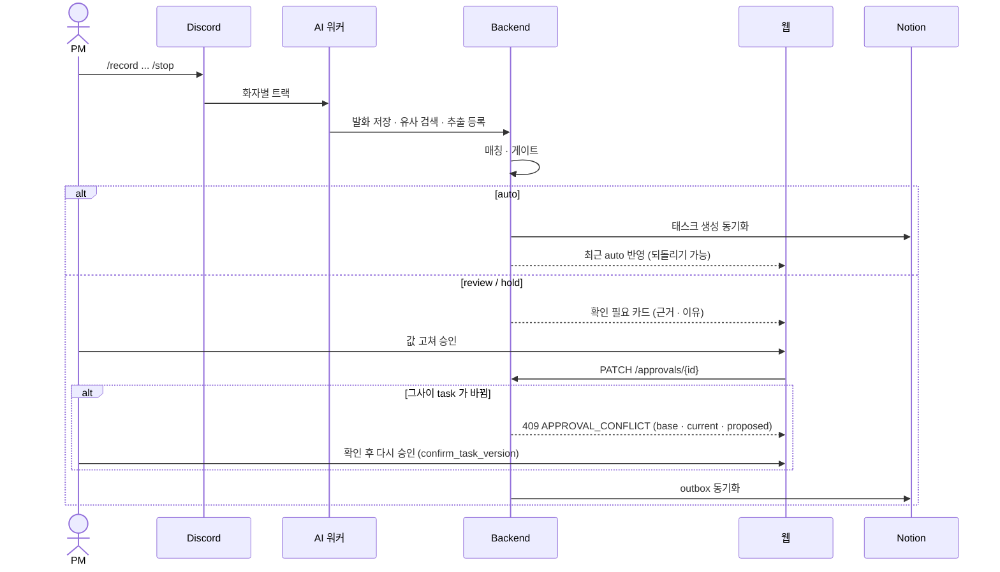
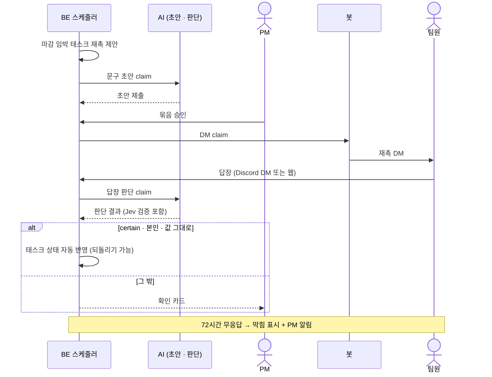
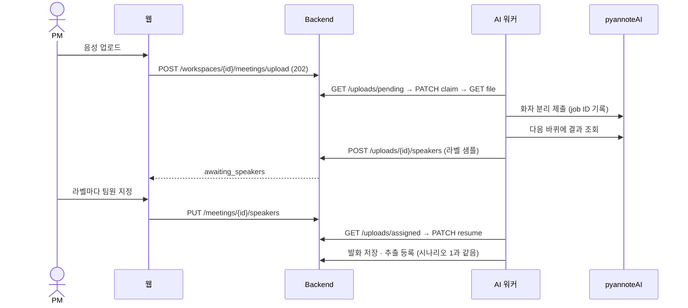

# 시나리오

사용자(PM·팀원) 관점의 대표 흐름 세 가지와 그때 시스템이 하는 일을 정리한다. 화면 사용법은 [사용자 가이드](../user/review-approve.md)에 있다.

| # | 시나리오 | 주인공 | 핵심 동작 |
|---|---|---|---|
| 1 | 회의 → 자동 반영/확인 → 승인 → Notion | PM | 근거 확인, 값 고쳐 승인, 409 충돌 |
| 2 | 재촉 → DM → 웹 답장 → 반영 | PM·팀원 | 재촉 제안, 답장 판단, 자동 반영 또는 확인 카드 |
| 3 | 오프라인 회의 업로드 → 화자 지정 | PM | 화자 분리, 라벨별 팀원 지정, 처리 진행 표시 |

## 1. 회의에서 정한 일이 보드에 들어가기까지

1. 팀이 Discord 음성 채널에서 회의하고 봇에 `/record`, `/stop` 을 보낸다.
2. 워커가 전사 → 판단 → BE 인계까지 처리한다. 웹 처리 화면·토스트에 단계(`stt → sources → extract → handoff`)가 보인다.
3. 조건을 모두 만족한 새 할 일은 **auto** 로 바로 태스크가 되고 대시보드 "최근 auto 반영"에 뜬다(되돌리기 가능).
4. 나머지는 **확인 필요** 카드다. PM 은 근거 인용·화자·회의 내 시각·원문 듣기와 "확인이 필요한 이유"를 본다. 신뢰도 숫자는 보이지 않는다.
5. PM 이 제목·담당·마감을 고쳐 승인하거나 반려한다. 기존 task 수정 카드는 AI 가 본 값과 지금 값이 다르면 409 로 비교 화면을 보여 준다.
6. 승인된 태스크는 Notion 보드에 동기화된다(outbox, 실패하면 재시도·수동 재시도 버튼).

> 📷 **사진 자리**: 승인 확인 화면 — 근거 인용·화자·시각·원문 듣기와 "확인이 필요한 이유" (파일: ../assets/techspec-approval-card.png)

> 📷 **사진 자리**: 409 충돌 비교 화면(기준값·지금 값·제안 값) (파일: ../assets/techspec-approval-conflict.png)

> 📷 **사진 자리**: 승인 뒤 Notion 보드에 반영된 태스크 (파일: ../assets/techspec-notion-board.png)

## 2. 마감 전 재촉과 팀원 답장

1. BE 리마인드 스케줄러가 마감 전 발송 시각(기본 마감 하루 전 09시) 3일 전부터 재촉을 제안한다.
2. AI 가 DM 가운데 문구 초안을 쓴다. PM 이 메시지 화면에서 묶음을 확인·수정·승인한다(설정으로 자동 승인 가능).
3. 봇이 팀원에게 DM 을 보낸다. 팀원은 Discord DM 또는 웹 메시지 화면에서 답장한다.
4. AI 가 답장을 판단한다. 상태 변경이 certain 이고 본인이며 판단이 본 값이 지금도 그대로면 BE 가 자동 반영하고, 아니면 PM 확인 카드가 된다. 태스크를 못 정한 답장은 PM 이 고른다.
5. DM 전달 뒤 72시간 무응답이면 태스크를 막힘으로 바꾸고 PM 에게 알린다(답이 오면 풀림, PM 이 되돌릴 수 있음).

> 📷 **사진 자리**: 메시지 화면 — 보내기 전 확인 묶음과 팀원 웹 답장 (파일: ../assets/techspec-reminder-bundle.png)

> 📷 **사진 자리**: Discord 재촉 DM 과 답장 (파일: ../assets/techspec-reminder-dm.png)

## 3. 오프라인 회의를 업로드하고 화자 지정

1. PM 이 웹에서 음성 파일 1개(최대 100MiB)와 제목·날짜·참석자를 올린다. Notion 미연결이면 안내로 막는다.
2. AI 워커가 파일을 가져가 pyannoteAI 로 화자를 나누고, 라벨마다 다른 화자와 겹치지 않는 구간으로 10초 샘플을 보고한다.
3. 회의 상태가 `awaiting_speakers` 가 되고 토스트가 "화자 지정 필요"를 알린다.
4. PM 이 샘플을 들어 보고 라벨마다 팀원 또는 외부 참석자를 지정한다.
5. 워커가 이어 받아 전사 → 판단 → 인계를 하고, 시나리오 1의 5단계부터 같다.
6. 예외: 가져가지 않은 업로드 24시간, 진행 없음 3시간, 화자 지정 대기 7일이 지나면 BE sweeper 가 failed 로 정리한다.

> 📷 **사진 자리**: 화자 지정 화면 — 라벨별 샘플 듣기와 팀원 선택 (파일: ../assets/techspec-speaker-assign.png)

> 📷 **사진 자리**: 처리 진행 토스트(정리 중·화자 지정 필요·완료) (파일: ../assets/techspec-progress-toast.png)

## 함께 볼 곳

- 채팅 수집 흐름(매일 09:00 하루치 "채팅 회의", auto 없음): [아키텍처](architecture.md#입력-경로-세-가지)
- 업로드 상세 규칙: [BE↔AI 계약 웹 업로드](../../backend/docs/contracts/backend-ai-contract.md#웹-업로드-가져가기)
- 사용자 가이드: [회의 기록](../user/record-meeting.md), [확인과 승인](../user/review-approve.md), [후속 관리](../user/follow-up.md)
- 화면 설계: [AI 결과 보여 주기](../design/frontend/ai-result-ui.md), [실시간 메시지](../design/frontend/realtime-messages.md)
