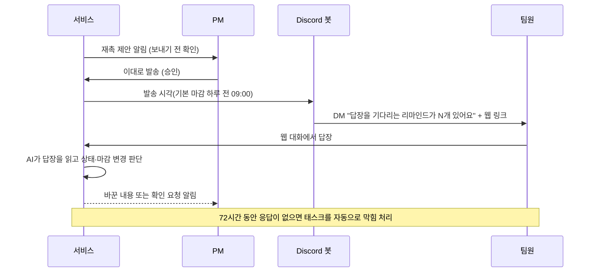

# 마감 관리와 메시지

태스크가 생긴 뒤 마감을 챙기는 방법이에요. 마감이 다가오면 서비스가 재촉을 준비하고, 팀원에게 Discord DM으로 알린 뒤, 답장은 웹에서 주고받아요.

## 흐름 한눈에



답장을 판단하는 방식은 [답장 판단](../design/ai/reply-judgment.md)에 있어요.

## 1. 마감 리마인드와 재촉

| 규칙 | 기본값 | 바꾸는 곳 |
|---|---|---|
| 재촉 보내는 날 | 마감 하루 전 (최대 3일 전, 당일 가능) | 설정 > 알림 **재촉 며칠 전** |
| 재촉 보내는 시각 | 09:00 (한국 시간) | 설정 > 알림 **재촉 보낼 시각** |
| 보내기 전 PM 승인 | 필요 | 설정 > 알림 **재촉 자동 승인** |
| 응답 없음 처리 | 72시간 뒤 태스크를 **막힘**으로 | 자동 |

- 담당자와 마감이 있는 태스크만 재촉해요. 완료한 태스크, 담당자가 없거나 탈퇴한 태스크는 재촉하지 않아요.
- 서비스가 재촉을 제안하면 PM에게 "○○님에게 보낼 재촉을 제안했어요. 보내기 전 확인에서 승인해 주세요" 알림이 와요.
- 72시간 무응답이면 태스크에 "리마인드에 72시간 동안 응답이 없어요" 사유로 **자동 막힘**이 붙어요. 팀원이 답하거나 상태를 바꾸면 풀려요.

### 직접 재촉 만들기

- 태스크 상세의 **재촉 만들기**, 또는 메시지 화면의 **새 재촉**에서 만들어요.
- 받는 팀원, 태스크, 보낼 시각, **메모 (선택)**를 정해요.
- "재촉을 만들었어요. 메시지 화면에서 확인하고 승인해야 나가요."가 떠요.

## 2. 메시지 화면 (PM)

왼쪽 메뉴 **메시지**에 세 갈래가 있어요.

| 구역 | 내용 |
|---|---|
| **보내기 전 확인** | 나갈 DM 묶음. 승인해야 나가요 |
| **내 리마인드** | PM 자신이 담당자로 받은 리마인드 대화 |
| **대화** | 팀원마다 하나씩 있는 대화. 답장·PM 메시지가 쌓여요 |

### 보내기 전 확인

한 팀원에게 같은 시각에 나갈 재촉은 한 통으로 묶여요.

1. **미리보기**에서 AI 초안 문구를 확인해요.
2. 필요하면 **고쳐 쓰기**로 문구를 바꾸거나, 보낼 시각을 바꾸거나, 태스크를 **빼기** 해요.
3. **이대로 발송**을 눌러 승인해요. 보내지 않으려면 **보내지 않음**을 눌러요.

- 승인한 뒤 문구가 바뀌면(재촉이 더해지는 등) 승인이 풀려요. "보낼 메시지가 바뀌었어요. 다시 확인해 주세요."가 뜨면 다시 승인해요.
- 보낼 시각이 지났다면 시각을 다시 골라야 승인할 수 있어요.

### 대화와 답장 처리

- 팀원 답장이 오면 AI가 읽고 태스크 상태·마감을 바꾸거나 PM에게 물어요. 예: "'API 연동' 완료로 바꿨어요(되돌리기)", "마감을 9/21로 미룰까요?"
- AI가 어느 태스크인지 못 정하면 **어느 태스크에 대한 답장인가요?**에서 PM이 골라요. 해당 없으면 **해당 없음**으로 정해요.
- 답장으로 바뀐 값은 대화에서 되돌릴 수 있어요.
- **새 대화** / 메시지 입력칸으로 팀원에게 직접 메시지를 보낼 수 있어요. 팀원 DM에는 "PM 이 메시지를 보냈어요." 안내와 웹 링크만 가요.

## 3. Discord DM 안내

팀원이 받는 DM에는 내용 대신 안내와 웹 링크가 들어가요.

```text
<워크스페이스>에서 답장을 기다리는 리마인드가 2개 있어요.
웹에서 답장해 주세요.
https://<서비스 주소>/workspaces/.../messages/threads/...
```

- Discord DM 은 "답장을 기다리는 리마인드가 N개 있어요"와 웹 답장 링크만 와요. 인사와 안내는 웹 메시지 화면의 본문에 있어요.
- **봇 DM 창에 쓴 답장은 전달되지 않아요.** 웹 대화에서 답해요.
- 웹 계정이 없는 팀원에게는 "웹 답장을 하려면 가입한 뒤 PM 에게 아이디를 알려 초대를 받아 주세요."가 가요. → [시작하기의 팀원 초대](getting-started.md#6-팀원-초대)
- 팀원이 서버 DM을 막아 두면 **DM 못 보냄**이 표시돼요.

## 4. 알림 설정

**설정 > 알림** (PM만 바꿀 수 있어요. 팀원은 읽기만 해요.)

| 항목 | 설명 |
|---|---|
| (재촉 규칙)에 담당자에게 DM | 끄면 재촉 제안을 만들지 않아요. 태스크 안내 DM은 그대로 가요 |
| 재촉 자동 승인 | 켜면 PM이 막지 않은 재촉은 발송 시각에 자동으로 나가요 |
| 회의 정리가 끝나면 #회의록에 요약 올리기 | 아직 준비 중이라 설정만 저장돼요 |
| 사흘 넘게 응답이 없으면 나에게만 알려주기 | 팀원에게는 아무것도 보내지 않아요 |
| PM 알림 방식 (웹 / Discord DM / 둘 다) | 지금은 웹으로만 알려요. 고른 방식은 저장만 돼요 |

### 웹 알림과 브라우저 알림

- 화면 위 **알림 종**에서 새 알림을 봐요(재촉 제안, 답장, 확인 요청 등).
- **이 기기의 브라우저 알림**에서 **알림 켜기**를 누르면 기기 푸시를 받아요.
- iPhone·iPad는 Safari 공유 메뉴에서 홈 화면에 추가한 앱으로 열어야 알림을 받아요.

## 5. 대시보드

로그인하면 처음 보는 화면이에요.

| 영역 | 내용 |
|---|---|
| 워크스페이스 현황 | **확인 대기 · 기한 지남 · 7일 이내 마감 · 막힌 일** 네 숫자. 누르면 해당 목록으로 가요 |
| 확인이 필요한 일 | PM 확인을 기다리는 항목 (PM만) |
| 마감 임박 | 곧 마감인 태스크 |
| 최근 반영 | 최근 회의에서 자동으로 만든 태스크. **되돌리기** 가능 (PM만) → [회의록 검토와 승인](review-approve.md#3-자동-반영-되돌리기) |

## 6. 태스크 보기

왼쪽 메뉴 **태스크**.

| 보기 | 쓰임 |
|---|---|
| 리스트 | 탭(**전체 · 확인 필요 · 진행 중 · 완료**), 담당자·마감 조건(기한 지남, 7일 안에 마감, 막힘) 필터 |
| 보드 | 승인이 끝난 일만. Notion 보드와 같은 상태 |
| 캘린더 | 마감일 기준. 날짜 없는 일은 아래 칸 |
| 간트 | 일정 한눈에 |

태스크 상세에서는 상태 바꾸기, 제목·담당·마감 고치기, 막힌 사유, 재촉 만들기, **변경 이력**과 되돌리기를 해요.

## 다음 단계

- [팀원 가이드](for-members.md)
- [자주 묻는 질문](faq.md)
