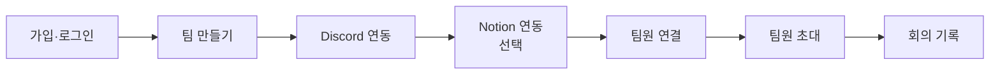

# 시작하기

Manager's Manager(화면 이름 "매스")를 처음 쓰는 PM이 가입부터 팀원 초대까지 마치는 순서예요. 심사위원은 맨 위 테스트 계정으로 바로 써 볼 수 있어요.

## 테스트 계정으로 바로 써 보기

설정이 끝난 워크스페이스에 샘플 회의가 들어 있어요. 가입·연결 단계를 건너뛰고 핵심 기능을 볼 수 있어요.

| 항목 | 값 |
|---|---|
| 배포 서비스 URL | `[확정 후 기입 — #606]` |
| PM 계정 (1개) | `[확정 후 기입 — #606]` |
| 팀원 계정 (5개) | `[확정 후 기입 — #606]` |
| 샘플 음성 파일 | `[확정 후 기입 — #606]` |
| 테스트용 Discord 서버 | `[확정 후 기입 — #606]` |

추천 순서 (10분 안팎):

1. PM 계정으로 로그인 → **대시보드**에서 확인 대기·기한 지남 숫자를 봐요.
2. **회의록**에서 샘플 회의를 열고 요약·전사문·추출된 일 탭을 봐요. → [회의록 검토와 승인](review-approve.md)
3. **태스크 > 확인 필요** 탭에서 카드 하나를 고쳐 승인해요.
4. **회의록 > 회의 올리기**에서 샘플 음성을 올리고 화자를 지정해요. → [회의 기록하기](record-meeting.md)
5. **메시지**에서 보내기 전 확인을 승인해요. → [마감 관리와 메시지](follow-up.md)
6. 팀원 계정으로 다시 로그인해 팀원이 보는 화면을 비교해요. → [팀원 가이드](for-members.md)

## 전체 흐름 한눈에

> 시작 전에 준비할 것: **Discord 서버를 먼저 만들고 팀원을 그 서버에 초대해 두세요.** 팀원 연결 화면은 봇이 들어간 서버의 사용자 목록을 보여 줘요. 서버에 없는 사람은 목록에 나오지 않아요.

## 1. 가입과 로그인

### 이메일로 가입

1. 로그인 화면에서 **처음이신가요? 회원가입**을 눌러요.
2. 이메일을 적고 **인증 코드 받기**를 눌러요.
3. 메일로 온 6자리 코드를 넣고 **코드 확인**을 눌러요. 코드는 10분 동안 쓸 수 있어요. 메일이 안 오면 스팸함을 확인해요.
4. 이름과 비밀번호를 적고 **계정 만들기**를 눌러요. 가입하면 바로 로그인돼요.
5. 처음 들어가면 **서비스 이용 동의** 화면이 떠요. 이용약관과 개인정보처리방침을 확인하고 동의해요.

> 📷 **사진 자리**: 가입 화면의 인증 코드 입력 단계 (파일: ../assets/user-signup-code.png)

### 카카오로 가입·로그인

- 로그인 화면의 **카카오 로그인** 버튼을 눌러요.
- 처음이면 가입 화면으로 이어져요. 이메일 인증은 똑같이 거쳐야 하고, 이름 칸에는 카카오 닉네임이 미리 들어가요.
- Google 버튼은 아직 쓸 수 없어요.

비밀번호를 잊었다면 **비밀번호를 잊으셨나요?**에서 재설정해요. 로그인을 여러 번 틀리면 잠시 막혀요.

## 2. 워크스페이스 만들기 (온보딩)

로그인하면 **어떻게 시작할까요?** 화면이 떠요.

| 선택 | 누가 | 하는 일 |
|---|---|---|
| **PM으로 팀 만들기** | PM | 새 워크스페이스를 만들고 팀 설정을 시작해요 |
| **팀원으로 시작** | 팀원 | 받은 초대를 확인하고 들어가요 |

PM으로 시작하면 온보딩 4단계를 차례로 지나요. 단계는 저장되니 중간에 나가도 이어서 할 수 있어요.

| 단계 | 화면 제목 | 필수 |
|---|---|---|
| 1 | 팀 만들기 | 필수. 팀 이름 1~20자, 내 계정 안에서 겹치면 안 돼요 |
| 2 | 디스코드 연동 | 건너뛸 수 있지만 녹음·DM을 쓰려면 필요해요 |
| 3 | 노션 연동 | 선택 |
| 4 | 팀원 연결 | 나중에 하기 가능 (팀 화면에서 다시 할 수 있어요) |

> 📷 **사진 자리**: 온보딩 1단계 팀 만들기 카드 (파일: ../assets/user-onboarding-create.png)

## 3. Discord 연결

**먼저 할 일**

1. 팀이 쓸 Discord 서버를 만들어요(이미 있으면 그 서버를 써요).
2. 팀원을 모두 그 서버에 초대해요.
3. 녹음할 음성 채널과 명령을 칠 텍스트 채널을 만들어 둬요.

**연결하기**

1. 2단계 **디스코드 연동** 카드에서 **Discord 연결하기**를 눌러요.
2. Discord 화면에서 봇을 넣을 서버를 고르고 승인해요. 서버에 봇을 추가할 권한이 있어야 해요 `[확인 필요: 필요한 Discord 서버 권한 이름]`.
3. 웹으로 돌아오면 상태가 **연결됨**으로 바뀌어요.

- 한 Discord 서버는 워크스페이스 하나에만 연결돼요.
- 취소하면 "Discord 연결을 취소했어요"가 떠요. 다시 시도하거나 건너뛸 수 있어요.
- 건너뛰었다면 나중에 **설정 > 연결**에서 연결해요. Discord 연결은 PM만 할 수 있어요.

> 📷 **사진 자리**: Discord 봇 추가 화면에서 서버를 고르는 모습 (파일: ../assets/user-discord-oauth.png)

## 4. Notion 연결 (선택)

- 3단계 **노션 연동**에서 **Notion 연결하기**를 눌러요.
- Notion 허용 화면에서 **템플릿 사용**을 골라요. 템플릿이 내 Notion 에 복사돼 새 데이터베이스가 연결돼요.
- 처음 연결할 때 기존 페이지를 고르면 이어 쓸 데이터베이스가 없어 연결이 실패해요. 다시 연결할 때는 쓰던 데이터베이스가 든 기존 페이지를 골라 그 데이터베이스를 이어 쓸 수도 있어요.
- 연결하면 반영된 태스크가 그 데이터베이스에도 올라가요. 회의록 본문은 올라가지 않아요.
- 연결하지 않아도 회의 올리기·회의록·태스크는 모두 써요. **건너뛰기**를 눌러도 돼요.

## 5. 팀원 연결

마지막 단계에서 Discord 사용자와 팀원 이름을 이어요. 이어 둬야 회의에서 누가 말했는지 알고, 마감 전에 DM을 보낼 수 있어요.

1. 화면에 "디스코드에서 팀원 N명을 찾았어요 — 이름만 확인해 주세요."가 떠요.
2. 줄마다 `@디스코드아이디` 옆 **누구인가요?** 칸에 실제 팀원 이름을 적어요.
3. 내 Discord 계정 줄은 맨 앞 체크박스로 **PM 체크**를 해요. 이름이 달라도 PM으로 연결돼요. PM을 체크해야 완료할 수 있어요.
4. **N명 확인 완료**를 눌러요. 지금 다 못 하면 **나중에 하기**를 눌러요.

**이름은 정확히 적어요.** 회의에서 부르는 이름과 다르면 담당자를 못 찾아 할 일이 "보류"로 가요. 별명이나 줄임말은 **팀** 화면에서 팀원마다 **별칭**으로 더할 수 있어요.

| 오류 문구 | 뜻 |
|---|---|
| 같은 팀원 이름을 두 줄에 쓸 수 없어요. | 한 이름은 한 Discord 계정에만 이어요 |
| 이미 다른 Discord 계정과 연결된 팀원이에요. | 기존 연결을 먼저 정리해요 |
| PM의 디스코드 계정을 체크해야 완료할 수 있어요. | 내 줄의 체크박스를 눌러요 |

> 📷 **사진 자리**: 온보딩 팀원 연결 단계, PM 체크와 이름 칸 (파일: ../assets/user-onboarding-members.png)

나중에 서버에 들어온 사람은 **팀** 화면의 **연결되지 않은 계정**에서 이어요.

## 6. 팀원 초대

팀원이 웹에서 회의록·태스크를 보고 답장하려면 계정을 워크스페이스에 들여야 해요.

1. **팀** 화면에서 팀원 줄의 **초대**를 눌러요.
2. 그 팀원이 가입하거나 로그인할 **가입 이메일**을 적어요.
3. **메일은 가지 않아요.** 초대한 뒤 Discord 등으로 직접 알려 주세요.

팀원 쪽에서는:

1. 그 이메일로 가입하거나 로그인해요.
2. 시작 화면에 **받은 초대**가 떠요(워크스페이스 이름, 팀원 이름, 초대한 사람).
3. **수락**을 누르면 바로 그 워크스페이스로 들어가요. **거절**은 되돌릴 수 없어요.

- 초대를 취소하려면 같은 자리의 **초대 취소**를 눌러요.
- 다른 이메일로 가입했다면 초대가 보이지 않아요. PM에게 다시 초대해 달라고 해요.

> 📷 **사진 자리**: 팀원 시작 화면의 받은 초대 목록과 수락 버튼 (파일: ../assets/user-invitation-accept.png)

## 다음 단계

- [회의 기록하기](record-meeting.md)
- [회의록 검토와 승인](review-approve.md)
- [자주 묻는 질문](faq.md)
