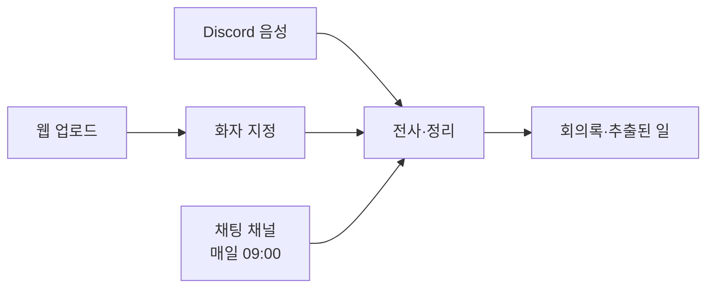

# 회의 기록하기

회의를 서비스에 넣는 길은 세 가지예요. Discord 음성 녹음, 웹에서 녹음 파일 올리기, Discord 채팅 자동 수집이에요. 어느 길로 들어와도 같은 회의록 화면에서 결과를 봐요.

| 경로 | 언제 쓰나요 | 누가 | 화자 구분 |
|---|---|---|---|
| Discord 음성 녹음 | Discord 음성 채널에서 회의할 때 | 서버에 있는 누구나 명령 가능 | 사람마다 따로 녹음돼 자동 |
| 웹 업로드 | 대면 회의·다른 도구로 녹음한 파일이 있을 때 | PM만 | 처리 뒤 PM이 화자를 지정 |
| 채팅 수집 | 텍스트 채널에서 오간 논의를 챙길 때 | PM이 채널을 고름 | 메시지 작성자 |

처리 흐름의 기술 설명은 [아키텍처](../techspec/architecture.md)와 [판단 파이프라인](../design/ai/judge-pipeline.md)에 있어요.

## 1. Discord 음성 채널에서 녹음하기

먼저 [시작하기](getting-started.md)의 Discord 연결을 마쳐야 해요. 연결되지 않은 서버에서는 녹음하지 않아요.

| 순서 | 할 일 | 봇 답 |
|---|---|---|
| 1 | 음성 채널에 들어가요 | — |
| 2 | 텍스트 채널에서 `/join` | "`채널이름` 입장 완료. `/record` 로 녹음을 시작하세요." |
| 3 | `/record` | 녹음 안내 메시지 (아래) |
| 4 | 회의해요 | — |
| 5 | `/stop` | "⏹ 녹음 종료. 트랙을 닫고 저장합니다. 처리 진행이 이 채널에 올라옵니다." |
| 6 | 끝나면 `/leave` 또는 `/end` | 봇이 음성 채널에서 나가요 |

- `/end`는 저장이 끝난 뒤에 나가요. 녹음 중에 바로 끝내고 나가고 싶을 때 써요.
- `/leave`는 녹음 중이면 거절해요. 먼저 `/stop`을 쳐요.
- 녹음 중에는 `/join`으로 다른 방으로 옮길 수 없어요.

`/record`를 치면 채널에 이 안내가 올라와요. 참석자에게 녹음 사실을 알리는 문구예요.

> 🔴 녹음·전사 중입니다. 이 음성 채널의 말은 화자별로 녹음되고 `/stop` 뒤 회의록이 여기 올라옵니다. 전사와 정리를 위해 음성을 외부 서비스(Elice)로 보냅니다. 녹음은 웹에서 다시 들을 수 있도록 최대 7일 보관한 뒤 삭제합니다. 녹음을 원하지 않으면 음성 채널에서 나가 주세요.

### 진행 메시지

`/stop` 뒤에는 처리 단계가 끝날 때마다 같은 채널에 메시지가 올라와요.

| 메시지 | 뜻 |
|---|---|
| ⏳ 회의 처리를 시작합니다. | 차례가 왔어요 |
| 📝 전사를 마쳤습니다. 줄 N개. | 말을 글로 옮겼어요 |
| 🗂 웹 회의록에 N줄을 올렸습니다. | 웹 전사문 탭에서 볼 수 있어요 |
| 📋 할 일 후보 N건을 찾았습니다. | 할 일·변경 후보를 뽑았어요 |
| 📨 웹에 올렸습니다. PM 승인을 기다리는 항목 N건. | 웹에서 확인할 수 있어요 |
| ⚠️ … | 실패·빠진 구간 경고. 자동으로 다시 시도해요 |

웹에서는 오른쪽 아래 진행 알림과 회의록 목록의 **정리 중** 표시로도 볼 수 있어요.

## 2. 웹에서 녹음 파일 올리기

PM만 올릴 수 있어요. **회의록** 화면의 **회의 올리기**를 눌러요.

1. 파일을 끌어다 놓거나 **컴퓨터에서 찾기**로 골라요. 한 번에 하나만 올려요.
2. **회의 제목**과 **회의 날짜**를 적어요.
3. **참석자**에서 회의에 있던 팀원을 한 명 이상 골라요. 참석자를 알려 주면 목소리와 이름을 더 정확히 맞춰요.
4. **정리 시작하기**를 눌러요.

| 제한 | 값 |
|---|---|
| 형식 | mp3 · wav · m4a · ogg · webm |
| 크기 | **200MiB 이하** (서버 코드 기본 한도 `UPLOAD_MAX_BYTES`) |
| 길이 | 2시간 이하 |

> 서버 기본 한도는 200MiB이고 화면 안내와 같아요(#620). 넘으면 서버가 거절(413)해요.

- 이미 정리 중인 회의가 있으면 새로 올릴 수 없어요. 업로드 화면 대신 그 회의의 처리 화면으로 가요. 끝난 뒤 올려요.
- 파일을 보내는 동안 진행 막대가 보여요. 다 보내면 "파일을 다 보냈어요. 정리를 시작하는 중이에요."가 떠요.
- 정리하는 동안 다른 화면을 써도 돼요. 끝나면 알려 줘요.

### 처리 화면

| 단계 | 화면 문구 |
|---|---|
| 대기 | 차례를 기다리고 있어요 |
| 전사 | 음성을 텍스트로 옮기고 있어요 |
| 화자 지정 | 화자 지정을 기다리고 있어요 |
| 정리 | 결정사항과 할 일을 뽑고 있어요 |
| 완료 | 회의 정리가 끝났어요 → **회의록 보기** |

### 화자 지정

업로드 파일은 한 트랙이라 AI가 목소리로 화자를 나눠요. 나눈 뒤에는 **화자 지정이 필요해요** 알림이 떠요.

1. **화자 지정하기**를 눌러요.
2. 화자마다 **듣기**로 샘플 구간을 들어 봐요.
3. **누가 말했는지 골라 주세요**에서 팀원을 고르거나, 팀원이 아니면 **팀원이 아닌 사람**을 골라요.
4. 모든 화자를 고르고 제출하면 정리가 이어져요.

- 화자 지정은 **7일 안에** 해야 해요. 지나면 "화자 지정 기한 만료"가 되고 다시 올려야 해요.
- 일반 팀원에게는 "PM이 화자를 지정하고 있어요"가 보여요.

## 3. Discord 채팅 자동 수집

텍스트 채널에서 오간 결정·할 일도 챙길 수 있어요.

1. **설정 > 연결**의 Discord 카드 아래 **회의 채팅 채널**에서 채널을 골라요.
2. 저장하면 봇이 그 채널에 안내 메시지를 남겨요.
3. 매일 **09:00 (한국 시간)**에 지난 수집 뒤의 메시지를 읽어 하루치를 "채팅 회의" 하나로 만들어요.
4. 회의록 목록에 **Discord 채팅** 배지로 보여요. 전사문 시각은 메시지를 쓴 실제 시각이에요.

- 채팅에서 나온 할 일은 자동 반영하지 않고 PM 확인(**확인 필요**나 **보류**)으로 가요.
- 끄려면 **사용 안 함**을 골라요.
- 봇에게 채널 읽기·메시지 보내기 권한이 없으면 저장이 안 돼요. 오류 문구대로 Discord 채널 권한을 고쳐요.

## 다음 단계

- [회의록 검토와 승인](review-approve.md)
- 문제가 생기면 [자주 묻는 질문](faq.md)
