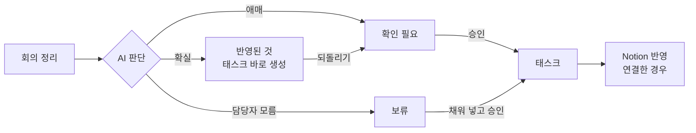

# 회의록 검토와 승인

회의 정리가 끝나면 AI가 뽑은 할 일이 세 갈래로 나뉘어요. 확실한 건 바로 태스크가 되고, 애매한 건 PM 확인을 기다려요. 이 쪽은 PM이 회의록을 읽고 확인 요청을 처리하는 방법이에요.

## 세 갈래 한눈에

| 화면 표기 | 뜻 | PM이 할 일 |
|---|---|---|
| **반영된 것** | 담당자·마감이 분명해 승인 없이 태스크로 만든 일 | 틀렸으면 **되돌리기** |
| **확인 필요** | 내용·담당자·마감 중 확인할 게 있는 일, 기존 태스크를 바꾸자는 제안 | **확인하기** → 고쳐서 승인 또는 반려 |
| **보류** | 누군가를 담당자로 말했는데 누구인지 못 찾은 일 | **채워 넣기** → 담당자를 골라 승인 |

- 기존 태스크를 바꾸자는 제안(마감 변경, 담당 변경 등)은 항상 **확인 필요**로 가요.
- Discord 채팅에서 나온 일은 반영하지 않고 모두 **확인 필요**로 가요.
- 판단 기준은 [판단 파이프라인](../ai-logic/judge-pipeline.md)과 [근거 검증](../ai-logic/evidence-check.md)에 있어요.
- 화면에는 신뢰도 숫자를 보이지 않아요. 대신 "확인이 필요한 이유"를 회의에서 한 말로 보여 줘요.

## 1. 회의록 보기

왼쪽 메뉴 **회의록**에서 회의를 골라요. 목록에는 출처 배지(**Discord 채팅**, **직접 올린 녹음** 등)와 **정리 중** 표시가 붙어요.

| 탭 | 내용 |
|---|---|
| **요약** | 핵심 내용, 결정한 것 |
| **전사문** | 화자·시각과 함께 옮겨 적은 발언 |
| **추출된 일** | 이 회의에서 나온 일. **반영된 것**과 **확인이 필요한 일** 두 칸 |

- **확인이 필요한 일** 칸의 줄마다 배지(**확인 필요** / **보류**)와 까닭(예: "담당자를 정해야 해요", "마감을 정해야 해요")이 붙어요.
- 버튼은 확인 필요면 **확인하기**, 보류면 **채워 넣기**예요.
- 할 일이 다 처리되면 "이 회의에서 나온 할 일은 모두 반영됐거나 처리됐어요."가 보여요.

> 📷 **사진 자리**: 회의록 추출된 일 탭, 반영된 것과 확인이 필요한 일 두 칸 (파일: ../assets/user-minutes-extracted.png)

## 2. 확인 요청 처리하기

두 곳에서 처리할 수 있어요.

- **태스크 > 확인 필요** 탭: 카드에서 바로 고치고 승인해요. 여러 건을 빨리 처리할 때 좋아요.
- 확인 요청 상세 화면: 회의록의 **확인하기**나 대시보드 링크로 들어가요. 근거와 비교표를 자세히 봐요.

### 새 태스크 확인

1. 카드 제목 아래 "확인이 필요한 이유"를 읽어요.
2. **근거**에서 인용문·화자·시각을 보고, 필요하면 **원문 듣기**로 녹음을 들어요.
3. **태스크명**, **담당자**, **마감**을 바로 고쳐요. 마감을 비워 두면 미정으로 올라가요.
4. **승인**을 누르면 태스크가 생겨요. 필요 없으면 **반려**를 눌러요.

- 바꾸지 않은 칸은 원래 제안을 유지해요.
- 여러 발언이 같은 일로 합쳐진 카드는 **합쳐진 근거**를 펼쳐 볼 수 있어요. 반려하면 합쳐진 항목이 모두 반려돼요.

> 📷 **사진 자리**: 태스크 > 확인 필요 탭의 승인 카드, 고칠 칸과 원문 듣기 (파일: ../assets/user-approval-card.png)

### 보류 채워 넣기

- 담당자 칸에서 "이 워크스페이스의 팀원 중에서 담당자를 골라 주세요."를 따라 팀원을 골라요.
- 고른 뒤 **승인**해요.
- 같은 사람이 자주 보류로 간다면 **팀** 화면에서 그 팀원에 **별칭**을 더해요. 회의에서 부르는 이름을 알려 주는 거예요.

### 태스크 변경 확인

기존 태스크를 바꾸자는 제안이에요. **현재값**과 **제안값**을 표로 비교해 보고 승인하거나 반려해요. 범위 변경은 바꿀 값 없이 근거만 보여 줘요.

### 충돌 안내 (다른 사람이 먼저 바꿨을 때)

화면을 연 뒤 내용이 바뀌면 승인이 바로 되지 않고 비교표가 떠요.

| 상황 | 화면 문구 | 표 칸 | 버튼 |
|---|---|---|---|
| 확인 요청이 바뀜 | 보신 뒤에 내용이 바뀌었어요 | 항목 · 보던 값 · 새 제안 · 승인할 값 | 새 내용을 확인했어요, 승인 |
| 대상 태스크가 바뀜 | 제안한 뒤에 태스크가 바뀌었어요 | 항목 · 기준값 · 현재값 · 확정할 값 | 지금 값을 확인했어요, 다시 승인 |

표를 보고 맞으면 버튼을 다시 눌러요. 아니면 반려해요.

> 📷 **사진 자리**: 충돌 비교표 "보신 뒤에 내용이 바뀌었어요" (파일: ../assets/user-approval-conflict.png)

## 3. 자동 반영 되돌리기

**대시보드**의 **최근 반영**에 최근 회의에서 자동으로 만든 태스크가 모여요.

1. 틀린 줄의 **되돌리기**를 눌러요.
2. "자동 반영을 되돌릴까요?" 창에서 **되돌리기**를 눌러요.
3. 그 태스크는 지워지고 같은 내용의 **확인 필요**가 새로 생겨요. 거기서 고쳐 승인하면 다시 생기고, 반려하면 끝나요.

되돌릴 수 없는 경우도 있어요.

| 문구 | 까닭 |
|---|---|
| 만든 뒤에 태스크가 바뀌어 되돌릴 수 없어요. 태스크에서 직접 고쳐 주세요. | 누군가 이미 태스크를 고쳤어요 |
| 이 태스크에 처리를 기다리는 확인 요청이 있어 되돌릴 수 없어요. | 확인 요청부터 처리해요 |
| 태스크가 이미 지워져 되돌릴 수 없어요. | — |

> 📷 **사진 자리**: 대시보드 최근 반영 목록과 되돌리기 확인 창 (파일: ../assets/user-auto-revert.png)

## 4. Notion 반영

Notion을 연결했다면 확실한 태스크는 바로, 확인이 필요한 태스크는 승인한 뒤 Notion에도 올라가요.

- 승인 화면 아래 **Notion 에 올라갈 태스크**(또는 **Notion 에 올라갈 변경**)에서 상태를 봐요: 반영 대기 → 반영 중 → 반영 완료.
- **반영 실패**면 다시 요청할 수 있어요. "다시 반영을 요청했어요. 반영되면 여기에서 바뀌어요."가 떠요.
- Notion 데이터베이스 속성이 바뀌었다면 **설정 > 연결**의 **속성 다시 맞추기**를 눌러요.

## 5. 자동 반영 기준 (설정)

**설정 > 자동 반영**에서 기준을 고르는 화면이 있어요.

| 선택지 | 뜻 |
|---|---|
| 전부 내가 확인한다 | 모든 항목이 확인 대기로 와요 |
| 담당자·마감이 분명한 건만 자동으로 | "제가 목요일까지 할게요"처럼 본인이 직접 말한 경우만 (기본) |
| 전부 자동으로 올린다 | 지원하지 않아요 |

`[확인 필요: 이 선택은 아직 서버에 저장되지 않고 화면 안에서만 바뀜(AutoApplySection). 실제 자동 반영 여부는 서버 설정 AUTO_CREATE_ENABLED 로 정해짐]`

## 다음 단계

- [마감 관리와 메시지](follow-up.md)
- [자주 묻는 질문](faq.md)
