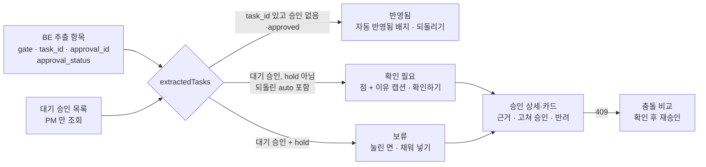

# AI 결과 화면

AI 가 회의·답장에서 뽑은 값을 PM 이 "믿지도 무시하지도 않게" 보여 주는 화면 설계다. 게이트(auto·review·hold)는 BE 가 정하고([판단 파이프라인](../../docs/design/ai/judge-pipeline.md#게이트-auto--review--hold)), FE 는 그 결과를 반영됨·확인 필요·보류로 그리고, 근거를 붙이고, 고쳐 승인하거나 되돌리는 길을 준다.

## 문제

| 문제 | 그대로 두면 |
|---|---|
| LLM 결과의 절반은 확률적 추측이다 | PM 이 확정 사실과 AI 추측을 구분하지 못한다 |
| 신뢰도 숫자(0.92)를 보이면 | 근거 없는 정밀도가 생기고, 숫자를 본 PM 은 원문을 읽지 않는다 |
| `전체 승인` 같은 버튼이 있으면 | 게이트가 장식(rubber stamp)이 된다 |
| PM 이 카드를 보는 사이 태스크·카드가 바뀌면 | 본 적 없는 값으로 승인한다 |
| auto 로 만든 태스크가 틀리면 | 되돌릴 길이 없으면 auto 를 열 수 없다 |

원칙은 [디자인 시스템](https://github.com/kakaotechcampus-4/ktc4-kyungpook-3/blob/develop/frontend/docs/design/design-system.md) §0(신뢰도는 배지·점으로만), §1-1(확정과 추측을 눈으로 구분), §1-5(판단을 유도하는 UI 금지), §12(금지 목록)에 있다.

## 동작

### 세 상태를 가르는 법

[`extractedTasks.ts`](https://github.com/kakaotechcampus-4/ktc4-kyungpook-3/blob/develop/frontend/src/widgets/meeting-minutes/lib/extractedTasks.ts) 가 추출과 승인 두 엔티티를 잇는다.

| 상태 | 판정 | 표시 (§3-4) | 액션 |
|---|---|---|---|
| 반영됨 | `task_id` 가 있고 승인이 없거나 `approval_status=approved` | 흰 면, `자동 반영됨` 회색 배지 | `되돌리기` 만. 승인 버튼 없음 |
| 확인 필요 | 반영 안 됨 ∩ 대기 승인 ID, `gate` 가 hold 가 아님(되돌린 auto 는 `gate=auto` 인 채 여기로 온다) | 흰 면 + 진한 테두리, 채움 없는 점 + `확인 필요` | `확인하기` → `반려`·`승인` |
| 보류 | 같은 조건, `gate=hold` | 눌린 면(`#FAFAFA`), `보류` 배지, "정보가 부족해 태스크 초안을 만들지 않았어요" | `채워 넣기`. 승인은 필드를 채운 뒤 |

- `task_id` 만으로 반영을 판정하지 않는다. 수정 제안은 승인 전에도 `task_id` 가 있어, 승인 대기 제안이 반영 완료로 보였다(#419, #442 → `approval_status` 로 판정).
- 반려·승인으로 닫힌 승인은 대기 목록에 없어 자동으로 빠진다(D-172).
- 모르는 `gate` 값은 `hold` 로 내린다(보수 폴백, D-184). 행동이 줄 뿐 사실과 다르게 말하지 않는다.

### 이유와 근거

| 요소 | 내용 | 코드 |
|---|---|---|
| 이유 캡션 | 빠진 값으로 만든 한 줄("담당자와 마감을 정해야 해요"). 상세에서는 회의에서 한 말을 인용한 「확인이 필요한 이유」 | [`approvalView.ts`](https://github.com/kakaotechcampus-4/ktc4-kyungpook-3/blob/develop/frontend/src/widgets/approval-review/lib/approvalView.ts), [`attention.ts`](https://github.com/kakaotechcampus-4/ktc4-kyungpook-3/blob/develop/frontend/src/features/approval-resolve/model/attention.ts) |
| 칸 강조 | AI 가 못 정한 칸(`missing`)과 지금 값으로 승인 못 하는 칸(`invalid`)을 레드로. 라벨·경계·근거 강조·이유가 같은 값을 읽는다 | `fieldAttention` |
| 근거 블록 | `전사문 12:40 · 화자` + 원문 인용(요약하지 않음). 채팅 회의는 실제 작성 시각, 답장은 `리마인드 답장 · 팀원` | [`ApprovalReview.tsx`](https://github.com/kakaotechcampus-4/ktc4-kyungpook-3/blob/develop/frontend/src/widgets/approval-review/ui/ApprovalReview.tsx) `EvidenceFigure` |
| 화자 | 멤버 ID 우선, 없으면 Discord uid 로 찾고, 못 찾으면 `알 수 없음`. uid 를 그대로 보이던 문제는 M6-API 에서 고침 | m6-api errors |
| 원문 듣기 | 그 회의의 회의록으로 이동 | 같은 파일 |

## 고쳐 승인과 409 충돌

PM 은 제목·담당·마감(수정 제안은 상태·마감도, 담당자 줄이 있는 답장 카드는 담당도)을 카드에서 바로 고쳐 승인 한 번에 보낸다. 담당·마감은 미정(`null`)으로도 승인할 수 있다. 키 생략은 "원래 제안 유지", 명시적 `null` 은 "미정"으로 구분한다.

| 409 코드 | 뜻 | 화면 |
|---|---|---|
| `APPROVAL_CONFLICT` | AI 가 본 뒤 태스크가 바뀜. `details.conflicts[]` 에 필드별 기준값·지금 값·제안 값 | 세 값 비교 표. 확인 뒤 `confirm_task_version` 을 실어 재승인 |
| `APPROVAL_CHANGED` | PM 이 카드를 연 뒤 카드 내용이 바뀜(다른 회의 항목 합치기 #533, `payload_version` #547) | 폼을 새 카드에 맞추되 PM 이 고친 칸은 둠. "바뀐 내용" 안내, 버튼이 「새 내용을 확인했어요, 승인」 |

규칙(근거 [2026-11-04 결정](https://github.com/kakaotechcampus-4/ktc4-kyungpook-3/blob/develop/frontend/docs/plan/m6/basis-for-decision/2026-11-04-approval-edits-and-conflict-confirmation.md), [2026-11-08 결정](https://github.com/kakaotechcampus-4/ktc4-kyungpook-3/blob/develop/frontend/docs/plan/m8/basis-for-decision/2026-11-08-merged-approval-recheck.md)):

- 충돌 확인은 **그때 제출한 수정값에만** 유효하다. 입력을 바꾸면 확인이 풀리고, 값을 원래대로 되돌려도 옛 확인을 되살리지 않는다.
- 카드가 바뀌면 `form.reset(새 값, { keepDirtyValues: true })` 로 고치지 않은 칸만 바꾸고 기본값도 새 카드로 옮긴다. `resetField` 는 고친 칸의 기본값이 옛 제안에 남는 틈이 있어 버렸다.
- 쓰기 응답을 읽지 못하면(`INVALID_RESPONSE`) 실패라 하지 않고 "서버에는 반영됐을 수 있어요"와 `새로고침` 을 보인다(D-184).
- 승인 뒤 Notion 은 조회 응답이 실제 `synced` 일 때만 `반영됨`, 그 전 polling 동안은 `반영 중`.

## 자동 반영 되돌리기

대시보드 「최근 반영」에서 확인 모달을 거쳐 실행한다(D-036). 되돌린 항목은 목록에서 지우지 않고 `되돌림` 으로 자리를 지킨다(D-037). 성공하면 "태스크를 지우고 확인 필요에 다시 올렸어요" 토스트, 거절(409 `AUTO_TASK_NOT_REVERTIBLE`)은 사유별 문구다([`revertMessage.ts`](https://github.com/kakaotechcampus-4/ktc4-kyungpook-3/blob/develop/frontend/src/features/auto-item-revert/lib/revertMessage.ts)).

| 사유 | 안내 |
|---|---|
| `task_changed` | 만든 뒤 태스크가 바뀜 → 태스크에서 직접 고치도록 링크 |
| `pending_approval` | 이 태스크에 대기 확인 요청 → 그 승인으로 링크 |
| `already_reverted`, `not_auto_created`, `task_missing`, 모르는 값 | 각 문구. 서버 `message` 는 쓰지 않는다 |

답장으로 자동 반영된 상태 변경은 태스크 기록(timeline)의 그 줄에서 되돌린다(`features/reply-change-undo`).

## PM 과 팀원의 화면

디자인 시스템 v0 은 "웹 사용자는 PM 한 명"이 전제였다. 팀원 초대(#321 BE, #332 FE) 뒤 팀원도 웹에 들어오면서 권한별로 나눴다.

| 화면 | PM | 팀원 |
|---|---|---|
| 회의록 「확인이 필요한 일」 | 보임 | 영역 전체와 개수까지 숨김(D-104). 승인 목록을 아예 부르지 않는다 |
| 회의록 요약·전사문·반영된 태스크 | 보임 + `되돌리기` | 읽기 전용(D-105) |
| 승인 상세 URL | 열림 | `RequirePM` 이 태스크 목록으로 보내고 `접근 권한이 없어요`. 승인 조회 0회(D-103) |
| 회의 올리기 | 열림 | 막힘. 재업로드는 PM 에게 요청 안내 |
| 태스크 기록의 답장 | 답장 글과 바뀐 값, 되돌리기 | 답장 글 대신 안내, 되돌리기 없음 |

권한은 BE 가 최종으로 막는다. FE 가드는 화면을 감출 뿐이다(D-172).

## 왜 이 방식인가

| 결정 | 실제로 비교한 대안 | 고른 이유 | 기록 |
|---|---|---|---|
| 신뢰도 숫자 비노출 | 점수 표시, 점수 순 정렬 | BE 게이트가 숫자 하나가 아니라 막는 사유 조건이 됐다. `needs_check` 면 점수와 무관하게 review 라 "낮은 점수만 의심하는 UI" 를 만들지 않는다 | 디자인 시스템 §0·§12, D-172 |
| 상태별로 다른 배지 표현 | 통일 배지 컴포넌트 | 흑백으로도 확정도가 구분돼야 한다(점·필·테두리) | §7-1 |
| 승인 한 번에 수정값 싣기 | 수정 저장 → 승인 두 단계 | 서버에 초안 저장 API 가 없다. 중간 상태가 생기지 않는다 | [2026-10-11 결정](https://github.com/kakaotechcampus-4/ktc4-kyungpook-3/blob/develop/frontend/docs/plan/m6/basis-for-decision/2026-10-11-approval-overrides-held-until-approve.md) |
| 기존 mutation 으로 충돌 관리 | 입력·제출·충돌 별도 상태 기계 | 요청 생명주기를 다시 표현하는 비용이 크다. 대신 상태 기계 안의 "입력 바뀌면 확인 해제" 규칙만 가져왔다 | 2026-11-04 결정 |
| 카드가 바뀌면 언제든 폼 맞춤 | 409 때만 맞춤 / 안내만 | 409 없이 다시 받은 응답으로 카드가 바뀌면 폼이 낡은 채 한 번 더 409 가 된다 | 2026-11-08 결정 |

## 어떻게 검증했나

| 무엇 | 테스트 |
|---|---|
| 반영·확인 필요 분리, 반려 뒤 사라짐, 승인 뒤 반영으로 이동 | [`tasks-approval.e2e.ts`](https://github.com/kakaotechcampus-4/ktc4-kyungpook-3/blob/develop/frontend/e2e/tasks-approval.e2e.ts), `extractedTasks.test.ts` |
| 미정 승인, 충돌 → 입력 변경 → 되돌림 → 새 충돌 확인 뒤에만 재승인 | 같은 E2E, `approvalOverrides.test.tsx` |
| 합쳐진 카드 재확인 | `approvalMerged.test.tsx` |
| 키보드만으로 승인까지 | `tasks-approval.e2e.ts` 키보드 테스트 |
| Notion `반영 중` → `반영됨` | 같은 E2E, `notionSyncPolling.test.tsx` |
| 팀원 접근 차단·답장 기록 | `tasks-approval.e2e.ts`, [`reply-judgment.e2e.ts`](https://github.com/kakaotechcampus-4/ktc4-kyungpook-3/blob/develop/frontend/e2e/reply-judgment.e2e.ts) |
| 화면 코드에 `confidence` 사용 0건 | `.tsx` 검색(2026-11-09) |

모두 MSW 기준이다. 실 API 보완 승인은 [M6 결과](https://github.com/kakaotechcampus-4/ktc4-kyungpook-3/blob/develop/frontend/docs/plan/m6/result.md)가 미검증으로 남겼다.
