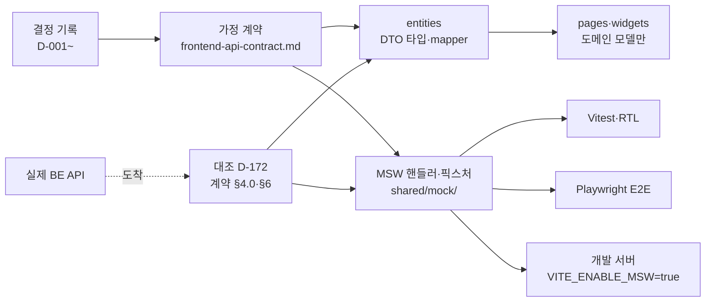

# 계약 우선과 MSW

BE·AI 가 API 를 만들기 전에 FE 가 필요한 요청·응답을 스스로 가정해 계약 문서로 고정하고, MSW(Mock Service Worker)를 유일한 데이터 출처로 화면을 만든 뒤 실제 API 가 오면 대조한 방식이다. 근거는 [D-159](https://github.com/kakaotechcampus-4/ktc4-kyungpook-3/blob/develop/frontend/docs/decision/frontend-decisions.md)(합의 없이 단독 진행), D-160(BE 기존 구현에 맞춤), D-172(실제 API 대조)다.

## 문제

| 상황 (2026-09-15 계획 시점) | 결과 |
|---|---|
| BE 는 `meetings`·`extractions`·`approvals` 뿐. 인증·워크스페이스·태스크·메시지 API 와 CORS 가 없었다 | 화면이 붙을 서버가 없다 |
| FE 코드는 한 줄도 없고 결정 기록 D-001~D-149 만 있었다 | 화면 범위·정책은 정해졌으나 데이터 모양이 없다 |
| 세 파트가 같은 주에 시작했다(주차 보고: 2주차 FE M0 기반·CI, 7주차 M1 도메인 모델·MSW) | BE 를 기다리면 FE 일정이 통째로 밀린다 |

전체 계획은 이를 "MSW 우선 개발이 선택이 아니라 전제"라고 적었다([frontend-plan.md](https://github.com/kakaotechcampus-4/ktc4-kyungpook-3/blob/develop/frontend/docs/plan/frontend-plan.md) Context, 보호 문서).

## 동작

1. **가정 계약(M1).** 화면마다 필요한 요청·응답을 [계약 문서](https://github.com/kakaotechcampus-4/ktc4-kyungpook-3/blob/develop/frontend/docs/contracts/frontend-api-contract.md)에 적는다. BE 에 바라는 것은 §4 한 절에 모은다(D-160). 결정이 없는 파라미터는 `결정 대기` 로만 표시하고 앞질러 확정하지 않는다.
2. **변환 계층.** DTO 는 `entities` 에서만 다룬다. mapper 가 DTO → 도메인 모델로 바꾸고 화면은 도메인 모델만 받는다(D-133). M1 완료 기준이 "화면 코드에서 DTO 타입을 직접 import 하는 곳이 없다"였다.
3. **MSW 하나로 세 곳.** 브라우저 worker(`browser.ts`)와 Node 서버(`server.ts`)가 같은 핸들러 목록(`handlers/index.ts`)을 쓴다. 테스트용 응답을 따로 만들지 않는다.
4. **대조.** 실제 API 가 오면 필드 이름·형태·의미를 맞춰 보고, 차이는 mapper 가 흡수하거나 계약 §4 로 BE 에 요청한다.

### MSW 구성 (`frontend/src/shared/mock/`)

| 파일·폴더 | 하는 일 |
|---|---|
| `handlers/` | 도메인별 핸들러 19개(승인·추출·회의·메시지·메시지 소켓·알림·탈퇴 등) |
| `fixtures/` | 고정 시나리오 원본. 기준 날짜 `2026-09-18` |
| `db.ts` | 픽스처의 깊은 복사본. 승인하면 태스크가 생기는 등 쓰기 의미까지 흉내 낸다 |
| `scenarios.ts` | `?msw-scenario=` 시작 상태 약 80개(로그인 안 함, 공간 여러 개, 화자 지정 대기, 답장 판단 팀원 등) |
| `persistence.ts`, `browserDb.ts` | 개발 브라우저에서 sessionStorage 에 DB 를 남겨 새로고침·OAuth 왕복을 견딘다 |
| `meetingFlow.ts` | 회의 처리 흐름. 시간이 아니라 상세 조회가 시계다(조회마다 한 단계 진행) |
| 모의 화면 | `/__mock/oauth/...`(Discord·Notion), `/__mock/kakao`, `/__mock/mail` |

- production 번들에는 MSW 가 들어가지 않는다(`import.meta.env.DEV` 조건). 실제 API 호출이 실패해도 모의 응답으로 자동 전환하지 않는다.
- 픽스처가 지켜야 할 값(예: 새 항목을 만든 시점에 `gate=auto` 는 `task_id` 만, `review`·`hold` 는 `approval_id` 만. 수정 항목은 둘 다 가질 수 있고, auto 를 되돌리면 `gate=auto` 인 채 `task_id=null` 에 새 승인이 걸린다)은 계약 §7 에 적었다.

## 계약 불일치를 어떻게 잡았나

| 시점 | 무엇 | 결과 |
|---|---|---|
| 2026-09-22 (D-172) | PR #59 로 실제 API 도착. `origin/develop f441ea4` 와 대조 | **필드 이름 수준에서 일치**해 도메인 타입·mapper 를 재작성하지 않았다. 형태가 다른 곳 셋(DELETE 204 무본문, 회의 `title` nullable, `role` Optional)은 mapper·클라이언트가 흡수. 오류 코드 11개가 제안 그대로 들어왔다 |
| 2026-09-22 (D-172) | 같은 대조에서 BE 쪽 문제 발견 | `tasks`·`approvals`·`extractions`·`members` 에 인증 의존성이 없음을 계약 §4.0-②-1 과 별도 이슈로 알림. "가드는 보안 경계가 아니다"를 명시 |
| 2026-09-23 | 핸들러 전수 대조 | 리뷰가 찾아 주는 것만 고치다 다섯 라운드를 돈 뒤, "MSW 는 실 API 의 의미에 맞춘다"를 M1 완료 기준 7번째로 넣고 전수 대조 |
| 2026-10-12 (M6-API) | 배포 BE(`a1e623b`)에 실제로 붙여 대조 | 문제 12건을 [errors/](https://github.com/kakaotechcampus-4/ktc4-kyungpook-3/blob/develop/frontend/docs/plan/m6-api/errors/README.md)에 한 파일씩. FE 수정 5건(수정 승인 제목 필드, 근거 화자에 Discord uid 노출, 오류 코드 5개 누락 등), BE 요청·보류 7건 |
| 2026-11-05~09 (#348, D-184) | 응답을 zod 스키마로 검증 | 모르는 태스크 상태가 `할 일` 로, 모르는 승인 상태가 `승인 대기` 로 보이던 문제를 막음. 상태 판단 값은 `INVALID_RESPONSE`, 표시용은 `알 수 없는 ○○`, 권한은 보수 폴백(`role` → `member`, `gate` → `hold`) |
| 2026-11-09 (#362) | 계약 머리 「후속 구현 상태 대조」 | develop `70534a85` 의 BE·FE 소스를 다시 대조. 실행 검증과 정적 대조를 나눠 적음 |

- 계약 문서 머리에는 기준 커밋을 적는다(D-160). 첫 판이 하루 낡은 로컬 develop 을 보고 이미 있는 API 를 "새로 만들어 달라"고 적은 실수에서 나온 규칙이다.
- 배포 순서: 새 enum 값은 FE 가 먼저 받을 수 있게 배포하고 BE 가 뒤에 내보낸다(계약 「응답 검증과 새 값 배포 순서」). 이 순서가 지켜지면 `INVALID_RESPONSE` 는 계약 위반 신호가 된다.

## 결정 기록 운영

| 층 | 위치 | 쓰는 때 |
|---|---|---|
| 제품·기술 결정 | [frontend-decisions.md](https://github.com/kakaotechcampus-4/ktc4-kyungpook-3/blob/develop/frontend/docs/decision/frontend-decisions.md) D-001~D-185 | 화면 범위·정책·스택처럼 여러 마일스톤이 공유하는 것. 바꾸면 지우지 않고 "D-xxx 대체" 로 새 번호 |
| 구현 결정 | `frontend/docs/plan/mN/basis-for-decision/` (M1~M8, 90여 개) | 구현 중 고른 길과 버린 대안. 예: [승인 수정값과 충돌 확인](https://github.com/kakaotechcampus-4/ktc4-kyungpook-3/blob/develop/frontend/docs/plan/m6/basis-for-decision/2026-11-04-approval-edits-and-conflict-confirmation.md) |
| 이슈 결과 | `frontend/docs/issues/<번호>-<이름>/result.md` (40여 개) | 마일스톤 밖 작업의 구현·검증·남은 것 |
| 연동 오류 | `plan/m6-api/errors/`, `plan/m7/errors/` | 실제 서버에 붙이며 찾은 차이 |

계획 시점 범위가 D-001~D-172 였고, 이후 실제 사용·리뷰에서 나온 변경이 D-173~D-185 로 쌓였다(예: D-180 휴대폰 360px, D-181 Storybook 제거, D-184 응답 검증).

## 왜 이 방식인가

| 결정 | 실제로 비교한 대안 | 고른 이유 | 기록 |
|---|---|---|---|
| 합의 없이 FE 가 계약을 가정 | BE 와 사전 합의 회의 | BE 가 같은 시기에 도메인 모델을 만들고 있었다. 가정 명세를 회의 안건이 아니라 인수인계 자료로 넘겼다 | D-159 |
| BE 에 이미 있는 것에 맞춤 | 화면 사정에 맞게 BE 변경 요청 | 구현된 것을 바꾸면 양쪽 작업이 모두 되돌아간다. 요청은 "추가"와 "의미 확정"만 | D-160 |
| DTO 는 entities 에서만 | 화면이 응답을 직접 참조 | 가정은 실제와 다를 것이 확실했다. 고칠 범위를 entities 로 묶는 유일한 장치 | D-159 전제 조건 |
| 앱·테스트가 같은 MSW | 테스트 전용 목(mock) 함수 | 개발 화면과 테스트가 다른 응답을 보면 한쪽만 통과한다 | [msw-guide](https://github.com/kakaotechcampus-4/ktc4-kyungpook-3/blob/develop/frontend/docs/msw-guide.md) |
| zod 로 응답 검증 | 생성 타입 + MSW 통합 테스트만(D-134) | 생성 타입이 끝내 없었다. zod 는 이미 번들에 있어 비용이 스키마 코드뿐 | D-184 |
| Storybook 제거 | Storybook + RTL + E2E 유지 | 같은 상태를 세 곳에서 그렸다. 모르는 값의 화면도 RTL `server.use` 로 본다 | D-181, #482 |

## 어떻게 검증했나

| 층 | 도구 | 규모 | 기준 |
|---|---|---|---|
| 단위·화면 | Vitest + RTL, MSW Node 서버 | 테스트 파일 305개(이 브랜치). 기록된 전체 실행 284개 파일 3,661개 통과(2026-11-09, `ed1aeb90`, #558 기록) | 매 테스트 뒤 `server.resetHandlers()` + `resetDb()` |
| 사용자 흐름 | Playwright Chromium, Vite 개발 서버 + MSW(포트 5211) | [`frontend/e2e/`](https://github.com/kakaotechcampus-4/ktc4-kyungpook-3/tree/develop/frontend/e2e) spec 39개, 테스트 선언 약 165개 | 테스트마다 `?msw-scenario=` 로 DB 초기화(`e2e/support.ts`) |
| 약관 동의 공개 | 별도 설정 `playwright.consent.config.ts` | `consent-preparing`·`consent-published` | 공개 전·후 화면 |
| CI | [frontend-ci.yml](https://github.com/kakaotechcampus-4/ktc4-kyungpook-3/blob/develop/.github/workflows/frontend-ci.yml) | typecheck → lint → format → test, build, e2e(재시도 1) | 세 파트 CI 가 같은 커밋에서 통과해야 배포 |

- 주요 E2E: 회의 업로드·처리·실패(`meeting-flow`), 승인·충돌·키보드(`tasks-approval`), 메시지 승인·답장·토스트(`messages-*`), 대비(`color-contrast`), 레이아웃 폭(`layout`), 새로고침·OAuth 왕복 복원(`restore`).
- 간헐 실패도 원인까지 본다. #593 에서 모의 DB 저장 시점(응답 뒤 알림 → `request:match`)과 동작 줄이기 CSS 가 만든 포커스 전환을 대조 실험으로 입증하고 고쳤다([결과](https://github.com/kakaotechcampus-4/ktc4-kyungpook-3/blob/develop/frontend/docs/plan/m0/work-items/593-e2e-stability/result.md)).
