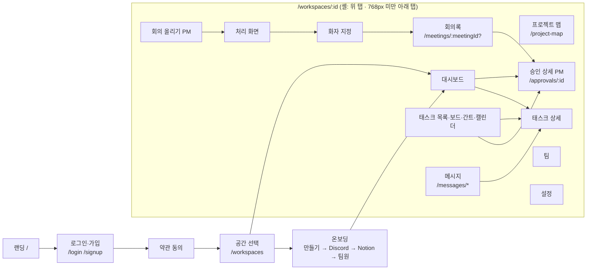

# 프론트엔드 설계 심화

PM·팀원이 AI 결과를 확인하고 고치는 웹 화면의 설계 선택과 그 근거를 푼다. FE 에는 에이전트 판단 로직이 없다. 대신 "AI 가 정한 값을 사람이 믿지도 무시하지도 않게 보여 주는 법"과 "BE·AI 보다 먼저 화면을 만드는 법"을 정했다. 테크스펙([아키텍처](../../docs/techspec/architecture.md), [시나리오](../../docs/techspec/scenarios.md))은 결론만 적고, 여기서는 왜 그렇게 했는지와 어떻게 확인했는지를 적는다.

## 이 쪽들을 읽는 법

2026-11-11 발표용 정리를 추가했다. 요청한 주제와 평가 근거를 다음 문서에서 찾는다. 원본 계획·개발 결과·결정 기록은 기존 위치에 보존한다.

| 찾는 내용 | 문서 |
|---|---|
| 테크스펙·대상 사용자·핵심 기능 | [프론트엔드 테크스펙](techspec.md) |
| 계층·상태·라우팅·API·세션 경계 | [프론트엔드 구조](structure.md) |
| 실제 증상·원인·수정·검증 한계 | [주요 문제 해결 사례](troubleshooting.md) |
| 비교한 대안·선택 이유·대가·현재 규칙 | [대안 비교와 결정](tradeoffs-decisions.md) |
| 성능 병목·개선 전후·측정 조건·보류한 시도 | [프론트엔드 성능 개선](performance.md) |
| 평가 항목별 FE 근거·데모·발표 전 확인 | [검증 범위와 발표 데모](verification.md) |

발표에서는 테크스펙의 핵심 흐름을 먼저 설명하고, 문제 사례와 결정 중 필요한 내용을 골라 근거를 보여 준다. 검증 기록은 실행 날짜와 환경을 함께 읽는다.

- 쪽마다 **문제 → 동작 → 왜 이 방식인가 → 어떻게 검증했나 → 한계와 다음 단계** 순서로 쓴다.
- 결정 번호 `D-xxx` 는 [제품·기술 결정](https://github.com/kakaotechcampus-4/ktc4-kyungpook-3/blob/develop/frontend/docs/decision/frontend-decisions.md), 날짜 이름 문서는 마일스톤별 `basis-for-decision/`, `#번호` 는 GitHub 이슈·PR 이다.
- 검증 대부분은 MSW(모의 API) 위의 Vitest·Playwright 다. 실서버·실기기에서 확인하지 않은 것은 쪽마다 "한계"에 따로 적었다.

## 구조 한 장

| 항목 | 선택 | 근거 |
|---|---|---|
| 기본 | React 19, TypeScript, Vite 8, Node 24 고정 | [package.json](https://github.com/kakaotechcampus-4/ktc4-kyungpook-3/blob/develop/frontend/package.json), D-107·D-127 |
| 라우팅 | React Router 7, 주요 화면의 경로별 lazy 로딩 + 화면별 오류 경계 | [routes.tsx](https://github.com/kakaotechcampus-4/ktc4-kyungpook-3/blob/develop/frontend/src/app/router/routes.tsx) |
| 서버 데이터 | TanStack Query 5. 화면 상태(필터·보기)는 URL | D-110, D-132 |
| UI 상태 | Zustand(토스트·처리 추적 등 UI 상태만) | D-109, D-110 |
| 폼·검증 | React Hook Form + zod. API 응답도 zod 로 검증(#348) | D-111, [D-184](https://github.com/kakaotechcampus-4/ktc4-kyungpook-3/blob/develop/frontend/docs/decision/frontend-decisions.md) |
| HTTP | Axios 하나(`shared/api`), 응답 봉투 `{data, error}` 해제 | D-120 |
| 스타일 | Tailwind CSS 4 + 디자인 토큰, Radix UI primitive | D-112, D-113, [디자인 시스템](https://github.com/kakaotechcampus-4/ktc4-kyungpook-3/blob/develop/frontend/docs/design/design-system.md) |
| 모의 API | MSW 2. 개발(선택)·Vitest·E2E 가 같은 핸들러 | D-159, [MSW 안내](https://github.com/kakaotechcampus-4/ktc4-kyungpook-3/blob/develop/frontend/docs/msw-guide.md) |
| 테스트 | Vitest + RTL, Playwright(Chromium). Storybook 은 지웠다(#482) | D-115~D-118, D-181 |

### FSD 계층

`src/` 는 Feature-Sliced Design 이다. 의존은 위에서 아래로만 흐르고, ESLint `eslint-plugin-boundaries` 가 어기면 막는다(D-114, [eslint.config.js](https://github.com/kakaotechcampus-4/ktc4-kyungpook-3/blob/develop/frontend/eslint.config.js)).

| 계층 | 하는 일 | 예 |
|---|---|---|
| `app` | 라우터·가드·레이아웃·전역 공급자, 앱 단위 통합 테스트 | `app/router/guards/` |
| `pages` | 라우트·URL 상태를 화면 구성과 연결한다 | `pages/messages`, `pages/approval-detail` |
| `widgets` | 여러 엔티티를 잇는 화면 덩어리 | `meeting-minutes`, `approval-review`, `task-board`, `message-inbox` |
| `features` | 사용자 행동 하나 | `approval-resolve`, `auto-item-revert`, `browser-push` |
| `entities` | API 호출, zod 스키마, DTO → 도메인 모델 변환(mapper) | `entities/approval`, `entities/message` |
| `shared` | API 클라이언트, UI 부품, MSW, 토큰 | `shared/mock/`, `shared/ui/` |

DTO 정의와 응답 스키마는 `shared/types/api`에 있고 `shared/mock`도 DTO를 사용한다. 화면은 도메인 모델을 받으며 entity 요청 경계가 응답 검증·변환을 맡는다. 실제 API와 차이가 생기면 이 경계를 먼저 확인한다([계약 우선과 MSW](contract-first-msw.md)).

### 라우터 가드

가드는 화면을 감추는 UX 장치이지 보안 경계가 아니다. 권한 판정은 BE 가 한다(D-172).

| 가드 | 막는 것 |
|---|---|
| `RedirectIfAuthed` | 로그인한 사람이 로그인·가입 화면에 오면 `?next=` 또는 공간으로 보낸다(#411) |
| `RequireAuth` | 비로그인이면 지금 주소를 `?next=` 에 담아 로그인으로 |
| `RequireConsent` | 약관 동의 판본이 맞지 않으면 동의 화면으로(#566) |
| `RequireTeamMember` | 그 공간 소속이 아니면 접근 불가 화면 |
| `RequireOnboardingComplete` | 온보딩 미완료 공간의 대시보드 접근(D-071) |
| `RequirePM` | 회의 업로드·승인 상세는 PM 만(D-102, D-103) |

부팅 때 세션과 워크스페이스 목록을 함께 받기 시작해 가드가 차례로 기다리는 워터폴을 막았다([bootQueries.ts](https://github.com/kakaotechcampus-4/ktc4-kyungpook-3/blob/develop/frontend/src/app/bootQueries.ts)). 셸 탭에 다가가면(마우스·포커스·터치) 그 탭의 화면 코드와 첫 데이터를 미리 받는다. 유휴 시에는 데이터 절약 설정을 고려해 데스크톱 여섯 탭을 사전 조회한다(#536, [shellPrefetch.ts](https://github.com/kakaotechcampus-4/ktc4-kyungpook-3/blob/develop/frontend/src/app/router/shellPrefetch.ts)). 모바일 하단 탭은 다섯 개이며 프로젝트 맵은 계정 메뉴에 있다.

## 화면 지도

> 📷 **사진 자리**: 데스크톱 대시보드(확인 대기·기한 지남·7일 이내·막힘 네 숫자, 확인이 필요한 일, 최근 auto 반영) (파일: ../../assets/design-frontend-dashboard.png)

## 쪽 목록

| 쪽 | 다루는 것 | 심사에서 먼저 볼 곳 |
|---|---|---|
| [계약 우선과 MSW](contract-first-msw.md) | 계약을 가정해 MSW 만으로 개발하고 실제 API 에 대조, 결정 기록 운영, 테스트 | D-159·D-172 대조 결과, #348 응답 검증 |
| [AI 결과 화면](ai-result-ui.md) | 반영됨·확인 필요·보류, 신뢰도 숫자 대신 배지, 근거, 승인 수정·409, 되돌리기, PM/팀원 | 디자인 시스템 금지 목록, 충돌 확인 규칙 |
| [메시지·알림 실시간](realtime-messages.md) | 메시지·답장·알림, 웹소켓 재연결과 폴백, 웹 푸시·PWA, 토스트 | polling → 알림 연동 → 웹소켓(#558) 흐름 |
| [접근성·성능](a11y-performance.md) | 토큰, 대비 E2E, 키보드·포커스, 360px, 스켈레톤 지연, 측정 수치 | 대비 4.5:1 자동 검사, 렌더 309 → 0, LCP 0.5~1.0초 감소 |
| [성능 개선](performance.md) | 폰트·재렌더·추가 조회·반복 계산·사전 조회 | 지표별 전후 값과 조건, 적용 비용, 채택하지 않은 대안 |

## 공통 원칙 (모든 쪽에 해당)

- **AI 의 추측과 확정된 사실을 눈으로 구분한다.** 숫자 점수 대신 배지와 이유 문장(디자인 시스템 §1-1, §7-1).
- **BE 가 이미 정한 것에는 FE 가 맞춘다.** 요청은 없는 것에 한정하고 계약 문서 §4 한 곳에 모은다(D-160).
- **모르는 응답 값을 정상 값으로 바꾸지 않는다.** 상태 판단 값은 화면 전체 오류, 표시용 값은 `알 수 없는 ○○`(D-184).
- **MSW 통과를 실서버 검증으로 말하지 않는다.** 결과 문서마다 "MSW 기준"과 "실서버 미검증"을 나눠 적는다.
